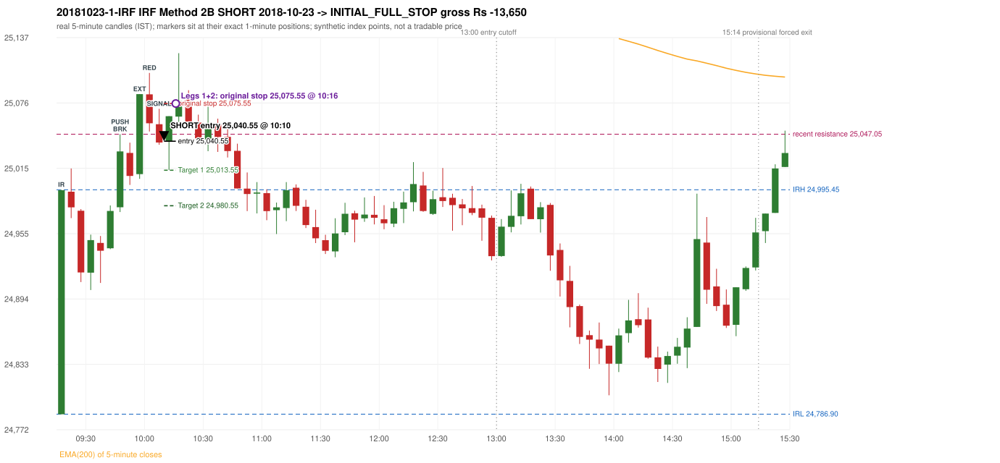
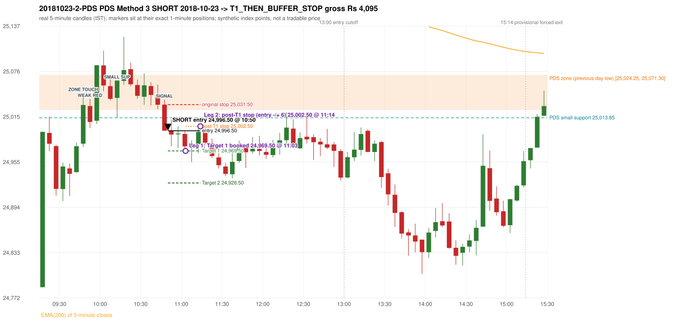

# Trading journal - 2018-10-23 (Tuesday)

> Phase 5 cross-index test, BANKNIFTY window C (Window C 2018-01-01..2018-12-31 (secondary-source minutes); status EXPLORATORY). The FROZEN Phase 3.6 configuration (IRF, ORB, PDR body-based, PDS, RF; shared controller) with the NIFTY index-point stops and targets UNCHANGED on the BANKNIFTY index price. INDEX-POINT RESULTS ONLY: no option premium is used or estimated. HISTORICAL RESEARCH ONLY: the strategy was developed using later NIFTY data. 5paisa returns no minute data before 2019-03-01, so this year rests on one unattributed vendor with nothing to check it against Synthetic BANKNIFTY index-point P&L (the index is not tradable). The owner's review status is intentionally blank.

## A. Trading day overview

| item | value |
|---|---|
| Date / weekday | 2018-10-23 / Tuesday |
| Session type | USABLE_WITH_FLAGS / VALID |
| Original session open (first 1-minute open) | 24,786.90 |
| Previous session | 2018-10-22 |
| Previous-day high / low (wicks included) | 25,491.45 / 25,024.25 |
| Previous-day highest BODY high (the body-based PDR ceiling; wicks ignored) | 25,484.25 |
| Previous-day official close / last 5-minute close | 25,078.60 / 25,113.85 |
| Raw engine records / confirmed signals / fully valid signals | 10 / 5 / 5 |
| Setups that did not complete (invalidated / incomplete) | 5 |
| Executed trades | 2 20181023-1-IRF;20181023-2-PDS |
| Gross P&L (Rs, synthetic) | -9,555.00 |
| Illustrative net P&L (Rs; Rs 500/trade + 0.5 pt/fill) | -11,335.00 |
| Day-end portfolio status | DAY_FINISHED |
| Manual journal trades (matched / unmatched) | 0 (0 / 0) |
| Extra automated trades | 0 |

## B. Daily strategy signal timeline (confirmed signals, chronological)

| time | strategy | method | dir | entry-rule status | valid for execution | <= 13:00 | portfolio state | accepted / ignored | specific reason | competing (same minute) |
|---|---|---|---|---|---|---|---|---|---|---|
| 10:10 | IRF | Method 2B | SHORT | PROPOSAL_DEPENDENT | True | True | FIRST_TRADE_ACTIVE | ACCEPTED -> 20181023-1-IRF | first eligible signal of the day; trade 1: INITIAL_FULL_STOP |  |
| 10:50 | IRF | Method 2A | SHORT | PROPOSAL_DEPENDENT | True | True | SECOND_TRADE_ACTIVE | REJECTED | SECOND_TRADE_RESTRICTED_TO_PDR_PDS [blocked by IRF#1] | PDS Method 3 SHORT |
| 10:50 | PDS | Method 3 | SHORT | PROPOSAL_DEPENDENT | True | True | SECOND_TRADE_ACTIVE | ACCEPTED -> 20181023-2-PDS | permitted second trade: newly confirmed PDR/PDS after the original full stop; trade 2: T1_THEN_BUFFER_STOP | IRF Method 2A SHORT |
| 10:55 | IRF | Method 1 | SHORT | PROPOSAL_DEPENDENT | True | True | SECOND_TRADE_ACTIVE | IGNORED | POSITION_ACTIVE (signal kept for diagnostics only; never reused) [blocked by PDS#2] |  |
| 12:25 | IRF | Method 1 | SHORT | PROPOSAL_DEPENDENT | True | True | DAY_FINISHED | IGNORED | DAY_FINISHED [blocked by PDS#2] |  |

Engine setups that did not complete (5); the complete list with failed rule ids is in `rejected_signals.csv`:

| candle | strategy | method | dir | status | precise reason | failed rules |
|---|---|---|---|---|---|---|
| 12:45 | IRF | Method 3 | SHORT | INVALIDATED | WICK_SHARE_OUT_OF_BAND | IRF-M3-003 |
| 15:20 | IRF | Method 1/2 | SHORT | INCOMPLETE_AT_EOD | SESSION_ENDED_BEFORE_CONFIRMATION |  |
| 09:15 | ORB | Method 1 | SHORT | INVALIDATED | CANDLE_QUALITY(not a strong body / wick too large) | ORB-M1-SHORT-003 |
| 09:15 | ORB | Method 2 | SHORT | INVALIDATED | CANDLE_QUALITY | ORB-M2-SHORT-003 |
| 15:25 | PDS | Method 1/2/3 | SHORT | INCOMPLETE_AT_EOD | NO_QUALIFYING_ENTRY_BEFORE_SESSION_END |  |

## C. Detailed trade journals

### 20181023-1-IRF: IRF Method 2B SHORT (FIRST trade)

Chart: 

**Rule configuration:** CFG-phase36_body_based-866f954e55 - signal verification status **PROPOSAL_DEPENDENT** (never VERIFIED while a rule rests on a proposal).

#### 1. Setup identification

IRF Method 2B SHORT: the 09:45-09:50 candle closed at 25,031.05, above IRH 24,995.45, and the next candle did not close back inside the range, so the setup is Method 2 and price stayed above it until the trigger. Extension candle 09:55-10:00, red candle 10:00-10:05. The trigger came 4 candles after the breakout candle: a red candle closed back below the first-push resistance after price had traded above it (10:05-10:10); confirmed at 10:10 with close 25,039.30. Entry reference close 25,039.30 is 43.85 points above IRH 24,995.45.

#### 2. Candle and indicator calculations

| role | session | candle | O | H | L | C | range | body % | upper wick % | lower wick % | direction | EMA(200) | strong bull / bear | pin bull / bear | small (body<=30%) | used for |
|---|---|---|---|---|---|---|---|---|---|---|---|---|---|---|---|---|
| initial_range_candle | TODAY | 09:15-09:20 | 24,786.90 | 24,995.45 | 24,786.90 | 24,995.05 | 208.55 | 99.81 | 0.19 | 0.00 | BULLISH | 25,264.92 | True / False | False / False | False | initial range = high/low of the 09:15 candle |
| signal_candle | TODAY | 10:05-10:10 | 25,056.30 | 25,070.65 | 25,037.20 | 25,039.30 | 33.45 | 50.82 | 42.90 | 6.28 | BEARISH | 25,239.64 | False / False | False / False | False | candle whose close completed the trigger |
| breakout_candle | TODAY | 09:45-09:50 | 24,979.15 | 25,047.05 | 24,974.70 | 25,031.05 | 72.35 | 71.73 | 22.11 | 6.15 | BULLISH | 25,247.49 | False / False | False / False | False | breakout candle: a completed candle closing above IRH |
| extension_candle | TODAY | 09:55-10:00 | 25,009.90 | 25,084.25 | 25,005.55 | 25,084.25 | 78.70 | 94.47 | 0.00 | 5.53 | BULLISH | 25,243.51 | True / False | False / False | False | extension: first later candle trading above the breakout candle's high |
| red_candle | TODAY | 10:00-10:05 | 25,084.10 | 25,104.00 | 25,049.50 | 25,057.20 | 54.50 | 49.36 | 36.51 | 14.13 | BEARISH | 25,241.65 | False / False | False / False | False | first red candle during the extension |
| first_push_top | TODAY | 09:45-09:50 | 24,979.15 | 25,047.05 | 24,974.70 | 25,031.05 | 72.35 | 71.73 | 22.11 | 6.15 | BULLISH | 25,247.49 | False / False | False / False | False | recent resistance = top of the first push after the breakout |

Every condition, with the rule, the calculation, the observed values and the result:

| # | group | rule | result | status / numeric definition | calculation | observed | required | available at | why it matters |
|---|---|---|---|---|---|---|---|---|---|
| 1 | SELECTION | SEL-FIRST-001 | PASS | USER_APPROVED / USER_APPROVED | earliest CONFIRMED signal of the day across IRF/ORB/PDR/PDS/RF that passed the controller's checks | 0 confirmed signal(s) earlier today; 5 confirmed signals in the day in total, this one at 10:10 | no earlier executable signal | 2018-10-23 10:10 | the shared controller trades only the first valid signal; the five strategies are not independent positions |
| 2 | SELECTION | SEL-TIE-001 | PASS | USER_APPROVED / USER_APPROVED | other CONFIRMED signals with exactly the same confirmation timestamp | none | no different-strategy / opposite-direction signal in the same minute (otherwise an unresolved conflict, no trade) | 2018-10-23 10:10 | an unresolved same-minute collision would have produced no trade at all |
| 3 | SELECTION | ENTRY-CUTOFF-001 | PASS | USER_APPROVED / USER_APPROVED | fill timestamp vs 13:00:00 IST | signal confirmed 10:10; fill 10:10 | fill at or before 13:00:00 IST | 2018-10-23 10:10 | no new position may be entered with a fill after 13:00 IST |
| 4 | SELECTION | EXE-FILL-001 | PASS | PROPOSED_FOR_REVIEW / PROPOSED_FOR_REVIEW | fill = open of the 1-minute bar that starts at the signal candle's end | bar 10:10 O 25,040.55 H 25,042.25 L 25,030.60 C 25,030.70; executable=True; entry 25,040.55 | fill bar exists, starts exactly at the signal end, is fillable; entry = its open | 2018-10-23 10:10 | a 5-minute signal is known only when its candle closes; the first price that can be traded is the next minute's open |
| 5 | SELECTION | DAY-MAX-001 | PASS | USER_APPROVED / USER_APPROVED | number of entries today | trade 1 of at most 2 | <= 2 entries per day | 2018-10-23 10:10 | daily trade cap |
| 6 | SETUP | IRF-GLOBAL-001 | PASS | SOURCE_VERIFIED / EXPLICIT_IN_SOURCE | initial range = high and low (wicks included) of the first completed 5-minute candle | 09:15-09:20 IRH 24,995.45, IRL 24,786.90 (range 208.55; engine recorded IRH 24,995.45, IRL 24,786.90) | high/low of the 09:15-09:20 candle | 2018-10-23 09:20 | all three IRF methods measure price against this range |
| 7 | SETUP | IRF-GLOBAL-003 | PASS | SOURCE_VERIFIED / EXPLICIT_IN_SOURCE | closes confirm, wicks do not: every trigger is evaluated on a completed 5-minute candle | trigger candle 10:05-10:10 was complete when the signal was stamped 10:10; decision uses its close 25,039.30 | completed candle close, not an intra-candle wick | 2018-10-23 10:10 | an intra-candle wick can reverse before the candle closes |
| 8 | SETUP | IRF-GLOBAL-002 | PASS | SOURCE_VERIFIED / EXPLICIT_IN_SOURCE | direction | SHORT (IRF trades short only) | short only | 2018-10-23 10:10 | IRF fades failed upside breakouts |
| 9 | SETUP | IRF-M2-001 | PASS | SOURCE_VERIFIED / EXPLICIT_IN_SOURCE | breakout candle close vs IRH | 09:45-09:50 O 24,979.15 H 25,047.05 L 24,974.70 C 25,031.05; range 72.35, body 51.90 (71.73%), upper wick 16.00 (22.11%), lower wick 4.45 (6.15%), bullish; close 25,031.05 is 35.60 points above IRH 24,995.45 | close > IRH (a wick above IRH is not a breakout) | 2018-10-23 09:50 | starts every IRF setup |
| 10 | SETUP | IRF-M2-004 | PASS | SOURCE_VERIFIED / EXPLICIT_IN_SOURCE | the candle after the breakout must NOT close back inside the range (else the setup is Method 1) | 09:50 close 25,008.20 vs [24,786.90, 24,995.45) | not (IRL <= close < IRH) | 2018-10-23 09:55 | separates Method 2 (price holds above) from Method 1 (immediate failure) |
| 11 | SETUP | IRF-M2-002 | PASS | SOURCE_VERIFIED / QUALITATIVE_SOURCE_NUMERIC_DEFINITION_PROPOSED_FOR_REVIEW | extension = a later candle whose high exceeds the breakout candle's high (research definition E1) | 09:55 high 25,084.25 vs breakout candle high 25,047.05 (+37.20) | high > breakout candle high | 2018-10-23 10:00 | the guide says price 'extends further upward'; the numeric test is a proposal |
| 12 | SETUP | IRF-M2-003 | PASS | SOURCE_VERIFIED / QUALITATIVE_SOURCE_NUMERIC_DEFINITION_PROPOSED_FOR_REVIEW | a red candle (close < open) forms after the extension | 10:00-10:05 O 25,084.10 H 25,104.00 L 25,049.50 C 25,057.20; range 54.50, body 26.90 (49.36%), upper wick 19.90 (36.51%), lower wick 7.70 (14.13%), bearish | close < open, at or after the candle following the extension | 2018-10-23 10:05 | the red candle shows the first pause/reversal inside the extension |
| 13 | CONFIRMATION | IRF-M2-005 | PASS | SOURCE_VERIFIED / EXPLICIT_IN_SOURCE | a red candle alone is not confirmation: a level break is required | red trigger candle 10:05 also closes below the resistance (see IRF-M2B-003) | a red candle plus a closing break of the level | 2018-10-23 10:10 | a red candle with no level break does not qualify |
| 14 | CONFIRMATION | IRF-M2B-001 | PASS | SOURCE_VERIFIED / QUALITATIVE_SOURCE_NUMERIC_DEFINITION_PROPOSED_FOR_REVIEW | recent resistance = first 3-candle fractal high (k=1) at/after the breakout candle (FIRST_PUSH_TOP) | 09:45 high 25,047.05; engine recorded 25,047.05 (the first push top IS the breakout candle itself) | first push top | 2018-10-23 09:55 | the level whose retake-and-fail completes Method 2B (definition is a proposal) |
| 15 | CONFIRMATION | IRF-M2B-002 | PASS | SOURCE_VERIFIED / QUALITATIVE_SOURCE_NUMERIC_DEFINITION_PROPOSED_FOR_REVIEW | price trades back above the resistance after the first push | first candle with high above 25,047.05: 09:55 high 25,084.25 | some candle after the first push has high > resistance (the push may be the trigger candle: m2b_push_must_precede_red_candle = False) | 2018-10-23 10:10 | the guide's figure shows three separate candles; the engine also accepts a single candle |
| 16 | CONFIRMATION | IRF-M2B-003 | PASS | SOURCE_VERIFIED / EXPLICIT_IN_SOURCE | trigger = a red candle closing back below the resistance | 10:05-10:10 O 25,056.30 H 25,070.65 L 25,037.20 C 25,039.30; range 33.45, body 17.00 (50.82%), upper wick 14.35 (42.90%), lower wick 2.10 (6.28%), bearish; close 25,039.30 vs resistance 25,047.05 | red candle and close < resistance | 2018-10-23 10:10 | completes Method 2B |
| 17 | EXECUTION | EXE-STOP-001 | PASS | USER_APPROVED / USER_APPROVED | initial stop = entry + 35 points | entry 25,040.55 -> stop 25,075.55 | stop 35 index points (BASELINE) | 2018-10-23 10:10 | defines the loss if the setup fails before Target 1 |
| 18 | EXECUTION | EXE-T1-001 | PASS | SOURCE_VERIFIED / EXPLICIT_IN_SOURCE | Target 1 = entry +/- 27 points | T1 25,013.55 | 27 points | 2018-10-23 10:10 | Leg 1 (3 lots) is booked at Target 1 |
| 19 | EXECUTION | IRF-TGT-001 | PASS | SOURCE_VERIFIED / EXPLICIT_IN_SOURCE | Target 2 = entry +/- 60 points | T2 24,980.55 | 60 points | 2018-10-23 10:10 | Leg 2 (3 lots) is booked at Target 2 |
| 20 | EXECUTION | POST-T1-STOP-006 | PASS | USER_APPROVED / USER_APPROVED | after T1 the Leg-2 stop = entry + 6 (no trailing) | post-T1 stop 25,046.55 | entry -6 (LONG) / +6 (SHORT) | 2018-10-23 10:10 | protects the remaining three lots once the first three are booked |
| 21 | EXECUTION | SIZE-LOT-001 | PASS | USER_APPROVED / USER_APPROVED | 6 lots x 65 = 390, Leg 1 = 3 lots = 195, Leg 2 = 195 | 6 lots, lot size 65, legs 3+3 | 6 lots in two equal legs | 2018-10-23 10:10 | position size for the synthetic P&L |
| 22 | NOTE | IRF-M2-006 | UNRESOLVED | UNRESOLVED / UNRESOLVED | delay between the breakout candle and this trigger; expiry rule | 4 candles after the breakout; expiry none configured | the source states no expiry | 2018-10-23 10:10 | an old breakout can still trigger hours later |
| 23 | NOTE | IRF-M2-006 | UNRESOLVED | UNRESOLVED / UNRESOLVED | did price stay above IRH between the breakout and the trigger? | 0 closes at or below IRH between 09:50 and 10:05; trigger close 25,039.30 above IRH 24,995.45 | the engine does not require price to stay above IRH | 2018-10-23 10:10 | the guide describes price 'holding above IRH and keeping rising'; the code only needs the level break |
| 24 | NOTE | IRF-GLOBAL-004 | UNRESOLVED | UNRESOLVED / UNRESOLVED | which close above IRH of the session produced this attempt; repeat setups | this breakout is upward crossing no. 1 of the session (a close above IRH after a close at/below it) | the source states no first-breakout-only, re-arming, expiry or trades-per-day rule | 2018-10-23 10:10 | IRF re-arms on every later breakout in the code, producing many raw setups; the controller keeps only the first |
| 25 | NOTE | NOTE-IRF-REPEATED-SETUPS | NOT_APPLICABLE | NOT_A_RULE / NOT_A_REGISTRY_RULE | other IRF signals later in the session (not traded) | 3 further confirmed IRF signal(s): Method 2A@10:50, Method 1@10:55, Method 1@12:25 | disclosure of repeated raw setups | 2018-10-23 10:10 | repeated raw IRF setups are not hidden; they are logged as ignored |
| 26 | NOTE | IRF-SL-001 | NOT_APPLICABLE | SOURCE_VERIFIED / QUALITATIVE_SOURCE_NUMERIC_DEFINITION_PROPOSED_FOR_REVIEW | the guide's 35-or-40 rule: 35 if the most recent green candle's high is within 35 points of entry, else 40 | most recent green candle high 25,084.25 is 43.70 points from the entry 25,040.55: the guide's rule would select 40 points; the baseline applies a fixed 35 (USER_APPROVED research baseline; the 35-vs-40 selection and the 40-point variant are separate labelled scenarios) | source selection rule | 2018-10-23 10:10 | the stop distance is a modelling choice and changes losses, not entries |
| 27 | NOTE | NOTE-UNRESOLVED-DEPENDENCIES | UNRESOLVED | NOT_A_RULE / NOT_A_REGISTRY_RULE | rules the signal depends on that the sources leave unresolved | engine-recorded unresolved rule ids: IRF-GLOBAL-004; verification status PROPOSAL_DEPENDENT | n/a (disclosure) | 2018-10-23 10:10 | the entry is only as verified as the rules it rests on |

#### 3. Entry decision and explanation

IRF Method 2B SHORT: the 09:45-09:50 candle closed at 25,031.05, above IRH 24,995.45, and the next candle did not close back inside the range, so the setup is Method 2 and price stayed above it until the trigger. Extension candle 09:55-10:00, red candle 10:00-10:05. The trigger came 4 candles after the breakout candle: a red candle closed back below the first-push resistance after price had traded above it (10:05-10:10); confirmed at 10:10 with close 25,039.30. Entry reference close 25,039.30 is 43.85 points above IRH 24,995.45.

**Why this trade ahead of the other strategies:** This IRF Method 2B signal was the earliest executable signal of the day: 0 confirmed signal(s) earlier, 0 other in the same minute. 4 later confirmed signal(s) (IRF x3, PDS x1) are logged as ignored or rejected. State of the other four engines at that moment: [ORB: Method 1 invalidated at 09:15: CANDLE_QUALITY(not a strong body / wick too large); Method 2 invalidated at 09:15: CANDLE_QUALITY] [PDR: no setup record before this time (a base condition was not met, or nothing triggered)] [PDS: no setup record before this time (a base condition was not met, or nothing triggered)] [RF: no setup record before this time (a base condition was not met, or nothing triggered)]

#### 4. Actual entry execution

| item | value |
|---|---|
| Signal candle | 10:05-10:10 |
| Signal confirmed | 2018-10-23 10:10 |
| Fill timestamp | 2018-10-23 10:10 |
| Entry price | 25,040.55 |
| Source partition / 1-minute bar | data/processed/banknifty/KAPRI_1M_BANKNIFTY/minutes/year=2018/month=10/candles.parquet / 2018-10-23 10:10 |
| Source bar O / H / L / C | 25,040.55 / 25,042.25 / 25,030.60 / 25,030.70 |
| Fill assumption | open of the 1-minute bar starting at the signal candle's end (EXE-FILL-001, PROPOSED causal convention) |
| Initial stop / T1 / T2 / post-T1 stop | 25,075.55 / 25,013.55 / 24,980.55 / 25,046.55 |
| Position | 6 lots x 65 = 390 units (Leg 1 195, Leg 2 195) |

#### 5-8. Trade progress, Target 1, post-T1 stop and final exit

Between the 10:10 entry bar and the final exit (7 one-minute bars) the best excursion in favour was 26.70 points at 10:11 and the worst against was 44.60 points at 10:16. At 10:16 price reached the original stop 25,075.55 before Target 1 25,013.55, so all six lots exited together at 25,075.55. This is an INITIAL_FULL_STOP: one more trade is allowed that day, only a newly confirmed PDR/PDS signal.

| leg | qty | exit time | exit price | reason | source 1-minute bar | O / H / L / C | gross points | gross Rs | slippage pts | flags |
|---|---|---|---|---|---|---|---|---|---|---|
| 1 | 195 | 10:16 | 25,075.55 | ORIGINAL_STOP_BEFORE_T1 | 10:16 | 25,058.20 / 25,085.15 / 25,058.20 / 25,083.60 | -35.00 | -6,825.00 | 0.00 |  |
| 2 | 195 | 10:16 | 25,075.55 | ORIGINAL_STOP_BEFORE_T1 | 10:16 | 25,058.20 / 25,085.15 / 25,058.20 / 25,083.60 | -35.00 | -6,825.00 | 0.00 |  |

Exit evidence per leg:

* Leg 1: 1-minute bar 10:16 O 25,058.20 H 25,085.15 L 25,058.20 C 25,083.60: high 25,085.15 reached the original stop 25,075.55 before Target 1 25,013.55 was touched; both legs exit at the stop level 25,075.55
* Leg 2: 1-minute bar 10:16 O 25,058.20 H 25,085.15 L 25,058.20 C 25,083.60: high 25,085.15 reached the original stop 25,075.55 before Target 1 25,013.55 was touched; both legs exit at the stop level 25,075.55

#### 9. Gross and illustrative net P&L

| item | value (Rs) |
|---|---|
| Leg 1 gross | -6,825.00 |
| Leg 2 gross | -6,825.00 |
| Trade gross (= Leg 1 + Leg 2) | -13,650.00 |
| Illustrative fixed cost | -500.00 |
| Illustrative slippage (0.5 pt on every fill, entry + exits, all units) | -390.00 |
| Illustrative net | -14,540.00 |

#### 10. Manual journal comparison

No manual journal exists for this period; no comparison.

### 20181023-2-PDS: PDS Method 3 SHORT (SECOND trade)

Chart: 

**Rule configuration:** CFG-phase36_body_based-866f954e55 - signal verification status **PROPOSAL_DEPENDENT** (never VERIFIED while a rule rests on a proposal).

#### 1. Setup identification

PDS Method 3 SHORT: the session opened 237.35 points below the previous-day-low zone [25,024.25, 25,071.30]; the first red candle at the zone (09:50) was weak (body 54.45%), so the engine waited for a small support; the 10:10 candle's low 25,013.85 (10.40 points below the zone floor) was broken by the close of the 10:45 candle (24,996.65); confirmed 10:50.

#### 2. Candle and indicator calculations

| role | session | candle | O | H | L | C | range | body % | upper wick % | lower wick % | direction | EMA(200) | strong bull / bear | pin bull / bear | small (body<=30%) | used for |
|---|---|---|---|---|---|---|---|---|---|---|---|---|---|---|---|---|
| zone_source_candle | PREVIOUS | 15:10-15:15 | 25,071.30 | 25,077.50 | 25,024.25 | 25,060.50 | 53.25 | 20.28 | 11.64 | 68.08 | BEARISH | 25,272.74 | False / False | False / False | True | previous-day low candle that defines the zone (A_LOWEST_LOW) |
| zone_retest_candle | TODAY | 09:45-09:50 | 24,979.15 | 25,047.05 | 24,974.70 | 25,031.05 | 72.35 | 71.73 | 22.11 | 6.15 | BULLISH | 25,247.49 | False / False | False / False | False | first candle whose range reaches the zone from below |
| signal_candle | TODAY | 10:45-10:50 | 25,031.60 | 25,038.25 | 24,996.65 | 24,996.65 | 41.60 | 84.01 | 15.99 | 0.00 | BEARISH | 25,224.77 | False / True | False / False | False | trigger candle |
| weak_first_red_candle | TODAY | 09:50-09:55 | 25,029.60 | 25,039.20 | 24,999.90 | 25,008.20 | 39.30 | 54.45 | 24.43 | 21.12 | BEARISH | 25,245.11 | False / False | False / False | False | first red candle at the zone that failed the quality rule |
| small_support_pivot | TODAY | 10:10-10:15 | 25,040.55 | 25,063.80 | 25,013.85 | 25,063.80 | 49.95 | 46.55 | 0.00 | 53.45 | BULLISH | 25,237.89 | False / False | False / False | False | small support: latest 3-candle fractal low after the weak candle |

Every condition, with the rule, the calculation, the observed values and the result:

| # | group | rule | result | status / numeric definition | calculation | observed | required | available at | why it matters |
|---|---|---|---|---|---|---|---|---|---|
| 1 | SELECTION | DAY-SL-001 | PASS | USER_APPROVED / USER_APPROVED | first trade outcome, strategy of this signal, position-close time vs this signal's timestamp | first trade IRF Method 2B closed as INITIAL_FULL_STOP at 10:16; position free from 10:17; this PDS signal confirmed 10:50 | first trade INITIAL_FULL_STOP before Target 1, and a NEWLY confirmed PDR/PDS signal after the first position closed | 2018-10-23 10:50 | the only way a second trade is allowed |
| 2 | SELECTION | DAY-NOREUSE-001 | PASS | USER_APPROVED / USER_APPROVED | signals confirmed while the first position was open | 1 signal(s) were ignored during the first trade (never reused): IRF Method 2B SHORT @10:10 | this trade comes from a signal confirmed after the first exit, not from an ignored one | 2018-10-23 10:50 | an ignored signal can never become the second trade |
| 3 | SELECTION | ENTRY-CUTOFF-001 | PASS | USER_APPROVED / USER_APPROVED | fill timestamp vs 13:00:00 IST | signal confirmed 10:50; fill 10:50 | fill at or before 13:00:00 IST | 2018-10-23 10:50 | no new position may be entered with a fill after 13:00 IST |
| 4 | SELECTION | EXE-FILL-001 | PASS | PROPOSED_FOR_REVIEW / PROPOSED_FOR_REVIEW | fill = open of the 1-minute bar that starts at the signal candle's end | bar 10:50 O 24,996.50 H 25,011.50 L 24,996.50 C 25,007.45; executable=True; entry 24,996.50 | fill bar exists, starts exactly at the signal end, is fillable; entry = its open | 2018-10-23 10:50 | a 5-minute signal is known only when its candle closes; the first price that can be traded is the next minute's open |
| 5 | SELECTION | DAY-MAX-001 | PASS | USER_APPROVED / USER_APPROVED | number of entries today | trade 2 of at most 2 | <= 2 entries per day | 2018-10-23 10:50 | daily trade cap |
| 6 | SETUP | PDS-003 | PASS | SOURCE_VERIFIED / EXPLICIT_WORDING_DETAIL_PROPOSED_FOR_REVIEW | gap = first 1-minute open of today - previous session's OFFICIAL close | today's open 24,786.90 (first 1-minute bar 09:15) - previous close 25,078.60 (DAILY_VENDOR, 2018-10-22) = -291.70 points -> gap DOWN | gap DOWN (more than 0 points) | 2018-10-23 09:15 | approved convention: the original first-minute open, never the vendor daily open |
| 7 | SETUP | PDS-006 | PASS | SOURCE_VERIFIED / QUALITATIVE_SOURCE_NUMERIC_DEFINITION_PROPOSED_FOR_REVIEW | gap-down open below the zone | today's open 24,786.90 vs zone low 25,024.25: 237.35 points below | open < zone low | 2018-10-23 09:15 | the guide: 'price is trading below the previous day's support zone' after the gap; a PROPOSED strict reading |
| 8 | SETUP | PDS-004 | PASS | SOURCE_VERIFIED / EXPLICIT_IN_SOURCE | PDS is not a breakdown strategy: the zone must be tested from below first | open 24,786.90 below the zone floor 25,024.25; the first candle to reach the zone is 09:45 | price rises to the zone before any short | 2018-10-23 09:15 | a short below the level without a retest is not this strategy |
| 9 | SETUP | PDS-005 | PASS | SOURCE_VERIFIED / QUALITATIVE_SOURCE_NUMERIC_DEFINITION_PROPOSED_FOR_REVIEW | price comes up to the zone: first candle whose [low, high] intersects it (+/- proximity) | 09:45-09:50 O 24,979.15 H 25,047.05 L 24,974.70 C 25,031.05; range 72.35, body 51.90 (71.73%), upper wick 16.00 (22.11%), lower wick 4.45 (6.15%), bullish; high 25,047.05 vs zone low 25,024.25 | range intersects the zone | 2018-10-23 09:50 | PDS is not a breakdown strategy: the zone must be tested from below first |
| 10 | ZONE | PDS-001 | PASS | SOURCE_VERIFIED / EXPLICIT_IN_SOURCE | direction | SHORT (PDS is short only) | short-only | 2018-10-23 10:50 | PDS sells a retest of previous-day support from below |
| 11 | ZONE | PDS-002 | PASS | SOURCE_VERIFIED / QUALITATIVE_SOURCE_NUMERIC_DEFINITION_PROPOSED_FOR_REVIEW | zone = [lowest low, body top] of the previous session's absolute-low candle (method A_LOWEST_LOW; the lower wick is part of the zone) | zone [25,024.25, 25,071.30] from the 15:10 candle of 2018-10-22 (15:10-15:15 O 25,071.30 H 25,077.50 L 25,024.25 C 25,060.50; range 53.25, body 10.80 (20.28%), upper wick 6.20 (11.64%), lower wick 36.25 (68.08%), bearish); engine recorded [25,024.25, 25,071.30] | previous trading day's low where price took support (body + lower wick) | 2018-10-22 15:15 | the reference level of the strategy; the exact candle(s) are a research choice (PDS-ZONE-002) |
| 12 | CONFIRMATION | PDS-M-001 | PASS | SOURCE_VERIFIED / QUALITATIVE_SOURCE_NUMERIC_DEFINITION_PROPOSED_FOR_REVIEW | Method 3 is used when the first red candle at the zone is not satisfying | first red candle at the zone: 09:50-09:55 O 25,029.60 H 25,039.20 L 24,999.90 C 25,008.20; range 39.30, body 21.40 (54.45%), upper wick 9.60 (24.43%), lower wick 8.30 (21.12%), bearish; strong-bearish test body >= 60%, lower wick <= 20% -> not met; pin bar -> not met | first red candle is neither strong nor a pin bar | 2018-10-23 09:55 | the quality rule keeps weak candles out; Method 3 waits for a support break instead |
| 13 | CONFIRMATION | PDS-M3-001 | PASS | SOURCE_VERIFIED / QUALITATIVE_SOURCE_NUMERIC_DEFINITION_PROPOSED_FOR_REVIEW | small support = latest 3-candle fractal low (k=1) formed at/after the weak candle with low <= zone high (25,071.30); definition SWING_K1_NEAR_ZONE | support 25,013.85 from the 10:10 candle; engine recorded 25,013.85; distance below the zone floor 10.40 points (zone floor 25,024.25); the guide says 'near the zone' but defines no distance - the code has no lower bound | a small support near the zone | 2018-10-23 10:20 | 'near' and the size of the small support are undefined in the guide |
| 14 | CONFIRMATION | PDS-M3-001 | PASS | SOURCE_VERIFIED / QUALITATIVE_SOURCE_NUMERIC_DEFINITION_PROPOSED_FOR_REVIEW | trigger: candle closes below the small support (break basis CLOSE) | 10:45 close 24,996.65 vs support 25,013.85: 17.20 points below | close < support | 2018-10-23 10:50 | the guide does not say close or touch; the close is used |
| 15 | EXECUTION | EXE-STOP-001 | PASS | USER_APPROVED / USER_APPROVED | initial stop = entry + 35 points | entry 24,996.50 -> stop 25,031.50 | stop 35 index points (BASELINE) | 2018-10-23 10:50 | defines the loss if the setup fails before Target 1 |
| 16 | EXECUTION | EXE-T1-001 | PASS | SOURCE_VERIFIED / EXPLICIT_IN_SOURCE | Target 1 = entry +/- 27 points | T1 24,969.50 | 27 points | 2018-10-23 10:50 | Leg 1 (3 lots) is booked at Target 1 |
| 17 | EXECUTION | PDS-TGT-001 | PASS | SOURCE_VERIFIED / EXPLICIT_IN_SOURCE | Target 2 = entry +/- 70 points | T2 24,926.50 (the guide says 70; the report suggests 60 - CONFLICTING) | 70 points | 2018-10-23 10:50 | Leg 2 (3 lots) is booked at Target 2 |
| 18 | EXECUTION | POST-T1-STOP-006 | PASS | USER_APPROVED / USER_APPROVED | after T1 the Leg-2 stop = entry + 6 (no trailing) | post-T1 stop 25,002.50 | entry -6 (LONG) / +6 (SHORT) | 2018-10-23 10:50 | protects the remaining three lots once the first three are booked |
| 19 | EXECUTION | SIZE-LOT-001 | PASS | USER_APPROVED / USER_APPROVED | 6 lots x 65 = 390, Leg 1 = 3 lots = 195, Leg 2 = 195 | 6 lots, lot size 65, legs 3+3 | 6 lots in two equal legs | 2018-10-23 10:50 | position size for the synthetic P&L |
| 20 | NOTE | PDS-007 | NOT_APPLICABLE | PROPOSED_FOR_REVIEW / PROPOSED_FOR_REVIEW | repeated PDS signals today | 1 confirmed PDS signal(s) in the session | n/a (disclosure) | 2018-10-23 10:50 | the per-session cap is lifted for the controller runs; the controller trades only the first (or the permitted second) trade |
| 21 | NOTE | PDS-MISSING-001 | UNRESOLVED | UNRESOLVED / UNRESOLVED | entry timing | signal on the candle close; fill at the next minute's open | the guide does not say whether entry is intra-candle or after the close | 2018-10-23 10:50 | causal convention: nothing is entered before the trigger candle has closed |
| 22 | NOTE | PDS-SL-001 | NOT_APPLICABLE | SOURCE_VERIFIED / QUALITATIVE_SOURCE_NUMERIC_DEFINITION_PROPOSED_FOR_REVIEW | the guide's 35-or-40 rule: 35 if the most recent green candle's high is within 35 points of entry, else 40 | most recent green candle high 25,073.60 is 77.10 points from the entry 24,996.50: the guide's rule would select 40 points; the baseline applies a fixed 35 (USER_APPROVED research baseline; the 35-vs-40 selection and the 40-point variant are separate labelled scenarios) | source selection rule | 2018-10-23 10:50 | the stop distance is a modelling choice and changes losses, not entries |
| 23 | NOTE | NOTE-UNRESOLVED-DEPENDENCIES | NOT_APPLICABLE | NOT_A_RULE / NOT_A_REGISTRY_RULE | rules the signal depends on that the sources leave unresolved | engine-recorded unresolved rule ids: none; verification status PROPOSAL_DEPENDENT | n/a (disclosure) | 2018-10-23 10:50 | the entry is only as verified as the rules it rests on |

#### 3. Entry decision and explanation

PDS Method 3 SHORT: the session opened 237.35 points below the previous-day-low zone [25,024.25, 25,071.30]; the first red candle at the zone (09:50) was weak (body 54.45%), so the engine waited for a small support; the 10:10 candle's low 25,013.85 (10.40 points below the zone floor) was broken by the close of the 10:45 candle (24,996.65); confirmed 10:50.

**Why this trade ahead of the other strategies:** The first trade (IRF Method 2B) was stopped out before Target 1 at 10:16; this newly confirmed PDS signal at 10:50 is the first PDR/PDS signal after that exit, so it is the day's permitted second trade. State of the other engines at that moment: [IRF: 2 confirmed signal(s) up to this time (Method 2B@10:10, Method 2A@10:50)] [ORB: Method 1 invalidated at 09:15: CANDLE_QUALITY(not a strong body / wick too large); Method 2 invalidated at 09:15: CANDLE_QUALITY] [PDR: no setup record before this time (a base condition was not met, or nothing triggered)] [RF: no setup record before this time (a base condition was not met, or nothing triggered)]

#### 4. Actual entry execution

| item | value |
|---|---|
| Signal candle | 10:45-10:50 |
| Signal confirmed | 2018-10-23 10:50 |
| Fill timestamp | 2018-10-23 10:50 |
| Entry price | 24,996.50 |
| Source partition / 1-minute bar | data/processed/banknifty/KAPRI_1M_BANKNIFTY/minutes/year=2018/month=10/candles.parquet / 2018-10-23 10:50 |
| Source bar O / H / L / C | 24,996.50 / 25,011.50 / 24,996.50 / 25,007.45 |
| Fill assumption | open of the 1-minute bar starting at the signal candle's end (EXE-FILL-001, PROPOSED causal convention) |
| Initial stop / T1 / T2 / post-T1 stop | 25,031.50 / 24,969.50 / 24,926.50 / 25,002.50 |
| Position | 6 lots x 65 = 390 units (Leg 1 195, Leg 2 195) |

#### 5-8. Trade progress, Target 1, post-T1 stop and final exit

Between the 10:50 entry bar and the final exit (25 one-minute bars) the best excursion in favour was 42.20 points at 11:07 and the worst against was 15.00 points at 10:50. At 11:03 price reached Target 1 24,969.50 and three lots exited. At 11:03 the remaining three lots' protective stop was set to 25,002.50 (entry + 6; no trailing, no further change); the engine applies it from the Target-1 bar onward and tests it within that same bar. At 11:14 the remaining three lots stopped out at 25,002.50. T1_THEN_BUFFER_STOP: no second trade that day (DAY-BUF-001).

| leg | qty | exit time | exit price | reason | source 1-minute bar | O / H / L / C | gross points | gross Rs | slippage pts | flags |
|---|---|---|---|---|---|---|---|---|---|---|
| 1 | 195 | 11:03 | 24,969.50 | TARGET_1 | 11:03 | 24,978.45 / 24,978.45 / 24,967.15 / 24,971.75 | 27.00 | 5,265.00 | 0.00 |  |
| 2 | 195 | 11:14 | 25,002.50 | POST_T1_STOP_ENTRY_MINUS_PLUS_6 | 11:14 | 24,977.15 / 25,002.55 / 24,976.60 / 24,994.95 | -6.00 | -1,170.00 | 0.00 |  |

Exit evidence per leg:

* Leg 1: 1-minute bar 11:03 O 24,978.45 H 24,978.45 L 24,967.15 C 24,971.75: low 24,967.15 reached Target 1 24,969.50; Leg 1 booked at the target level
* Leg 2: 1-minute bar 11:14 O 24,977.15 H 25,002.55 L 24,976.60 C 24,994.95: high 25,002.55 reached the post-T1 stop 25,002.50; Leg 2 exits at 25,002.50 at the stop level

#### 9. Gross and illustrative net P&L

| item | value (Rs) |
|---|---|
| Leg 1 gross | 5,265.00 |
| Leg 2 gross | -1,170.00 |
| Trade gross (= Leg 1 + Leg 2) | 4,095.00 |
| Illustrative fixed cost | -500.00 |
| Illustrative slippage (0.5 pt on every fill, entry + exits, all units) | -390.00 |
| Illustrative net | 3,205.00 |

#### 10. Manual journal comparison

No manual journal exists for this period; no comparison.

## D. Manual journal comparison

No manual journal exists for this period (the manual journal covers 2025-09-01 .. 2026-08-31 only); no comparison is made and no automated trade is labelled 'extra'.

## E. Daily conclusion

* **Traded:** 20181023-1-IRF - IRF Method 2B SHORT at 10:10 (entry 25,040.55), outcome INITIAL_FULL_STOP, gross Rs -13,650.00, illustrative net Rs -14,540.00. **Why:** This IRF Method 2B signal was the earliest executable signal of the day: 0 confirmed signal(s) earlier, 0 other in the same minute. 4 later confirmed signal(s) (IRF x3, PDS x1) are logged as ignored or rejected. State of the other four engines at that moment: [ORB: Method 1 invalidated at 09:15: CANDLE_QUALITY(not a strong body / wick too large); Method 2 invalidated at 09:15: CANDLE_QUALITY] [PDR: no setup record before this time (a base condition was not met, or nothing triggered)] [PDS: no setup record before this time (a base condition was not met, or nothing triggered)] [RF: no setup record before this time (a base condition was not met, or nothing triggered)] **How it ended:** At 10:16 price reached the original stop 25,075.55 before Target 1 25,013.55, so all six lots exited together at 25,075.55. This is an INITIAL_FULL_STOP: one more trade is allowed that day, only a newly confirmed PDR/PDS signal.
* **Traded:** 20181023-2-PDS - PDS Method 3 SHORT at 10:50 (entry 24,996.50), outcome T1_THEN_BUFFER_STOP, gross Rs 4,095.00, illustrative net Rs 3,205.00. **Why:** The first trade (IRF Method 2B) was stopped out before Target 1 at 10:16; this newly confirmed PDS signal at 10:50 is the first PDR/PDS signal after that exit, so it is the day's permitted second trade. State of the other engines at that moment: [IRF: 2 confirmed signal(s) up to this time (Method 2B@10:10, Method 2A@10:50)] [ORB: Method 1 invalidated at 09:15: CANDLE_QUALITY(not a strong body / wick too large); Method 2 invalidated at 09:15: CANDLE_QUALITY] [PDR: no setup record before this time (a base condition was not met, or nothing triggered)] [RF: no setup record before this time (a base condition was not met, or nothing triggered)] **How it ended:** At 11:03 price reached Target 1 24,969.50 and three lots exited. At 11:03 the remaining three lots' protective stop was set to 25,002.50 (entry + 6; no trailing, no further change); the engine applies it from the Target-1 bar onward and tests it within that same bar. At 11:14 the remaining three lots stopped out at 25,002.50. T1_THEN_BUFFER_STOP: no second trade that day (DAY-BUF-001).
* **Ignored / rejected signals:** IRF REJECTED SECOND_TRADE_RESTRICTED_TO_PDR_PDS x1; IRF IGNORED POSITION_ACTIVE x1; IRF IGNORED DAY_FINISHED x1
* **Open strategy-definition issues that affected this day:** IRF-GLOBAL-004 (NOT STATED: how many IRF trades per day, a latest entry time, and whether a new breakout may re-arm a setup after a signal), IRF-M2-006 (How long a Method 2 setup stays valid (expiry / invalidation before a level breaks) is not stated), NOTE-UNRESOLVED-DEPENDENCIES, PDS-MISSING-001 (Entry timing (during the candle or after it closes) is not specified)
* **Automated triage (not an approval; the owner's review status stays blank):** TRADED_NO_FLAGS

## Option-execution feasibility (information only; no option trade is simulated)

The index result above is an INDEX-POINT result on BANKNIFTY. It is not an option result: a move of N index points is not a move of N premium points (delta, gamma, theta, vega, spread and liquidity decide the premium).

| trade | strategy | index direction | long option it maps to | historical contract identified? | premium data available? | premium fill supportable? |
|---|---|---|---|---|---|---|
| 20181023-1-IRF | IRF | SHORT | BUY PUT (PE) | no | no | no |
| 20181023-2-PDS | PDS | SHORT | BUY PUT (PE) | no | no | no |

Why: (1) the broker's instrument master lists only contracts that are live today, so the scrip code of a contract that existed on this date is not available; (2) historical candles can only be requested by scrip code; (3) the strike and expiry selection policy is an owner decision that has not been made (`options_feasibility/option_contract_selection_decisions.md`). No option entry, exit, premium or option P&L is shown, and none may be inferred from the index points.
