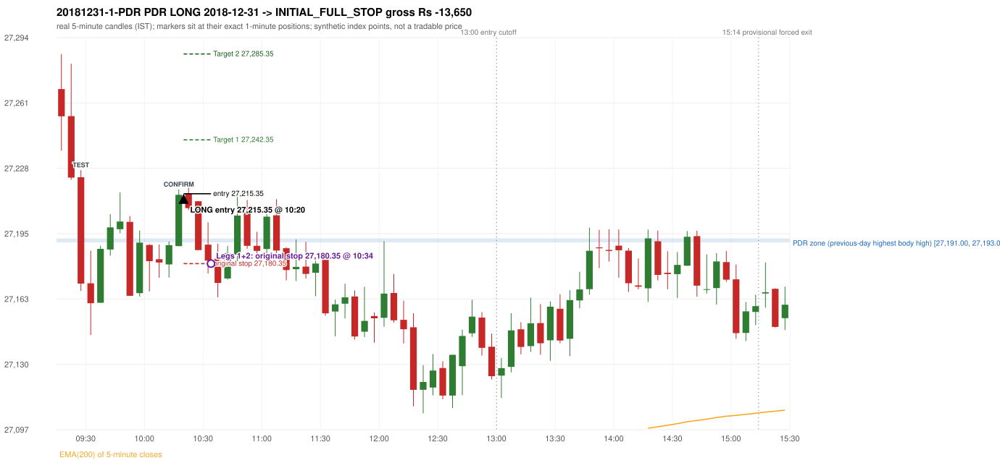
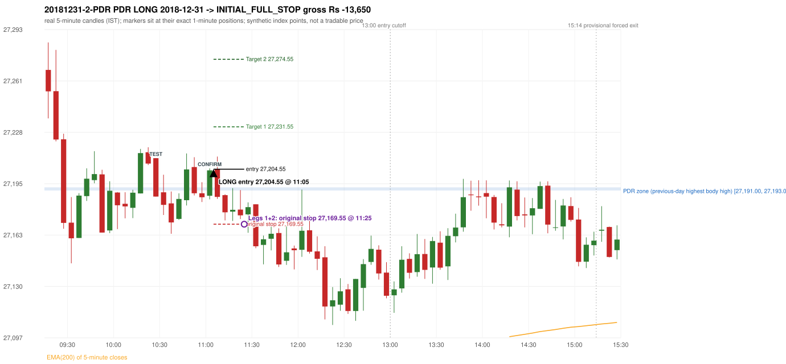

# Trading journal - 2018-12-31 (Monday)

> Phase 5 cross-index test, BANKNIFTY window C (Window C 2018-01-01..2018-12-31 (secondary-source minutes); status EXPLORATORY). The FROZEN Phase 3.6 configuration (IRF, ORB, PDR body-based, PDS, RF; shared controller) with the NIFTY index-point stops and targets UNCHANGED on the BANKNIFTY index price. INDEX-POINT RESULTS ONLY: no option premium is used or estimated. HISTORICAL RESEARCH ONLY: the strategy was developed using later NIFTY data. 5paisa returns no minute data before 2019-03-01, so this year rests on one unattributed vendor with nothing to check it against Synthetic BANKNIFTY index-point P&L (the index is not tradable). The owner's review status is intentionally blank.

## A. Trading day overview

| item | value |
|---|---|
| Date / weekday | 2018-12-31 / Monday |
| Session type | USABLE_WITH_FLAGS / VALID |
| Original session open (first 1-minute open) | 27,267.80 |
| Previous session | 2018-12-28 |
| Previous-day high / low (wicks included) | 27,210.90 / 27,043.20 |
| Previous-day highest BODY high (the body-based PDR ceiling; wicks ignored) | 27,193.00 |
| Previous-day official close / last 5-minute close | 27,125.25 / 27,120.75 |
| Raw engine records / confirmed signals / fully valid signals | 7 / 3 / 3 |
| Setups that did not complete (invalidated / incomplete) | 4 |
| Executed trades | 2 20181231-1-PDR;20181231-2-PDR |
| Gross P&L (Rs, synthetic) | -27,300.00 |
| Illustrative net P&L (Rs; Rs 500/trade + 0.5 pt/fill) | -29,080.00 |
| Day-end portfolio status | DAY_FINISHED |
| Manual journal trades (matched / unmatched) | 0 (0 / 0) |
| Extra automated trades | 0 |

## B. Daily strategy signal timeline (confirmed signals, chronological)

| time | strategy | method | dir | entry-rule status | valid for execution | <= 13:00 | portfolio state | accepted / ignored | specific reason | competing (same minute) |
|---|---|---|---|---|---|---|---|---|---|---|
| 10:20 | PDR | PDR | LONG | RESEARCH_VARIANT | True | True | FIRST_TRADE_ACTIVE | ACCEPTED -> 20181231-1-PDR | first eligible signal of the day; trade 1: INITIAL_FULL_STOP |  |
| 11:05 | PDR | PDR | LONG | RESEARCH_VARIANT | True | True | SECOND_TRADE_ACTIVE | ACCEPTED -> 20181231-2-PDR | permitted second trade: newly confirmed PDR/PDS after the original full stop; trade 2: INITIAL_FULL_STOP |  |
| 14:40 | PDR | PDR | LONG | RESEARCH_VARIANT | True | False | DAY_FINISHED | IGNORED | DAY_FINISHED [blocked by PDR#2] |  |

Engine setups that did not complete (4); the complete list with failed rule ids is in `rejected_signals.csv`:

| candle | strategy | method | dir | status | precise reason | failed rules |
|---|---|---|---|---|---|---|
| 09:15 | ORB | Method 1 | LONG | INVALIDATED | CANDLE_QUALITY(not a strong body / wick too large) | ORB-M1-LONG-003 |
| 09:15 | ORB | Method 2 | LONG | INVALIDATED | TRENDLINE_NOT_SUPPORTIVE | ORB-M2-LONG-001 |
| 14:40 | PDR | PDR | LONG | INCOMPLETE_AT_EOD | NO_QUALIFYING_CONFIRMATION_BEFORE_SESSION_END |  |
| 09:20 | RF | RF | LONG | INCOMPLETE_AT_EOD | NO_RETURN_INSIDE_BEFORE_SESSION_END |  |

## C. Detailed trade journals

### 20181231-1-PDR: PDR LONG (FIRST trade)

Chart: 

**Rule configuration:** CFG-phase36_body_based-866f954e55 - signal verification status **RESEARCH_VARIANT** (never VERIFIED while a rule rests on a proposal).

#### 1. Setup identification

PDR LONG (body-based engine, A_HIGHEST_BODY_HIGH): the session opened 142.55 points above the previous close and 74.80 points above the previous-day highest BODY high 27,193.00 (zone [27,191.00, 27,193.00] from the 10:25 candle of 2018-12-28; the highest wick 27,210.90 is ignored). The 09:25 candle (27,166.65 - 27,227.15) tested the zone; the 10:15 candle (green, O 27,189.10 H 27,217.50 L 27,189.10 C 27,214.80) passed GOOD_GREEN_BODY and closed 21.80 points above the zone ceiling, confirming the entry at 10:20. The pattern thresholds and the zone's lower boundary are provisional research assumptions, not approved by the strategy author.

#### 2. Candle and indicator calculations

| role | session | candle | O | H | L | C | range | body % | upper wick % | lower wick % | direction | EMA(200) | strong bull / bear | pin bull / bear | small (body<=30%) | used for |
|---|---|---|---|---|---|---|---|---|---|---|---|---|---|---|---|---|
| zone_source_candle | PREVIOUS | 10:25-10:30 | 27,193.00 | 27,210.90 | 27,187.60 | 27,191.00 | 23.30 | 8.58 | 76.82 | 14.59 | BEARISH | 26,948.44 | False / False | False / True | True | candle of the previous session's highest BODY high (A_HIGHEST_BODY_HIGH) |
| prev_day_wick_high_candle | PREVIOUS | 10:25-10:30 | 27,193.00 | 27,210.90 | 27,187.60 | 27,191.00 | 23.30 | 8.58 | 76.82 | 14.59 | BEARISH | 26,948.44 | False / False | False / True | True | candle of the previous session's highest WICK (ignored by the author's rule; shown for comparison) |
| interaction_candle | TODAY | 09:25-09:30 | 27,223.60 | 27,227.15 | 27,166.65 | 27,170.35 | 60.50 | 88.02 | 5.87 | 6.12 | BEARISH | 27,045.10 | False / True | False / False | False | first candle whose range overlaps the zone (the test) |
| confirmation_candle | TODAY | 10:15-10:20 | 27,189.10 | 27,217.50 | 27,189.10 | 27,214.80 | 28.40 | 90.49 | 9.51 | 0.00 | BULLISH | 27,058.62 | True / False | False / False | False | candle that satisfies one of the three patterns and closes above the zone ceiling |

Every condition, with the rule, the calculation, the observed values and the result:

| # | group | rule | result | status / numeric definition | calculation | observed | required | available at | why it matters |
|---|---|---|---|---|---|---|---|---|---|
| 1 | SELECTION | SEL-FIRST-001 | PASS | USER_APPROVED / USER_APPROVED | earliest CONFIRMED signal of the day across IRF/ORB/PDR/PDS/RF that passed the controller's checks | 0 confirmed signal(s) earlier today; 3 confirmed signals in the day in total, this one at 10:20 | no earlier executable signal | 2018-12-31 10:20 | the shared controller trades only the first valid signal; the five strategies are not independent positions |
| 2 | SELECTION | SEL-TIE-001 | PASS | USER_APPROVED / USER_APPROVED | other CONFIRMED signals with exactly the same confirmation timestamp | none | no different-strategy / opposite-direction signal in the same minute (otherwise an unresolved conflict, no trade) | 2018-12-31 10:20 | an unresolved same-minute collision would have produced no trade at all |
| 3 | SELECTION | ENTRY-CUTOFF-001 | PASS | USER_APPROVED / USER_APPROVED | fill timestamp vs 13:00:00 IST | signal confirmed 10:20; fill 10:20 | fill at or before 13:00:00 IST | 2018-12-31 10:20 | no new position may be entered with a fill after 13:00 IST |
| 4 | SELECTION | EXE-FILL-001 | PASS | PROPOSED_FOR_REVIEW / PROPOSED_FOR_REVIEW | fill = open of the 1-minute bar that starts at the signal candle's end | bar 10:20 O 27,215.35 H 27,216.50 L 27,207.20 C 27,209.80; executable=True; entry 27,215.35 | fill bar exists, starts exactly at the signal end, is fillable; entry = its open | 2018-12-31 10:20 | a 5-minute signal is known only when its candle closes; the first price that can be traded is the next minute's open |
| 5 | SELECTION | DAY-MAX-001 | PASS | USER_APPROVED / USER_APPROVED | number of entries today | trade 1 of at most 2 | <= 2 entries per day | 2018-12-31 10:20 | daily trade cap |
| 6 | SETUP | PDR-004 | PASS | SOURCE_VERIFIED / EXPLICIT_WORDING_DETAIL_PROPOSED_FOR_REVIEW | gap = first 1-minute open of today - previous session's OFFICIAL close | today's open 27,267.80 (first 1-minute bar 09:15) - previous close 27,125.25 (DAILY_VENDOR, 2018-12-28) = +142.55 points -> gap UP | gap UP (more than 0 points) | 2018-12-31 09:15 | approved convention: the original first-minute open, never the vendor daily open |
| 7 | SETUP | PDR-B03 | PASS | AUTHOR_APPROVED / AUTHOR_STATEMENT_NUMERIC_DETAILS_ARE_SEPARATE_PROPOSED_ROWS | the session opens strictly above the previous day's resistance zone (author-approved) | today's first 1-minute open 27,267.80 vs zone ceiling 27,193.00: 74.80 points above (open - ceiling = +74.80) | open > zone ceiling (equal or inside the zone rejects the setup) | 2018-12-31 09:15 | the original first-minute open is used, never a vendor daily open |
| 8 | ZONE | PDR-001 | PASS | SOURCE_VERIFIED / EXPLICIT_IN_SOURCE | direction | LONG (PDR is long only) | long-only | 2018-12-31 10:20 | PDR buys a retest of previous-day resistance after a gap up |
| 9 | ZONE | PDR-B01a | PASS | AUTHOR_APPROVED / AUTHOR_STATEMENT_NUMERIC_DETAILS_ARE_SEPARATE_PROPOSED_ROWS | wicks ignored, bodies considered: body_high = max(open, close) of every completed previous-session 5-minute candle; ceiling = the highest body_high; floor = body low of that candle | previous session 2018-12-28: highest body high 27,193.00 on the 10:25 candle (O 27,193.00 C 27,191.00; wick high of that candle 27,210.90, ignored); four highest body highs: 27,193.00 (10:25); 27,192.15 (10:20); 27,189.25 (10:15); 27,188.45 (10:30). Highest WICK of the session 27,210.90 (10:25 candle) is 17.90 points above the ceiling and plays no part. Zone [27,191.00 (body low), 27,193.00 (body high)]; engine recorded [27,191.00, 27,193.00] | ceiling = highest body high of the previous session (author: wick ignored, body considered) | 2018-12-28 15:30 | a wick-only price never becomes resistance; the zone is drawn from candle bodies |
| 10 | ZONE | PDR-B02 | UNRESOLVED | AUTHOR_APPROVED / AUTHOR_STATEMENT_NUMERIC_DETAILS_ARE_SEPARATE_PROPOSED_ROWS | multiple highs connected into one zone (author principle; candidate B) | candidate A (used): [27,191.00, 27,193.00]. Candidate B (multiple-body-high cluster, tolerance 5 points) would be [27,191.00, 27,193.00] (ISOLATED_BODY_HIGH, 1 touch(es), member body highs 27,193.00); ceiling difference 0.00 points | a zone that connects all relevant highs (numbers not given by the author) | 2018-12-28 15:30 | candidate B has the same ceiling by construction, so this signal is unaffected by the choice; the lower boundary and the cluster numbers are research parameters |
| 11 | ZONE | PDR-003 | PASS | SOURCE_VERIFIED / EXPLICIT_IN_SOURCE | the zone is an area, not a single price | zone height 2.00 points [27,191.00, 27,193.00] | a rectangle with positive height (a zero-height zone is left unresolved by the engine) | 2018-12-28 15:30 | price may touch any part of the area |
| 12 | CONFIRMATION | PDR-B03b | PASS | PRESERVED_FROM_PHASE2 / PRESERVED_FROM_PHASE2 | the first candle whose [low, high] overlaps the zone (+/- proximity) is the test; the confirmation must come strictly after it | 09:25-09:30 O 27,223.60 H 27,227.15 L 27,166.65 C 27,170.35; range 60.50, body 53.25 (88.02%), upper wick 3.55 (5.87%), lower wick 3.70 (6.12%), bearish; low 27,166.65 vs zone ceiling 27,193.00, high 27,227.15 vs zone floor 27,191.00; proximity 0; confirmation candle 10:15 is candle no. 13, the test candle no. 3 | range overlaps the zone; confirmation after the test | 2018-12-31 09:30 | the retest of the previous-day resistance |
| 13 | CONFIRMATION | PDR-B04c | PASS | PROPOSED_FOR_REVIEW / NUMERIC_DEFINITION_PROPOSED_FOR_REVIEW | Pattern 1: good green body on the 10:15-10:20 candle (O 27,189.10 H 27,217.50 L 27,189.10 C 27,214.80); the numeric thresholds are PROVISIONAL (RESEARCH_DEFAULT), not author-approved | colour green; body 90.49%; upper wick 9.51% -> PASSES | green, body >= 60% and upper wick <= 20% of the range | 2018-12-31 10:20 | one of the three patterns is enough (author: one good green body OR lower price rejection OR hammer); fixed thresholds are not required by the author, so the numbers are a research convention; a pattern that does not pass is not an error |
| 14 | CONFIRMATION | PDR-B04c | NOT_APPLICABLE | PROPOSED_FOR_REVIEW / NUMERIC_DEFINITION_PROPOSED_FOR_REVIEW | Pattern 2: lower-price rejection candle on the 10:15-10:20 candle (O 27,189.10 H 27,217.50 L 27,189.10 C 27,214.80); the numeric thresholds are PROVISIONAL (RESEARCH_DEFAULT), not author-approved | lower wick 0.00 = 0.00 x body 25.70; close 9.51% below the high; low 27,189.10; low reached the zone ceiling 27,193.00 -> does not pass | lower wick >= 2 x body, close within the top 30% of the range, low <= zone ceiling (colour not required) | 2018-12-31 10:20 | one of the three patterns is enough (author: one good green body OR lower price rejection OR hammer); fixed thresholds are not required by the author, so the numbers are a research convention; a pattern that does not pass is not an error |
| 15 | CONFIRMATION | PDR-B04c | NOT_APPLICABLE | PROPOSED_FOR_REVIEW / NUMERIC_DEFINITION_PROPOSED_FOR_REVIEW | Pattern 3: hammer candle on the 10:15-10:20 candle (O 27,189.10 H 27,217.50 L 27,189.10 C 27,214.80); the numeric thresholds are PROVISIONAL (RESEARCH_DEFAULT), not author-approved | lower wick 0.00 = 0.00 x body; upper wick 9.51%; body bottom at 0.00% of the range -> does not pass | lower wick >= 2 x body, upper wick <= 10%, body bottom >= 60% of the range (colour not required) | 2018-12-31 10:20 | one of the three patterns is enough (author: one good green body OR lower price rejection OR hammer); fixed thresholds are not required by the author, so the numbers are a research convention; a pattern that does not pass is not an error |
| 16 | CONFIRMATION | PDR-B04 | PASS | AUTHOR_APPROVED / AUTHOR_STATEMENT_NUMERIC_DETAILS_ARE_SEPARATE_PROPOSED_ROWS | at least one of the three patterns passes (OR logic; every passing pattern is recorded) | patterns passed: GOOD_GREEN_BODY (engine recorded: GOOD_GREEN_BODY) | at least one pattern | 2018-12-31 10:20 | the author's entry candle requirement |
| 17 | CONFIRMATION | PDR-B05 | PASS | AUTHOR_APPROVED / AUTHOR_STATEMENT_NUMERIC_DETAILS_ARE_SEPARATE_PROPOSED_ROWS | the confirmation candle must close above the zone | close 27,214.80 vs zone ceiling 27,193.00: +21.80 points (floor 27,191.00; low 27,189.10 dipped into/below the zone) | close > zone ceiling, strictly (lower wick may penetrate the zone) | 2018-12-31 10:20 | no pattern overrides the close rule |
| 18 | CONFIRMATION | PDR-B06 | PASS | USER_APPROVED / USER_APPROVED | no entry at the open and no look-ahead: the order is placed only after the confirmation candle has completed | test candle 09:25 (no. 3) precedes the confirmation candle 10:15-10:20; signal stamped 10:20; fill 10:20 at the open of that 1-minute bar = 27,215.35 | interaction before the confirmation; fill after the confirmation candle's end | 2018-12-31 10:20 | existing causal fill convention (EXE-FILL-001) |
| 19 | EXECUTION | EXE-STOP-001 | PASS | USER_APPROVED / USER_APPROVED | initial stop = entry - 35 points | entry 27,215.35 -> stop 27,180.35 | stop 35 index points (BASELINE) | 2018-12-31 10:20 | defines the loss if the setup fails before Target 1 |
| 20 | EXECUTION | EXE-T1-001 | PASS | SOURCE_VERIFIED / EXPLICIT_IN_SOURCE | Target 1 = entry +/- 27 points | T1 27,242.35 | 27 points | 2018-12-31 10:20 | Leg 1 (3 lots) is booked at Target 1 |
| 21 | EXECUTION | PDR-008 | PASS | SOURCE_VERIFIED / EXPLICIT_IN_SOURCE | Target 2 = entry +/- 70 points | T2 27,285.35 (the guide says 70; the performance report's winners suggest 60 - CONFLICTING, recorded) | 70 points | 2018-12-31 10:20 | Leg 2 (3 lots) is booked at Target 2 |
| 22 | EXECUTION | POST-T1-STOP-006 | PASS | USER_APPROVED / USER_APPROVED | after T1 the Leg-2 stop = entry - 6 (no trailing) | post-T1 stop 27,209.35 | entry -6 (LONG) / +6 (SHORT) | 2018-12-31 10:20 | protects the remaining three lots once the first three are booked |
| 23 | EXECUTION | SIZE-LOT-001 | PASS | USER_APPROVED / USER_APPROVED | 6 lots x 65 = 390, Leg 1 = 3 lots = 195, Leg 2 = 195 | 6 lots, lot size 65, legs 3+3 | 6 lots in two equal legs | 2018-12-31 10:20 | position size for the synthetic P&L |
| 24 | NOTE | PDR-B04x | UNRESOLVED | PROPOSED_FOR_REVIEW / NUMERIC_DEFINITION_PROPOSED_FOR_REVIEW | provisional parameters this signal rests on | pattern thresholds RESEARCH_DEFAULT: {'green_body_min': 0.6, 'green_upper_wick_max': 0.2, 'reject_wick_to_body_min': 2.0, 'reject_close_fraction_max': 0.3, 'hammer_wick_to_body_min': 2.0, 'hammer_upper_wick_max': 0.1, 'hammer_body_position_min': 0.6}; zone lower boundary = hull of the member bodies; zero-height policy UNRESOLVED_NO_SETUP; wait policy WAIT_FOR_QUALIFYING_CANDLE; cluster parameters (candidate B only) tolerance 5, touches 2, separation 2 | n/a (disclosure) | 2018-12-31 10:20 | the strategy author has NOT approved these numbers or conventions; the signal is a RESEARCH_VARIANT, never VERIFIED |
| 25 | NOTE | PDR-012 | NOT_APPLICABLE | PROPOSED_FOR_REVIEW / PROPOSED_FOR_REVIEW | repeated PDR signals today | 3 confirmed PDR signal(s) in the session | n/a (disclosure) | 2018-12-31 10:20 | this engine reports EVERY qualifying signal (the per-session cap is lifted); the controller trades only the first (and a PDR/PDS second trade after an initial full stop) |
| 26 | NOTE | PDR-B07 | UNRESOLVED | PROPOSED_FOR_REVIEW / NUMERIC_DEFINITION_PROPOSED_FOR_REVIEW | state of the zone between the test and the confirmation (the author and the guide are silent on price crossing below the zone) | test candle 09:25 (no. 3), confirmation candle 10:15 (no. 13): 10 candle(s) later; 8 candle(s) in between CLOSED BELOW the zone floor 27,191.00 (lowest close 27,160.55) before price returned above the ceiling | n/a (disclosure; the wait policy is a research parameter) | 2018-12-31 10:20 | the engine keeps a tested setup armed until a candle qualifies; whether a zone that price has closed through should still count is an owner decision |
| 27 | NOTE | PDR-009 | UNRESOLVED | UNRESOLVED / UNRESOLVED | stop 35 or 40 'depending on the situation' | the guide gives no selection rule; baseline fixed 35 points | unresolved in the source | 2018-12-31 10:20 | PDR stop selection is left to the owner |
| 28 | NOTE | NOTE-UNRESOLVED-DEPENDENCIES | UNRESOLVED | NOT_A_RULE / NOT_A_REGISTRY_RULE | rules the signal depends on that the sources leave unresolved | engine-recorded unresolved rule ids: PDR-B01b, PDR-B02a, PDR-B02b, PDR-B02c, PDR-B02d, PDR-B02e, PDR-B02f, PDR-B02g, PDR-B02h, PDR-B04b, PDR-B04c, PDR-B05a, PDR-B07; verification status RESEARCH_VARIANT | n/a (disclosure) | 2018-12-31 10:20 | the entry is only as verified as the rules it rests on |

#### 3. Entry decision and explanation

PDR LONG (body-based engine, A_HIGHEST_BODY_HIGH): the session opened 142.55 points above the previous close and 74.80 points above the previous-day highest BODY high 27,193.00 (zone [27,191.00, 27,193.00] from the 10:25 candle of 2018-12-28; the highest wick 27,210.90 is ignored). The 09:25 candle (27,166.65 - 27,227.15) tested the zone; the 10:15 candle (green, O 27,189.10 H 27,217.50 L 27,189.10 C 27,214.80) passed GOOD_GREEN_BODY and closed 21.80 points above the zone ceiling, confirming the entry at 10:20. The pattern thresholds and the zone's lower boundary are provisional research assumptions, not approved by the strategy author.

**Why this trade ahead of the other strategies:** This PDR signal was the earliest executable signal of the day: 0 confirmed signal(s) earlier, 0 other in the same minute. 2 later confirmed signal(s) (PDR x2) are logged as ignored or rejected. State of the other four engines at that moment: [IRF: no setup record before this time (a base condition was not met, or nothing triggered)] [ORB: Method 1 invalidated at 09:15: CANDLE_QUALITY(not a strong body / wick too large); Method 2 invalidated at 09:15: TRENDLINE_NOT_SUPPORTIVE] [PDS: no setup record before this time (a base condition was not met, or nothing triggered)] [RF: no setup record before this time (a base condition was not met, or nothing triggered)]

#### 4. Actual entry execution

| item | value |
|---|---|
| Signal candle | 10:15-10:20 |
| Signal confirmed | 2018-12-31 10:20 |
| Fill timestamp | 2018-12-31 10:20 |
| Entry price | 27,215.35 |
| Source partition / 1-minute bar | data/processed/banknifty/KAPRI_1M_BANKNIFTY/minutes/year=2018/month=12/candles.parquet / 2018-12-31 10:20 |
| Source bar O / H / L / C | 27,215.35 / 27,216.50 / 27,207.20 / 27,209.80 |
| Fill assumption | open of the 1-minute bar starting at the signal candle's end (EXE-FILL-001, PROPOSED causal convention) |
| Initial stop / T1 / T2 / post-T1 stop | 27,180.35 / 27,242.35 / 27,285.35 / 27,209.35 |
| Position | 6 lots x 65 = 390 units (Leg 1 195, Leg 2 195) |

#### 5-8. Trade progress, Target 1, post-T1 stop and final exit

Between the 10:20 entry bar and the final exit (15 one-minute bars) the best excursion in favour was 3.20 points at 10:23 and the worst against was 39.95 points at 10:34. At 10:34 price reached the original stop 27,180.35 before Target 1 27,242.35, so all six lots exited together at 27,180.35. This is an INITIAL_FULL_STOP: one more trade is allowed that day, only a newly confirmed PDR/PDS signal.

| leg | qty | exit time | exit price | reason | source 1-minute bar | O / H / L / C | gross points | gross Rs | slippage pts | flags |
|---|---|---|---|---|---|---|---|---|---|---|
| 1 | 195 | 10:34 | 27,180.35 | ORIGINAL_STOP_BEFORE_T1 | 10:34 | 27,187.40 / 27,189.55 / 27,175.40 / 27,181.85 | -35.00 | -6,825.00 | 0.00 |  |
| 2 | 195 | 10:34 | 27,180.35 | ORIGINAL_STOP_BEFORE_T1 | 10:34 | 27,187.40 / 27,189.55 / 27,175.40 / 27,181.85 | -35.00 | -6,825.00 | 0.00 |  |

Exit evidence per leg:

* Leg 1: 1-minute bar 10:34 O 27,187.40 H 27,189.55 L 27,175.40 C 27,181.85: low 27,175.40 reached the original stop 27,180.35 before Target 1 27,242.35 was touched; both legs exit at the stop level 27,180.35
* Leg 2: 1-minute bar 10:34 O 27,187.40 H 27,189.55 L 27,175.40 C 27,181.85: low 27,175.40 reached the original stop 27,180.35 before Target 1 27,242.35 was touched; both legs exit at the stop level 27,180.35

#### 9. Gross and illustrative net P&L

| item | value (Rs) |
|---|---|
| Leg 1 gross | -6,825.00 |
| Leg 2 gross | -6,825.00 |
| Trade gross (= Leg 1 + Leg 2) | -13,650.00 |
| Illustrative fixed cost | -500.00 |
| Illustrative slippage (0.5 pt on every fill, entry + exits, all units) | -390.00 |
| Illustrative net | -14,540.00 |

#### 10. Manual journal comparison

No manual journal exists for this period; no comparison.

### 20181231-2-PDR: PDR LONG (SECOND trade)

Chart: 

**Rule configuration:** CFG-phase36_body_based-866f954e55 - signal verification status **RESEARCH_VARIANT** (never VERIFIED while a rule rests on a proposal).

#### 1. Setup identification

PDR LONG (body-based engine, A_HIGHEST_BODY_HIGH): the session opened 142.55 points above the previous close and 74.80 points above the previous-day highest BODY high 27,193.00 (zone [27,191.00, 27,193.00] from the 10:25 candle of 2018-12-28; the highest wick 27,210.90 is ignored). The 10:25 candle (27,187.15 - 27,211.60) tested the zone; the 11:00 candle (green, O 27,187.65 H 27,205.10 L 27,185.35 C 27,203.85) passed GOOD_GREEN_BODY and closed 10.85 points above the zone ceiling, confirming the entry at 11:05. The pattern thresholds and the zone's lower boundary are provisional research assumptions, not approved by the strategy author.

#### 2. Candle and indicator calculations

| role | session | candle | O | H | L | C | range | body % | upper wick % | lower wick % | direction | EMA(200) | strong bull / bear | pin bull / bear | small (body<=30%) | used for |
|---|---|---|---|---|---|---|---|---|---|---|---|---|---|---|---|---|
| zone_source_candle | PREVIOUS | 10:25-10:30 | 27,193.00 | 27,210.90 | 27,187.60 | 27,191.00 | 23.30 | 8.58 | 76.82 | 14.59 | BEARISH | 26,948.44 | False / False | False / True | True | candle of the previous session's highest BODY high (A_HIGHEST_BODY_HIGH) |
| prev_day_wick_high_candle | PREVIOUS | 10:25-10:30 | 27,193.00 | 27,210.90 | 27,187.60 | 27,191.00 | 23.30 | 8.58 | 76.82 | 14.59 | BEARISH | 26,948.44 | False / False | False / True | True | candle of the previous session's highest WICK (ignored by the author's rule; shown for comparison) |
| interaction_candle | TODAY | 10:25-10:30 | 27,211.60 | 27,211.60 | 27,187.15 | 27,187.15 | 24.45 | 100.00 | 0.00 | 0.00 | BEARISH | 27,061.37 | False / True | False / False | False | first candle whose range overlaps the zone (the test) |
| confirmation_candle | TODAY | 11:00-11:05 | 27,187.65 | 27,205.10 | 27,185.35 | 27,203.85 | 19.75 | 82.03 | 6.33 | 11.65 | BULLISH | 27,070.01 | True / False | False / False | False | candle that satisfies one of the three patterns and closes above the zone ceiling |

Every condition, with the rule, the calculation, the observed values and the result:

| # | group | rule | result | status / numeric definition | calculation | observed | required | available at | why it matters |
|---|---|---|---|---|---|---|---|---|---|
| 1 | SELECTION | DAY-SL-001 | PASS | USER_APPROVED / USER_APPROVED | first trade outcome, strategy of this signal, position-close time vs this signal's timestamp | first trade PDR PDR closed as INITIAL_FULL_STOP at 10:34; position free from 10:35; this PDR signal confirmed 11:05 | first trade INITIAL_FULL_STOP before Target 1, and a NEWLY confirmed PDR/PDS signal after the first position closed | 2018-12-31 11:05 | the only way a second trade is allowed |
| 2 | SELECTION | DAY-NOREUSE-001 | PASS | USER_APPROVED / USER_APPROVED | signals confirmed while the first position was open | 1 signal(s) were ignored during the first trade (never reused): PDR PDR LONG @10:20 | this trade comes from a signal confirmed after the first exit, not from an ignored one | 2018-12-31 11:05 | an ignored signal can never become the second trade |
| 3 | SELECTION | ENTRY-CUTOFF-001 | PASS | USER_APPROVED / USER_APPROVED | fill timestamp vs 13:00:00 IST | signal confirmed 11:05; fill 11:05 | fill at or before 13:00:00 IST | 2018-12-31 11:05 | no new position may be entered with a fill after 13:00 IST |
| 4 | SELECTION | EXE-FILL-001 | PASS | PROPOSED_FOR_REVIEW / PROPOSED_FOR_REVIEW | fill = open of the 1-minute bar that starts at the signal candle's end | bar 11:05 O 27,204.55 H 27,212.60 L 27,202.30 C 27,207.10; executable=True; entry 27,204.55 | fill bar exists, starts exactly at the signal end, is fillable; entry = its open | 2018-12-31 11:05 | a 5-minute signal is known only when its candle closes; the first price that can be traded is the next minute's open |
| 5 | SELECTION | DAY-MAX-001 | PASS | USER_APPROVED / USER_APPROVED | number of entries today | trade 2 of at most 2 | <= 2 entries per day | 2018-12-31 11:05 | daily trade cap |
| 6 | SETUP | PDR-004 | PASS | SOURCE_VERIFIED / EXPLICIT_WORDING_DETAIL_PROPOSED_FOR_REVIEW | gap = first 1-minute open of today - previous session's OFFICIAL close | today's open 27,267.80 (first 1-minute bar 09:15) - previous close 27,125.25 (DAILY_VENDOR, 2018-12-28) = +142.55 points -> gap UP | gap UP (more than 0 points) | 2018-12-31 09:15 | approved convention: the original first-minute open, never the vendor daily open |
| 7 | SETUP | PDR-B03 | PASS | AUTHOR_APPROVED / AUTHOR_STATEMENT_NUMERIC_DETAILS_ARE_SEPARATE_PROPOSED_ROWS | the session opens strictly above the previous day's resistance zone (author-approved) | today's first 1-minute open 27,267.80 vs zone ceiling 27,193.00: 74.80 points above (open - ceiling = +74.80) | open > zone ceiling (equal or inside the zone rejects the setup) | 2018-12-31 09:15 | the original first-minute open is used, never a vendor daily open |
| 8 | ZONE | PDR-001 | PASS | SOURCE_VERIFIED / EXPLICIT_IN_SOURCE | direction | LONG (PDR is long only) | long-only | 2018-12-31 11:05 | PDR buys a retest of previous-day resistance after a gap up |
| 9 | ZONE | PDR-B01a | PASS | AUTHOR_APPROVED / AUTHOR_STATEMENT_NUMERIC_DETAILS_ARE_SEPARATE_PROPOSED_ROWS | wicks ignored, bodies considered: body_high = max(open, close) of every completed previous-session 5-minute candle; ceiling = the highest body_high; floor = body low of that candle | previous session 2018-12-28: highest body high 27,193.00 on the 10:25 candle (O 27,193.00 C 27,191.00; wick high of that candle 27,210.90, ignored); four highest body highs: 27,193.00 (10:25); 27,192.15 (10:20); 27,189.25 (10:15); 27,188.45 (10:30). Highest WICK of the session 27,210.90 (10:25 candle) is 17.90 points above the ceiling and plays no part. Zone [27,191.00 (body low), 27,193.00 (body high)]; engine recorded [27,191.00, 27,193.00] | ceiling = highest body high of the previous session (author: wick ignored, body considered) | 2018-12-28 15:30 | a wick-only price never becomes resistance; the zone is drawn from candle bodies |
| 10 | ZONE | PDR-B02 | UNRESOLVED | AUTHOR_APPROVED / AUTHOR_STATEMENT_NUMERIC_DETAILS_ARE_SEPARATE_PROPOSED_ROWS | multiple highs connected into one zone (author principle; candidate B) | candidate A (used): [27,191.00, 27,193.00]. Candidate B (multiple-body-high cluster, tolerance 5 points) would be [27,191.00, 27,193.00] (ISOLATED_BODY_HIGH, 1 touch(es), member body highs 27,193.00); ceiling difference 0.00 points | a zone that connects all relevant highs (numbers not given by the author) | 2018-12-28 15:30 | candidate B has the same ceiling by construction, so this signal is unaffected by the choice; the lower boundary and the cluster numbers are research parameters |
| 11 | ZONE | PDR-003 | PASS | SOURCE_VERIFIED / EXPLICIT_IN_SOURCE | the zone is an area, not a single price | zone height 2.00 points [27,191.00, 27,193.00] | a rectangle with positive height (a zero-height zone is left unresolved by the engine) | 2018-12-28 15:30 | price may touch any part of the area |
| 12 | CONFIRMATION | PDR-B03b | PASS | PRESERVED_FROM_PHASE2 / PRESERVED_FROM_PHASE2 | the first candle whose [low, high] overlaps the zone (+/- proximity) is the test; the confirmation must come strictly after it | 10:25-10:30 O 27,211.60 H 27,211.60 L 27,187.15 C 27,187.15; range 24.45, body 24.45 (100.00%), upper wick 0.00 (0.00%), lower wick 0.00 (0.00%), bearish; low 27,187.15 vs zone ceiling 27,193.00, high 27,211.60 vs zone floor 27,191.00; proximity 0; confirmation candle 11:00 is candle no. 22, the test candle no. 15 | range overlaps the zone; confirmation after the test | 2018-12-31 10:30 | the retest of the previous-day resistance (re-armed after the earlier signal: scanning restarted after the 10:15 candle) |
| 13 | CONFIRMATION | PDR-B04c | PASS | PROPOSED_FOR_REVIEW / NUMERIC_DEFINITION_PROPOSED_FOR_REVIEW | Pattern 1: good green body on the 11:00-11:05 candle (O 27,187.65 H 27,205.10 L 27,185.35 C 27,203.85); the numeric thresholds are PROVISIONAL (RESEARCH_DEFAULT), not author-approved | colour green; body 82.03%; upper wick 6.33% -> PASSES | green, body >= 60% and upper wick <= 20% of the range | 2018-12-31 11:05 | one of the three patterns is enough (author: one good green body OR lower price rejection OR hammer); fixed thresholds are not required by the author, so the numbers are a research convention; a pattern that does not pass is not an error |
| 14 | CONFIRMATION | PDR-B04c | NOT_APPLICABLE | PROPOSED_FOR_REVIEW / NUMERIC_DEFINITION_PROPOSED_FOR_REVIEW | Pattern 2: lower-price rejection candle on the 11:00-11:05 candle (O 27,187.65 H 27,205.10 L 27,185.35 C 27,203.85); the numeric thresholds are PROVISIONAL (RESEARCH_DEFAULT), not author-approved | lower wick 2.30 = 0.14 x body 16.20; close 6.33% below the high; low 27,185.35; low reached the zone ceiling 27,193.00 -> does not pass | lower wick >= 2 x body, close within the top 30% of the range, low <= zone ceiling (colour not required) | 2018-12-31 11:05 | one of the three patterns is enough (author: one good green body OR lower price rejection OR hammer); fixed thresholds are not required by the author, so the numbers are a research convention; a pattern that does not pass is not an error |
| 15 | CONFIRMATION | PDR-B04c | NOT_APPLICABLE | PROPOSED_FOR_REVIEW / NUMERIC_DEFINITION_PROPOSED_FOR_REVIEW | Pattern 3: hammer candle on the 11:00-11:05 candle (O 27,187.65 H 27,205.10 L 27,185.35 C 27,203.85); the numeric thresholds are PROVISIONAL (RESEARCH_DEFAULT), not author-approved | lower wick 2.30 = 0.14 x body; upper wick 6.33%; body bottom at 11.65% of the range -> does not pass | lower wick >= 2 x body, upper wick <= 10%, body bottom >= 60% of the range (colour not required) | 2018-12-31 11:05 | one of the three patterns is enough (author: one good green body OR lower price rejection OR hammer); fixed thresholds are not required by the author, so the numbers are a research convention; a pattern that does not pass is not an error |
| 16 | CONFIRMATION | PDR-B04 | PASS | AUTHOR_APPROVED / AUTHOR_STATEMENT_NUMERIC_DETAILS_ARE_SEPARATE_PROPOSED_ROWS | at least one of the three patterns passes (OR logic; every passing pattern is recorded) | patterns passed: GOOD_GREEN_BODY (engine recorded: GOOD_GREEN_BODY) | at least one pattern | 2018-12-31 11:05 | the author's entry candle requirement |
| 17 | CONFIRMATION | PDR-B05 | PASS | AUTHOR_APPROVED / AUTHOR_STATEMENT_NUMERIC_DETAILS_ARE_SEPARATE_PROPOSED_ROWS | the confirmation candle must close above the zone | close 27,203.85 vs zone ceiling 27,193.00: +10.85 points (floor 27,191.00; low 27,185.35 dipped into/below the zone) | close > zone ceiling, strictly (lower wick may penetrate the zone) | 2018-12-31 11:05 | no pattern overrides the close rule |
| 18 | CONFIRMATION | PDR-B06 | PASS | USER_APPROVED / USER_APPROVED | no entry at the open and no look-ahead: the order is placed only after the confirmation candle has completed | test candle 10:25 (no. 15) precedes the confirmation candle 11:00-11:05; signal stamped 11:05; fill 11:05 at the open of that 1-minute bar = 27,204.55 | interaction before the confirmation; fill after the confirmation candle's end | 2018-12-31 11:05 | existing causal fill convention (EXE-FILL-001) |
| 19 | EXECUTION | EXE-STOP-001 | PASS | USER_APPROVED / USER_APPROVED | initial stop = entry - 35 points | entry 27,204.55 -> stop 27,169.55 | stop 35 index points (BASELINE) | 2018-12-31 11:05 | defines the loss if the setup fails before Target 1 |
| 20 | EXECUTION | EXE-T1-001 | PASS | SOURCE_VERIFIED / EXPLICIT_IN_SOURCE | Target 1 = entry +/- 27 points | T1 27,231.55 | 27 points | 2018-12-31 11:05 | Leg 1 (3 lots) is booked at Target 1 |
| 21 | EXECUTION | PDR-008 | PASS | SOURCE_VERIFIED / EXPLICIT_IN_SOURCE | Target 2 = entry +/- 70 points | T2 27,274.55 (the guide says 70; the performance report's winners suggest 60 - CONFLICTING, recorded) | 70 points | 2018-12-31 11:05 | Leg 2 (3 lots) is booked at Target 2 |
| 22 | EXECUTION | POST-T1-STOP-006 | PASS | USER_APPROVED / USER_APPROVED | after T1 the Leg-2 stop = entry - 6 (no trailing) | post-T1 stop 27,198.55 | entry -6 (LONG) / +6 (SHORT) | 2018-12-31 11:05 | protects the remaining three lots once the first three are booked |
| 23 | EXECUTION | SIZE-LOT-001 | PASS | USER_APPROVED / USER_APPROVED | 6 lots x 65 = 390, Leg 1 = 3 lots = 195, Leg 2 = 195 | 6 lots, lot size 65, legs 3+3 | 6 lots in two equal legs | 2018-12-31 11:05 | position size for the synthetic P&L |
| 24 | NOTE | PDR-B04x | UNRESOLVED | PROPOSED_FOR_REVIEW / NUMERIC_DEFINITION_PROPOSED_FOR_REVIEW | provisional parameters this signal rests on | pattern thresholds RESEARCH_DEFAULT: {'green_body_min': 0.6, 'green_upper_wick_max': 0.2, 'reject_wick_to_body_min': 2.0, 'reject_close_fraction_max': 0.3, 'hammer_wick_to_body_min': 2.0, 'hammer_upper_wick_max': 0.1, 'hammer_body_position_min': 0.6}; zone lower boundary = hull of the member bodies; zero-height policy UNRESOLVED_NO_SETUP; wait policy WAIT_FOR_QUALIFYING_CANDLE; cluster parameters (candidate B only) tolerance 5, touches 2, separation 2 | n/a (disclosure) | 2018-12-31 11:05 | the strategy author has NOT approved these numbers or conventions; the signal is a RESEARCH_VARIANT, never VERIFIED |
| 25 | NOTE | PDR-012 | NOT_APPLICABLE | PROPOSED_FOR_REVIEW / PROPOSED_FOR_REVIEW | repeated PDR signals today | 3 confirmed PDR signal(s) in the session | n/a (disclosure) | 2018-12-31 11:05 | this engine reports EVERY qualifying signal (the per-session cap is lifted); the controller trades only the first (and a PDR/PDS second trade after an initial full stop) |
| 26 | NOTE | PDR-B07 | UNRESOLVED | PROPOSED_FOR_REVIEW / NUMERIC_DEFINITION_PROPOSED_FOR_REVIEW | state of the zone between the test and the confirmation (the author and the guide are silent on price crossing below the zone) | test candle 10:25 (no. 15), confirmation candle 11:00 (no. 22): 7 candle(s) later; 6 candle(s) in between CLOSED BELOW the zone floor 27,191.00 (lowest close 27,170.65) before price returned above the ceiling | n/a (disclosure; the wait policy is a research parameter) | 2018-12-31 11:05 | the engine keeps a tested setup armed until a candle qualifies; whether a zone that price has closed through should still count is an owner decision |
| 27 | NOTE | PDR-009 | UNRESOLVED | UNRESOLVED / UNRESOLVED | stop 35 or 40 'depending on the situation' | the guide gives no selection rule; baseline fixed 35 points | unresolved in the source | 2018-12-31 11:05 | PDR stop selection is left to the owner |
| 28 | NOTE | NOTE-UNRESOLVED-DEPENDENCIES | UNRESOLVED | NOT_A_RULE / NOT_A_REGISTRY_RULE | rules the signal depends on that the sources leave unresolved | engine-recorded unresolved rule ids: PDR-B01b, PDR-B02a, PDR-B02b, PDR-B02c, PDR-B02d, PDR-B02e, PDR-B02f, PDR-B02g, PDR-B02h, PDR-B04b, PDR-B04c, PDR-B05a, PDR-B07; verification status RESEARCH_VARIANT | n/a (disclosure) | 2018-12-31 11:05 | the entry is only as verified as the rules it rests on |

#### 3. Entry decision and explanation

PDR LONG (body-based engine, A_HIGHEST_BODY_HIGH): the session opened 142.55 points above the previous close and 74.80 points above the previous-day highest BODY high 27,193.00 (zone [27,191.00, 27,193.00] from the 10:25 candle of 2018-12-28; the highest wick 27,210.90 is ignored). The 10:25 candle (27,187.15 - 27,211.60) tested the zone; the 11:00 candle (green, O 27,187.65 H 27,205.10 L 27,185.35 C 27,203.85) passed GOOD_GREEN_BODY and closed 10.85 points above the zone ceiling, confirming the entry at 11:05. The pattern thresholds and the zone's lower boundary are provisional research assumptions, not approved by the strategy author.

**Why this trade ahead of the other strategies:** The first trade (PDR PDR) was stopped out before Target 1 at 10:34; this newly confirmed PDR signal at 11:05 is the first PDR/PDS signal after that exit, so it is the day's permitted second trade. State of the other engines at that moment: [IRF: no setup record before this time (a base condition was not met, or nothing triggered)] [ORB: Method 1 invalidated at 09:15: CANDLE_QUALITY(not a strong body / wick too large); Method 2 invalidated at 09:15: TRENDLINE_NOT_SUPPORTIVE] [PDS: no setup record before this time (a base condition was not met, or nothing triggered)] [RF: no setup record before this time (a base condition was not met, or nothing triggered)]

#### 4. Actual entry execution

| item | value |
|---|---|
| Signal candle | 11:00-11:05 |
| Signal confirmed | 2018-12-31 11:05 |
| Fill timestamp | 2018-12-31 11:05 |
| Entry price | 27,204.55 |
| Source partition / 1-minute bar | data/processed/banknifty/KAPRI_1M_BANKNIFTY/minutes/year=2018/month=12/candles.parquet / 2018-12-31 11:05 |
| Source bar O / H / L / C | 27,204.55 / 27,212.60 / 27,202.30 / 27,207.10 |
| Fill assumption | open of the 1-minute bar starting at the signal candle's end (EXE-FILL-001, PROPOSED causal convention) |
| Initial stop / T1 / T2 / post-T1 stop | 27,169.55 / 27,231.55 / 27,274.55 / 27,198.55 |
| Position | 6 lots x 65 = 390 units (Leg 1 195, Leg 2 195) |

#### 5-8. Trade progress, Target 1, post-T1 stop and final exit

Between the 11:05 entry bar and the final exit (21 one-minute bars) the best excursion in favour was 8.05 points at 11:05 and the worst against was 38.55 points at 11:25. At 11:25 price reached the original stop 27,169.55 before Target 1 27,231.55, so all six lots exited together at 27,169.55. This is an INITIAL_FULL_STOP: one more trade is allowed that day, only a newly confirmed PDR/PDS signal.

| leg | qty | exit time | exit price | reason | source 1-minute bar | O / H / L / C | gross points | gross Rs | slippage pts | flags |
|---|---|---|---|---|---|---|---|---|---|---|
| 1 | 195 | 11:25 | 27,169.55 | ORIGINAL_STOP_BEFORE_T1 | 11:25 | 27,175.80 / 27,177.45 / 27,166.00 / 27,166.55 | -35.00 | -6,825.00 | 0.00 |  |
| 2 | 195 | 11:25 | 27,169.55 | ORIGINAL_STOP_BEFORE_T1 | 11:25 | 27,175.80 / 27,177.45 / 27,166.00 / 27,166.55 | -35.00 | -6,825.00 | 0.00 |  |

Exit evidence per leg:

* Leg 1: 1-minute bar 11:25 O 27,175.80 H 27,177.45 L 27,166.00 C 27,166.55: low 27,166.00 reached the original stop 27,169.55 before Target 1 27,231.55 was touched; both legs exit at the stop level 27,169.55
* Leg 2: 1-minute bar 11:25 O 27,175.80 H 27,177.45 L 27,166.00 C 27,166.55: low 27,166.00 reached the original stop 27,169.55 before Target 1 27,231.55 was touched; both legs exit at the stop level 27,169.55

#### 9. Gross and illustrative net P&L

| item | value (Rs) |
|---|---|
| Leg 1 gross | -6,825.00 |
| Leg 2 gross | -6,825.00 |
| Trade gross (= Leg 1 + Leg 2) | -13,650.00 |
| Illustrative fixed cost | -500.00 |
| Illustrative slippage (0.5 pt on every fill, entry + exits, all units) | -390.00 |
| Illustrative net | -14,540.00 |

#### 10. Manual journal comparison

No manual journal exists for this period; no comparison.

## D. Manual journal comparison

No manual journal exists for this period (the manual journal covers 2025-09-01 .. 2026-08-31 only); no comparison is made and no automated trade is labelled 'extra'.

## E. Daily conclusion

* **Traded:** 20181231-1-PDR - PDR PDR LONG at 10:20 (entry 27,215.35), outcome INITIAL_FULL_STOP, gross Rs -13,650.00, illustrative net Rs -14,540.00. **Why:** This PDR signal was the earliest executable signal of the day: 0 confirmed signal(s) earlier, 0 other in the same minute. 2 later confirmed signal(s) (PDR x2) are logged as ignored or rejected. State of the other four engines at that moment: [IRF: no setup record before this time (a base condition was not met, or nothing triggered)] [ORB: Method 1 invalidated at 09:15: CANDLE_QUALITY(not a strong body / wick too large); Method 2 invalidated at 09:15: TRENDLINE_NOT_SUPPORTIVE] [PDS: no setup record before this time (a base condition was not met, or nothing triggered)] [RF: no setup record before this time (a base condition was not met, or nothing triggered)] **How it ended:** At 10:34 price reached the original stop 27,180.35 before Target 1 27,242.35, so all six lots exited together at 27,180.35. This is an INITIAL_FULL_STOP: one more trade is allowed that day, only a newly confirmed PDR/PDS signal.
* **Traded:** 20181231-2-PDR - PDR PDR LONG at 11:05 (entry 27,204.55), outcome INITIAL_FULL_STOP, gross Rs -13,650.00, illustrative net Rs -14,540.00. **Why:** The first trade (PDR PDR) was stopped out before Target 1 at 10:34; this newly confirmed PDR signal at 11:05 is the first PDR/PDS signal after that exit, so it is the day's permitted second trade. State of the other engines at that moment: [IRF: no setup record before this time (a base condition was not met, or nothing triggered)] [ORB: Method 1 invalidated at 09:15: CANDLE_QUALITY(not a strong body / wick too large); Method 2 invalidated at 09:15: TRENDLINE_NOT_SUPPORTIVE] [PDS: no setup record before this time (a base condition was not met, or nothing triggered)] [RF: no setup record before this time (a base condition was not met, or nothing triggered)] **How it ended:** At 11:25 price reached the original stop 27,169.55 before Target 1 27,231.55, so all six lots exited together at 27,169.55. This is an INITIAL_FULL_STOP: one more trade is allowed that day, only a newly confirmed PDR/PDS signal.
* **Ignored / rejected signals:** PDR IGNORED DAY_FINISHED x1
* **Open strategy-definition issues that affected this day:** NOTE-UNRESOLVED-DEPENDENCIES, PDR-009 (Stop-loss 35 or 40 'depending on the situation'; choose before entering, do not move after entry), PDR-B02, PDR-B04x, PDR-B07
* **Automated triage (not an approval; the owner's review status stays blank):** TRADED_NO_FLAGS

## Option-execution feasibility (information only; no option trade is simulated)

The index result above is an INDEX-POINT result on BANKNIFTY. It is not an option result: a move of N index points is not a move of N premium points (delta, gamma, theta, vega, spread and liquidity decide the premium).

| trade | strategy | index direction | long option it maps to | historical contract identified? | premium data available? | premium fill supportable? |
|---|---|---|---|---|---|---|
| 20181231-1-PDR | PDR | LONG | BUY CALL (CE) | no | no | no |
| 20181231-2-PDR | PDR | LONG | BUY CALL (CE) | no | no | no |

Why: (1) the broker's instrument master lists only contracts that are live today, so the scrip code of a contract that existed on this date is not available; (2) historical candles can only be requested by scrip code; (3) the strike and expiry selection policy is an owner decision that has not been made (`options_feasibility/option_contract_selection_decisions.md`). No option entry, exit, premium or option P&L is shown, and none may be inferred from the index points.
