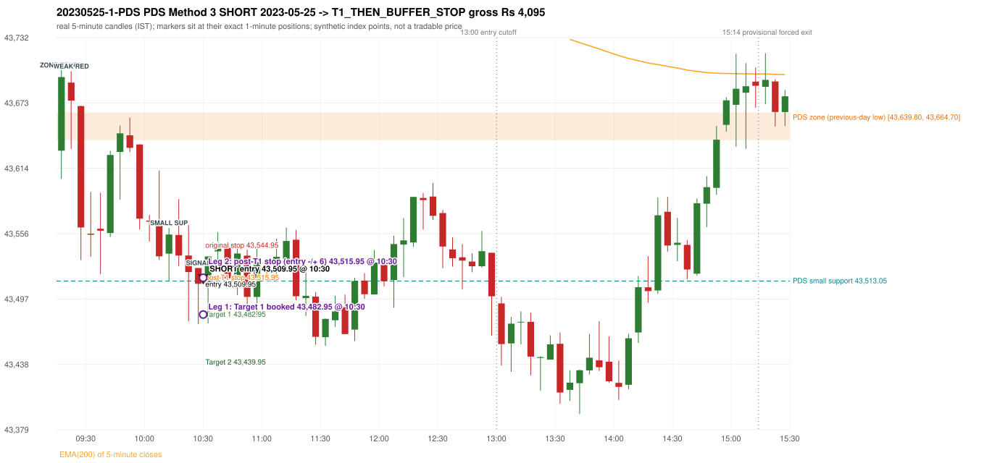

# Trading journal - 2023-05-25 (Thursday)

> Phase 5 cross-index test, BANKNIFTY window M (Main window 2022-09-01..2026-08-31 (5paisa minutes); status DATA_VALIDATED). The FROZEN Phase 3.6 configuration (IRF, ORB, PDR body-based, PDS, RF; shared controller) with the NIFTY index-point stops and targets UNCHANGED on the BANKNIFTY index price. INDEX-POINT RESULTS ONLY: no option premium is used or estimated. HISTORICAL RESEARCH ONLY: the strategy was developed using later NIFTY data. same provider and download path as the NIFTY Phase 4 / Phase 3.6 runs; the status only says the DATA window passed the quality gate Synthetic BANKNIFTY index-point P&L (the index is not tradable). The owner's review status is intentionally blank.

## A. Trading day overview

| item | value |
|---|---|
| Date / weekday | 2023-05-25 / Thursday |
| Session type | USABLE_WITH_FLAGS / VALID |
| Original session open (first 1-minute open) | 43,630.25 |
| Previous session | 2023-05-24 |
| Previous-day high / low (wicks included) | 44,010.45 / 43,639.80 |
| Previous-day highest BODY high (the body-based PDR ceiling; wicks ignored) | 43,989.20 |
| Previous-day official close / last 5-minute close | 43,677.85 / 43,662.90 |
| Raw engine records / confirmed signals / fully valid signals | 4 / 1 / 1 |
| Setups that did not complete (invalidated / incomplete) | 3 |
| Executed trades | 1 20230525-1-PDS |
| Gross P&L (Rs, synthetic) | 4,095.00 |
| Illustrative net P&L (Rs; Rs 500/trade + 0.5 pt/fill) | 3,205.00 |
| Day-end portfolio status | DAY_FINISHED |
| Manual journal trades (matched / unmatched) | 0 (0 / 0) |
| Extra automated trades | 0 |

## B. Daily strategy signal timeline (confirmed signals, chronological)

| time | strategy | method | dir | entry-rule status | valid for execution | <= 13:00 | portfolio state | accepted / ignored | specific reason | competing (same minute) |
|---|---|---|---|---|---|---|---|---|---|---|
| 10:30 | PDS | Method 3 | SHORT | PROPOSAL_DEPENDENT | True | True | FIRST_TRADE_ACTIVE | ACCEPTED -> 20230525-1-PDS | first eligible signal of the day; trade 1: T1_THEN_BUFFER_STOP |  |

Engine setups that did not complete (3); the complete list with failed rule ids is in `rejected_signals.csv`:

| candle | strategy | method | dir | status | precise reason | failed rules |
|---|---|---|---|---|---|---|
| 09:15 | ORB | Method 2 | SHORT | INVALIDATED | TRENDLINE_NOT_SUPPORTIVE | ORB-M2-SHORT-001 |
| 14:50 | PDS | Method 1/2/3 | SHORT | INCOMPLETE_AT_EOD | NO_QUALIFYING_ENTRY_BEFORE_SESSION_END |  |
| 09:40 | RF | RF | LONG | INVALIDATED | TREND:EMA_PREV_SESSION_CLOSE wrong side | RF-001;RF-008 |

## C. Detailed trade journals

### 20230525-1-PDS: PDS Method 3 SHORT (FIRST trade)

Chart: 

**Rule configuration:** CFG-phase36_body_based-866f954e55 - signal verification status **PROPOSAL_DEPENDENT** (never VERIFIED while a rule rests on a proposal).

#### 1. Setup identification

PDS Method 3 SHORT: the session opened 9.55 points below the previous-day-low zone [43,639.80, 43,664.70]; the first red candle at the zone (09:20) was weak (body 23.26%), so the engine waited for a small support; the 10:10 candle's low 43,513.05 (126.75 points below the zone floor) was broken by the close of the 10:25 candle (43,510.60); confirmed 10:30.

#### 2. Candle and indicator calculations

| role | session | candle | O | H | L | C | range | body % | upper wick % | lower wick % | direction | EMA(200) | strong bull / bear | pin bull / bear | small (body<=30%) | used for |
|---|---|---|---|---|---|---|---|---|---|---|---|---|---|---|---|---|
| zone_source_candle | PREVIOUS | 15:00-15:05 | 43,664.70 | 43,725.60 | 43,639.80 | 43,655.55 | 85.80 | 10.66 | 70.98 | 18.36 | BEARISH | 43,884.99 | False / False | False / True | True | previous-day low candle that defines the zone (A_LOWEST_LOW) |
| zone_retest_candle | TODAY | 09:15-09:20 | 43,630.25 | 43,702.60 | 43,604.85 | 43,696.45 | 97.75 | 67.72 | 6.29 | 25.98 | BULLISH | 43,872.90 | True / False | False / False | False | first candle whose range reaches the zone from below |
| signal_candle | TODAY | 10:25-10:30 | 43,524.75 | 43,524.75 | 43,474.40 | 43,510.60 | 50.35 | 28.10 | 0.00 | 71.90 | BEARISH | 43,833.80 | False / False | True / False | True | trigger candle |
| weak_first_red_candle | TODAY | 09:20-09:25 | 43,691.45 | 43,701.55 | 43,631.90 | 43,675.25 | 69.65 | 23.26 | 14.50 | 62.24 | BEARISH | 43,870.93 | False / False | False / False | True | first red candle at the zone that failed the quality rule |
| small_support_pivot | TODAY | 10:10-10:15 | 43,537.65 | 43,560.75 | 43,513.05 | 43,554.85 | 47.70 | 36.06 | 12.37 | 51.57 | BULLISH | 43,843.28 | False / False | False / False | False | small support: latest 3-candle fractal low after the weak candle |

Every condition, with the rule, the calculation, the observed values and the result:

| # | group | rule | result | status / numeric definition | calculation | observed | required | available at | why it matters |
|---|---|---|---|---|---|---|---|---|---|
| 1 | SELECTION | SEL-FIRST-001 | PASS | USER_APPROVED / USER_APPROVED | earliest CONFIRMED signal of the day across IRF/ORB/PDR/PDS/RF that passed the controller's checks | 0 confirmed signal(s) earlier today; 1 confirmed signals in the day in total, this one at 10:30 | no earlier executable signal | 2023-05-25 10:30 | the shared controller trades only the first valid signal; the five strategies are not independent positions |
| 2 | SELECTION | SEL-TIE-001 | PASS | USER_APPROVED / USER_APPROVED | other CONFIRMED signals with exactly the same confirmation timestamp | none | no different-strategy / opposite-direction signal in the same minute (otherwise an unresolved conflict, no trade) | 2023-05-25 10:30 | an unresolved same-minute collision would have produced no trade at all |
| 3 | SELECTION | ENTRY-CUTOFF-001 | PASS | USER_APPROVED / USER_APPROVED | fill timestamp vs 13:00:00 IST | signal confirmed 10:30; fill 10:30 | fill at or before 13:00:00 IST | 2023-05-25 10:30 | no new position may be entered with a fill after 13:00 IST |
| 4 | SELECTION | EXE-FILL-001 | PASS | PROPOSED_FOR_REVIEW / PROPOSED_FOR_REVIEW | fill = open of the 1-minute bar that starts at the signal candle's end | bar 10:30 O 43,509.95 H 43,520.60 L 43,478.50 C 43,478.50; executable=True; entry 43,509.95 | fill bar exists, starts exactly at the signal end, is fillable; entry = its open | 2023-05-25 10:30 | a 5-minute signal is known only when its candle closes; the first price that can be traded is the next minute's open |
| 5 | SELECTION | DAY-MAX-001 | PASS | USER_APPROVED / USER_APPROVED | number of entries today | trade 1 of at most 2 | <= 2 entries per day | 2023-05-25 10:30 | daily trade cap |
| 6 | SETUP | PDS-003 | PASS | SOURCE_VERIFIED / EXPLICIT_WORDING_DETAIL_PROPOSED_FOR_REVIEW | gap = first 1-minute open of today - previous session's OFFICIAL close | today's open 43,630.25 (first 1-minute bar 09:15) - previous close 43,677.85 (DAILY_VENDOR, 2023-05-24) = -47.60 points -> gap DOWN | gap DOWN (more than 0 points) | 2023-05-25 09:15 | approved convention: the original first-minute open, never the vendor daily open |
| 7 | SETUP | PDS-006 | PASS | SOURCE_VERIFIED / QUALITATIVE_SOURCE_NUMERIC_DEFINITION_PROPOSED_FOR_REVIEW | gap-down open below the zone | today's open 43,630.25 vs zone low 43,639.80: 9.55 points below | open < zone low | 2023-05-25 09:15 | the guide: 'price is trading below the previous day's support zone' after the gap; a PROPOSED strict reading |
| 8 | SETUP | PDS-004 | PASS | SOURCE_VERIFIED / EXPLICIT_IN_SOURCE | PDS is not a breakdown strategy: the zone must be tested from below first | open 43,630.25 below the zone floor 43,639.80; the first candle to reach the zone is 09:15 | price rises to the zone before any short | 2023-05-25 09:15 | a short below the level without a retest is not this strategy |
| 9 | SETUP | PDS-005 | PASS | SOURCE_VERIFIED / QUALITATIVE_SOURCE_NUMERIC_DEFINITION_PROPOSED_FOR_REVIEW | price comes up to the zone: first candle whose [low, high] intersects it (+/- proximity) | 09:15-09:20 O 43,630.25 H 43,702.60 L 43,604.85 C 43,696.45; range 97.75, body 66.20 (67.72%), upper wick 6.15 (6.29%), lower wick 25.40 (25.98%), bullish; high 43,702.60 vs zone low 43,639.80 | range intersects the zone | 2023-05-25 09:20 | PDS is not a breakdown strategy: the zone must be tested from below first |
| 10 | ZONE | PDS-001 | PASS | SOURCE_VERIFIED / EXPLICIT_IN_SOURCE | direction | SHORT (PDS is short only) | short-only | 2023-05-25 10:30 | PDS sells a retest of previous-day support from below |
| 11 | ZONE | PDS-002 | PASS | SOURCE_VERIFIED / QUALITATIVE_SOURCE_NUMERIC_DEFINITION_PROPOSED_FOR_REVIEW | zone = [lowest low, body top] of the previous session's absolute-low candle (method A_LOWEST_LOW; the lower wick is part of the zone) | zone [43,639.80, 43,664.70] from the 15:00 candle of 2023-05-24 (15:00-15:05 O 43,664.70 H 43,725.60 L 43,639.80 C 43,655.55; range 85.80, body 9.15 (10.66%), upper wick 60.90 (70.98%), lower wick 15.75 (18.36%), bearish); engine recorded [43,639.80, 43,664.70] | previous trading day's low where price took support (body + lower wick) | 2023-05-24 15:05 | the reference level of the strategy; the exact candle(s) are a research choice (PDS-ZONE-002) |
| 12 | CONFIRMATION | PDS-M-001 | PASS | SOURCE_VERIFIED / QUALITATIVE_SOURCE_NUMERIC_DEFINITION_PROPOSED_FOR_REVIEW | Method 3 is used when the first red candle at the zone is not satisfying | first red candle at the zone: 09:20-09:25 O 43,691.45 H 43,701.55 L 43,631.90 C 43,675.25; range 69.65, body 16.20 (23.26%), upper wick 10.10 (14.50%), lower wick 43.35 (62.24%), bearish; strong-bearish test body >= 60%, lower wick <= 20% -> not met; pin bar -> not met | first red candle is neither strong nor a pin bar | 2023-05-25 09:25 | the quality rule keeps weak candles out; Method 3 waits for a support break instead |
| 13 | CONFIRMATION | PDS-M3-001 | PASS | SOURCE_VERIFIED / QUALITATIVE_SOURCE_NUMERIC_DEFINITION_PROPOSED_FOR_REVIEW | small support = latest 3-candle fractal low (k=1) formed at/after the weak candle with low <= zone high (43,664.70); definition SWING_K1_NEAR_ZONE | support 43,513.05 from the 10:10 candle; engine recorded 43,513.05; distance below the zone floor 126.75 points (zone floor 43,639.80); the guide says 'near the zone' but defines no distance - the code has no lower bound | a small support near the zone | 2023-05-25 10:20 | 'near' and the size of the small support are undefined in the guide |
| 14 | CONFIRMATION | PDS-M3-001 | PASS | SOURCE_VERIFIED / QUALITATIVE_SOURCE_NUMERIC_DEFINITION_PROPOSED_FOR_REVIEW | trigger: candle closes below the small support (break basis CLOSE) | 10:25 close 43,510.60 vs support 43,513.05: 2.45 points below | close < support | 2023-05-25 10:30 | the guide does not say close or touch; the close is used |
| 15 | EXECUTION | EXE-STOP-001 | PASS | USER_APPROVED / USER_APPROVED | initial stop = entry + 35 points | entry 43,509.95 -> stop 43,544.95 | stop 35 index points (BASELINE) | 2023-05-25 10:30 | defines the loss if the setup fails before Target 1 |
| 16 | EXECUTION | EXE-T1-001 | PASS | SOURCE_VERIFIED / EXPLICIT_IN_SOURCE | Target 1 = entry +/- 27 points | T1 43,482.95 | 27 points | 2023-05-25 10:30 | Leg 1 (3 lots) is booked at Target 1 |
| 17 | EXECUTION | PDS-TGT-001 | PASS | SOURCE_VERIFIED / EXPLICIT_IN_SOURCE | Target 2 = entry +/- 70 points | T2 43,439.95 (the guide says 70; the report suggests 60 - CONFLICTING) | 70 points | 2023-05-25 10:30 | Leg 2 (3 lots) is booked at Target 2 |
| 18 | EXECUTION | POST-T1-STOP-006 | PASS | USER_APPROVED / USER_APPROVED | after T1 the Leg-2 stop = entry + 6 (no trailing) | post-T1 stop 43,515.95 | entry -6 (LONG) / +6 (SHORT) | 2023-05-25 10:30 | protects the remaining three lots once the first three are booked |
| 19 | EXECUTION | SIZE-LOT-001 | PASS | USER_APPROVED / USER_APPROVED | 6 lots x 65 = 390, Leg 1 = 3 lots = 195, Leg 2 = 195 | 6 lots, lot size 65, legs 3+3 | 6 lots in two equal legs | 2023-05-25 10:30 | position size for the synthetic P&L |
| 20 | NOTE | PDS-007 | NOT_APPLICABLE | PROPOSED_FOR_REVIEW / PROPOSED_FOR_REVIEW | repeated PDS signals today | 1 confirmed PDS signal(s) in the session | n/a (disclosure) | 2023-05-25 10:30 | the per-session cap is lifted for the controller runs; the controller trades only the first (or the permitted second) trade |
| 21 | NOTE | PDS-MISSING-001 | UNRESOLVED | UNRESOLVED / UNRESOLVED | entry timing | signal on the candle close; fill at the next minute's open | the guide does not say whether entry is intra-candle or after the close | 2023-05-25 10:30 | causal convention: nothing is entered before the trigger candle has closed |
| 22 | NOTE | PDS-SL-001 | NOT_APPLICABLE | SOURCE_VERIFIED / QUALITATIVE_SOURCE_NUMERIC_DEFINITION_PROPOSED_FOR_REVIEW | the guide's 35-or-40 rule: 35 if the most recent green candle's high is within 35 points of entry, else 40 | most recent green candle high 43,560.75 is 50.80 points from the entry 43,509.95: the guide's rule would select 40 points; the baseline applies a fixed 35 (USER_APPROVED research baseline; the 35-vs-40 selection and the 40-point variant are separate labelled scenarios) | source selection rule | 2023-05-25 10:30 | the stop distance is a modelling choice and changes losses, not entries |
| 23 | NOTE | NOTE-UNRESOLVED-DEPENDENCIES | NOT_APPLICABLE | NOT_A_RULE / NOT_A_REGISTRY_RULE | rules the signal depends on that the sources leave unresolved | engine-recorded unresolved rule ids: none; verification status PROPOSAL_DEPENDENT | n/a (disclosure) | 2023-05-25 10:30 | the entry is only as verified as the rules it rests on |

#### 3. Entry decision and explanation

PDS Method 3 SHORT: the session opened 9.55 points below the previous-day-low zone [43,639.80, 43,664.70]; the first red candle at the zone (09:20) was weak (body 23.26%), so the engine waited for a small support; the 10:10 candle's low 43,513.05 (126.75 points below the zone floor) was broken by the close of the 10:25 candle (43,510.60); confirmed 10:30.

**Why this trade ahead of the other strategies:** This PDS Method 3 signal was the earliest executable signal of the day: 0 confirmed signal(s) earlier, 0 other in the same minute. No later signal was generated. State of the other four engines at that moment: [IRF: no setup record before this time (a base condition was not met, or nothing triggered)] [ORB: Method 2 invalidated at 09:15: TRENDLINE_NOT_SUPPORTIVE] [PDR: no setup record before this time (a base condition was not met, or nothing triggered)] [RF: RF invalidated at 09:40: TREND:EMA_PREV_SESSION_CLOSE wrong side]

#### 4. Actual entry execution

| item | value |
|---|---|
| Signal candle | 10:25-10:30 |
| Signal confirmed | 2023-05-25 10:30 |
| Fill timestamp | 2023-05-25 10:30 |
| Entry price | 43,509.95 |
| Source partition / 1-minute bar | data/processed/banknifty/FIVEPAISA_1M_BANKNIFTY/minutes/year=2023/month=05/candles.parquet / 2023-05-25 10:30 |
| Source bar O / H / L / C | 43,509.95 / 43,520.60 / 43,478.50 / 43,478.50 |
| Fill assumption | open of the 1-minute bar starting at the signal candle's end (EXE-FILL-001, PROPOSED causal convention) |
| Initial stop / T1 / T2 / post-T1 stop | 43,544.95 / 43,482.95 / 43,439.95 / 43,515.95 |
| Position | 6 lots x 65 = 390 units (Leg 1 195, Leg 2 195) |

#### 5-8. Trade progress, Target 1, post-T1 stop and final exit

Between the 10:30 entry bar and the final exit (1 one-minute bars) the best excursion in favour was 31.45 points at 10:30 and the worst against was 10.65 points at 10:30. At 10:30 price reached Target 1 43,482.95 and three lots exited. At 10:30 the remaining three lots' protective stop was set to 43,515.95 (entry + 6; no trailing, no further change); the engine applies it from the Target-1 bar onward and tests it within that same bar. At 10:30 (the SAME 1-minute bar: its intra-minute order is unknown, so the engine resolves it adversely) the remaining three lots stopped out at 43,515.95. T1_THEN_BUFFER_STOP: no second trade that day (DAY-BUF-001). Execution ambiguity flagged: 2023-05-25 10:30:00+05:30: Target 1 and the post-T1 stop 43515.95 both touched in one bar; resolved as the STOP (adverse)

| leg | qty | exit time | exit price | reason | source 1-minute bar | O / H / L / C | gross points | gross Rs | slippage pts | flags |
|---|---|---|---|---|---|---|---|---|---|---|
| 1 | 195 | 10:30 | 43,482.95 | TARGET_1 | 10:30 | 43,509.95 / 43,520.60 / 43,478.50 / 43,478.50 | 27.00 | 5,265.00 | 0.00 |  |
| 2 | 195 | 10:30 | 43,515.95 | POST_T1_STOP_ENTRY_MINUS_PLUS_6 | 10:30 | 43,509.95 / 43,520.60 / 43,478.50 / 43,478.50 | -6.00 | -1,170.00 | 0.00 | SAME_BAR_AMBIGUITY |

Exit evidence per leg:

* Leg 1: 1-minute bar 10:30 O 43,509.95 H 43,520.60 L 43,478.50 C 43,478.50: low 43,478.50 reached Target 1 43,482.95; Leg 1 booked at the target level
* Leg 2: 1-minute bar 10:30 O 43,509.95 H 43,520.60 L 43,478.50 C 43,478.50: high 43,520.60 reached the post-T1 stop 43,515.95; Leg 2 exits at 43,515.95 at the stop level

#### 9. Gross and illustrative net P&L

| item | value (Rs) |
|---|---|
| Leg 1 gross | 5,265.00 |
| Leg 2 gross | -1,170.00 |
| Trade gross (= Leg 1 + Leg 2) | 4,095.00 |
| Illustrative fixed cost | -500.00 |
| Illustrative slippage (0.5 pt on every fill, entry + exits, all units) | -390.00 |
| Illustrative net | 3,205.00 |

#### 10. Manual journal comparison

No manual journal exists for this period; no comparison.

## D. Manual journal comparison

No manual journal exists for this period (the manual journal covers 2025-09-01 .. 2026-08-31 only); no comparison is made and no automated trade is labelled 'extra'.

## E. Daily conclusion

* **Traded:** 20230525-1-PDS - PDS Method 3 SHORT at 10:30 (entry 43,509.95), outcome T1_THEN_BUFFER_STOP, gross Rs 4,095.00, illustrative net Rs 3,205.00. **Why:** This PDS Method 3 signal was the earliest executable signal of the day: 0 confirmed signal(s) earlier, 0 other in the same minute. No later signal was generated. State of the other four engines at that moment: [IRF: no setup record before this time (a base condition was not met, or nothing triggered)] [ORB: Method 2 invalidated at 09:15: TRENDLINE_NOT_SUPPORTIVE] [PDR: no setup record before this time (a base condition was not met, or nothing triggered)] [RF: RF invalidated at 09:40: TREND:EMA_PREV_SESSION_CLOSE wrong side] **How it ended:** At 10:30 price reached Target 1 43,482.95 and three lots exited. At 10:30 the remaining three lots' protective stop was set to 43,515.95 (entry + 6; no trailing, no further change); the engine applies it from the Target-1 bar onward and tests it within that same bar. At 10:30 (the SAME 1-minute bar: its intra-minute order is unknown, so the engine resolves it adversely) the remaining three lots st
* **Open strategy-definition issues that affected this day:** PDS-MISSING-001 (Entry timing (during the candle or after it closes) is not specified)
* **Automated triage (not an approval; the owner's review status stays blank):** REVIEW: EXECUTION_AMBIGUITY

## Option-execution feasibility (information only; no option trade is simulated)

The index result above is an INDEX-POINT result on BANKNIFTY. It is not an option result: a move of N index points is not a move of N premium points (delta, gamma, theta, vega, spread and liquidity decide the premium).

| trade | strategy | index direction | long option it maps to | historical contract identified? | premium data available? | premium fill supportable? |
|---|---|---|---|---|---|---|
| 20230525-1-PDS | PDS | SHORT | BUY PUT (PE) | no | no | no |

Why: (1) the broker's instrument master lists only contracts that are live today, so the scrip code of a contract that existed on this date is not available; (2) historical candles can only be requested by scrip code; (3) the strike and expiry selection policy is an owner decision that has not been made (`options_feasibility/option_contract_selection_decisions.md`). No option entry, exit, premium or option P&L is shown, and none may be inferred from the index points.
