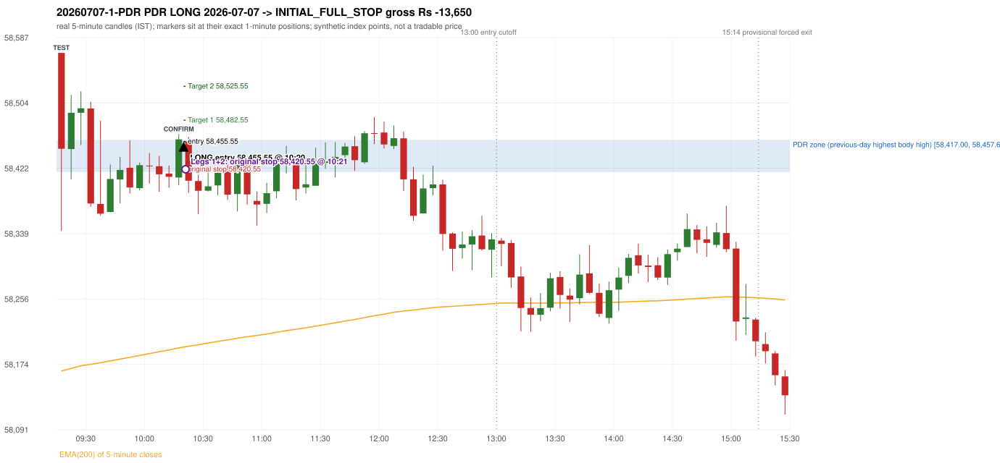
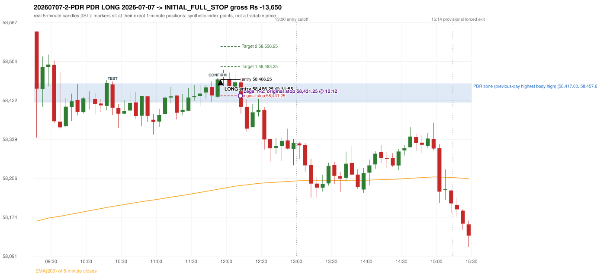

# Trading journal - 2026-07-07 (Tuesday)

> Phase 5 cross-index test, BANKNIFTY window M (Main window 2022-09-01..2026-08-31 (5paisa minutes); status DATA_VALIDATED). The FROZEN Phase 3.6 configuration (IRF, ORB, PDR body-based, PDS, RF; shared controller) with the NIFTY index-point stops and targets UNCHANGED on the BANKNIFTY index price. INDEX-POINT RESULTS ONLY: no option premium is used or estimated. HISTORICAL RESEARCH ONLY: the strategy was developed using later NIFTY data. same provider and download path as the NIFTY Phase 4 / Phase 3.6 runs; the status only says the DATA window passed the quality gate Synthetic BANKNIFTY index-point P&L (the index is not tradable). The owner's review status is intentionally blank.

## A. Trading day overview

| item | value |
|---|---|
| Date / weekday | 2026-07-07 / Tuesday |
| Session type | USABLE_WITH_FLAGS / VALID |
| Original session open (first 1-minute open) | 58,567.85 |
| Previous session | 2026-07-06 |
| Previous-day high / low (wicks included) | 58,476.55 / 57,943.00 |
| Previous-day highest BODY high (the body-based PDR ceiling; wicks ignored) | 58,457.65 |
| Previous-day official close / last 5-minute close | 58,291.50 / 58,263.00 |
| Raw engine records / confirmed signals / fully valid signals | 5 / 2 / 2 |
| Setups that did not complete (invalidated / incomplete) | 3 |
| Executed trades | 2 20260707-1-PDR;20260707-2-PDR |
| Gross P&L (Rs, synthetic) | -27,300.00 |
| Illustrative net P&L (Rs; Rs 500/trade + 0.5 pt/fill) | -29,080.00 |
| Day-end portfolio status | DAY_FINISHED |
| Manual journal trades (matched / unmatched) | 0 (0 / 0) |
| Extra automated trades | 0 |

## B. Daily strategy signal timeline (confirmed signals, chronological)

| time | strategy | method | dir | entry-rule status | valid for execution | <= 13:00 | portfolio state | accepted / ignored | specific reason | competing (same minute) |
|---|---|---|---|---|---|---|---|---|---|---|
| 10:20 | PDR | PDR | LONG | RESEARCH_VARIANT | True | True | FIRST_TRADE_ACTIVE | ACCEPTED -> 20260707-1-PDR | first eligible signal of the day; trade 1: INITIAL_FULL_STOP |  |
| 11:55 | PDR | PDR | LONG | RESEARCH_VARIANT | True | True | SECOND_TRADE_ACTIVE | ACCEPTED -> 20260707-2-PDR | permitted second trade: newly confirmed PDR/PDS after the original full stop; trade 2: INITIAL_FULL_STOP |  |

Engine setups that did not complete (3); the complete list with failed rule ids is in `rejected_signals.csv`:

| candle | strategy | method | dir | status | precise reason | failed rules |
|---|---|---|---|---|---|---|
| 09:15 | ORB | Method 2 | LONG | INVALIDATED | TRENDLINE_NOT_SUPPORTIVE | ORB-M2-LONG-001 |
| 11:55 | PDR | PDR | LONG | INCOMPLETE_AT_EOD | NO_QUALIFYING_CONFIRMATION_BEFORE_SESSION_END |  |
| 14:35 | RF | RF | LONG | INVALIDATED | GAP_UP_OUTSIDE_YESTERDAYS_RANGE | RF-004 |

## C. Detailed trade journals

### 20260707-1-PDR: PDR LONG (FIRST trade)

Chart: 

**Rule configuration:** CFG-phase36_body_based-866f954e55 - signal verification status **RESEARCH_VARIANT** (never VERIFIED while a rule rests on a proposal).

#### 1. Setup identification

PDR LONG (body-based engine, A_HIGHEST_BODY_HIGH): the session opened 276.35 points above the previous close and 110.20 points above the previous-day highest BODY high 58,457.65 (zone [58,417.00, 58,457.65] from the 12:35 candle of 2026-07-06; the highest wick 58,476.55 is ignored). The 09:15 candle (58,342.40 - 58,567.85) tested the zone; the 10:15 candle (green, O 58,410.10 H 58,464.90 L 58,400.45 C 58,458.35) passed GOOD_GREEN_BODY and closed 0.70 points above the zone ceiling, confirming the entry at 10:20. The pattern thresholds and the zone's lower boundary are provisional research assumptions, not approved by the strategy author.

#### 2. Candle and indicator calculations

| role | session | candle | O | H | L | C | range | body % | upper wick % | lower wick % | direction | EMA(200) | strong bull / bear | pin bull / bear | small (body<=30%) | used for |
|---|---|---|---|---|---|---|---|---|---|---|---|---|---|---|---|---|
| zone_source_candle | PREVIOUS | 12:35-12:40 | 58,457.65 | 58,462.65 | 58,413.35 | 58,417.00 | 49.30 | 82.45 | 10.14 | 7.40 | BEARISH | 58,086.10 | False / True | False / False | False | candle of the previous session's highest BODY high (A_HIGHEST_BODY_HIGH) |
| prev_day_wick_high_candle | PREVIOUS | 12:30-12:35 | 58,428.35 | 58,476.55 | 58,418.35 | 58,453.65 | 58.20 | 43.47 | 39.35 | 17.18 | BULLISH | 58,082.77 | False / False | False / False | False | candle of the previous session's highest WICK (ignored by the author's rule; shown for comparison) |
| interaction_candle | TODAY | 09:15-09:20 | 58,567.85 | 58,567.85 | 58,342.40 | 58,446.50 | 225.45 | 53.83 | 0.00 | 46.17 | BEARISH | 58,165.20 | False / False | False / False | False | first candle whose range overlaps the zone (the test) |
| confirmation_candle | TODAY | 10:15-10:20 | 58,410.10 | 58,464.90 | 58,400.45 | 58,458.35 | 64.45 | 74.86 | 10.16 | 14.97 | BULLISH | 58,194.46 | True / False | False / False | False | candle that satisfies one of the three patterns and closes above the zone ceiling |

Every condition, with the rule, the calculation, the observed values and the result:

| # | group | rule | result | status / numeric definition | calculation | observed | required | available at | why it matters |
|---|---|---|---|---|---|---|---|---|---|
| 1 | SELECTION | SEL-FIRST-001 | PASS | USER_APPROVED / USER_APPROVED | earliest CONFIRMED signal of the day across IRF/ORB/PDR/PDS/RF that passed the controller's checks | 0 confirmed signal(s) earlier today; 2 confirmed signals in the day in total, this one at 10:20 | no earlier executable signal | 2026-07-07 10:20 | the shared controller trades only the first valid signal; the five strategies are not independent positions |
| 2 | SELECTION | SEL-TIE-001 | PASS | USER_APPROVED / USER_APPROVED | other CONFIRMED signals with exactly the same confirmation timestamp | none | no different-strategy / opposite-direction signal in the same minute (otherwise an unresolved conflict, no trade) | 2026-07-07 10:20 | an unresolved same-minute collision would have produced no trade at all |
| 3 | SELECTION | ENTRY-CUTOFF-001 | PASS | USER_APPROVED / USER_APPROVED | fill timestamp vs 13:00:00 IST | signal confirmed 10:20; fill 10:20 | fill at or before 13:00:00 IST | 2026-07-07 10:20 | no new position may be entered with a fill after 13:00 IST |
| 4 | SELECTION | EXE-FILL-001 | PASS | PROPOSED_FOR_REVIEW / PROPOSED_FOR_REVIEW | fill = open of the 1-minute bar that starts at the signal candle's end | bar 10:20 O 58,455.55 H 58,461.50 L 58,422.00 C 58,426.45; executable=True; entry 58,455.55 | fill bar exists, starts exactly at the signal end, is fillable; entry = its open | 2026-07-07 10:20 | a 5-minute signal is known only when its candle closes; the first price that can be traded is the next minute's open |
| 5 | SELECTION | DAY-MAX-001 | PASS | USER_APPROVED / USER_APPROVED | number of entries today | trade 1 of at most 2 | <= 2 entries per day | 2026-07-07 10:20 | daily trade cap |
| 6 | SETUP | PDR-004 | PASS | SOURCE_VERIFIED / EXPLICIT_WORDING_DETAIL_PROPOSED_FOR_REVIEW | gap = first 1-minute open of today - previous session's OFFICIAL close | today's open 58,567.85 (first 1-minute bar 09:15) - previous close 58,291.50 (DAILY_VENDOR, 2026-07-06) = +276.35 points -> gap UP | gap UP (more than 0 points) | 2026-07-07 09:15 | approved convention: the original first-minute open, never the vendor daily open |
| 7 | SETUP | PDR-B03 | PASS | AUTHOR_APPROVED / AUTHOR_STATEMENT_NUMERIC_DETAILS_ARE_SEPARATE_PROPOSED_ROWS | the session opens strictly above the previous day's resistance zone (author-approved) | today's first 1-minute open 58,567.85 vs zone ceiling 58,457.65: 110.20 points above (open - ceiling = +110.20) | open > zone ceiling (equal or inside the zone rejects the setup) | 2026-07-07 09:15 | the original first-minute open is used, never a vendor daily open |
| 8 | ZONE | PDR-001 | PASS | SOURCE_VERIFIED / EXPLICIT_IN_SOURCE | direction | LONG (PDR is long only) | long-only | 2026-07-07 10:20 | PDR buys a retest of previous-day resistance after a gap up |
| 9 | ZONE | PDR-B01a | PASS | AUTHOR_APPROVED / AUTHOR_STATEMENT_NUMERIC_DETAILS_ARE_SEPARATE_PROPOSED_ROWS | wicks ignored, bodies considered: body_high = max(open, close) of every completed previous-session 5-minute candle; ceiling = the highest body_high; floor = body low of that candle | previous session 2026-07-06: highest body high 58,457.65 on the 12:35 candle (O 58,457.65 C 58,417.00; wick high of that candle 58,462.65, ignored); four highest body highs: 58,457.65 (12:35); 58,456.95 (13:05); 58,453.65 (12:30); 58,453.55 (12:10). Highest WICK of the session 58,476.55 (12:30 candle) is 18.90 points above the ceiling and plays no part. Zone [58,417.00 (body low), 58,457.65 (body high)]; engine recorded [58,417.00, 58,457.65] | ceiling = highest body high of the previous session (author: wick ignored, body considered) | 2026-07-06 15:30 | a wick-only price never becomes resistance; the zone is drawn from candle bodies |
| 10 | ZONE | PDR-B02 | UNRESOLVED | AUTHOR_APPROVED / AUTHOR_STATEMENT_NUMERIC_DETAILS_ARE_SEPARATE_PROPOSED_ROWS | multiple highs connected into one zone (author principle; candidate B) | candidate A (used): [58,417.00, 58,457.65]. Candidate B (multiple-body-high cluster, tolerance 5 points) would be [58,348.80, 58,457.65] (MULTIPLE_BODY_HIGH_CLUSTER, 3 touch(es), member body highs 58,453.55, 58,457.65, 58,456.95); ceiling difference 0.00 points | a zone that connects all relevant highs (numbers not given by the author) | 2026-07-06 15:30 | candidate B has the same ceiling by construction, so this signal is unaffected by the choice; the lower boundary and the cluster numbers are research parameters |
| 11 | ZONE | PDR-003 | PASS | SOURCE_VERIFIED / EXPLICIT_IN_SOURCE | the zone is an area, not a single price | zone height 40.65 points [58,417.00, 58,457.65] | a rectangle with positive height (a zero-height zone is left unresolved by the engine) | 2026-07-06 15:30 | price may touch any part of the area |
| 12 | CONFIRMATION | PDR-B03b | PASS | PRESERVED_FROM_PHASE2 / PRESERVED_FROM_PHASE2 | the first candle whose [low, high] overlaps the zone (+/- proximity) is the test; the confirmation must come strictly after it | 09:15-09:20 O 58,567.85 H 58,567.85 L 58,342.40 C 58,446.50; range 225.45, body 121.35 (53.83%), upper wick 0.00 (0.00%), lower wick 104.10 (46.17%), bearish; low 58,342.40 vs zone ceiling 58,457.65, high 58,567.85 vs zone floor 58,417.00; proximity 0; confirmation candle 10:15 is candle no. 13, the test candle no. 1 | range overlaps the zone; confirmation after the test | 2026-07-07 09:20 | the retest of the previous-day resistance |
| 13 | CONFIRMATION | PDR-B04c | PASS | PROPOSED_FOR_REVIEW / NUMERIC_DEFINITION_PROPOSED_FOR_REVIEW | Pattern 1: good green body on the 10:15-10:20 candle (O 58,410.10 H 58,464.90 L 58,400.45 C 58,458.35); the numeric thresholds are PROVISIONAL (RESEARCH_DEFAULT), not author-approved | colour green; body 74.86%; upper wick 10.16% -> PASSES | green, body >= 60% and upper wick <= 20% of the range | 2026-07-07 10:20 | one of the three patterns is enough (author: one good green body OR lower price rejection OR hammer); fixed thresholds are not required by the author, so the numbers are a research convention; a pattern that does not pass is not an error |
| 14 | CONFIRMATION | PDR-B04c | NOT_APPLICABLE | PROPOSED_FOR_REVIEW / NUMERIC_DEFINITION_PROPOSED_FOR_REVIEW | Pattern 2: lower-price rejection candle on the 10:15-10:20 candle (O 58,410.10 H 58,464.90 L 58,400.45 C 58,458.35); the numeric thresholds are PROVISIONAL (RESEARCH_DEFAULT), not author-approved | lower wick 9.65 = 0.20 x body 48.25; close 10.16% below the high; low 58,400.45; low reached the zone ceiling 58,457.65 -> does not pass | lower wick >= 2 x body, close within the top 30% of the range, low <= zone ceiling (colour not required) | 2026-07-07 10:20 | one of the three patterns is enough (author: one good green body OR lower price rejection OR hammer); fixed thresholds are not required by the author, so the numbers are a research convention; a pattern that does not pass is not an error |
| 15 | CONFIRMATION | PDR-B04c | NOT_APPLICABLE | PROPOSED_FOR_REVIEW / NUMERIC_DEFINITION_PROPOSED_FOR_REVIEW | Pattern 3: hammer candle on the 10:15-10:20 candle (O 58,410.10 H 58,464.90 L 58,400.45 C 58,458.35); the numeric thresholds are PROVISIONAL (RESEARCH_DEFAULT), not author-approved | lower wick 9.65 = 0.20 x body; upper wick 10.16%; body bottom at 14.97% of the range -> does not pass | lower wick >= 2 x body, upper wick <= 10%, body bottom >= 60% of the range (colour not required) | 2026-07-07 10:20 | one of the three patterns is enough (author: one good green body OR lower price rejection OR hammer); fixed thresholds are not required by the author, so the numbers are a research convention; a pattern that does not pass is not an error |
| 16 | CONFIRMATION | PDR-B04 | PASS | AUTHOR_APPROVED / AUTHOR_STATEMENT_NUMERIC_DETAILS_ARE_SEPARATE_PROPOSED_ROWS | at least one of the three patterns passes (OR logic; every passing pattern is recorded) | patterns passed: GOOD_GREEN_BODY (engine recorded: GOOD_GREEN_BODY) | at least one pattern | 2026-07-07 10:20 | the author's entry candle requirement |
| 17 | CONFIRMATION | PDR-B05 | PASS | AUTHOR_APPROVED / AUTHOR_STATEMENT_NUMERIC_DETAILS_ARE_SEPARATE_PROPOSED_ROWS | the confirmation candle must close above the zone | close 58,458.35 vs zone ceiling 58,457.65: +0.70 points (floor 58,417.00; low 58,400.45 dipped into/below the zone) | close > zone ceiling, strictly (lower wick may penetrate the zone) | 2026-07-07 10:20 | no pattern overrides the close rule |
| 18 | CONFIRMATION | PDR-B06 | PASS | USER_APPROVED / USER_APPROVED | no entry at the open and no look-ahead: the order is placed only after the confirmation candle has completed | test candle 09:15 (no. 1) precedes the confirmation candle 10:15-10:20; signal stamped 10:20; fill 10:20 at the open of that 1-minute bar = 58,455.55 | interaction before the confirmation; fill after the confirmation candle's end | 2026-07-07 10:20 | existing causal fill convention (EXE-FILL-001) |
| 19 | EXECUTION | EXE-STOP-001 | PASS | USER_APPROVED / USER_APPROVED | initial stop = entry - 35 points | entry 58,455.55 -> stop 58,420.55 | stop 35 index points (BASELINE) | 2026-07-07 10:20 | defines the loss if the setup fails before Target 1 |
| 20 | EXECUTION | EXE-T1-001 | PASS | SOURCE_VERIFIED / EXPLICIT_IN_SOURCE | Target 1 = entry +/- 27 points | T1 58,482.55 | 27 points | 2026-07-07 10:20 | Leg 1 (3 lots) is booked at Target 1 |
| 21 | EXECUTION | PDR-008 | PASS | SOURCE_VERIFIED / EXPLICIT_IN_SOURCE | Target 2 = entry +/- 70 points | T2 58,525.55 (the guide says 70; the performance report's winners suggest 60 - CONFLICTING, recorded) | 70 points | 2026-07-07 10:20 | Leg 2 (3 lots) is booked at Target 2 |
| 22 | EXECUTION | POST-T1-STOP-006 | PASS | USER_APPROVED / USER_APPROVED | after T1 the Leg-2 stop = entry - 6 (no trailing) | post-T1 stop 58,449.55 | entry -6 (LONG) / +6 (SHORT) | 2026-07-07 10:20 | protects the remaining three lots once the first three are booked |
| 23 | EXECUTION | SIZE-LOT-001 | PASS | USER_APPROVED / USER_APPROVED | 6 lots x 65 = 390, Leg 1 = 3 lots = 195, Leg 2 = 195 | 6 lots, lot size 65, legs 3+3 | 6 lots in two equal legs | 2026-07-07 10:20 | position size for the synthetic P&L |
| 24 | NOTE | PDR-B04x | UNRESOLVED | PROPOSED_FOR_REVIEW / NUMERIC_DEFINITION_PROPOSED_FOR_REVIEW | provisional parameters this signal rests on | pattern thresholds RESEARCH_DEFAULT: {'green_body_min': 0.6, 'green_upper_wick_max': 0.2, 'reject_wick_to_body_min': 2.0, 'reject_close_fraction_max': 0.3, 'hammer_wick_to_body_min': 2.0, 'hammer_upper_wick_max': 0.1, 'hammer_body_position_min': 0.6}; zone lower boundary = hull of the member bodies; zero-height policy UNRESOLVED_NO_SETUP; wait policy WAIT_FOR_QUALIFYING_CANDLE; cluster parameters (candidate B only) tolerance 5, touches 2, separation 2 | n/a (disclosure) | 2026-07-07 10:20 | the strategy author has NOT approved these numbers or conventions; the signal is a RESEARCH_VARIANT, never VERIFIED |
| 25 | NOTE | PDR-012 | NOT_APPLICABLE | PROPOSED_FOR_REVIEW / PROPOSED_FOR_REVIEW | repeated PDR signals today | 2 confirmed PDR signal(s) in the session | n/a (disclosure) | 2026-07-07 10:20 | this engine reports EVERY qualifying signal (the per-session cap is lifted); the controller trades only the first (and a PDR/PDS second trade after an initial full stop) |
| 26 | NOTE | PDR-B07 | UNRESOLVED | PROPOSED_FOR_REVIEW / NUMERIC_DEFINITION_PROPOSED_FOR_REVIEW | state of the zone between the test and the confirmation (the author and the guide are silent on price crossing below the zone) | test candle 09:15 (no. 1), confirmation candle 10:15 (no. 13): 12 candle(s) later; 6 candle(s) in between CLOSED BELOW the zone floor 58,417.00 (lowest close 58,364.30) before price returned above the ceiling | n/a (disclosure; the wait policy is a research parameter) | 2026-07-07 10:20 | the engine keeps a tested setup armed until a candle qualifies; whether a zone that price has closed through should still count is an owner decision |
| 27 | NOTE | PDR-009 | UNRESOLVED | UNRESOLVED / UNRESOLVED | stop 35 or 40 'depending on the situation' | the guide gives no selection rule; baseline fixed 35 points | unresolved in the source | 2026-07-07 10:20 | PDR stop selection is left to the owner |
| 28 | NOTE | NOTE-UNRESOLVED-DEPENDENCIES | UNRESOLVED | NOT_A_RULE / NOT_A_REGISTRY_RULE | rules the signal depends on that the sources leave unresolved | engine-recorded unresolved rule ids: PDR-B01b, PDR-B02a, PDR-B02b, PDR-B02c, PDR-B02d, PDR-B02e, PDR-B02f, PDR-B02g, PDR-B02h, PDR-B04b, PDR-B04c, PDR-B05a, PDR-B07; verification status RESEARCH_VARIANT | n/a (disclosure) | 2026-07-07 10:20 | the entry is only as verified as the rules it rests on |

#### 3. Entry decision and explanation

PDR LONG (body-based engine, A_HIGHEST_BODY_HIGH): the session opened 276.35 points above the previous close and 110.20 points above the previous-day highest BODY high 58,457.65 (zone [58,417.00, 58,457.65] from the 12:35 candle of 2026-07-06; the highest wick 58,476.55 is ignored). The 09:15 candle (58,342.40 - 58,567.85) tested the zone; the 10:15 candle (green, O 58,410.10 H 58,464.90 L 58,400.45 C 58,458.35) passed GOOD_GREEN_BODY and closed 0.70 points above the zone ceiling, confirming the entry at 10:20. The pattern thresholds and the zone's lower boundary are provisional research assumptions, not approved by the strategy author.

**Why this trade ahead of the other strategies:** This PDR signal was the earliest executable signal of the day: 0 confirmed signal(s) earlier, 0 other in the same minute. 1 later confirmed signal(s) (PDR x1) are logged as ignored or rejected. State of the other four engines at that moment: [IRF: no setup record before this time (a base condition was not met, or nothing triggered)] [ORB: Method 2 invalidated at 09:15: TRENDLINE_NOT_SUPPORTIVE] [PDS: no setup record before this time (a base condition was not met, or nothing triggered)] [RF: no setup record before this time (a base condition was not met, or nothing triggered)]

#### 4. Actual entry execution

| item | value |
|---|---|
| Signal candle | 10:15-10:20 |
| Signal confirmed | 2026-07-07 10:20 |
| Fill timestamp | 2026-07-07 10:20 |
| Entry price | 58,455.55 |
| Source partition / 1-minute bar | data/processed/banknifty/FIVEPAISA_1M_BANKNIFTY/minutes/year=2026/month=07/candles.parquet / 2026-07-07 10:20 |
| Source bar O / H / L / C | 58,455.55 / 58,461.50 / 58,422.00 / 58,426.45 |
| Fill assumption | open of the 1-minute bar starting at the signal candle's end (EXE-FILL-001, PROPOSED causal convention) |
| Initial stop / T1 / T2 / post-T1 stop | 58,420.55 / 58,482.55 / 58,525.55 / 58,449.55 |
| Position | 6 lots x 65 = 390 units (Leg 1 195, Leg 2 195) |

#### 5-8. Trade progress, Target 1, post-T1 stop and final exit

Between the 10:20 entry bar and the final exit (2 one-minute bars) the best excursion in favour was 5.95 points at 10:20 and the worst against was 39.50 points at 10:21. At 10:21 price reached the original stop 58,420.55 before Target 1 58,482.55, so all six lots exited together at 58,420.55. This is an INITIAL_FULL_STOP: one more trade is allowed that day, only a newly confirmed PDR/PDS signal.

| leg | qty | exit time | exit price | reason | source 1-minute bar | O / H / L / C | gross points | gross Rs | slippage pts | flags |
|---|---|---|---|---|---|---|---|---|---|---|
| 1 | 195 | 10:21 | 58,420.55 | ORIGINAL_STOP_BEFORE_T1 | 10:21 | 58,424.70 / 58,441.15 / 58,416.05 / 58,418.60 | -35.00 | -6,825.00 | 0.00 |  |
| 2 | 195 | 10:21 | 58,420.55 | ORIGINAL_STOP_BEFORE_T1 | 10:21 | 58,424.70 / 58,441.15 / 58,416.05 / 58,418.60 | -35.00 | -6,825.00 | 0.00 |  |

Exit evidence per leg:

* Leg 1: 1-minute bar 10:21 O 58,424.70 H 58,441.15 L 58,416.05 C 58,418.60: low 58,416.05 reached the original stop 58,420.55 before Target 1 58,482.55 was touched; both legs exit at the stop level 58,420.55
* Leg 2: 1-minute bar 10:21 O 58,424.70 H 58,441.15 L 58,416.05 C 58,418.60: low 58,416.05 reached the original stop 58,420.55 before Target 1 58,482.55 was touched; both legs exit at the stop level 58,420.55

#### 9. Gross and illustrative net P&L

| item | value (Rs) |
|---|---|
| Leg 1 gross | -6,825.00 |
| Leg 2 gross | -6,825.00 |
| Trade gross (= Leg 1 + Leg 2) | -13,650.00 |
| Illustrative fixed cost | -500.00 |
| Illustrative slippage (0.5 pt on every fill, entry + exits, all units) | -390.00 |
| Illustrative net | -14,540.00 |

#### 10. Manual journal comparison

No manual journal exists for this period; no comparison.

### 20260707-2-PDR: PDR LONG (SECOND trade)

Chart: 

**Rule configuration:** CFG-phase36_body_based-866f954e55 - signal verification status **RESEARCH_VARIANT** (never VERIFIED while a rule rests on a proposal).

#### 1. Setup identification

PDR LONG (body-based engine, A_HIGHEST_BODY_HIGH): the session opened 276.35 points above the previous close and 110.20 points above the previous-day highest BODY high 58,457.65 (zone [58,417.00, 58,457.65] from the 12:35 candle of 2026-07-06; the highest wick 58,476.55 is ignored). The 10:20 candle (58,390.65 - 58,461.50) tested the zone; the 11:50 candle (green, O 58,429.35 H 58,468.85 L 58,427.40 C 58,466.10) passed GOOD_GREEN_BODY and closed 8.45 points above the zone ceiling, confirming the entry at 11:55. The pattern thresholds and the zone's lower boundary are provisional research assumptions, not approved by the strategy author.

#### 2. Candle and indicator calculations

| role | session | candle | O | H | L | C | range | body % | upper wick % | lower wick % | direction | EMA(200) | strong bull / bear | pin bull / bear | small (body<=30%) | used for |
|---|---|---|---|---|---|---|---|---|---|---|---|---|---|---|---|---|
| zone_source_candle | PREVIOUS | 12:35-12:40 | 58,457.65 | 58,462.65 | 58,413.35 | 58,417.00 | 49.30 | 82.45 | 10.14 | 7.40 | BEARISH | 58,086.10 | False / True | False / False | False | candle of the previous session's highest BODY high (A_HIGHEST_BODY_HIGH) |
| prev_day_wick_high_candle | PREVIOUS | 12:30-12:35 | 58,428.35 | 58,476.55 | 58,418.35 | 58,453.65 | 58.20 | 43.47 | 39.35 | 17.18 | BULLISH | 58,082.77 | False / False | False / False | False | candle of the previous session's highest WICK (ignored by the author's rule; shown for comparison) |
| interaction_candle | TODAY | 10:20-10:25 | 58,455.55 | 58,461.50 | 58,390.65 | 58,406.05 | 70.85 | 69.87 | 8.40 | 21.74 | BEARISH | 58,196.57 | False / False | False / False | False | first candle whose range overlaps the zone (the test) |
| confirmation_candle | TODAY | 11:50-11:55 | 58,429.35 | 58,468.85 | 58,427.40 | 58,466.10 | 41.45 | 88.66 | 6.63 | 4.70 | BULLISH | 58,232.78 | True / False | False / False | False | candle that satisfies one of the three patterns and closes above the zone ceiling |

Every condition, with the rule, the calculation, the observed values and the result:

| # | group | rule | result | status / numeric definition | calculation | observed | required | available at | why it matters |
|---|---|---|---|---|---|---|---|---|---|
| 1 | SELECTION | DAY-SL-001 | PASS | USER_APPROVED / USER_APPROVED | first trade outcome, strategy of this signal, position-close time vs this signal's timestamp | first trade PDR PDR closed as INITIAL_FULL_STOP at 10:21; position free from 10:22; this PDR signal confirmed 11:55 | first trade INITIAL_FULL_STOP before Target 1, and a NEWLY confirmed PDR/PDS signal after the first position closed | 2026-07-07 11:55 | the only way a second trade is allowed |
| 2 | SELECTION | DAY-NOREUSE-001 | PASS | USER_APPROVED / USER_APPROVED | signals confirmed while the first position was open | 1 signal(s) were ignored during the first trade (never reused): PDR PDR LONG @10:20 | this trade comes from a signal confirmed after the first exit, not from an ignored one | 2026-07-07 11:55 | an ignored signal can never become the second trade |
| 3 | SELECTION | ENTRY-CUTOFF-001 | PASS | USER_APPROVED / USER_APPROVED | fill timestamp vs 13:00:00 IST | signal confirmed 11:55; fill 11:55 | fill at or before 13:00:00 IST | 2026-07-07 11:55 | no new position may be entered with a fill after 13:00 IST |
| 4 | SELECTION | EXE-FILL-001 | PASS | PROPOSED_FOR_REVIEW / PROPOSED_FOR_REVIEW | fill = open of the 1-minute bar that starts at the signal candle's end | bar 11:55 O 58,466.25 H 58,481.25 L 58,464.30 C 58,475.35; executable=True; entry 58,466.25 | fill bar exists, starts exactly at the signal end, is fillable; entry = its open | 2026-07-07 11:55 | a 5-minute signal is known only when its candle closes; the first price that can be traded is the next minute's open |
| 5 | SELECTION | DAY-MAX-001 | PASS | USER_APPROVED / USER_APPROVED | number of entries today | trade 2 of at most 2 | <= 2 entries per day | 2026-07-07 11:55 | daily trade cap |
| 6 | SETUP | PDR-004 | PASS | SOURCE_VERIFIED / EXPLICIT_WORDING_DETAIL_PROPOSED_FOR_REVIEW | gap = first 1-minute open of today - previous session's OFFICIAL close | today's open 58,567.85 (first 1-minute bar 09:15) - previous close 58,291.50 (DAILY_VENDOR, 2026-07-06) = +276.35 points -> gap UP | gap UP (more than 0 points) | 2026-07-07 09:15 | approved convention: the original first-minute open, never the vendor daily open |
| 7 | SETUP | PDR-B03 | PASS | AUTHOR_APPROVED / AUTHOR_STATEMENT_NUMERIC_DETAILS_ARE_SEPARATE_PROPOSED_ROWS | the session opens strictly above the previous day's resistance zone (author-approved) | today's first 1-minute open 58,567.85 vs zone ceiling 58,457.65: 110.20 points above (open - ceiling = +110.20) | open > zone ceiling (equal or inside the zone rejects the setup) | 2026-07-07 09:15 | the original first-minute open is used, never a vendor daily open |
| 8 | ZONE | PDR-001 | PASS | SOURCE_VERIFIED / EXPLICIT_IN_SOURCE | direction | LONG (PDR is long only) | long-only | 2026-07-07 11:55 | PDR buys a retest of previous-day resistance after a gap up |
| 9 | ZONE | PDR-B01a | PASS | AUTHOR_APPROVED / AUTHOR_STATEMENT_NUMERIC_DETAILS_ARE_SEPARATE_PROPOSED_ROWS | wicks ignored, bodies considered: body_high = max(open, close) of every completed previous-session 5-minute candle; ceiling = the highest body_high; floor = body low of that candle | previous session 2026-07-06: highest body high 58,457.65 on the 12:35 candle (O 58,457.65 C 58,417.00; wick high of that candle 58,462.65, ignored); four highest body highs: 58,457.65 (12:35); 58,456.95 (13:05); 58,453.65 (12:30); 58,453.55 (12:10). Highest WICK of the session 58,476.55 (12:30 candle) is 18.90 points above the ceiling and plays no part. Zone [58,417.00 (body low), 58,457.65 (body high)]; engine recorded [58,417.00, 58,457.65] | ceiling = highest body high of the previous session (author: wick ignored, body considered) | 2026-07-06 15:30 | a wick-only price never becomes resistance; the zone is drawn from candle bodies |
| 10 | ZONE | PDR-B02 | UNRESOLVED | AUTHOR_APPROVED / AUTHOR_STATEMENT_NUMERIC_DETAILS_ARE_SEPARATE_PROPOSED_ROWS | multiple highs connected into one zone (author principle; candidate B) | candidate A (used): [58,417.00, 58,457.65]. Candidate B (multiple-body-high cluster, tolerance 5 points) would be [58,348.80, 58,457.65] (MULTIPLE_BODY_HIGH_CLUSTER, 3 touch(es), member body highs 58,453.55, 58,457.65, 58,456.95); ceiling difference 0.00 points | a zone that connects all relevant highs (numbers not given by the author) | 2026-07-06 15:30 | candidate B has the same ceiling by construction, so this signal is unaffected by the choice; the lower boundary and the cluster numbers are research parameters |
| 11 | ZONE | PDR-003 | PASS | SOURCE_VERIFIED / EXPLICIT_IN_SOURCE | the zone is an area, not a single price | zone height 40.65 points [58,417.00, 58,457.65] | a rectangle with positive height (a zero-height zone is left unresolved by the engine) | 2026-07-06 15:30 | price may touch any part of the area |
| 12 | CONFIRMATION | PDR-B03b | PASS | PRESERVED_FROM_PHASE2 / PRESERVED_FROM_PHASE2 | the first candle whose [low, high] overlaps the zone (+/- proximity) is the test; the confirmation must come strictly after it | 10:20-10:25 O 58,455.55 H 58,461.50 L 58,390.65 C 58,406.05; range 70.85, body 49.50 (69.87%), upper wick 5.95 (8.40%), lower wick 15.40 (21.74%), bearish; low 58,390.65 vs zone ceiling 58,457.65, high 58,461.50 vs zone floor 58,417.00; proximity 0; confirmation candle 11:50 is candle no. 32, the test candle no. 14 | range overlaps the zone; confirmation after the test | 2026-07-07 10:25 | the retest of the previous-day resistance (re-armed after the earlier signal: scanning restarted after the 10:15 candle) |
| 13 | CONFIRMATION | PDR-B04c | PASS | PROPOSED_FOR_REVIEW / NUMERIC_DEFINITION_PROPOSED_FOR_REVIEW | Pattern 1: good green body on the 11:50-11:55 candle (O 58,429.35 H 58,468.85 L 58,427.40 C 58,466.10); the numeric thresholds are PROVISIONAL (RESEARCH_DEFAULT), not author-approved | colour green; body 88.66%; upper wick 6.63% -> PASSES | green, body >= 60% and upper wick <= 20% of the range | 2026-07-07 11:55 | one of the three patterns is enough (author: one good green body OR lower price rejection OR hammer); fixed thresholds are not required by the author, so the numbers are a research convention; a pattern that does not pass is not an error |
| 14 | CONFIRMATION | PDR-B04c | NOT_APPLICABLE | PROPOSED_FOR_REVIEW / NUMERIC_DEFINITION_PROPOSED_FOR_REVIEW | Pattern 2: lower-price rejection candle on the 11:50-11:55 candle (O 58,429.35 H 58,468.85 L 58,427.40 C 58,466.10); the numeric thresholds are PROVISIONAL (RESEARCH_DEFAULT), not author-approved | lower wick 1.95 = 0.05 x body 36.75; close 6.63% below the high; low 58,427.40; low reached the zone ceiling 58,457.65 -> does not pass | lower wick >= 2 x body, close within the top 30% of the range, low <= zone ceiling (colour not required) | 2026-07-07 11:55 | one of the three patterns is enough (author: one good green body OR lower price rejection OR hammer); fixed thresholds are not required by the author, so the numbers are a research convention; a pattern that does not pass is not an error |
| 15 | CONFIRMATION | PDR-B04c | NOT_APPLICABLE | PROPOSED_FOR_REVIEW / NUMERIC_DEFINITION_PROPOSED_FOR_REVIEW | Pattern 3: hammer candle on the 11:50-11:55 candle (O 58,429.35 H 58,468.85 L 58,427.40 C 58,466.10); the numeric thresholds are PROVISIONAL (RESEARCH_DEFAULT), not author-approved | lower wick 1.95 = 0.05 x body; upper wick 6.63%; body bottom at 4.70% of the range -> does not pass | lower wick >= 2 x body, upper wick <= 10%, body bottom >= 60% of the range (colour not required) | 2026-07-07 11:55 | one of the three patterns is enough (author: one good green body OR lower price rejection OR hammer); fixed thresholds are not required by the author, so the numbers are a research convention; a pattern that does not pass is not an error |
| 16 | CONFIRMATION | PDR-B04 | PASS | AUTHOR_APPROVED / AUTHOR_STATEMENT_NUMERIC_DETAILS_ARE_SEPARATE_PROPOSED_ROWS | at least one of the three patterns passes (OR logic; every passing pattern is recorded) | patterns passed: GOOD_GREEN_BODY (engine recorded: GOOD_GREEN_BODY) | at least one pattern | 2026-07-07 11:55 | the author's entry candle requirement |
| 17 | CONFIRMATION | PDR-B05 | PASS | AUTHOR_APPROVED / AUTHOR_STATEMENT_NUMERIC_DETAILS_ARE_SEPARATE_PROPOSED_ROWS | the confirmation candle must close above the zone | close 58,466.10 vs zone ceiling 58,457.65: +8.45 points (floor 58,417.00; low 58,427.40 dipped into/below the zone) | close > zone ceiling, strictly (lower wick may penetrate the zone) | 2026-07-07 11:55 | no pattern overrides the close rule |
| 18 | CONFIRMATION | PDR-B06 | PASS | USER_APPROVED / USER_APPROVED | no entry at the open and no look-ahead: the order is placed only after the confirmation candle has completed | test candle 10:20 (no. 14) precedes the confirmation candle 11:50-11:55; signal stamped 11:55; fill 11:55 at the open of that 1-minute bar = 58,466.25 | interaction before the confirmation; fill after the confirmation candle's end | 2026-07-07 11:55 | existing causal fill convention (EXE-FILL-001) |
| 19 | EXECUTION | EXE-STOP-001 | PASS | USER_APPROVED / USER_APPROVED | initial stop = entry - 35 points | entry 58,466.25 -> stop 58,431.25 | stop 35 index points (BASELINE) | 2026-07-07 11:55 | defines the loss if the setup fails before Target 1 |
| 20 | EXECUTION | EXE-T1-001 | PASS | SOURCE_VERIFIED / EXPLICIT_IN_SOURCE | Target 1 = entry +/- 27 points | T1 58,493.25 | 27 points | 2026-07-07 11:55 | Leg 1 (3 lots) is booked at Target 1 |
| 21 | EXECUTION | PDR-008 | PASS | SOURCE_VERIFIED / EXPLICIT_IN_SOURCE | Target 2 = entry +/- 70 points | T2 58,536.25 (the guide says 70; the performance report's winners suggest 60 - CONFLICTING, recorded) | 70 points | 2026-07-07 11:55 | Leg 2 (3 lots) is booked at Target 2 |
| 22 | EXECUTION | POST-T1-STOP-006 | PASS | USER_APPROVED / USER_APPROVED | after T1 the Leg-2 stop = entry - 6 (no trailing) | post-T1 stop 58,460.25 | entry -6 (LONG) / +6 (SHORT) | 2026-07-07 11:55 | protects the remaining three lots once the first three are booked |
| 23 | EXECUTION | SIZE-LOT-001 | PASS | USER_APPROVED / USER_APPROVED | 6 lots x 65 = 390, Leg 1 = 3 lots = 195, Leg 2 = 195 | 6 lots, lot size 65, legs 3+3 | 6 lots in two equal legs | 2026-07-07 11:55 | position size for the synthetic P&L |
| 24 | NOTE | PDR-B04x | UNRESOLVED | PROPOSED_FOR_REVIEW / NUMERIC_DEFINITION_PROPOSED_FOR_REVIEW | provisional parameters this signal rests on | pattern thresholds RESEARCH_DEFAULT: {'green_body_min': 0.6, 'green_upper_wick_max': 0.2, 'reject_wick_to_body_min': 2.0, 'reject_close_fraction_max': 0.3, 'hammer_wick_to_body_min': 2.0, 'hammer_upper_wick_max': 0.1, 'hammer_body_position_min': 0.6}; zone lower boundary = hull of the member bodies; zero-height policy UNRESOLVED_NO_SETUP; wait policy WAIT_FOR_QUALIFYING_CANDLE; cluster parameters (candidate B only) tolerance 5, touches 2, separation 2 | n/a (disclosure) | 2026-07-07 11:55 | the strategy author has NOT approved these numbers or conventions; the signal is a RESEARCH_VARIANT, never VERIFIED |
| 25 | NOTE | PDR-012 | NOT_APPLICABLE | PROPOSED_FOR_REVIEW / PROPOSED_FOR_REVIEW | repeated PDR signals today | 2 confirmed PDR signal(s) in the session | n/a (disclosure) | 2026-07-07 11:55 | this engine reports EVERY qualifying signal (the per-session cap is lifted); the controller trades only the first (and a PDR/PDS second trade after an initial full stop) |
| 26 | NOTE | PDR-B07 | UNRESOLVED | PROPOSED_FOR_REVIEW / NUMERIC_DEFINITION_PROPOSED_FOR_REVIEW | state of the zone between the test and the confirmation (the author and the guide are silent on price crossing below the zone) | test candle 10:20 (no. 14), confirmation candle 11:50 (no. 32): 18 candle(s) later; 10 candle(s) in between CLOSED BELOW the zone floor 58,417.00 (lowest close 58,375.95) before price returned above the ceiling | n/a (disclosure; the wait policy is a research parameter) | 2026-07-07 11:55 | the engine keeps a tested setup armed until a candle qualifies; whether a zone that price has closed through should still count is an owner decision |
| 27 | NOTE | PDR-009 | UNRESOLVED | UNRESOLVED / UNRESOLVED | stop 35 or 40 'depending on the situation' | the guide gives no selection rule; baseline fixed 35 points | unresolved in the source | 2026-07-07 11:55 | PDR stop selection is left to the owner |
| 28 | NOTE | NOTE-UNRESOLVED-DEPENDENCIES | UNRESOLVED | NOT_A_RULE / NOT_A_REGISTRY_RULE | rules the signal depends on that the sources leave unresolved | engine-recorded unresolved rule ids: PDR-B01b, PDR-B02a, PDR-B02b, PDR-B02c, PDR-B02d, PDR-B02e, PDR-B02f, PDR-B02g, PDR-B02h, PDR-B04b, PDR-B04c, PDR-B05a, PDR-B07; verification status RESEARCH_VARIANT | n/a (disclosure) | 2026-07-07 11:55 | the entry is only as verified as the rules it rests on |

#### 3. Entry decision and explanation

PDR LONG (body-based engine, A_HIGHEST_BODY_HIGH): the session opened 276.35 points above the previous close and 110.20 points above the previous-day highest BODY high 58,457.65 (zone [58,417.00, 58,457.65] from the 12:35 candle of 2026-07-06; the highest wick 58,476.55 is ignored). The 10:20 candle (58,390.65 - 58,461.50) tested the zone; the 11:50 candle (green, O 58,429.35 H 58,468.85 L 58,427.40 C 58,466.10) passed GOOD_GREEN_BODY and closed 8.45 points above the zone ceiling, confirming the entry at 11:55. The pattern thresholds and the zone's lower boundary are provisional research assumptions, not approved by the strategy author.

**Why this trade ahead of the other strategies:** The first trade (PDR PDR) was stopped out before Target 1 at 10:21; this newly confirmed PDR signal at 11:55 is the first PDR/PDS signal after that exit, so it is the day's permitted second trade. State of the other engines at that moment: [IRF: no setup record before this time (a base condition was not met, or nothing triggered)] [ORB: Method 2 invalidated at 09:15: TRENDLINE_NOT_SUPPORTIVE] [PDS: no setup record before this time (a base condition was not met, or nothing triggered)] [RF: no setup record before this time (a base condition was not met, or nothing triggered)]

#### 4. Actual entry execution

| item | value |
|---|---|
| Signal candle | 11:50-11:55 |
| Signal confirmed | 2026-07-07 11:55 |
| Fill timestamp | 2026-07-07 11:55 |
| Entry price | 58,466.25 |
| Source partition / 1-minute bar | data/processed/banknifty/FIVEPAISA_1M_BANKNIFTY/minutes/year=2026/month=07/candles.parquet / 2026-07-07 11:55 |
| Source bar O / H / L / C | 58,466.25 / 58,481.25 / 58,464.30 / 58,475.35 |
| Fill assumption | open of the 1-minute bar starting at the signal candle's end (EXE-FILL-001, PROPOSED causal convention) |
| Initial stop / T1 / T2 / post-T1 stop | 58,431.25 / 58,493.25 / 58,536.25 / 58,460.25 |
| Position | 6 lots x 65 = 390 units (Leg 1 195, Leg 2 195) |

#### 5-8. Trade progress, Target 1, post-T1 stop and final exit

Between the 11:55 entry bar and the final exit (18 one-minute bars) the best excursion in favour was 20.35 points at 11:56 and the worst against was 40.40 points at 12:12. At 12:12 price reached the original stop 58,431.25 before Target 1 58,493.25, so all six lots exited together at 58,431.25. This is an INITIAL_FULL_STOP: one more trade is allowed that day, only a newly confirmed PDR/PDS signal.

| leg | qty | exit time | exit price | reason | source 1-minute bar | O / H / L / C | gross points | gross Rs | slippage pts | flags |
|---|---|---|---|---|---|---|---|---|---|---|
| 1 | 195 | 12:12 | 58,431.25 | ORIGINAL_STOP_BEFORE_T1 | 12:12 | 58,446.75 / 58,451.15 / 58,425.85 / 58,434.40 | -35.00 | -6,825.00 | 0.00 |  |
| 2 | 195 | 12:12 | 58,431.25 | ORIGINAL_STOP_BEFORE_T1 | 12:12 | 58,446.75 / 58,451.15 / 58,425.85 / 58,434.40 | -35.00 | -6,825.00 | 0.00 |  |

Exit evidence per leg:

* Leg 1: 1-minute bar 12:12 O 58,446.75 H 58,451.15 L 58,425.85 C 58,434.40: low 58,425.85 reached the original stop 58,431.25 before Target 1 58,493.25 was touched; both legs exit at the stop level 58,431.25
* Leg 2: 1-minute bar 12:12 O 58,446.75 H 58,451.15 L 58,425.85 C 58,434.40: low 58,425.85 reached the original stop 58,431.25 before Target 1 58,493.25 was touched; both legs exit at the stop level 58,431.25

#### 9. Gross and illustrative net P&L

| item | value (Rs) |
|---|---|
| Leg 1 gross | -6,825.00 |
| Leg 2 gross | -6,825.00 |
| Trade gross (= Leg 1 + Leg 2) | -13,650.00 |
| Illustrative fixed cost | -500.00 |
| Illustrative slippage (0.5 pt on every fill, entry + exits, all units) | -390.00 |
| Illustrative net | -14,540.00 |

#### 10. Manual journal comparison

No manual journal exists for this period; no comparison.

## D. Manual journal comparison

No manual journal exists for this period (the manual journal covers 2025-09-01 .. 2026-08-31 only); no comparison is made and no automated trade is labelled 'extra'.

## E. Daily conclusion

* **Traded:** 20260707-1-PDR - PDR PDR LONG at 10:20 (entry 58,455.55), outcome INITIAL_FULL_STOP, gross Rs -13,650.00, illustrative net Rs -14,540.00. **Why:** This PDR signal was the earliest executable signal of the day: 0 confirmed signal(s) earlier, 0 other in the same minute. 1 later confirmed signal(s) (PDR x1) are logged as ignored or rejected. State of the other four engines at that moment: [IRF: no setup record before this time (a base condition was not met, or nothing triggered)] [ORB: Method 2 invalidated at 09:15: TRENDLINE_NOT_SUPPORTIVE] [PDS: no setup record before this time (a base condition was not met, or nothing triggered)] [RF: no setup record before this time (a base condition was not met, or nothing triggered)] **How it ended:** At 10:21 price reached the original stop 58,420.55 before Target 1 58,482.55, so all six lots exited together at 58,420.55. This is an INITIAL_FULL_STOP: one more trade is allowed that day, only a newly confirmed PDR/PDS signal.
* **Traded:** 20260707-2-PDR - PDR PDR LONG at 11:55 (entry 58,466.25), outcome INITIAL_FULL_STOP, gross Rs -13,650.00, illustrative net Rs -14,540.00. **Why:** The first trade (PDR PDR) was stopped out before Target 1 at 10:21; this newly confirmed PDR signal at 11:55 is the first PDR/PDS signal after that exit, so it is the day's permitted second trade. State of the other engines at that moment: [IRF: no setup record before this time (a base condition was not met, or nothing triggered)] [ORB: Method 2 invalidated at 09:15: TRENDLINE_NOT_SUPPORTIVE] [PDS: no setup record before this time (a base condition was not met, or nothing triggered)] [RF: no setup record before this time (a base condition was not met, or nothing triggered)] **How it ended:** At 12:12 price reached the original stop 58,431.25 before Target 1 58,493.25, so all six lots exited together at 58,431.25. This is an INITIAL_FULL_STOP: one more trade is allowed that day, only a newly confirmed PDR/PDS signal.
* **Open strategy-definition issues that affected this day:** NOTE-UNRESOLVED-DEPENDENCIES, PDR-009 (Stop-loss 35 or 40 'depending on the situation'; choose before entering, do not move after entry), PDR-B02, PDR-B04x, PDR-B07
* **Automated triage (not an approval; the owner's review status stays blank):** TRADED_NO_FLAGS

## Option-execution feasibility (information only; no option trade is simulated)

The index result above is an INDEX-POINT result on BANKNIFTY. It is not an option result: a move of N index points is not a move of N premium points (delta, gamma, theta, vega, spread and liquidity decide the premium).

| trade | strategy | index direction | long option it maps to | historical contract identified? | premium data available? | premium fill supportable? |
|---|---|---|---|---|---|---|
| 20260707-1-PDR | PDR | LONG | BUY CALL (CE) | no | no | no |
| 20260707-2-PDR | PDR | LONG | BUY CALL (CE) | no | no | no |

Why: (1) the broker's instrument master lists only contracts that are live today, so the scrip code of a contract that existed on this date is not available; (2) historical candles can only be requested by scrip code; (3) the strike and expiry selection policy is an owner decision that has not been made (`options_feasibility/option_contract_selection_decisions.md`). No option entry, exit, premium or option P&L is shown, and none may be inferred from the index points.
