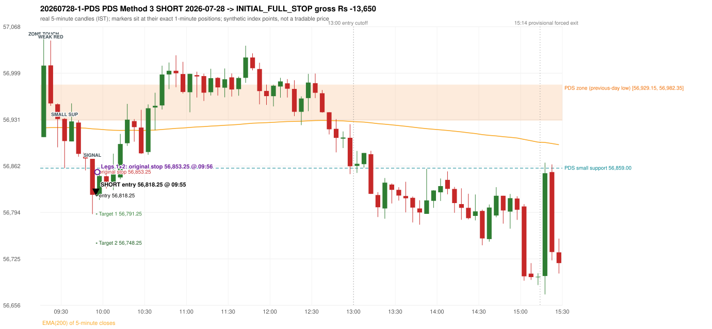
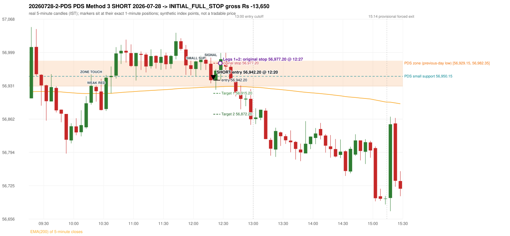

# Trading journal - 2026-07-28 (Tuesday)

> Phase 5 cross-index test, BANKNIFTY window M (Main window 2022-09-01..2026-08-31 (5paisa minutes); status DATA_VALIDATED). The FROZEN Phase 3.6 configuration (IRF, ORB, PDR body-based, PDS, RF; shared controller) with the NIFTY index-point stops and targets UNCHANGED on the BANKNIFTY index price. INDEX-POINT RESULTS ONLY: no option premium is used or estimated. HISTORICAL RESEARCH ONLY: the strategy was developed using later NIFTY data. same provider and download path as the NIFTY Phase 4 / Phase 3.6 runs; the status only says the DATA window passed the quality gate Synthetic BANKNIFTY index-point P&L (the index is not tradable). The owner's review status is intentionally blank.

## A. Trading day overview

| item | value |
|---|---|
| Date / weekday | 2026-07-28 / Tuesday |
| Session type | USABLE_WITH_FLAGS / VALID |
| Original session open (first 1-minute open) | 56,904.85 |
| Previous session | 2026-07-27 |
| Previous-day high / low (wicks included) | 57,329.30 / 56,929.15 |
| Previous-day highest BODY high (the body-based PDR ceiling; wicks ignored) | 57,265.55 |
| Previous-day official close / last 5-minute close | 57,087.20 / 57,115.95 |
| Raw engine records / confirmed signals / fully valid signals | 6 / 3 / 3 |
| Setups that did not complete (invalidated / incomplete) | 3 |
| Executed trades | 2 20260728-1-PDS;20260728-2-PDS |
| Gross P&L (Rs, synthetic) | -27,300.00 |
| Illustrative net P&L (Rs; Rs 500/trade + 0.5 pt/fill) | -29,080.00 |
| Day-end portfolio status | DAY_FINISHED |
| Manual journal trades (matched / unmatched) | 0 (0 / 0) |
| Extra automated trades | 0 |

## B. Daily strategy signal timeline (confirmed signals, chronological)

| time | strategy | method | dir | entry-rule status | valid for execution | <= 13:00 | portfolio state | accepted / ignored | specific reason | competing (same minute) |
|---|---|---|---|---|---|---|---|---|---|---|
| 09:55 | PDS | Method 3 | SHORT | PROPOSAL_DEPENDENT | True | True | FIRST_TRADE_ACTIVE | ACCEPTED -> 20260728-1-PDS | first eligible signal of the day; trade 1: INITIAL_FULL_STOP |  |
| 12:20 | PDS | Method 3 | SHORT | PROPOSAL_DEPENDENT | True | True | SECOND_TRADE_ACTIVE | ACCEPTED -> 20260728-2-PDS | permitted second trade: newly confirmed PDR/PDS after the original full stop; trade 2: INITIAL_FULL_STOP |  |
| 13:00 | PDS | Method 3 | SHORT | PROPOSAL_DEPENDENT | True | True | DAY_FINISHED | IGNORED | DAY_FINISHED [blocked by PDS#2] |  |

Engine setups that did not complete (3); the complete list with failed rule ids is in `rejected_signals.csv`:

| candle | strategy | method | dir | status | precise reason | failed rules |
|---|---|---|---|---|---|---|
| 09:15 | ORB | Method 2 | SHORT | INVALIDATED | TREND:EMA_PREV_SESSION_CLOSE wrong side | ORB-TREND-001;ORB-TREND-002 |
| 09:15 | ORB | Gap/200DMA | SHORT | INVALIDATED | CLOSE_NOT_BEYOND_MA | ORB-GAP-SHORT-003 |
| 09:35 | RF | RF | LONG | INVALIDATED | GAP_NOT_UP(DOWN) | RF-003 |

## C. Detailed trade journals

### 20260728-1-PDS: PDS Method 3 SHORT (FIRST trade)

Chart: 

**Rule configuration:** CFG-phase36_body_based-866f954e55 - signal verification status **PROPOSAL_DEPENDENT** (never VERIFIED while a rule rests on a proposal).

#### 1. Setup identification

PDS Method 3 SHORT: the session opened 24.30 points below the previous-day-low zone [56,929.15, 56,982.35]; the first red candle at the zone (09:20) was weak (body 58.16%), so the engine waited for a small support; the 09:30 candle's low 56,859.00 (70.15 points below the zone floor) was broken by the close of the 09:50 candle (56,819.65); confirmed 09:55.

#### 2. Candle and indicator calculations

| role | session | candle | O | H | L | C | range | body % | upper wick % | lower wick % | direction | EMA(200) | strong bull / bear | pin bull / bear | small (body<=30%) | used for |
|---|---|---|---|---|---|---|---|---|---|---|---|---|---|---|---|---|
| zone_source_candle | PREVIOUS | 13:35-13:40 | 56,950.65 | 56,990.75 | 56,929.15 | 56,982.35 | 61.60 | 51.46 | 13.64 | 34.90 | BULLISH | 56,875.62 | False / False | False / False | False | previous-day low candle that defines the zone (A_LOWEST_LOW) |
| zone_retest_candle | TODAY | 09:15-09:20 | 56,904.85 | 57,051.70 | 56,904.85 | 57,010.50 | 146.85 | 71.94 | 28.06 | 0.00 | BULLISH | 56,918.52 | False / False | False / False | False | first candle whose range reaches the zone from below |
| signal_candle | TODAY | 09:50-09:55 | 56,872.75 | 56,872.75 | 56,791.10 | 56,819.65 | 81.65 | 65.03 | 0.00 | 34.97 | BEARISH | 56,917.08 | False / False | False / False | False | trigger candle |
| weak_first_red_candle | TODAY | 09:20-09:25 | 57,010.80 | 57,047.50 | 56,950.95 | 56,954.65 | 96.55 | 58.16 | 38.01 | 3.83 | BEARISH | 56,918.88 | False / False | False / False | False | first red candle at the zone that failed the quality rule |
| small_support_pivot | TODAY | 09:30-09:35 | 56,931.70 | 56,932.95 | 56,859.00 | 56,898.95 | 73.95 | 44.29 | 1.69 | 54.02 | BEARISH | 56,918.81 | False / False | False / False | False | small support: latest 3-candle fractal low after the weak candle |

Every condition, with the rule, the calculation, the observed values and the result:

| # | group | rule | result | status / numeric definition | calculation | observed | required | available at | why it matters |
|---|---|---|---|---|---|---|---|---|---|
| 1 | SELECTION | SEL-FIRST-001 | PASS | USER_APPROVED / USER_APPROVED | earliest CONFIRMED signal of the day across IRF/ORB/PDR/PDS/RF that passed the controller's checks | 0 confirmed signal(s) earlier today; 3 confirmed signals in the day in total, this one at 09:55 | no earlier executable signal | 2026-07-28 09:55 | the shared controller trades only the first valid signal; the five strategies are not independent positions |
| 2 | SELECTION | SEL-TIE-001 | PASS | USER_APPROVED / USER_APPROVED | other CONFIRMED signals with exactly the same confirmation timestamp | none | no different-strategy / opposite-direction signal in the same minute (otherwise an unresolved conflict, no trade) | 2026-07-28 09:55 | an unresolved same-minute collision would have produced no trade at all |
| 3 | SELECTION | ENTRY-CUTOFF-001 | PASS | USER_APPROVED / USER_APPROVED | fill timestamp vs 13:00:00 IST | signal confirmed 09:55; fill 09:55 | fill at or before 13:00:00 IST | 2026-07-28 09:55 | no new position may be entered with a fill after 13:00 IST |
| 4 | SELECTION | EXE-FILL-001 | PASS | PROPOSED_FOR_REVIEW / PROPOSED_FOR_REVIEW | fill = open of the 1-minute bar that starts at the signal candle's end | bar 09:55 O 56,818.25 H 56,847.35 L 56,812.15 C 56,847.35; executable=True; entry 56,818.25 | fill bar exists, starts exactly at the signal end, is fillable; entry = its open | 2026-07-28 09:55 | a 5-minute signal is known only when its candle closes; the first price that can be traded is the next minute's open |
| 5 | SELECTION | DAY-MAX-001 | PASS | USER_APPROVED / USER_APPROVED | number of entries today | trade 1 of at most 2 | <= 2 entries per day | 2026-07-28 09:55 | daily trade cap |
| 6 | SETUP | PDS-003 | PASS | SOURCE_VERIFIED / EXPLICIT_WORDING_DETAIL_PROPOSED_FOR_REVIEW | gap = first 1-minute open of today - previous session's OFFICIAL close | today's open 56,904.85 (first 1-minute bar 09:15) - previous close 57,087.20 (DAILY_VENDOR, 2026-07-27) = -182.35 points -> gap DOWN | gap DOWN (more than 0 points) | 2026-07-28 09:15 | approved convention: the original first-minute open, never the vendor daily open |
| 7 | SETUP | PDS-006 | PASS | SOURCE_VERIFIED / QUALITATIVE_SOURCE_NUMERIC_DEFINITION_PROPOSED_FOR_REVIEW | gap-down open below the zone | today's open 56,904.85 vs zone low 56,929.15: 24.30 points below | open < zone low | 2026-07-28 09:15 | the guide: 'price is trading below the previous day's support zone' after the gap; a PROPOSED strict reading |
| 8 | SETUP | PDS-004 | PASS | SOURCE_VERIFIED / EXPLICIT_IN_SOURCE | PDS is not a breakdown strategy: the zone must be tested from below first | open 56,904.85 below the zone floor 56,929.15; the first candle to reach the zone is 09:15 | price rises to the zone before any short | 2026-07-28 09:15 | a short below the level without a retest is not this strategy |
| 9 | SETUP | PDS-005 | PASS | SOURCE_VERIFIED / QUALITATIVE_SOURCE_NUMERIC_DEFINITION_PROPOSED_FOR_REVIEW | price comes up to the zone: first candle whose [low, high] intersects it (+/- proximity) | 09:15-09:20 O 56,904.85 H 57,051.70 L 56,904.85 C 57,010.50; range 146.85, body 105.65 (71.94%), upper wick 41.20 (28.06%), lower wick 0.00 (0.00%), bullish; high 57,051.70 vs zone low 56,929.15 | range intersects the zone | 2026-07-28 09:20 | PDS is not a breakdown strategy: the zone must be tested from below first |
| 10 | ZONE | PDS-001 | PASS | SOURCE_VERIFIED / EXPLICIT_IN_SOURCE | direction | SHORT (PDS is short only) | short-only | 2026-07-28 09:55 | PDS sells a retest of previous-day support from below |
| 11 | ZONE | PDS-002 | PASS | SOURCE_VERIFIED / QUALITATIVE_SOURCE_NUMERIC_DEFINITION_PROPOSED_FOR_REVIEW | zone = [lowest low, body top] of the previous session's absolute-low candle (method A_LOWEST_LOW; the lower wick is part of the zone) | zone [56,929.15, 56,982.35] from the 13:35 candle of 2026-07-27 (13:35-13:40 O 56,950.65 H 56,990.75 L 56,929.15 C 56,982.35; range 61.60, body 31.70 (51.46%), upper wick 8.40 (13.64%), lower wick 21.50 (34.90%), bullish); engine recorded [56,929.15, 56,982.35] | previous trading day's low where price took support (body + lower wick) | 2026-07-27 13:40 | the reference level of the strategy; the exact candle(s) are a research choice (PDS-ZONE-002) |
| 12 | CONFIRMATION | PDS-M-001 | PASS | SOURCE_VERIFIED / QUALITATIVE_SOURCE_NUMERIC_DEFINITION_PROPOSED_FOR_REVIEW | Method 3 is used when the first red candle at the zone is not satisfying | first red candle at the zone: 09:20-09:25 O 57,010.80 H 57,047.50 L 56,950.95 C 56,954.65; range 96.55, body 56.15 (58.16%), upper wick 36.70 (38.01%), lower wick 3.70 (3.83%), bearish; strong-bearish test body >= 60%, lower wick <= 20% -> not met; pin bar -> not met | first red candle is neither strong nor a pin bar | 2026-07-28 09:25 | the quality rule keeps weak candles out; Method 3 waits for a support break instead |
| 13 | CONFIRMATION | PDS-M3-001 | PASS | SOURCE_VERIFIED / QUALITATIVE_SOURCE_NUMERIC_DEFINITION_PROPOSED_FOR_REVIEW | small support = latest 3-candle fractal low (k=1) formed at/after the weak candle with low <= zone high (56,982.35); definition SWING_K1_NEAR_ZONE | support 56,859.00 from the 09:30 candle; engine recorded 56,859.00; distance below the zone floor 70.15 points (zone floor 56,929.15); the guide says 'near the zone' but defines no distance - the code has no lower bound | a small support near the zone | 2026-07-28 09:40 | 'near' and the size of the small support are undefined in the guide |
| 14 | CONFIRMATION | PDS-M3-001 | PASS | SOURCE_VERIFIED / QUALITATIVE_SOURCE_NUMERIC_DEFINITION_PROPOSED_FOR_REVIEW | trigger: candle closes below the small support (break basis CLOSE) | 09:50 close 56,819.65 vs support 56,859.00: 39.35 points below | close < support | 2026-07-28 09:55 | the guide does not say close or touch; the close is used |
| 15 | EXECUTION | EXE-STOP-001 | PASS | USER_APPROVED / USER_APPROVED | initial stop = entry + 35 points | entry 56,818.25 -> stop 56,853.25 | stop 35 index points (BASELINE) | 2026-07-28 09:55 | defines the loss if the setup fails before Target 1 |
| 16 | EXECUTION | EXE-T1-001 | PASS | SOURCE_VERIFIED / EXPLICIT_IN_SOURCE | Target 1 = entry +/- 27 points | T1 56,791.25 | 27 points | 2026-07-28 09:55 | Leg 1 (3 lots) is booked at Target 1 |
| 17 | EXECUTION | PDS-TGT-001 | PASS | SOURCE_VERIFIED / EXPLICIT_IN_SOURCE | Target 2 = entry +/- 70 points | T2 56,748.25 (the guide says 70; the report suggests 60 - CONFLICTING) | 70 points | 2026-07-28 09:55 | Leg 2 (3 lots) is booked at Target 2 |
| 18 | EXECUTION | POST-T1-STOP-006 | PASS | USER_APPROVED / USER_APPROVED | after T1 the Leg-2 stop = entry + 6 (no trailing) | post-T1 stop 56,824.25 | entry -6 (LONG) / +6 (SHORT) | 2026-07-28 09:55 | protects the remaining three lots once the first three are booked |
| 19 | EXECUTION | SIZE-LOT-001 | PASS | USER_APPROVED / USER_APPROVED | 6 lots x 65 = 390, Leg 1 = 3 lots = 195, Leg 2 = 195 | 6 lots, lot size 65, legs 3+3 | 6 lots in two equal legs | 2026-07-28 09:55 | position size for the synthetic P&L |
| 20 | NOTE | PDS-007 | NOT_APPLICABLE | PROPOSED_FOR_REVIEW / PROPOSED_FOR_REVIEW | repeated PDS signals today | 3 confirmed PDS signal(s) in the session | n/a (disclosure) | 2026-07-28 09:55 | the per-session cap is lifted for the controller runs; the controller trades only the first (or the permitted second) trade |
| 21 | NOTE | PDS-MISSING-001 | UNRESOLVED | UNRESOLVED / UNRESOLVED | entry timing | signal on the candle close; fill at the next minute's open | the guide does not say whether entry is intra-candle or after the close | 2026-07-28 09:55 | causal convention: nothing is entered before the trigger candle has closed |
| 22 | NOTE | PDS-SL-001 | NOT_APPLICABLE | SOURCE_VERIFIED / QUALITATIVE_SOURCE_NUMERIC_DEFINITION_PROPOSED_FOR_REVIEW | the guide's 35-or-40 rule: 35 if the most recent green candle's high is within 35 points of entry, else 40 | most recent green candle high 56,954.65 is 136.40 points from the entry 56,818.25: the guide's rule would select 40 points; the baseline applies a fixed 35 (USER_APPROVED research baseline; the 35-vs-40 selection and the 40-point variant are separate labelled scenarios) | source selection rule | 2026-07-28 09:55 | the stop distance is a modelling choice and changes losses, not entries |
| 23 | NOTE | NOTE-UNRESOLVED-DEPENDENCIES | NOT_APPLICABLE | NOT_A_RULE / NOT_A_REGISTRY_RULE | rules the signal depends on that the sources leave unresolved | engine-recorded unresolved rule ids: none; verification status PROPOSAL_DEPENDENT | n/a (disclosure) | 2026-07-28 09:55 | the entry is only as verified as the rules it rests on |

#### 3. Entry decision and explanation

PDS Method 3 SHORT: the session opened 24.30 points below the previous-day-low zone [56,929.15, 56,982.35]; the first red candle at the zone (09:20) was weak (body 58.16%), so the engine waited for a small support; the 09:30 candle's low 56,859.00 (70.15 points below the zone floor) was broken by the close of the 09:50 candle (56,819.65); confirmed 09:55.

**Why this trade ahead of the other strategies:** This PDS Method 3 signal was the earliest executable signal of the day: 0 confirmed signal(s) earlier, 0 other in the same minute. 2 later confirmed signal(s) (PDS x2) are logged as ignored or rejected. State of the other four engines at that moment: [IRF: no setup record before this time (a base condition was not met, or nothing triggered)] [ORB: Method 2 invalidated at 09:15: TREND:EMA_PREV_SESSION_CLOSE wrong side; Gap/200DMA invalidated at 09:15: CLOSE_NOT_BEYOND_MA] [PDR: no setup record before this time (a base condition was not met, or nothing triggered)] [RF: RF invalidated at 09:35: GAP_NOT_UP(DOWN)]

#### 4. Actual entry execution

| item | value |
|---|---|
| Signal candle | 09:50-09:55 |
| Signal confirmed | 2026-07-28 09:55 |
| Fill timestamp | 2026-07-28 09:55 |
| Entry price | 56,818.25 |
| Source partition / 1-minute bar | data/processed/banknifty/FIVEPAISA_1M_BANKNIFTY/minutes/year=2026/month=07/candles.parquet / 2026-07-28 09:55 |
| Source bar O / H / L / C | 56,818.25 / 56,847.35 / 56,812.15 / 56,847.35 |
| Fill assumption | open of the 1-minute bar starting at the signal candle's end (EXE-FILL-001, PROPOSED causal convention) |
| Initial stop / T1 / T2 / post-T1 stop | 56,853.25 / 56,791.25 / 56,748.25 / 56,824.25 |
| Position | 6 lots x 65 = 390 units (Leg 1 195, Leg 2 195) |

#### 5-8. Trade progress, Target 1, post-T1 stop and final exit

Between the 09:55 entry bar and the final exit (2 one-minute bars) the best excursion in favour was 6.10 points at 09:55 and the worst against was 35.30 points at 09:56. At 09:56 price reached the original stop 56,853.25 before Target 1 56,791.25, so all six lots exited together at 56,853.25. This is an INITIAL_FULL_STOP: one more trade is allowed that day, only a newly confirmed PDR/PDS signal.

| leg | qty | exit time | exit price | reason | source 1-minute bar | O / H / L / C | gross points | gross Rs | slippage pts | flags |
|---|---|---|---|---|---|---|---|---|---|---|
| 1 | 195 | 09:56 | 56,853.25 | ORIGINAL_STOP_BEFORE_T1 | 09:56 | 56,850.80 / 56,853.55 / 56,840.30 / 56,843.75 | -35.00 | -6,825.00 | 0.00 |  |
| 2 | 195 | 09:56 | 56,853.25 | ORIGINAL_STOP_BEFORE_T1 | 09:56 | 56,850.80 / 56,853.55 / 56,840.30 / 56,843.75 | -35.00 | -6,825.00 | 0.00 |  |

Exit evidence per leg:

* Leg 1: 1-minute bar 09:56 O 56,850.80 H 56,853.55 L 56,840.30 C 56,843.75: high 56,853.55 reached the original stop 56,853.25 before Target 1 56,791.25 was touched; both legs exit at the stop level 56,853.25
* Leg 2: 1-minute bar 09:56 O 56,850.80 H 56,853.55 L 56,840.30 C 56,843.75: high 56,853.55 reached the original stop 56,853.25 before Target 1 56,791.25 was touched; both legs exit at the stop level 56,853.25

#### 9. Gross and illustrative net P&L

| item | value (Rs) |
|---|---|
| Leg 1 gross | -6,825.00 |
| Leg 2 gross | -6,825.00 |
| Trade gross (= Leg 1 + Leg 2) | -13,650.00 |
| Illustrative fixed cost | -500.00 |
| Illustrative slippage (0.5 pt on every fill, entry + exits, all units) | -390.00 |
| Illustrative net | -14,540.00 |

#### 10. Manual journal comparison

No manual journal exists for this period; no comparison.

### 20260728-2-PDS: PDS Method 3 SHORT (SECOND trade)

Chart: 

**Rule configuration:** CFG-phase36_body_based-866f954e55 - signal verification status **PROPOSAL_DEPENDENT** (never VERIFIED while a rule rests on a proposal).

#### 1. Setup identification

PDS Method 3 SHORT: the session opened 24.30 points below the previous-day-low zone [56,929.15, 56,982.35]; the first red candle at the zone (10:20) was weak (body 26.54%), so the engine waited for a small support; the 12:00 candle's low 56,950.15 (-21.00 points below the zone floor) was broken by the close of the 12:15 candle (56,942.20); confirmed 12:20.

#### 2. Candle and indicator calculations

| role | session | candle | O | H | L | C | range | body % | upper wick % | lower wick % | direction | EMA(200) | strong bull / bear | pin bull / bear | small (body<=30%) | used for |
|---|---|---|---|---|---|---|---|---|---|---|---|---|---|---|---|---|
| zone_source_candle | PREVIOUS | 13:35-13:40 | 56,950.65 | 56,990.75 | 56,929.15 | 56,982.35 | 61.60 | 51.46 | 13.64 | 34.90 | BULLISH | 56,875.62 | False / False | False / False | False | previous-day low candle that defines the zone (A_LOWEST_LOW) |
| zone_retest_candle | TODAY | 10:15-10:20 | 56,895.80 | 56,953.90 | 56,891.90 | 56,930.60 | 62.00 | 56.13 | 37.58 | 6.29 | BULLISH | 56,914.88 | False / False | False / False | False | first candle whose range reaches the zone from below |
| signal_candle | TODAY | 12:15-12:20 | 56,976.00 | 56,988.85 | 56,935.80 | 56,942.20 | 53.05 | 63.71 | 24.22 | 12.06 | BEARISH | 56,927.97 | False / True | False / False | False | trigger candle |
| weak_first_red_candle | TODAY | 10:20-10:25 | 56,928.50 | 56,931.45 | 56,898.10 | 56,919.65 | 33.35 | 26.54 | 8.85 | 64.62 | BEARISH | 56,914.93 | False / False | False / False | True | first red candle at the zone that failed the quality rule |
| small_support_pivot | TODAY | 12:00-12:05 | 56,965.30 | 56,982.30 | 56,950.15 | 56,980.80 | 32.15 | 48.21 | 4.67 | 47.12 | BULLISH | 56,926.74 | False / False | False / False | False | small support: latest 3-candle fractal low after the weak candle |

Every condition, with the rule, the calculation, the observed values and the result:

| # | group | rule | result | status / numeric definition | calculation | observed | required | available at | why it matters |
|---|---|---|---|---|---|---|---|---|---|
| 1 | SELECTION | DAY-SL-001 | PASS | USER_APPROVED / USER_APPROVED | first trade outcome, strategy of this signal, position-close time vs this signal's timestamp | first trade PDS Method 3 closed as INITIAL_FULL_STOP at 09:56; position free from 09:57; this PDS signal confirmed 12:20 | first trade INITIAL_FULL_STOP before Target 1, and a NEWLY confirmed PDR/PDS signal after the first position closed | 2026-07-28 12:20 | the only way a second trade is allowed |
| 2 | SELECTION | DAY-NOREUSE-001 | PASS | USER_APPROVED / USER_APPROVED | signals confirmed while the first position was open | 1 signal(s) were ignored during the first trade (never reused): PDS Method 3 SHORT @09:55 | this trade comes from a signal confirmed after the first exit, not from an ignored one | 2026-07-28 12:20 | an ignored signal can never become the second trade |
| 3 | SELECTION | ENTRY-CUTOFF-001 | PASS | USER_APPROVED / USER_APPROVED | fill timestamp vs 13:00:00 IST | signal confirmed 12:20; fill 12:20 | fill at or before 13:00:00 IST | 2026-07-28 12:20 | no new position may be entered with a fill after 13:00 IST |
| 4 | SELECTION | EXE-FILL-001 | PASS | PROPOSED_FOR_REVIEW / PROPOSED_FOR_REVIEW | fill = open of the 1-minute bar that starts at the signal candle's end | bar 12:20 O 56,942.20 H 56,951.65 L 56,939.15 C 56,943.20; executable=True; entry 56,942.20 | fill bar exists, starts exactly at the signal end, is fillable; entry = its open | 2026-07-28 12:20 | a 5-minute signal is known only when its candle closes; the first price that can be traded is the next minute's open |
| 5 | SELECTION | DAY-MAX-001 | PASS | USER_APPROVED / USER_APPROVED | number of entries today | trade 2 of at most 2 | <= 2 entries per day | 2026-07-28 12:20 | daily trade cap |
| 6 | SETUP | PDS-003 | PASS | SOURCE_VERIFIED / EXPLICIT_WORDING_DETAIL_PROPOSED_FOR_REVIEW | gap = first 1-minute open of today - previous session's OFFICIAL close | today's open 56,904.85 (first 1-minute bar 09:15) - previous close 57,087.20 (DAILY_VENDOR, 2026-07-27) = -182.35 points -> gap DOWN | gap DOWN (more than 0 points) | 2026-07-28 09:15 | approved convention: the original first-minute open, never the vendor daily open |
| 7 | SETUP | PDS-006 | PASS | SOURCE_VERIFIED / QUALITATIVE_SOURCE_NUMERIC_DEFINITION_PROPOSED_FOR_REVIEW | gap-down open below the zone | today's open 56,904.85 vs zone low 56,929.15: 24.30 points below | open < zone low | 2026-07-28 09:15 | the guide: 'price is trading below the previous day's support zone' after the gap; a PROPOSED strict reading |
| 8 | SETUP | PDS-004 | PASS | SOURCE_VERIFIED / EXPLICIT_IN_SOURCE | PDS is not a breakdown strategy: the zone must be tested from below first | open 56,904.85 below the zone floor 56,929.15; the first candle to reach the zone is 10:15 | price rises to the zone before any short | 2026-07-28 09:15 | a short below the level without a retest is not this strategy |
| 9 | SETUP | PDS-005 | PASS | SOURCE_VERIFIED / QUALITATIVE_SOURCE_NUMERIC_DEFINITION_PROPOSED_FOR_REVIEW | price comes up to the zone: first candle whose [low, high] intersects it (+/- proximity) | 10:15-10:20 O 56,895.80 H 56,953.90 L 56,891.90 C 56,930.60; range 62.00, body 34.80 (56.13%), upper wick 23.30 (37.58%), lower wick 3.90 (6.29%), bullish; high 56,953.90 vs zone low 56,929.15 | range intersects the zone | 2026-07-28 10:20 | PDS is not a breakdown strategy: the zone must be tested from below first |
| 10 | ZONE | PDS-001 | PASS | SOURCE_VERIFIED / EXPLICIT_IN_SOURCE | direction | SHORT (PDS is short only) | short-only | 2026-07-28 12:20 | PDS sells a retest of previous-day support from below |
| 11 | ZONE | PDS-002 | PASS | SOURCE_VERIFIED / QUALITATIVE_SOURCE_NUMERIC_DEFINITION_PROPOSED_FOR_REVIEW | zone = [lowest low, body top] of the previous session's absolute-low candle (method A_LOWEST_LOW; the lower wick is part of the zone) | zone [56,929.15, 56,982.35] from the 13:35 candle of 2026-07-27 (13:35-13:40 O 56,950.65 H 56,990.75 L 56,929.15 C 56,982.35; range 61.60, body 31.70 (51.46%), upper wick 8.40 (13.64%), lower wick 21.50 (34.90%), bullish); engine recorded [56,929.15, 56,982.35] | previous trading day's low where price took support (body + lower wick) | 2026-07-27 13:40 | the reference level of the strategy; the exact candle(s) are a research choice (PDS-ZONE-002) |
| 12 | CONFIRMATION | PDS-M-001 | PASS | SOURCE_VERIFIED / QUALITATIVE_SOURCE_NUMERIC_DEFINITION_PROPOSED_FOR_REVIEW | Method 3 is used when the first red candle at the zone is not satisfying | first red candle at the zone: 10:20-10:25 O 56,928.50 H 56,931.45 L 56,898.10 C 56,919.65; range 33.35, body 8.85 (26.54%), upper wick 2.95 (8.85%), lower wick 21.55 (64.62%), bearish; strong-bearish test body >= 60%, lower wick <= 20% -> not met; pin bar -> not met | first red candle is neither strong nor a pin bar | 2026-07-28 10:25 | the quality rule keeps weak candles out; Method 3 waits for a support break instead |
| 13 | CONFIRMATION | PDS-M3-001 | PASS | SOURCE_VERIFIED / QUALITATIVE_SOURCE_NUMERIC_DEFINITION_PROPOSED_FOR_REVIEW | small support = latest 3-candle fractal low (k=1) formed at/after the weak candle with low <= zone high (56,982.35); definition SWING_K1_NEAR_ZONE | support 56,950.15 from the 12:00 candle; engine recorded 56,950.15; distance below the zone floor -21.00 points (negative: the support lies ABOVE the floor) (zone floor 56,929.15); the guide says 'near the zone' but defines no distance - the code has no lower bound | a small support near the zone | 2026-07-28 12:10 | 'near' and the size of the small support are undefined in the guide |
| 14 | CONFIRMATION | PDS-M3-001 | PASS | SOURCE_VERIFIED / QUALITATIVE_SOURCE_NUMERIC_DEFINITION_PROPOSED_FOR_REVIEW | trigger: candle closes below the small support (break basis CLOSE) | 12:15 close 56,942.20 vs support 56,950.15: 7.95 points below | close < support | 2026-07-28 12:20 | the guide does not say close or touch; the close is used |
| 15 | EXECUTION | EXE-STOP-001 | PASS | USER_APPROVED / USER_APPROVED | initial stop = entry + 35 points | entry 56,942.20 -> stop 56,977.20 | stop 35 index points (BASELINE) | 2026-07-28 12:20 | defines the loss if the setup fails before Target 1 |
| 16 | EXECUTION | EXE-T1-001 | PASS | SOURCE_VERIFIED / EXPLICIT_IN_SOURCE | Target 1 = entry +/- 27 points | T1 56,915.20 | 27 points | 2026-07-28 12:20 | Leg 1 (3 lots) is booked at Target 1 |
| 17 | EXECUTION | PDS-TGT-001 | PASS | SOURCE_VERIFIED / EXPLICIT_IN_SOURCE | Target 2 = entry +/- 70 points | T2 56,872.20 (the guide says 70; the report suggests 60 - CONFLICTING) | 70 points | 2026-07-28 12:20 | Leg 2 (3 lots) is booked at Target 2 |
| 18 | EXECUTION | POST-T1-STOP-006 | PASS | USER_APPROVED / USER_APPROVED | after T1 the Leg-2 stop = entry + 6 (no trailing) | post-T1 stop 56,948.20 | entry -6 (LONG) / +6 (SHORT) | 2026-07-28 12:20 | protects the remaining three lots once the first three are booked |
| 19 | EXECUTION | SIZE-LOT-001 | PASS | USER_APPROVED / USER_APPROVED | 6 lots x 65 = 390, Leg 1 = 3 lots = 195, Leg 2 = 195 | 6 lots, lot size 65, legs 3+3 | 6 lots in two equal legs | 2026-07-28 12:20 | position size for the synthetic P&L |
| 20 | NOTE | PDS-007 | NOT_APPLICABLE | PROPOSED_FOR_REVIEW / PROPOSED_FOR_REVIEW | repeated PDS signals today | 3 confirmed PDS signal(s) in the session | n/a (disclosure) | 2026-07-28 12:20 | the per-session cap is lifted for the controller runs; the controller trades only the first (or the permitted second) trade |
| 21 | NOTE | PDS-MISSING-001 | UNRESOLVED | UNRESOLVED / UNRESOLVED | entry timing | signal on the candle close; fill at the next minute's open | the guide does not say whether entry is intra-candle or after the close | 2026-07-28 12:20 | causal convention: nothing is entered before the trigger candle has closed |
| 22 | NOTE | PDS-SL-001 | NOT_APPLICABLE | SOURCE_VERIFIED / QUALITATIVE_SOURCE_NUMERIC_DEFINITION_PROPOSED_FOR_REVIEW | the guide's 35-or-40 rule: 35 if the most recent green candle's high is within 35 points of entry, else 40 | most recent green candle high 56,992.40 is 50.20 points from the entry 56,942.20: the guide's rule would select 40 points; the baseline applies a fixed 35 (USER_APPROVED research baseline; the 35-vs-40 selection and the 40-point variant are separate labelled scenarios) | source selection rule | 2026-07-28 12:20 | the stop distance is a modelling choice and changes losses, not entries |
| 23 | NOTE | NOTE-UNRESOLVED-DEPENDENCIES | NOT_APPLICABLE | NOT_A_RULE / NOT_A_REGISTRY_RULE | rules the signal depends on that the sources leave unresolved | engine-recorded unresolved rule ids: none; verification status PROPOSAL_DEPENDENT | n/a (disclosure) | 2026-07-28 12:20 | the entry is only as verified as the rules it rests on |

#### 3. Entry decision and explanation

PDS Method 3 SHORT: the session opened 24.30 points below the previous-day-low zone [56,929.15, 56,982.35]; the first red candle at the zone (10:20) was weak (body 26.54%), so the engine waited for a small support; the 12:00 candle's low 56,950.15 (-21.00 points below the zone floor) was broken by the close of the 12:15 candle (56,942.20); confirmed 12:20.

**Why this trade ahead of the other strategies:** The first trade (PDS Method 3) was stopped out before Target 1 at 09:56; this newly confirmed PDS signal at 12:20 is the first PDR/PDS signal after that exit, so it is the day's permitted second trade. State of the other engines at that moment: [IRF: no setup record before this time (a base condition was not met, or nothing triggered)] [ORB: Method 2 invalidated at 09:15: TREND:EMA_PREV_SESSION_CLOSE wrong side; Gap/200DMA invalidated at 09:15: CLOSE_NOT_BEYOND_MA] [PDR: no setup record before this time (a base condition was not met, or nothing triggered)] [RF: RF invalidated at 09:35: GAP_NOT_UP(DOWN)]

#### 4. Actual entry execution

| item | value |
|---|---|
| Signal candle | 12:15-12:20 |
| Signal confirmed | 2026-07-28 12:20 |
| Fill timestamp | 2026-07-28 12:20 |
| Entry price | 56,942.20 |
| Source partition / 1-minute bar | data/processed/banknifty/FIVEPAISA_1M_BANKNIFTY/minutes/year=2026/month=07/candles.parquet / 2026-07-28 12:20 |
| Source bar O / H / L / C | 56,942.20 / 56,951.65 / 56,939.15 / 56,943.20 |
| Fill assumption | open of the 1-minute bar starting at the signal candle's end (EXE-FILL-001, PROPOSED causal convention) |
| Initial stop / T1 / T2 / post-T1 stop | 56,977.20 / 56,915.20 / 56,872.20 / 56,948.20 |
| Position | 6 lots x 65 = 390 units (Leg 1 195, Leg 2 195) |

#### 5-8. Trade progress, Target 1, post-T1 stop and final exit

Between the 12:20 entry bar and the final exit (8 one-minute bars) the best excursion in favour was 19.65 points at 12:21 and the worst against was 36.80 points at 12:27. At 12:27 price reached the original stop 56,977.20 before Target 1 56,915.20, so all six lots exited together at 56,977.20. This is an INITIAL_FULL_STOP: one more trade is allowed that day, only a newly confirmed PDR/PDS signal.

| leg | qty | exit time | exit price | reason | source 1-minute bar | O / H / L / C | gross points | gross Rs | slippage pts | flags |
|---|---|---|---|---|---|---|---|---|---|---|
| 1 | 195 | 12:27 | 56,977.20 | ORIGINAL_STOP_BEFORE_T1 | 12:27 | 56,951.75 / 56,979.00 / 56,948.75 / 56,975.35 | -35.00 | -6,825.00 | 0.00 |  |
| 2 | 195 | 12:27 | 56,977.20 | ORIGINAL_STOP_BEFORE_T1 | 12:27 | 56,951.75 / 56,979.00 / 56,948.75 / 56,975.35 | -35.00 | -6,825.00 | 0.00 |  |

Exit evidence per leg:

* Leg 1: 1-minute bar 12:27 O 56,951.75 H 56,979.00 L 56,948.75 C 56,975.35: high 56,979.00 reached the original stop 56,977.20 before Target 1 56,915.20 was touched; both legs exit at the stop level 56,977.20
* Leg 2: 1-minute bar 12:27 O 56,951.75 H 56,979.00 L 56,948.75 C 56,975.35: high 56,979.00 reached the original stop 56,977.20 before Target 1 56,915.20 was touched; both legs exit at the stop level 56,977.20

#### 9. Gross and illustrative net P&L

| item | value (Rs) |
|---|---|
| Leg 1 gross | -6,825.00 |
| Leg 2 gross | -6,825.00 |
| Trade gross (= Leg 1 + Leg 2) | -13,650.00 |
| Illustrative fixed cost | -500.00 |
| Illustrative slippage (0.5 pt on every fill, entry + exits, all units) | -390.00 |
| Illustrative net | -14,540.00 |

#### 10. Manual journal comparison

No manual journal exists for this period; no comparison.

## D. Manual journal comparison

No manual journal exists for this period (the manual journal covers 2025-09-01 .. 2026-08-31 only); no comparison is made and no automated trade is labelled 'extra'.

## E. Daily conclusion

* **Traded:** 20260728-1-PDS - PDS Method 3 SHORT at 09:55 (entry 56,818.25), outcome INITIAL_FULL_STOP, gross Rs -13,650.00, illustrative net Rs -14,540.00. **Why:** This PDS Method 3 signal was the earliest executable signal of the day: 0 confirmed signal(s) earlier, 0 other in the same minute. 2 later confirmed signal(s) (PDS x2) are logged as ignored or rejected. State of the other four engines at that moment: [IRF: no setup record before this time (a base condition was not met, or nothing triggered)] [ORB: Method 2 invalidated at 09:15: TREND:EMA_PREV_SESSION_CLOSE wrong side; Gap/200DMA invalidated at 09:15: CLOSE_NOT_BEYOND_MA] [PDR: no setup record before this time (a base condition was not met, or nothing triggered)] [RF: RF invalidated at 09:35: GAP_NOT_UP(DOWN)] **How it ended:** At 09:56 price reached the original stop 56,853.25 before Target 1 56,791.25, so all six lots exited together at 56,853.25. This is an INITIAL_FULL_STOP: one more trade is allowed that day, only a newly confirmed PDR/PDS signal.
* **Traded:** 20260728-2-PDS - PDS Method 3 SHORT at 12:20 (entry 56,942.20), outcome INITIAL_FULL_STOP, gross Rs -13,650.00, illustrative net Rs -14,540.00. **Why:** The first trade (PDS Method 3) was stopped out before Target 1 at 09:56; this newly confirmed PDS signal at 12:20 is the first PDR/PDS signal after that exit, so it is the day's permitted second trade. State of the other engines at that moment: [IRF: no setup record before this time (a base condition was not met, or nothing triggered)] [ORB: Method 2 invalidated at 09:15: TREND:EMA_PREV_SESSION_CLOSE wrong side; Gap/200DMA invalidated at 09:15: CLOSE_NOT_BEYOND_MA] [PDR: no setup record before this time (a base condition was not met, or nothing triggered)] [RF: RF invalidated at 09:35: GAP_NOT_UP(DOWN)] **How it ended:** At 12:27 price reached the original stop 56,977.20 before Target 1 56,915.20, so all six lots exited together at 56,977.20. This is an INITIAL_FULL_STOP: one more trade is allowed that day, only a newly confirmed PDR/PDS signal.
* **Ignored / rejected signals:** PDS IGNORED DAY_FINISHED x1
* **Open strategy-definition issues that affected this day:** PDS-MISSING-001 (Entry timing (during the candle or after it closes) is not specified)
* **Automated triage (not an approval; the owner's review status stays blank):** TRADED_NO_FLAGS

## Option-execution feasibility (information only; no option trade is simulated)

The index result above is an INDEX-POINT result on BANKNIFTY. It is not an option result: a move of N index points is not a move of N premium points (delta, gamma, theta, vega, spread and liquidity decide the premium).

| trade | strategy | index direction | long option it maps to | historical contract identified? | premium data available? | premium fill supportable? |
|---|---|---|---|---|---|---|
| 20260728-1-PDS | PDS | SHORT | BUY PUT (PE) | no | no | no |
| 20260728-2-PDS | PDS | SHORT | BUY PUT (PE) | no | no | no |

Why: (1) the broker's instrument master lists only contracts that are live today, so the scrip code of a contract that existed on this date is not available; (2) historical candles can only be requested by scrip code; (3) the strike and expiry selection policy is an owner decision that has not been made (`options_feasibility/option_contract_selection_decisions.md`). No option entry, exit, premium or option P&L is shown, and none may be inferred from the index points.
