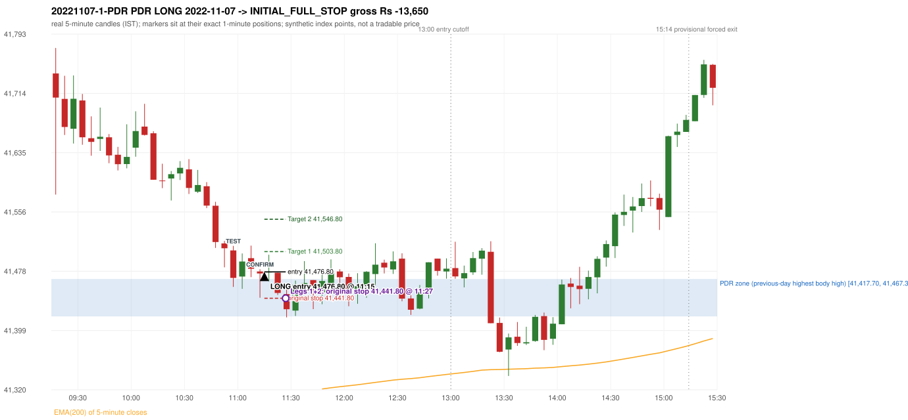
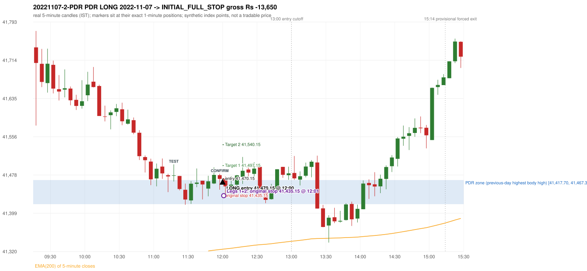

# Trading journal - 2022-11-07 (Monday)

> Phase 5 cross-index test, BANKNIFTY window MS (Vendor sensitivity 2022-09-01..2024-03-22 (secondary-source minutes); status VENDOR_SENSITIVITY). The FROZEN Phase 3.6 configuration (IRF, ORB, PDR body-based, PDS, RF; shared controller) with the NIFTY index-point stops and targets UNCHANGED on the BANKNIFTY index price. INDEX-POINT RESULTS ONLY: no option premium is used or estimated. HISTORICAL RESEARCH ONLY: the strategy was developed using later NIFTY data. the same dates with the secondary repository's minute bars (daily series still 5paisa); quantifies sensitivity to the data source, not a second independent result Synthetic BANKNIFTY index-point P&L (the index is not tradable). The owner's review status is intentionally blank.

## A. Trading day overview

| item | value |
|---|---|
| Date / weekday | 2022-11-07 / Monday |
| Session type | USABLE_WITH_FLAGS / VALID |
| Original session open (first 1-minute open) | 41,740.65 |
| Previous session | 2022-11-04 |
| Previous-day high / low (wicks included) | 41,514.85 / 41,052.75 |
| Previous-day highest BODY high (the body-based PDR ceiling; wicks ignored) | 41,467.35 |
| Previous-day official close / last 5-minute close | 41,258.45 / 41,297.15 |
| Raw engine records / confirmed signals / fully valid signals | 7 / 4 / 4 |
| Setups that did not complete (invalidated / incomplete) | 3 |
| Executed trades | 2 20221107-1-PDR;20221107-2-PDR |
| Gross P&L (Rs, synthetic) | -27,300.00 |
| Illustrative net P&L (Rs; Rs 500/trade + 0.5 pt/fill) | -29,080.00 |
| Day-end portfolio status | DAY_FINISHED |
| Manual journal trades (matched / unmatched) | 0 (0 / 0) |
| Extra automated trades | 0 |

## B. Daily strategy signal timeline (confirmed signals, chronological)

| time | strategy | method | dir | entry-rule status | valid for execution | <= 13:00 | portfolio state | accepted / ignored | specific reason | competing (same minute) |
|---|---|---|---|---|---|---|---|---|---|---|
| 11:15 | PDR | PDR | LONG | RESEARCH_VARIANT | True | True | FIRST_TRADE_ACTIVE | ACCEPTED -> 20221107-1-PDR | first eligible signal of the day; trade 1: INITIAL_FULL_STOP |  |
| 12:00 | PDR | PDR | LONG | RESEARCH_VARIANT | True | True | SECOND_TRADE_ACTIVE | ACCEPTED -> 20221107-2-PDR | permitted second trade: newly confirmed PDR/PDS after the original full stop; trade 2: INITIAL_FULL_STOP |  |
| 12:50 | PDR | PDR | LONG | RESEARCH_VARIANT | True | True | DAY_FINISHED | IGNORED | DAY_FINISHED [blocked by PDR#2] |  |
| 14:35 | PDR | PDR | LONG | RESEARCH_VARIANT | True | False | DAY_FINISHED | IGNORED | DAY_FINISHED [blocked by PDR#2] |  |

Engine setups that did not complete (3); the complete list with failed rule ids is in `rejected_signals.csv`:

| candle | strategy | method | dir | status | precise reason | failed rules |
|---|---|---|---|---|---|---|
| 09:15 | ORB | Method 1 | LONG | INVALIDATED | CANDLE_QUALITY(not a strong body / wick too large) | ORB-M1-LONG-003 |
| 09:15 | ORB | Method 2 | LONG | INVALIDATED | CANDLE_QUALITY | ORB-M2-LONG-003 |
| 15:00 | RF | RF | LONG | INVALIDATED | GAP_UP_OUTSIDE_YESTERDAYS_RANGE | RF-004 |

## C. Detailed trade journals

### 20221107-1-PDR: PDR LONG (FIRST trade)

Chart: 

**Rule configuration:** CFG-phase36_body_based-866f954e55 - signal verification status **RESEARCH_VARIANT** (never VERIFIED while a rule rests on a proposal).

#### 1. Setup identification

PDR LONG (body-based engine, A_HIGHEST_BODY_HIGH): the session opened 482.20 points above the previous close and 273.30 points above the previous-day highest BODY high 41,467.35 (zone [41,417.70, 41,467.35] from the 09:30 candle of 2022-11-04; the highest wick 41,514.85 is ignored). The 10:55 candle (41,456.90 - 41,511.35) tested the zone; the 11:10 candle (not green, O 41,477.35 H 41,480.30 L 41,442.50 C 41,474.70) passed LOWER_PRICE_REJECTION, HAMMER and closed 7.35 points above the zone ceiling, confirming the entry at 11:15. The pattern thresholds and the zone's lower boundary are provisional research assumptions, not approved by the strategy author.

#### 2. Candle and indicator calculations

| role | session | candle | O | H | L | C | range | body % | upper wick % | lower wick % | direction | EMA(200) | strong bull / bear | pin bull / bear | small (body<=30%) | used for |
|---|---|---|---|---|---|---|---|---|---|---|---|---|---|---|---|---|
| zone_source_candle | PREVIOUS | 09:30-09:35 | 41,467.35 | 41,514.85 | 41,399.60 | 41,417.70 | 115.25 | 43.08 | 41.21 | 15.71 | BEARISH | 41,293.53 | False / False | False / False | False | candle of the previous session's highest BODY high (A_HIGHEST_BODY_HIGH) |
| prev_day_wick_high_candle | PREVIOUS | 09:30-09:35 | 41,467.35 | 41,514.85 | 41,399.60 | 41,417.70 | 115.25 | 43.08 | 41.21 | 15.71 | BEARISH | 41,293.53 | False / False | False / False | False | candle of the previous session's highest WICK (ignored by the author's rule; shown for comparison) |
| interaction_candle | TODAY | 10:55-11:00 | 41,505.35 | 41,511.35 | 41,456.90 | 41,468.75 | 54.45 | 67.22 | 11.02 | 21.76 | BEARISH | 41,306.14 | False / False | False / False | False | first candle whose range overlaps the zone (the test) |
| confirmation_candle | TODAY | 11:10-11:15 | 41,477.35 | 41,480.30 | 41,442.50 | 41,474.70 | 37.80 | 7.01 | 7.80 | 85.19 | BEARISH | 41,311.34 | False / False | True / False | True | candle that satisfies one of the three patterns and closes above the zone ceiling |

Every condition, with the rule, the calculation, the observed values and the result:

| # | group | rule | result | status / numeric definition | calculation | observed | required | available at | why it matters |
|---|---|---|---|---|---|---|---|---|---|
| 1 | SELECTION | SEL-FIRST-001 | PASS | USER_APPROVED / USER_APPROVED | earliest CONFIRMED signal of the day across IRF/ORB/PDR/PDS/RF that passed the controller's checks | 0 confirmed signal(s) earlier today; 4 confirmed signals in the day in total, this one at 11:15 | no earlier executable signal | 2022-11-07 11:15 | the shared controller trades only the first valid signal; the five strategies are not independent positions |
| 2 | SELECTION | SEL-TIE-001 | PASS | USER_APPROVED / USER_APPROVED | other CONFIRMED signals with exactly the same confirmation timestamp | none | no different-strategy / opposite-direction signal in the same minute (otherwise an unresolved conflict, no trade) | 2022-11-07 11:15 | an unresolved same-minute collision would have produced no trade at all |
| 3 | SELECTION | ENTRY-CUTOFF-001 | PASS | USER_APPROVED / USER_APPROVED | fill timestamp vs 13:00:00 IST | signal confirmed 11:15; fill 11:15 | fill at or before 13:00:00 IST | 2022-11-07 11:15 | no new position may be entered with a fill after 13:00 IST |
| 4 | SELECTION | EXE-FILL-001 | PASS | PROPOSED_FOR_REVIEW / PROPOSED_FOR_REVIEW | fill = open of the 1-minute bar that starts at the signal candle's end | bar 11:15 O 41,476.80 H 41,476.80 L 41,464.40 C 41,471.20; executable=True; entry 41,476.80 | fill bar exists, starts exactly at the signal end, is fillable; entry = its open | 2022-11-07 11:15 | a 5-minute signal is known only when its candle closes; the first price that can be traded is the next minute's open |
| 5 | SELECTION | DAY-MAX-001 | PASS | USER_APPROVED / USER_APPROVED | number of entries today | trade 1 of at most 2 | <= 2 entries per day | 2022-11-07 11:15 | daily trade cap |
| 6 | SETUP | PDR-004 | PASS | SOURCE_VERIFIED / EXPLICIT_WORDING_DETAIL_PROPOSED_FOR_REVIEW | gap = first 1-minute open of today - previous session's OFFICIAL close | today's open 41,740.65 (first 1-minute bar 09:15) - previous close 41,258.45 (DAILY_VENDOR, 2022-11-04) = +482.20 points -> gap UP | gap UP (more than 0 points) | 2022-11-07 09:15 | approved convention: the original first-minute open, never the vendor daily open |
| 7 | SETUP | PDR-B03 | PASS | AUTHOR_APPROVED / AUTHOR_STATEMENT_NUMERIC_DETAILS_ARE_SEPARATE_PROPOSED_ROWS | the session opens strictly above the previous day's resistance zone (author-approved) | today's first 1-minute open 41,740.65 vs zone ceiling 41,467.35: 273.30 points above (open - ceiling = +273.30) | open > zone ceiling (equal or inside the zone rejects the setup) | 2022-11-07 09:15 | the original first-minute open is used, never a vendor daily open |
| 8 | ZONE | PDR-001 | PASS | SOURCE_VERIFIED / EXPLICIT_IN_SOURCE | direction | LONG (PDR is long only) | long-only | 2022-11-07 11:15 | PDR buys a retest of previous-day resistance after a gap up |
| 9 | ZONE | PDR-B01a | PASS | AUTHOR_APPROVED / AUTHOR_STATEMENT_NUMERIC_DETAILS_ARE_SEPARATE_PROPOSED_ROWS | wicks ignored, bodies considered: body_high = max(open, close) of every completed previous-session 5-minute candle; ceiling = the highest body_high; floor = body low of that candle | previous session 2022-11-04: highest body high 41,467.35 on the 09:30 candle (O 41,467.35 C 41,417.70; wick high of that candle 41,514.85, ignored); four highest body highs: 41,467.35 (09:30); 41,467.15 (09:25); 41,417.45 (09:35); 41,371.10 (09:20). Highest WICK of the session 41,514.85 (09:30 candle) is 47.50 points above the ceiling and plays no part. Zone [41,417.70 (body low), 41,467.35 (body high)]; engine recorded [41,417.70, 41,467.35] | ceiling = highest body high of the previous session (author: wick ignored, body considered) | 2022-11-04 15:30 | a wick-only price never becomes resistance; the zone is drawn from candle bodies |
| 10 | ZONE | PDR-B02 | UNRESOLVED | AUTHOR_APPROVED / AUTHOR_STATEMENT_NUMERIC_DETAILS_ARE_SEPARATE_PROPOSED_ROWS | multiple highs connected into one zone (author principle; candidate B) | candidate A (used): [41,417.70, 41,467.35]. Candidate B (multiple-body-high cluster, tolerance 5 points) would be [41,417.70, 41,467.35] (ISOLATED_BODY_HIGH, 1 touch(es), member body highs 41,467.35); ceiling difference 0.00 points | a zone that connects all relevant highs (numbers not given by the author) | 2022-11-04 15:30 | candidate B has the same ceiling by construction, so this signal is unaffected by the choice; the lower boundary and the cluster numbers are research parameters |
| 11 | ZONE | PDR-003 | PASS | SOURCE_VERIFIED / EXPLICIT_IN_SOURCE | the zone is an area, not a single price | zone height 49.65 points [41,417.70, 41,467.35] | a rectangle with positive height (a zero-height zone is left unresolved by the engine) | 2022-11-04 15:30 | price may touch any part of the area |
| 12 | CONFIRMATION | PDR-B03b | PASS | PRESERVED_FROM_PHASE2 / PRESERVED_FROM_PHASE2 | the first candle whose [low, high] overlaps the zone (+/- proximity) is the test; the confirmation must come strictly after it | 10:55-11:00 O 41,505.35 H 41,511.35 L 41,456.90 C 41,468.75; range 54.45, body 36.60 (67.22%), upper wick 6.00 (11.02%), lower wick 11.85 (21.76%), bearish; low 41,456.90 vs zone ceiling 41,467.35, high 41,511.35 vs zone floor 41,417.70; proximity 0; confirmation candle 11:10 is candle no. 24, the test candle no. 21 | range overlaps the zone; confirmation after the test | 2022-11-07 11:00 | the retest of the previous-day resistance |
| 13 | CONFIRMATION | PDR-B04c | NOT_APPLICABLE | PROPOSED_FOR_REVIEW / NUMERIC_DEFINITION_PROPOSED_FOR_REVIEW | Pattern 1: good green body on the 11:10-11:15 candle (O 41,477.35 H 41,480.30 L 41,442.50 C 41,474.70); the numeric thresholds are PROVISIONAL (RESEARCH_DEFAULT), not author-approved | colour NOT green; body 7.01%; upper wick 7.80% -> does not pass | green, body >= 60% and upper wick <= 20% of the range | 2022-11-07 11:15 | one of the three patterns is enough (author: one good green body OR lower price rejection OR hammer); fixed thresholds are not required by the author, so the numbers are a research convention; a pattern that does not pass is not an error |
| 14 | CONFIRMATION | PDR-B04c | PASS | PROPOSED_FOR_REVIEW / NUMERIC_DEFINITION_PROPOSED_FOR_REVIEW | Pattern 2: lower-price rejection candle on the 11:10-11:15 candle (O 41,477.35 H 41,480.30 L 41,442.50 C 41,474.70); the numeric thresholds are PROVISIONAL (RESEARCH_DEFAULT), not author-approved | lower wick 32.20 = 12.15 x body 2.65; close 14.81% below the high; low 41,442.50; low reached the zone ceiling 41,467.35 -> PASSES | lower wick >= 2 x body, close within the top 30% of the range, low <= zone ceiling (colour not required) | 2022-11-07 11:15 | one of the three patterns is enough (author: one good green body OR lower price rejection OR hammer); fixed thresholds are not required by the author, so the numbers are a research convention; a pattern that does not pass is not an error |
| 15 | CONFIRMATION | PDR-B04c | PASS | PROPOSED_FOR_REVIEW / NUMERIC_DEFINITION_PROPOSED_FOR_REVIEW | Pattern 3: hammer candle on the 11:10-11:15 candle (O 41,477.35 H 41,480.30 L 41,442.50 C 41,474.70); the numeric thresholds are PROVISIONAL (RESEARCH_DEFAULT), not author-approved | lower wick 32.20 = 12.15 x body; upper wick 7.80%; body bottom at 85.19% of the range -> PASSES | lower wick >= 2 x body, upper wick <= 10%, body bottom >= 60% of the range (colour not required) | 2022-11-07 11:15 | one of the three patterns is enough (author: one good green body OR lower price rejection OR hammer); fixed thresholds are not required by the author, so the numbers are a research convention; a pattern that does not pass is not an error |
| 16 | CONFIRMATION | PDR-B04 | PASS | AUTHOR_APPROVED / AUTHOR_STATEMENT_NUMERIC_DETAILS_ARE_SEPARATE_PROPOSED_ROWS | at least one of the three patterns passes (OR logic; every passing pattern is recorded) | patterns passed: LOWER_PRICE_REJECTION, HAMMER (engine recorded: LOWER_PRICE_REJECTION, HAMMER) | at least one pattern | 2022-11-07 11:15 | the author's entry candle requirement |
| 17 | CONFIRMATION | PDR-B05 | PASS | AUTHOR_APPROVED / AUTHOR_STATEMENT_NUMERIC_DETAILS_ARE_SEPARATE_PROPOSED_ROWS | the confirmation candle must close above the zone | close 41,474.70 vs zone ceiling 41,467.35: +7.35 points (floor 41,417.70; low 41,442.50 dipped into/below the zone) | close > zone ceiling, strictly (lower wick may penetrate the zone) | 2022-11-07 11:15 | no pattern overrides the close rule |
| 18 | CONFIRMATION | PDR-B06 | PASS | USER_APPROVED / USER_APPROVED | no entry at the open and no look-ahead: the order is placed only after the confirmation candle has completed | test candle 10:55 (no. 21) precedes the confirmation candle 11:10-11:15; signal stamped 11:15; fill 11:15 at the open of that 1-minute bar = 41,476.80 | interaction before the confirmation; fill after the confirmation candle's end | 2022-11-07 11:15 | existing causal fill convention (EXE-FILL-001) |
| 19 | EXECUTION | EXE-STOP-001 | PASS | USER_APPROVED / USER_APPROVED | initial stop = entry - 35 points | entry 41,476.80 -> stop 41,441.80 | stop 35 index points (BASELINE) | 2022-11-07 11:15 | defines the loss if the setup fails before Target 1 |
| 20 | EXECUTION | EXE-T1-001 | PASS | SOURCE_VERIFIED / EXPLICIT_IN_SOURCE | Target 1 = entry +/- 27 points | T1 41,503.80 | 27 points | 2022-11-07 11:15 | Leg 1 (3 lots) is booked at Target 1 |
| 21 | EXECUTION | PDR-008 | PASS | SOURCE_VERIFIED / EXPLICIT_IN_SOURCE | Target 2 = entry +/- 70 points | T2 41,546.80 (the guide says 70; the performance report's winners suggest 60 - CONFLICTING, recorded) | 70 points | 2022-11-07 11:15 | Leg 2 (3 lots) is booked at Target 2 |
| 22 | EXECUTION | POST-T1-STOP-006 | PASS | USER_APPROVED / USER_APPROVED | after T1 the Leg-2 stop = entry - 6 (no trailing) | post-T1 stop 41,470.80 | entry -6 (LONG) / +6 (SHORT) | 2022-11-07 11:15 | protects the remaining three lots once the first three are booked |
| 23 | EXECUTION | SIZE-LOT-001 | PASS | USER_APPROVED / USER_APPROVED | 6 lots x 65 = 390, Leg 1 = 3 lots = 195, Leg 2 = 195 | 6 lots, lot size 65, legs 3+3 | 6 lots in two equal legs | 2022-11-07 11:15 | position size for the synthetic P&L |
| 24 | NOTE | PDR-B04x | UNRESOLVED | PROPOSED_FOR_REVIEW / NUMERIC_DEFINITION_PROPOSED_FOR_REVIEW | provisional parameters this signal rests on | pattern thresholds RESEARCH_DEFAULT: {'green_body_min': 0.6, 'green_upper_wick_max': 0.2, 'reject_wick_to_body_min': 2.0, 'reject_close_fraction_max': 0.3, 'hammer_wick_to_body_min': 2.0, 'hammer_upper_wick_max': 0.1, 'hammer_body_position_min': 0.6}; zone lower boundary = hull of the member bodies; zero-height policy UNRESOLVED_NO_SETUP; wait policy WAIT_FOR_QUALIFYING_CANDLE; cluster parameters (candidate B only) tolerance 5, touches 2, separation 2 | n/a (disclosure) | 2022-11-07 11:15 | the strategy author has NOT approved these numbers or conventions; the signal is a RESEARCH_VARIANT, never VERIFIED |
| 25 | NOTE | PDR-012 | NOT_APPLICABLE | PROPOSED_FOR_REVIEW / PROPOSED_FOR_REVIEW | repeated PDR signals today | 4 confirmed PDR signal(s) in the session | n/a (disclosure) | 2022-11-07 11:15 | this engine reports EVERY qualifying signal (the per-session cap is lifted); the controller trades only the first (and a PDR/PDS second trade after an initial full stop) |
| 26 | NOTE | PDR-B07 | NOT_APPLICABLE | PROPOSED_FOR_REVIEW / NUMERIC_DEFINITION_PROPOSED_FOR_REVIEW | state of the zone between the test and the confirmation (the author and the guide are silent on price crossing below the zone) | test candle 10:55 (no. 21), confirmation candle 11:10 (no. 24): 3 candle(s) later; no candle in between closed below the zone floor | n/a (disclosure; the wait policy is a research parameter) | 2022-11-07 11:15 | the engine keeps a tested setup armed until a candle qualifies; whether a zone that price has closed through should still count is an owner decision |
| 27 | NOTE | PDR-009 | UNRESOLVED | UNRESOLVED / UNRESOLVED | stop 35 or 40 'depending on the situation' | the guide gives no selection rule; baseline fixed 35 points | unresolved in the source | 2022-11-07 11:15 | PDR stop selection is left to the owner |
| 28 | NOTE | NOTE-UNRESOLVED-DEPENDENCIES | UNRESOLVED | NOT_A_RULE / NOT_A_REGISTRY_RULE | rules the signal depends on that the sources leave unresolved | engine-recorded unresolved rule ids: PDR-B01b, PDR-B02a, PDR-B02b, PDR-B02c, PDR-B02d, PDR-B02e, PDR-B02f, PDR-B02g, PDR-B02h, PDR-B04b, PDR-B04c, PDR-B05a, PDR-B07; verification status RESEARCH_VARIANT | n/a (disclosure) | 2022-11-07 11:15 | the entry is only as verified as the rules it rests on |

#### 3. Entry decision and explanation

PDR LONG (body-based engine, A_HIGHEST_BODY_HIGH): the session opened 482.20 points above the previous close and 273.30 points above the previous-day highest BODY high 41,467.35 (zone [41,417.70, 41,467.35] from the 09:30 candle of 2022-11-04; the highest wick 41,514.85 is ignored). The 10:55 candle (41,456.90 - 41,511.35) tested the zone; the 11:10 candle (not green, O 41,477.35 H 41,480.30 L 41,442.50 C 41,474.70) passed LOWER_PRICE_REJECTION, HAMMER and closed 7.35 points above the zone ceiling, confirming the entry at 11:15. The pattern thresholds and the zone's lower boundary are provisional research assumptions, not approved by the strategy author.

**Why this trade ahead of the other strategies:** This PDR signal was the earliest executable signal of the day: 0 confirmed signal(s) earlier, 0 other in the same minute. 3 later confirmed signal(s) (PDR x3) are logged as ignored or rejected. State of the other four engines at that moment: [IRF: no setup record before this time (a base condition was not met, or nothing triggered)] [ORB: Method 1 invalidated at 09:15: CANDLE_QUALITY(not a strong body / wick too large); Method 2 invalidated at 09:15: CANDLE_QUALITY] [PDS: no setup record before this time (a base condition was not met, or nothing triggered)] [RF: no setup record before this time (a base condition was not met, or nothing triggered)]

#### 4. Actual entry execution

| item | value |
|---|---|
| Signal candle | 11:10-11:15 |
| Signal confirmed | 2022-11-07 11:15 |
| Fill timestamp | 2022-11-07 11:15 |
| Entry price | 41,476.80 |
| Source partition / 1-minute bar | data/processed/banknifty/KAPRI_1M_BANKNIFTY/minutes/year=2022/month=11/candles.parquet / 2022-11-07 11:15 |
| Source bar O / H / L / C | 41,476.80 / 41,476.80 / 41,464.40 / 41,471.20 |
| Fill assumption | open of the 1-minute bar starting at the signal candle's end (EXE-FILL-001, PROPOSED causal convention) |
| Initial stop / T1 / T2 / post-T1 stop | 41,441.80 / 41,503.80 / 41,546.80 / 41,470.80 |
| Position | 6 lots x 65 = 390 units (Leg 1 195, Leg 2 195) |

#### 5-8. Trade progress, Target 1, post-T1 stop and final exit

Between the 11:15 entry bar and the final exit (13 one-minute bars) the best excursion in favour was 22.85 points at 11:16 and the worst against was 40.60 points at 11:27. At 11:27 price reached the original stop 41,441.80 before Target 1 41,503.80, so all six lots exited together at 41,441.80. This is an INITIAL_FULL_STOP: one more trade is allowed that day, only a newly confirmed PDR/PDS signal.

| leg | qty | exit time | exit price | reason | source 1-minute bar | O / H / L / C | gross points | gross Rs | slippage pts | flags |
|---|---|---|---|---|---|---|---|---|---|---|
| 1 | 195 | 11:27 | 41,441.80 | ORIGINAL_STOP_BEFORE_T1 | 11:27 | 41,454.15 / 41,454.15 / 41,436.20 / 41,443.80 | -35.00 | -6,825.00 | 0.00 |  |
| 2 | 195 | 11:27 | 41,441.80 | ORIGINAL_STOP_BEFORE_T1 | 11:27 | 41,454.15 / 41,454.15 / 41,436.20 / 41,443.80 | -35.00 | -6,825.00 | 0.00 |  |

Exit evidence per leg:

* Leg 1: 1-minute bar 11:27 O 41,454.15 H 41,454.15 L 41,436.20 C 41,443.80: low 41,436.20 reached the original stop 41,441.80 before Target 1 41,503.80 was touched; both legs exit at the stop level 41,441.80
* Leg 2: 1-minute bar 11:27 O 41,454.15 H 41,454.15 L 41,436.20 C 41,443.80: low 41,436.20 reached the original stop 41,441.80 before Target 1 41,503.80 was touched; both legs exit at the stop level 41,441.80

#### 9. Gross and illustrative net P&L

| item | value (Rs) |
|---|---|
| Leg 1 gross | -6,825.00 |
| Leg 2 gross | -6,825.00 |
| Trade gross (= Leg 1 + Leg 2) | -13,650.00 |
| Illustrative fixed cost | -500.00 |
| Illustrative slippage (0.5 pt on every fill, entry + exits, all units) | -390.00 |
| Illustrative net | -14,540.00 |

#### 10. Manual journal comparison

No manual journal exists for this period; no comparison.

### 20221107-2-PDR: PDR LONG (SECOND trade)

Chart: 

**Rule configuration:** CFG-phase36_body_based-866f954e55 - signal verification status **RESEARCH_VARIANT** (never VERIFIED while a rule rests on a proposal).

#### 1. Setup identification

PDR LONG (body-based engine, A_HIGHEST_BODY_HIGH): the session opened 482.20 points above the previous close and 273.30 points above the previous-day highest BODY high 41,467.35 (zone [41,417.70, 41,467.35] from the 09:30 candle of 2022-11-04; the highest wick 41,514.85 is ignored). The 11:15 candle (41,464.40 - 41,499.65) tested the zone; the 11:55 candle (not green, O 41,477.35 H 41,480.30 L 41,447.45 C 41,469.65) passed HAMMER and closed 2.30 points above the zone ceiling, confirming the entry at 12:00. The pattern thresholds and the zone's lower boundary are provisional research assumptions, not approved by the strategy author.

#### 2. Candle and indicator calculations

| role | session | candle | O | H | L | C | range | body % | upper wick % | lower wick % | direction | EMA(200) | strong bull / bear | pin bull / bear | small (body<=30%) | used for |
|---|---|---|---|---|---|---|---|---|---|---|---|---|---|---|---|---|
| zone_source_candle | PREVIOUS | 09:30-09:35 | 41,467.35 | 41,514.85 | 41,399.60 | 41,417.70 | 115.25 | 43.08 | 41.21 | 15.71 | BEARISH | 41,293.53 | False / False | False / False | False | candle of the previous session's highest BODY high (A_HIGHEST_BODY_HIGH) |
| prev_day_wick_high_candle | PREVIOUS | 09:30-09:35 | 41,467.35 | 41,514.85 | 41,399.60 | 41,417.70 | 115.25 | 43.08 | 41.21 | 15.71 | BEARISH | 41,293.53 | False / False | False / False | False | candle of the previous session's highest WICK (ignored by the author's rule; shown for comparison) |
| interaction_candle | TODAY | 11:15-11:20 | 41,476.80 | 41,499.65 | 41,464.40 | 41,476.90 | 35.25 | 0.28 | 64.54 | 35.18 | BULLISH | 41,312.99 | False / False | False / False | True | first candle whose range overlaps the zone (the test) |
| confirmation_candle | TODAY | 11:55-12:00 | 41,477.35 | 41,480.30 | 41,447.45 | 41,469.65 | 32.85 | 23.44 | 8.98 | 67.58 | BEARISH | 41,324.20 | False / False | False / False | True | candle that satisfies one of the three patterns and closes above the zone ceiling |

Every condition, with the rule, the calculation, the observed values and the result:

| # | group | rule | result | status / numeric definition | calculation | observed | required | available at | why it matters |
|---|---|---|---|---|---|---|---|---|---|
| 1 | SELECTION | DAY-SL-001 | PASS | USER_APPROVED / USER_APPROVED | first trade outcome, strategy of this signal, position-close time vs this signal's timestamp | first trade PDR PDR closed as INITIAL_FULL_STOP at 11:27; position free from 11:28; this PDR signal confirmed 12:00 | first trade INITIAL_FULL_STOP before Target 1, and a NEWLY confirmed PDR/PDS signal after the first position closed | 2022-11-07 12:00 | the only way a second trade is allowed |
| 2 | SELECTION | DAY-NOREUSE-001 | PASS | USER_APPROVED / USER_APPROVED | signals confirmed while the first position was open | 1 signal(s) were ignored during the first trade (never reused): PDR PDR LONG @11:15 | this trade comes from a signal confirmed after the first exit, not from an ignored one | 2022-11-07 12:00 | an ignored signal can never become the second trade |
| 3 | SELECTION | ENTRY-CUTOFF-001 | PASS | USER_APPROVED / USER_APPROVED | fill timestamp vs 13:00:00 IST | signal confirmed 12:00; fill 12:00 | fill at or before 13:00:00 IST | 2022-11-07 12:00 | no new position may be entered with a fill after 13:00 IST |
| 4 | SELECTION | EXE-FILL-001 | PASS | PROPOSED_FOR_REVIEW / PROPOSED_FOR_REVIEW | fill = open of the 1-minute bar that starts at the signal candle's end | bar 12:00 O 41,470.15 H 41,474.65 L 41,437.15 C 41,437.20; executable=True; entry 41,470.15 | fill bar exists, starts exactly at the signal end, is fillable; entry = its open | 2022-11-07 12:00 | a 5-minute signal is known only when its candle closes; the first price that can be traded is the next minute's open |
| 5 | SELECTION | DAY-MAX-001 | PASS | USER_APPROVED / USER_APPROVED | number of entries today | trade 2 of at most 2 | <= 2 entries per day | 2022-11-07 12:00 | daily trade cap |
| 6 | SETUP | PDR-004 | PASS | SOURCE_VERIFIED / EXPLICIT_WORDING_DETAIL_PROPOSED_FOR_REVIEW | gap = first 1-minute open of today - previous session's OFFICIAL close | today's open 41,740.65 (first 1-minute bar 09:15) - previous close 41,258.45 (DAILY_VENDOR, 2022-11-04) = +482.20 points -> gap UP | gap UP (more than 0 points) | 2022-11-07 09:15 | approved convention: the original first-minute open, never the vendor daily open |
| 7 | SETUP | PDR-B03 | PASS | AUTHOR_APPROVED / AUTHOR_STATEMENT_NUMERIC_DETAILS_ARE_SEPARATE_PROPOSED_ROWS | the session opens strictly above the previous day's resistance zone (author-approved) | today's first 1-minute open 41,740.65 vs zone ceiling 41,467.35: 273.30 points above (open - ceiling = +273.30) | open > zone ceiling (equal or inside the zone rejects the setup) | 2022-11-07 09:15 | the original first-minute open is used, never a vendor daily open |
| 8 | ZONE | PDR-001 | PASS | SOURCE_VERIFIED / EXPLICIT_IN_SOURCE | direction | LONG (PDR is long only) | long-only | 2022-11-07 12:00 | PDR buys a retest of previous-day resistance after a gap up |
| 9 | ZONE | PDR-B01a | PASS | AUTHOR_APPROVED / AUTHOR_STATEMENT_NUMERIC_DETAILS_ARE_SEPARATE_PROPOSED_ROWS | wicks ignored, bodies considered: body_high = max(open, close) of every completed previous-session 5-minute candle; ceiling = the highest body_high; floor = body low of that candle | previous session 2022-11-04: highest body high 41,467.35 on the 09:30 candle (O 41,467.35 C 41,417.70; wick high of that candle 41,514.85, ignored); four highest body highs: 41,467.35 (09:30); 41,467.15 (09:25); 41,417.45 (09:35); 41,371.10 (09:20). Highest WICK of the session 41,514.85 (09:30 candle) is 47.50 points above the ceiling and plays no part. Zone [41,417.70 (body low), 41,467.35 (body high)]; engine recorded [41,417.70, 41,467.35] | ceiling = highest body high of the previous session (author: wick ignored, body considered) | 2022-11-04 15:30 | a wick-only price never becomes resistance; the zone is drawn from candle bodies |
| 10 | ZONE | PDR-B02 | UNRESOLVED | AUTHOR_APPROVED / AUTHOR_STATEMENT_NUMERIC_DETAILS_ARE_SEPARATE_PROPOSED_ROWS | multiple highs connected into one zone (author principle; candidate B) | candidate A (used): [41,417.70, 41,467.35]. Candidate B (multiple-body-high cluster, tolerance 5 points) would be [41,417.70, 41,467.35] (ISOLATED_BODY_HIGH, 1 touch(es), member body highs 41,467.35); ceiling difference 0.00 points | a zone that connects all relevant highs (numbers not given by the author) | 2022-11-04 15:30 | candidate B has the same ceiling by construction, so this signal is unaffected by the choice; the lower boundary and the cluster numbers are research parameters |
| 11 | ZONE | PDR-003 | PASS | SOURCE_VERIFIED / EXPLICIT_IN_SOURCE | the zone is an area, not a single price | zone height 49.65 points [41,417.70, 41,467.35] | a rectangle with positive height (a zero-height zone is left unresolved by the engine) | 2022-11-04 15:30 | price may touch any part of the area |
| 12 | CONFIRMATION | PDR-B03b | PASS | PRESERVED_FROM_PHASE2 / PRESERVED_FROM_PHASE2 | the first candle whose [low, high] overlaps the zone (+/- proximity) is the test; the confirmation must come strictly after it | 11:15-11:20 O 41,476.80 H 41,499.65 L 41,464.40 C 41,476.90; range 35.25, body 0.10 (0.28%), upper wick 22.75 (64.54%), lower wick 12.40 (35.18%), bullish; low 41,464.40 vs zone ceiling 41,467.35, high 41,499.65 vs zone floor 41,417.70; proximity 0; confirmation candle 11:55 is candle no. 33, the test candle no. 25 | range overlaps the zone; confirmation after the test | 2022-11-07 11:20 | the retest of the previous-day resistance (re-armed after the earlier signal: scanning restarted after the 11:10 candle) |
| 13 | CONFIRMATION | PDR-B04c | NOT_APPLICABLE | PROPOSED_FOR_REVIEW / NUMERIC_DEFINITION_PROPOSED_FOR_REVIEW | Pattern 1: good green body on the 11:55-12:00 candle (O 41,477.35 H 41,480.30 L 41,447.45 C 41,469.65); the numeric thresholds are PROVISIONAL (RESEARCH_DEFAULT), not author-approved | colour NOT green; body 23.44%; upper wick 8.98% -> does not pass | green, body >= 60% and upper wick <= 20% of the range | 2022-11-07 12:00 | one of the three patterns is enough (author: one good green body OR lower price rejection OR hammer); fixed thresholds are not required by the author, so the numbers are a research convention; a pattern that does not pass is not an error |
| 14 | CONFIRMATION | PDR-B04c | NOT_APPLICABLE | PROPOSED_FOR_REVIEW / NUMERIC_DEFINITION_PROPOSED_FOR_REVIEW | Pattern 2: lower-price rejection candle on the 11:55-12:00 candle (O 41,477.35 H 41,480.30 L 41,447.45 C 41,469.65); the numeric thresholds are PROVISIONAL (RESEARCH_DEFAULT), not author-approved | lower wick 22.20 = 2.88 x body 7.70; close 32.42% below the high; low 41,447.45; low reached the zone ceiling 41,467.35 -> does not pass | lower wick >= 2 x body, close within the top 30% of the range, low <= zone ceiling (colour not required) | 2022-11-07 12:00 | one of the three patterns is enough (author: one good green body OR lower price rejection OR hammer); fixed thresholds are not required by the author, so the numbers are a research convention; a pattern that does not pass is not an error |
| 15 | CONFIRMATION | PDR-B04c | PASS | PROPOSED_FOR_REVIEW / NUMERIC_DEFINITION_PROPOSED_FOR_REVIEW | Pattern 3: hammer candle on the 11:55-12:00 candle (O 41,477.35 H 41,480.30 L 41,447.45 C 41,469.65); the numeric thresholds are PROVISIONAL (RESEARCH_DEFAULT), not author-approved | lower wick 22.20 = 2.88 x body; upper wick 8.98%; body bottom at 67.58% of the range -> PASSES | lower wick >= 2 x body, upper wick <= 10%, body bottom >= 60% of the range (colour not required) | 2022-11-07 12:00 | one of the three patterns is enough (author: one good green body OR lower price rejection OR hammer); fixed thresholds are not required by the author, so the numbers are a research convention; a pattern that does not pass is not an error |
| 16 | CONFIRMATION | PDR-B04 | PASS | AUTHOR_APPROVED / AUTHOR_STATEMENT_NUMERIC_DETAILS_ARE_SEPARATE_PROPOSED_ROWS | at least one of the three patterns passes (OR logic; every passing pattern is recorded) | patterns passed: HAMMER (engine recorded: HAMMER) | at least one pattern | 2022-11-07 12:00 | the author's entry candle requirement |
| 17 | CONFIRMATION | PDR-B05 | PASS | AUTHOR_APPROVED / AUTHOR_STATEMENT_NUMERIC_DETAILS_ARE_SEPARATE_PROPOSED_ROWS | the confirmation candle must close above the zone | close 41,469.65 vs zone ceiling 41,467.35: +2.30 points (floor 41,417.70; low 41,447.45 dipped into/below the zone) | close > zone ceiling, strictly (lower wick may penetrate the zone) | 2022-11-07 12:00 | no pattern overrides the close rule |
| 18 | CONFIRMATION | PDR-B06 | PASS | USER_APPROVED / USER_APPROVED | no entry at the open and no look-ahead: the order is placed only after the confirmation candle has completed | test candle 11:15 (no. 25) precedes the confirmation candle 11:55-12:00; signal stamped 12:00; fill 12:00 at the open of that 1-minute bar = 41,470.15 | interaction before the confirmation; fill after the confirmation candle's end | 2022-11-07 12:00 | existing causal fill convention (EXE-FILL-001) |
| 19 | EXECUTION | EXE-STOP-001 | PASS | USER_APPROVED / USER_APPROVED | initial stop = entry - 35 points | entry 41,470.15 -> stop 41,435.15 | stop 35 index points (BASELINE) | 2022-11-07 12:00 | defines the loss if the setup fails before Target 1 |
| 20 | EXECUTION | EXE-T1-001 | PASS | SOURCE_VERIFIED / EXPLICIT_IN_SOURCE | Target 1 = entry +/- 27 points | T1 41,497.15 | 27 points | 2022-11-07 12:00 | Leg 1 (3 lots) is booked at Target 1 |
| 21 | EXECUTION | PDR-008 | PASS | SOURCE_VERIFIED / EXPLICIT_IN_SOURCE | Target 2 = entry +/- 70 points | T2 41,540.15 (the guide says 70; the performance report's winners suggest 60 - CONFLICTING, recorded) | 70 points | 2022-11-07 12:00 | Leg 2 (3 lots) is booked at Target 2 |
| 22 | EXECUTION | POST-T1-STOP-006 | PASS | USER_APPROVED / USER_APPROVED | after T1 the Leg-2 stop = entry - 6 (no trailing) | post-T1 stop 41,464.15 | entry -6 (LONG) / +6 (SHORT) | 2022-11-07 12:00 | protects the remaining three lots once the first three are booked |
| 23 | EXECUTION | SIZE-LOT-001 | PASS | USER_APPROVED / USER_APPROVED | 6 lots x 65 = 390, Leg 1 = 3 lots = 195, Leg 2 = 195 | 6 lots, lot size 65, legs 3+3 | 6 lots in two equal legs | 2022-11-07 12:00 | position size for the synthetic P&L |
| 24 | NOTE | PDR-B04x | UNRESOLVED | PROPOSED_FOR_REVIEW / NUMERIC_DEFINITION_PROPOSED_FOR_REVIEW | provisional parameters this signal rests on | pattern thresholds RESEARCH_DEFAULT: {'green_body_min': 0.6, 'green_upper_wick_max': 0.2, 'reject_wick_to_body_min': 2.0, 'reject_close_fraction_max': 0.3, 'hammer_wick_to_body_min': 2.0, 'hammer_upper_wick_max': 0.1, 'hammer_body_position_min': 0.6}; zone lower boundary = hull of the member bodies; zero-height policy UNRESOLVED_NO_SETUP; wait policy WAIT_FOR_QUALIFYING_CANDLE; cluster parameters (candidate B only) tolerance 5, touches 2, separation 2 | n/a (disclosure) | 2022-11-07 12:00 | the strategy author has NOT approved these numbers or conventions; the signal is a RESEARCH_VARIANT, never VERIFIED |
| 25 | NOTE | PDR-012 | NOT_APPLICABLE | PROPOSED_FOR_REVIEW / PROPOSED_FOR_REVIEW | repeated PDR signals today | 4 confirmed PDR signal(s) in the session | n/a (disclosure) | 2022-11-07 12:00 | this engine reports EVERY qualifying signal (the per-session cap is lifted); the controller trades only the first (and a PDR/PDS second trade after an initial full stop) |
| 26 | NOTE | PDR-B07 | NOT_APPLICABLE | PROPOSED_FOR_REVIEW / NUMERIC_DEFINITION_PROPOSED_FOR_REVIEW | state of the zone between the test and the confirmation (the author and the guide are silent on price crossing below the zone) | test candle 11:15 (no. 25), confirmation candle 11:55 (no. 33): 8 candle(s) later; no candle in between closed below the zone floor | n/a (disclosure; the wait policy is a research parameter) | 2022-11-07 12:00 | the engine keeps a tested setup armed until a candle qualifies; whether a zone that price has closed through should still count is an owner decision |
| 27 | NOTE | PDR-009 | UNRESOLVED | UNRESOLVED / UNRESOLVED | stop 35 or 40 'depending on the situation' | the guide gives no selection rule; baseline fixed 35 points | unresolved in the source | 2022-11-07 12:00 | PDR stop selection is left to the owner |
| 28 | NOTE | NOTE-UNRESOLVED-DEPENDENCIES | UNRESOLVED | NOT_A_RULE / NOT_A_REGISTRY_RULE | rules the signal depends on that the sources leave unresolved | engine-recorded unresolved rule ids: PDR-B01b, PDR-B02a, PDR-B02b, PDR-B02c, PDR-B02d, PDR-B02e, PDR-B02f, PDR-B02g, PDR-B02h, PDR-B04b, PDR-B04c, PDR-B05a, PDR-B07; verification status RESEARCH_VARIANT | n/a (disclosure) | 2022-11-07 12:00 | the entry is only as verified as the rules it rests on |

#### 3. Entry decision and explanation

PDR LONG (body-based engine, A_HIGHEST_BODY_HIGH): the session opened 482.20 points above the previous close and 273.30 points above the previous-day highest BODY high 41,467.35 (zone [41,417.70, 41,467.35] from the 09:30 candle of 2022-11-04; the highest wick 41,514.85 is ignored). The 11:15 candle (41,464.40 - 41,499.65) tested the zone; the 11:55 candle (not green, O 41,477.35 H 41,480.30 L 41,447.45 C 41,469.65) passed HAMMER and closed 2.30 points above the zone ceiling, confirming the entry at 12:00. The pattern thresholds and the zone's lower boundary are provisional research assumptions, not approved by the strategy author.

**Why this trade ahead of the other strategies:** The first trade (PDR PDR) was stopped out before Target 1 at 11:27; this newly confirmed PDR signal at 12:00 is the first PDR/PDS signal after that exit, so it is the day's permitted second trade. State of the other engines at that moment: [IRF: no setup record before this time (a base condition was not met, or nothing triggered)] [ORB: Method 1 invalidated at 09:15: CANDLE_QUALITY(not a strong body / wick too large); Method 2 invalidated at 09:15: CANDLE_QUALITY] [PDS: no setup record before this time (a base condition was not met, or nothing triggered)] [RF: no setup record before this time (a base condition was not met, or nothing triggered)]

#### 4. Actual entry execution

| item | value |
|---|---|
| Signal candle | 11:55-12:00 |
| Signal confirmed | 2022-11-07 12:00 |
| Fill timestamp | 2022-11-07 12:00 |
| Entry price | 41,470.15 |
| Source partition / 1-minute bar | data/processed/banknifty/KAPRI_1M_BANKNIFTY/minutes/year=2022/month=11/candles.parquet / 2022-11-07 12:00 |
| Source bar O / H / L / C | 41,470.15 / 41,474.65 / 41,437.15 / 41,437.20 |
| Fill assumption | open of the 1-minute bar starting at the signal candle's end (EXE-FILL-001, PROPOSED causal convention) |
| Initial stop / T1 / T2 / post-T1 stop | 41,435.15 / 41,497.15 / 41,540.15 / 41,464.15 |
| Position | 6 lots x 65 = 390 units (Leg 1 195, Leg 2 195) |

#### 5-8. Trade progress, Target 1, post-T1 stop and final exit

Between the 12:00 entry bar and the final exit (2 one-minute bars) the best excursion in favour was 4.50 points at 12:00 and the worst against was 38.90 points at 12:01. At 12:01 price reached the original stop 41,435.15 before Target 1 41,497.15, so all six lots exited together at 41,435.15. This is an INITIAL_FULL_STOP: one more trade is allowed that day, only a newly confirmed PDR/PDS signal.

| leg | qty | exit time | exit price | reason | source 1-minute bar | O / H / L / C | gross points | gross Rs | slippage pts | flags |
|---|---|---|---|---|---|---|---|---|---|---|
| 1 | 195 | 12:01 | 41,435.15 | ORIGINAL_STOP_BEFORE_T1 | 12:01 | 41,435.20 / 41,441.30 / 41,431.25 / 41,435.80 | -35.00 | -6,825.00 | 0.00 |  |
| 2 | 195 | 12:01 | 41,435.15 | ORIGINAL_STOP_BEFORE_T1 | 12:01 | 41,435.20 / 41,441.30 / 41,431.25 / 41,435.80 | -35.00 | -6,825.00 | 0.00 |  |

Exit evidence per leg:

* Leg 1: 1-minute bar 12:01 O 41,435.20 H 41,441.30 L 41,431.25 C 41,435.80: low 41,431.25 reached the original stop 41,435.15 before Target 1 41,497.15 was touched; both legs exit at the stop level 41,435.15
* Leg 2: 1-minute bar 12:01 O 41,435.20 H 41,441.30 L 41,431.25 C 41,435.80: low 41,431.25 reached the original stop 41,435.15 before Target 1 41,497.15 was touched; both legs exit at the stop level 41,435.15

#### 9. Gross and illustrative net P&L

| item | value (Rs) |
|---|---|
| Leg 1 gross | -6,825.00 |
| Leg 2 gross | -6,825.00 |
| Trade gross (= Leg 1 + Leg 2) | -13,650.00 |
| Illustrative fixed cost | -500.00 |
| Illustrative slippage (0.5 pt on every fill, entry + exits, all units) | -390.00 |
| Illustrative net | -14,540.00 |

#### 10. Manual journal comparison

No manual journal exists for this period; no comparison.

## D. Manual journal comparison

No manual journal exists for this period (the manual journal covers 2025-09-01 .. 2026-08-31 only); no comparison is made and no automated trade is labelled 'extra'.

## E. Daily conclusion

* **Traded:** 20221107-1-PDR - PDR PDR LONG at 11:15 (entry 41,476.80), outcome INITIAL_FULL_STOP, gross Rs -13,650.00, illustrative net Rs -14,540.00. **Why:** This PDR signal was the earliest executable signal of the day: 0 confirmed signal(s) earlier, 0 other in the same minute. 3 later confirmed signal(s) (PDR x3) are logged as ignored or rejected. State of the other four engines at that moment: [IRF: no setup record before this time (a base condition was not met, or nothing triggered)] [ORB: Method 1 invalidated at 09:15: CANDLE_QUALITY(not a strong body / wick too large); Method 2 invalidated at 09:15: CANDLE_QUALITY] [PDS: no setup record before this time (a base condition was not met, or nothing triggered)] [RF: no setup record before this time (a base condition was not met, or nothing triggered)] **How it ended:** At 11:27 price reached the original stop 41,441.80 before Target 1 41,503.80, so all six lots exited together at 41,441.80. This is an INITIAL_FULL_STOP: one more trade is allowed that day, only a newly confirmed PDR/PDS signal.
* **Traded:** 20221107-2-PDR - PDR PDR LONG at 12:00 (entry 41,470.15), outcome INITIAL_FULL_STOP, gross Rs -13,650.00, illustrative net Rs -14,540.00. **Why:** The first trade (PDR PDR) was stopped out before Target 1 at 11:27; this newly confirmed PDR signal at 12:00 is the first PDR/PDS signal after that exit, so it is the day's permitted second trade. State of the other engines at that moment: [IRF: no setup record before this time (a base condition was not met, or nothing triggered)] [ORB: Method 1 invalidated at 09:15: CANDLE_QUALITY(not a strong body / wick too large); Method 2 invalidated at 09:15: CANDLE_QUALITY] [PDS: no setup record before this time (a base condition was not met, or nothing triggered)] [RF: no setup record before this time (a base condition was not met, or nothing triggered)] **How it ended:** At 12:01 price reached the original stop 41,435.15 before Target 1 41,497.15, so all six lots exited together at 41,435.15. This is an INITIAL_FULL_STOP: one more trade is allowed that day, only a newly confirmed PDR/PDS signal.
* **Ignored / rejected signals:** PDR IGNORED DAY_FINISHED x2
* **Open strategy-definition issues that affected this day:** NOTE-UNRESOLVED-DEPENDENCIES, PDR-009 (Stop-loss 35 or 40 'depending on the situation'; choose before entering, do not move after entry), PDR-B02, PDR-B04x
* **Automated triage (not an approval; the owner's review status stays blank):** TRADED_NO_FLAGS

## Option-execution feasibility (information only; no option trade is simulated)

The index result above is an INDEX-POINT result on BANKNIFTY. It is not an option result: a move of N index points is not a move of N premium points (delta, gamma, theta, vega, spread and liquidity decide the premium).

| trade | strategy | index direction | long option it maps to | historical contract identified? | premium data available? | premium fill supportable? |
|---|---|---|---|---|---|---|
| 20221107-1-PDR | PDR | LONG | BUY CALL (CE) | no | no | no |
| 20221107-2-PDR | PDR | LONG | BUY CALL (CE) | no | no | no |

Why: (1) the broker's instrument master lists only contracts that are live today, so the scrip code of a contract that existed on this date is not available; (2) historical candles can only be requested by scrip code; (3) the strike and expiry selection policy is an owner decision that has not been made (`options_feasibility/option_contract_selection_decisions.md`). No option entry, exit, premium or option P&L is shown, and none may be inferred from the index points.
