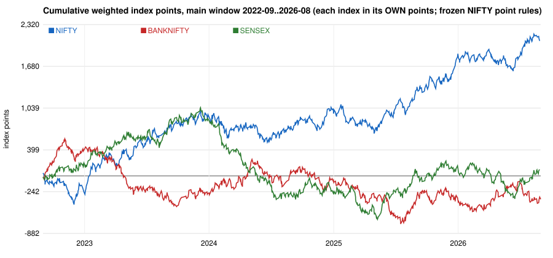

# Phase 5 - NIFTY 50 vs BANKNIFTY vs SENSEX (frozen rules, NIFTY point parameters)

> HISTORICAL RESEARCH ONLY. The strategy was developed using later NIFTY data; nothing here is a validation of the strategy, a forecast, or advice. Every result is an INDEX-POINT result; no option premium is used or estimated, and an index-point gain is not an option-premium gain.

**Read this first.** All three runs use the *same* point distances. Because the indices trade at very different levels (average entry level in 2025-26: NIFTY 24,812, BANKNIFTY 57,176, SENSEX 79,928), the same 35-point stop is 0.137% (NIFTY), 0.060% (BANKNIFTY), 0.043% (SENSEX) of the index. The runs therefore differ in market AND in effective risk scale; the comparison is a rule-transfer diagnostic, not a ranking of the indices. Index points of different indices are not economically equivalent, and **rupee figures are not compared**. NIFTY rows are read from the Phase 4 window B (5paisa) plus the unchanged Phase 3.6 window A; NIFTY 2018/2019 rows come from a different secondary vendor than the BANKNIFTY/SENSEX ones.

## 1. Whole periods (each index over its own usable sessions)

### M_ALL: 2022-09-01..2026-08-31 (DATA_VALIDATED)

| index | sessions | trades | win % | PF (pts) | index points | avg pts/trade | max DD (pts) | stops % | T1 % | T2 % | hold (min) | conflict days | stop % of index | avg level |
|---|---|---|---|---|---|---|---|---|---|---|---|---|---|---|
| NIFTY | 985 | 805 | 58.26 | 1.1808 | +2,069.7 | 2.571 | 482.93 | 41.5 | 58.1 | 30.3 | 65.6 | 13 | 0.1557 | 22286.6 |
| BANKNIFTY | 985 | 820 | 58.41 | 0.9692 | -358.5 | -0.437 | 1303.9 | 41.6 | 58.4 | 22.6 | 6.7 | 13 | 0.0695 | 49812.3 |
| SENSEX | 983 | 821 | 57.98 | 1.0082 | +97.2 | 0.118 | 1713.61 | 42.0 | 58.0 | 24.8 | 5.7 | 10 | 0.0472 | 73490.0 |

### M_2022_23: 2022-09-01..2023-08-31 (DATA_VALIDATED)

| index | sessions | trades | win % | PF (pts) | index points | avg pts/trade | max DD (pts) | stops % | T1 % | T2 % | hold (min) | conflict days | stop % of index | avg level |
|---|---|---|---|---|---|---|---|---|---|---|---|---|---|---|
| NIFTY | 248 | 198 | 59.09 | 1.268 | +739.6 | 3.735 | 482.93 | 40.9 | 58.6 | 31.8 | 95.4 | 3 | 0.1867 | 18243.4 |
| BANKNIFTY | 248 | 217 | 56.22 | 0.9215 | -254.1 | -1.171 | 937.55 | 43.8 | 56.2 | 23.0 | 9.4 | 5 | 0.0807 | 42339.7 |
| SENSEX | 247 | 206 | 60.68 | 1.2433 | +671.9 | 3.262 | 279.59 | 39.3 | 60.7 | 30.1 | 9.2 | 2 | 0.0554 | 61631.3 |

### M_2023_24: 2023-09-01..2024-08-31 (DATA_VALIDATED)

| index | sessions | trades | win % | PF (pts) | index points | avg pts/trade | max DD (pts) | stops % | T1 % | T2 % | hold (min) | conflict days | stop % of index | avg level |
|---|---|---|---|---|---|---|---|---|---|---|---|---|---|---|
| NIFTY | 243 | 219 | 54.34 | 0.9971 | -9.9 | -0.045 | 477.73 | 45.2 | 54.3 | 26.9 | 72.5 | 1 | 0.1565 | 21943.2 |
| BANKNIFTY | 243 | 201 | 63.68 | 1.1244 | +310.1 | 1.543 | 420.4 | 36.3 | 63.7 | 21.4 | 6.6 | 3 | 0.0716 | 47632.8 |
| SENSEX | 242 | 208 | 52.88 | 0.7134 | -960.1 | -4.616 | 1408.67 | 47.1 | 52.9 | 17.8 | 4.9 | 1 | 0.0472 | 72907.8 |

### M_2024_25: 2024-09-01..2025-08-31 (DATA_VALIDATED)

| index | sessions | trades | win % | PF (pts) | index points | avg pts/trade | max DD (pts) | stops % | T1 % | T2 % | hold (min) | conflict days | stop % of index | avg level |
|---|---|---|---|---|---|---|---|---|---|---|---|---|---|---|
| NIFTY | 247 | 192 | 60.42 | 1.2213 | +576.4 | 3.002 | 445.4 | 39.6 | 60.4 | 29.7 | 43.2 | 7 | 0.1418 | 24269.9 |
| BANKNIFTY | 247 | 203 | 54.68 | 0.8572 | -448.9 | -2.212 | 877.45 | 45.3 | 54.7 | 22.2 | 5.5 | 3 | 0.0649 | 52740.0 |
| SENSEX | 247 | 204 | 58.82 | 1.1111 | +323.5 | 1.586 | 633.6 | 41.2 | 58.8 | 28.4 | 4.1 | 1 | 0.0432 | 79652.5 |

### M_2025_26: 2025-09-01..2026-08-31 (DATA_VALIDATED)

| index | sessions | trades | win % | PF (pts) | index points | avg pts/trade | max DD (pts) | stops % | T1 % | T2 % | hold (min) | conflict days | stop % of index | avg level |
|---|---|---|---|---|---|---|---|---|---|---|---|---|---|---|
| NIFTY | 247 | 196 | 59.69 | 1.2839 | +763.5 | 3.895 | 335.0 | 39.8 | 59.7 | 33.2 | 49.9 | 2 | 0.137 | 24812.0 |
| BANKNIFTY | 247 | 199 | 59.3 | 1.0124 | +34.4 | 0.173 | 363.6 | 40.7 | 59.3 | 23.6 | 5.2 | 2 | 0.0597 | 57175.9 |
| SENSEX | 247 | 203 | 59.61 | 1.0221 | +61.9 | 0.305 | 582.23 | 40.4 | 59.6 | 23.2 | 4.4 | 6 | 0.0429 | 79927.6 |

### C_2018: 2018-01-01..2018-12-31 (EXPLORATORY)

| index | sessions | trades | win % | PF (pts) | index points | avg pts/trade | max DD (pts) | stops % | T1 % | T2 % | hold (min) | conflict days | stop % of index | avg level |
|---|---|---|---|---|---|---|---|---|---|---|---|---|---|---|
| NIFTY | 244 | 185 | 52.43 | 0.9074 | -261.7 | -1.415 | 403.3 | 43.2 | 47.0 | 16.8 | 187.1 | 0 | 0.3155 | 10746.5 |
| BANKNIFTY | 245 | 194 | 59.28 | 1.2763 | +744.7 | 3.839 | 183.0 | 40.7 | 59.3 | 34.0 | 24.6 | 3 | 0.1305 | 26114.6 |
| SENSEX | 198 | 151 | 61.59 | 1.3496 | +675.0 | 4.47 | 288.5 | 37.7 | 61.6 | 31.8 | 23.7 | 2 | 0.0952 | 35605.0 |

### D_2019_5P_PARTIAL: 2019-03-01..2019-12-31 (PARTIAL_YEAR)

| index | sessions | trades | win % | PF (pts) | index points | avg pts/trade | max DD (pts) | stops % | T1 % | T2 % | hold (min) | conflict days | stop % of index | avg level |
|---|---|---|---|---|---|---|---|---|---|---|---|---|---|---|
| NIFTY | 196 | 149 | 64.43 | 1.5356 | +904.1 | 6.068 | 190.38 | 32.9 | 61.7 | 28.2 | 168.9 | 4 | 0.293 | 11555.7 |
| BANKNIFTY | 196 | 157 | 59.87 | 1.0967 | +208.4 | 1.328 | 420.5 | 40.1 | 59.9 | 26.1 | 14.1 | 3 | 0.1141 | 29770.6 |
| SENSEX | 201 | 170 | 64.12 | 1.4105 | +860.5 | 5.062 | 220.01 | 35.9 | 64.1 | 31.8 | 16.2 | 1 | 0.087 | 38905.7 |

### D_2019_SECONDARY: 2019-01-01..2019-12-31 (EXPLORATORY)

| index | sessions | trades | win % | PF (pts) | index points | avg pts/trade | max DD (pts) | stops % | T1 % | T2 % | hold (min) | conflict days | stop % of index | avg level |
|---|---|---|---|---|---|---|---|---|---|---|---|---|---|---|
| NIFTY | 244 | 182 | 61.54 | 1.3565 | +772.6 | 4.245 | 255.15 | 33.5 | 59.3 | 26.9 | 168.6 | 4 | 0.2976 | 11439.2 |
| BANKNIFTY | 244 | 197 | 61.42 | 1.1871 | +482.9 | 2.451 | 507.1 | 38.6 | 61.4 | 26.9 | 17.8 | 3 | 0.1157 | 29308.4 |
| SENSEX | 235 | 191 | 62.3 | 1.2944 | +727.5 | 3.809 | 220.01 | 37.7 | 62.3 | 30.4 | 16.7 | 1 | 0.088 | 38586.8 |

### M_TO_2024_03_22: 2022-09-01..2024-03-22 (DATA_VALIDATED)

| index | sessions | trades | win % | PF (pts) | index points | avg pts/trade | max DD (pts) | stops % | T1 % | T2 % | hold (min) | conflict days | stop % of index | avg level |
|---|---|---|---|---|---|---|---|---|---|---|---|---|---|---|
| NIFTY | 385 | 326 | 57.06 | 1.1577 | +748.4 | 2.296 | 482.93 | 42.6 | 56.7 | 29.8 | 91.2 | 3 | 0.1774 | 19276.5 |
| BANKNIFTY | 385 | 328 | 59.45 | 0.9762 | -107.5 | -0.328 | 1038.05 | 40.5 | 59.5 | 21.3 | 8.4 | 7 | 0.0785 | 43537.9 |
| SENSEX | 384 | 318 | 59.12 | 1.0939 | +414.3 | 1.303 | 707.12 | 40.9 | 59.1 | 26.4 | 8.1 | 2 | 0.0532 | 64373.7 |

### MS_2022_09_2024_03: 2022-09-01..2024-03-22 (VENDOR_SENSITIVITY)

| index | sessions | trades | win % | PF (pts) | index points | avg pts/trade | max DD (pts) | stops % | T1 % | T2 % | hold (min) | conflict days | stop % of index | avg level |
|---|---|---|---|---|---|---|---|---|---|---|---|---|---|---|
| NIFTY | 386 | 320 | 57.5 | 1.1933 | +890.9 | 2.784 | 562.0 | 42.2 | 57.2 | 30.6 | 88.1 | 2 | 0.1776 | 19281.9 |
| BANKNIFTY | 386 | 328 | 58.54 | 0.9133 | -404.4 | -1.233 | 953.25 | 41.5 | 58.5 | 20.1 | 8.8 | 10 | 0.079 | 43530.4 |
| SENSEX | 386 | 326 | 56.75 | 0.9841 | -76.5 | -0.235 | 789.0 | 43.3 | 56.7 | 25.2 | 7.8 | 4 | 0.0533 | 64399.2 |

## 1b. Scale of the transferred distances against ordinary one-minute noise (5paisa bars, 2022-09-01..2025-08-31)

| index | median level | median 1-minute high-low range (points) | as % of level | 90th percentile (points) | 35-point stop in median 1-minute ranges | T1 (27 points) in median ranges |
|---|---|---|---|---|---|---|
| NIFTY | 22,030 | 6.5 | 0.030% | 14.1 | 5.4 | 4.2 |
| BANKNIFTY | 47,481 | 20.8 | 0.044% | 42.4 | 1.7 | 1.3 |
| SENSEX | 72,614 | 20.4 | 0.029% | 44.0 | 1.7 | 1.3 |

The point distances are the same, but in units of ordinary one-minute movement the stop is much tighter on BANKNIFTY and SENSEX than on NIFTY. The results below therefore mix market behaviour with effective risk scale.

## 2. The same sessions only (sessions evaluated on all three indices)

| period | index | common sessions | trades | win % | PF (pts) | index points | avg pts | max DD | hold | conflicts |
|---|---|---|---|---|---|---|---|---|---|---|
| M_2022_23 | NIFTY | 247 | 197 | 59.39 | 1.2819 | +769.6 | 3.907 | 482.93 | 95.8 | 3 |
| M_2022_23 | BANKNIFTY | 247 | 216 | 56.48 | 0.9301 | -224.1 | -1.037 | 907.55 | 9.4 | 5 |
| M_2022_23 | SENSEX | 247 | 206 | 60.68 | 1.2433 | +671.9 | 3.262 | 279.59 | 9.2 | 2 |
| M_2023_24 | NIFTY | 242 | 219 | 54.34 | 0.9971 | -9.9 | -0.045 | 477.73 | 72.5 | 1 |
| M_2023_24 | BANKNIFTY | 242 | 201 | 63.68 | 1.1244 | +310.1 | 1.543 | 420.4 | 6.6 | 3 |
| M_2023_24 | SENSEX | 242 | 208 | 52.88 | 0.7134 | -960.1 | -4.616 | 1408.67 | 4.9 | 1 |
| M_2024_25 | NIFTY | 247 | 192 | 60.42 | 1.2213 | +576.4 | 3.002 | 445.4 | 43.2 | 7 |
| M_2024_25 | BANKNIFTY | 247 | 203 | 54.68 | 0.8572 | -448.9 | -2.212 | 877.45 | 5.5 | 3 |
| M_2024_25 | SENSEX | 247 | 204 | 58.82 | 1.1111 | +323.5 | 1.586 | 633.6 | 4.1 | 1 |
| M_2025_26 | NIFTY | 247 | 196 | 59.69 | 1.2839 | +763.5 | 3.895 | 335.0 | 49.9 | 2 |
| M_2025_26 | BANKNIFTY | 247 | 199 | 59.3 | 1.0124 | +34.4 | 0.173 | 363.6 | 5.2 | 2 |
| M_2025_26 | SENSEX | 247 | 203 | 59.61 | 1.0221 | +61.9 | 0.305 | 582.23 | 4.4 | 6 |
| M_ALL | NIFTY | 983 | 804 | 58.33 | 1.1839 | +2,099.7 | 2.612 | 482.93 | 65.7 | 13 |
| M_ALL | BANKNIFTY | 983 | 819 | 58.49 | 0.9717 | -328.5 | -0.401 | 1273.9 | 6.7 | 13 |
| M_ALL | SENSEX | 983 | 821 | 57.98 | 1.0082 | +97.2 | 0.118 | 1713.61 | 5.7 | 10 |

## 3. Are the signals consistent across the indices? (common sessions of the main window)

| pair | common_sessions | sessions_with_a_trade_on_either | sessions_with_a_trade_on_both | both_first_trade_same_strategy_and_direction | both_same_set_of_directions | both_same_sign_of_day_result | pct_of_both_same_first_signal | pct_of_both_same_sign | correlation_of_daily_index_points |
|---|---|---|---|---|---|---|---|---|---|
| NIFTY vs BANKNIFTY | 983 | 866 | 646 | 387 | 487 | 367 | 59.9 | 56.8 | 0.106 |
| NIFTY vs SENSEX | 983 | 812 | 695 | 575 | 613 | 433 | 82.7 | 62.3 | 0.23 |
| BANKNIFTY vs SENSEX | 983 | 872 | 643 | 391 | 482 | 350 | 60.8 | 54.4 | 0.058 |

On days when two indices both trade, NIFTY vs BANKNIFTY: the same strategy and direction is taken first on 59.9% of 646 days, the day's result has the same sign on 56.8%, correlation of daily index points 0.106; NIFTY vs SENSEX: the same strategy and direction is taken first on 82.7% of 695 days, the day's result has the same sign on 62.3%, correlation of daily index points 0.23; BANKNIFTY vs SENSEX: the same strategy and direction is taken first on 60.8% of 643 days, the day's result has the same sign on 54.4%, correlation of daily index points 0.058. So the frozen rules give *similar* signals on NIFTY and SENSEX and noticeably different ones on BANKNIFTY, and even where the first signal is the same, the day's outcome often differs because the same point distances mean different things on each index. They do not behave as one 'market signal'.

## 4. By strategy, main window (index points)

| strategy | NIFTY trades / points / PF | BANKNIFTY trades / points / PF | SENSEX trades / points / PF |
|---|---|---|---|
| IRF | 437 / +887.2 / 1.1376 | 445 / +185.6 / 1.0299 | 444 / +51.5 / 1.0082 |
| ORB | 142 / +632.6 / 1.3692 | 147 / -132.0 / 0.9323 | 127 / +278.9 / 1.1631 |
| PDR | 131 / -9.6 / 0.9955 | 131 / -275.6 / 0.8643 | 129 / -328.6 / 0.8354 |
| PDS | 38 / +421.4 / 1.9998 | 36 / -31.0 / 0.9367 | 56 / +17.5 / 1.02 |
| RF | 57 / +138.0 / 1.1878 | 61 / -105.5 / 0.8923 | 65 / +77.9 / 1.0822 |

## 5. Data quality at a glance

| index | main window usable / expected | minute source | vendor overlap: bars identical | vendor overlap: mean abs close diff | main-window confidence |
|---|---|---|---|---|---|
| NIFTY | 738 / 744 (window B; the Phase 3.6 reference window A covers 2025-09..2026-08) | 5paisa | 39.8% (Phase 4, 2022-08..2025-08) | see Phase 4 `data_quality_by_year.md` | MODERATE (Phase 4) |
| BANKNIFTY | 985 / 992 | 5paisa | 0.458 | 1.0141 | MODERATE |
| SENSEX | 983 / 988 | 5paisa | 0.777 | 0.3141 | MODERATE |

## 6. What can and cannot be concluded

* The same frozen code ran on all three index series without a change (verified by hash before each run) and produced signals and trades from all five strategies on each.
* On the common sessions of the main window, NIFTY is the only index with a clearly positive profit factor; BANKNIFTY and SENSEX are close to break-even **before costs** in index points, and a per-trade average of well under one point does not survive any realistic slippage.
* The result by year is not stable on any index, and the vendor choice changes it materially (see each index's vendor-sensitivity table).
* 2018 and 2019 look better than 2022-2026 on BANKNIFTY and SENSEX (positive in every row), while NIFTY's 2018 is negative. These years rest on one unattributed vendor (2018 entirely, 2019 apart from the partial 5paisa year), the point distances are a larger share of the lower index levels of those years, and the strategy was developed using later NIFTY data - this is exploratory evidence, not out-of-sample validation.
* None of this says anything about option P&L: see `../options_feasibility/option_data_availability.md`.
