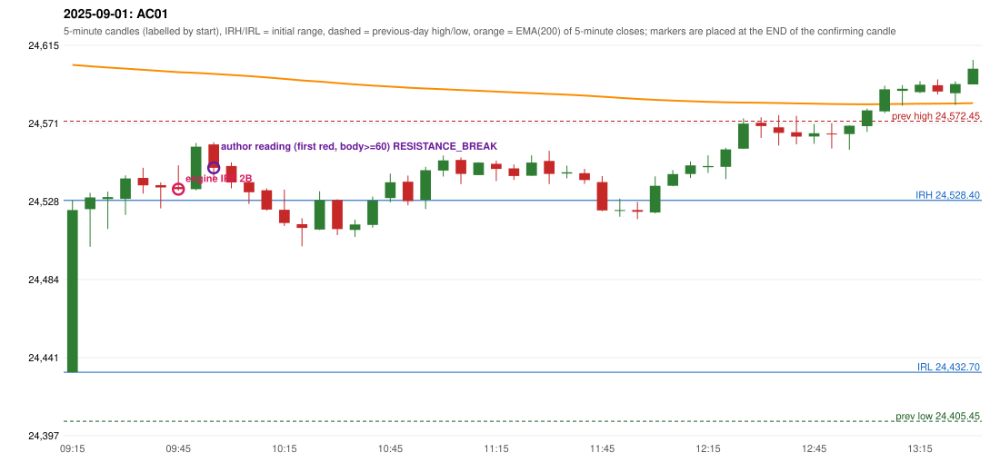

# 2025-09-01 - author's correction(s) against the engine

> Phase 5.1 date report. Evidence only; no rule was changed to produce a different outcome. Source image(s) are referenced under each correction.

## AC01 (PDF page 1, as written `20250901-1`, label `IRF`, ACTIVE)

### Author's observation

> IRF should be entered at the resistance itself. | Entry can either be break of Support/Resistance which ever happens first. | 60+ body candle in the entry side.

Suggested: **IRF (same strategy, different entry point)**; timing: earlier (at the resistance itself); requirement stated: entry = a break of the support OR of the resistance, whichever happens first; the entry-side candle must have a body of 60+ (percent, read as body share of the candle). Drawing (my reading): Rising green candles, then a few red/green candles under a line marked 'Resistance' with a lower line marked 'Support'; 'Entry' is written under the lower line at a candle that breaks below Support.. Uncertain: '60+ body' (percent of the candle range is my reading); the two statements 'entered at the resistance itself' and 'either support or resistance break, whichever first' are both written and are not obviously the same instruction. Image: `reports/phase5/phase51_author_corrections/pages/page_1_full.png (page 1 of docs/strategy_docs/corrected/Adobe Scan Nov 05, 2026.pdf)`.

### Original automated trade

20250901-1-IRF IRF Method 2B SHORT signal 09:50 entry 24534.6 -> T1_THEN_BUFFER_STOP

Stop 24569.6, T1 24507.6, T2 24474.6; exits 10:22 / 10:46. Engine explanation: IRF Method 2B SHORT: the 09:20-09:25 candle closed at 24,530.00, above IRH 24,528.40, and the next candle did not close back inside the range, so the setup is Method 2 and price stayed above it until the trigger. Extension candle 09:25-09:30, red candle 09:35-09:40. The trigger came 5 candles after the breakout candle: a red candle closed back below the first-push resistance after price had traded above it (09:45-09:50); confirmed at 09:50 with close 24,534.65. Entry reference close 24,534.65 is 6.25 points above IRH 24,528.40.

### Independent historical evidence

Session: open 24432.7, previous high/low/close 24572.45 / 24405.45 / 24426.85 (gap 5.85); first candle {'high': 24528.4, 'low': 24432.7, 'open': 24432.7, 'close': 24523.0}.

Signal-candle measurements: signal_candle_start=09:45, colour=R, body_pct=8.2, upper_wick_pct=85.8, lower_wick_pct=6.0, signal_close=24534.65, ema200=24599.73, entry_minus_ema=-65.08, ema_below_entry=False, ema_within_27_below_entry=False, ema_between_entry_and_target1=False, close_below_ema=True, session_low_before_candle=24432.7, close_below_prior_session_low=False, candle_low_at_or_below_prior_session_low=False, points_above_prior_session_low=101.95, body_pct_below_60=True, body_pct_below_50=True

Readings of the author's 'first red candle' wording (my formalisations, side by side):

| reading | first red candle | support | resistance | entry (signal time, close, trigger, body %) |
|---|---|---|---|---|
| FULLY_ABOVE|body>=60 | 09:35 | 24532.15 | 24546.55 | 10:00, 24546.5, RESISTANCE_BREAK, 63.2 |
| FULLY_ABOVE|body>=0 | 09:35 | 24532.15 | 24546.55 | 10:00, 24546.5, RESISTANCE_BREAK, 63.2 |
| CLOSE_ABOVE|body>=60 | 09:35 | 24532.15 | 24546.55 | 10:00, 24546.5, RESISTANCE_BREAK, 63.2 |
| CLOSE_ABOVE|body>=0 | 09:35 | 24532.15 | 24546.55 | 10:00, 24546.5, RESISTANCE_BREAK, 63.2 |

ORB records: Method 2 ENGINE_SETUP_INVALIDATED: TREND:EMA_PREV_SESSION_CLOSE wrong side

Chronological signal timeline (engine):

| time | strategy | method | dir | event | reason |
|---|---|---|---|---|---|
| 09:50 | IRF | Method 2B | SHORT | EXECUTED | trade 1: T1_THEN_BUFFER_STOP |
| 10:15 | IRF | Method 1 | SHORT | IGNORED | POSITION_ACTIVE (signal kept for diagnostics only; never reused) |
| 10:35 | IRF | Method 1 | SHORT | IGNORED | POSITION_ACTIVE (signal kept for diagnostics only; never reused) |
| 10:55 | IRF | Method 1 | SHORT | IGNORED | DAY_FINISHED |
| 11:50 | IRF | Method 1 | SHORT | IGNORED | DAY_FINISHED |
| 11:50 | IRF | Method 2A | SHORT | IGNORED | DAY_FINISHED |

Rejected / invalidated setups: 12:00 IRF Method 1/2: SESSION_ENDED_BEFORE_CONFIRMATION; 09:15 ORB Method 2: TREND:EMA_PREV_SESSION_CLOSE wrong side; 09:15 PDR PDR: OPEN_NOT_STRICTLY_ABOVE_ZONE

Applicable source rules:

* `IRF-GLOBAL-005` (VERIFIED_QUALITATIVE): Apply only the rules of the method that is forming; one method's rules at a time. Applying one method's confirmation to the other is a common cause of poor execution.

### Conclusion

* **Classification:** MISSING_AUTHOR_RULE, CANDLE_CONFIRMATION_MISMATCH, ENTRY_TIMING_MISMATCH   **Category:** C
* **Is the author correct under the existing rules?** No: the IRF guide has no entry-candle strength test and does not say which red candle supplies the resistance
* **Is the engine correct under the existing rules?** Yes: the engine confirmed Method 2B on a red candle whose body is 8.2% of its range (85.8% upper wick); IRF-M2B-003 asks only for a red candle closing back below the resistance (resistance = first-push top, a proposal)
* **Missing requirement / root cause:** the author's clarification that the entry candle must have a 60+ body and that the support / resistance is that of the first red candle outside the range
* **New rule required?** yes: 'first red candle S/R + entry-side body >= 60'   **Implementable objectively now?** not yet: the wording has several readings (see the readings table)   **Owner approval needed?** YES

Candles 09:15-13:00 (start, O, H, L, C, colour, body %, upper wick %, lower wick %, EMA200, close - EMA):

| start | O | H | L | C | col | body% | uw% | lw% | EMA | c-EMA |
|---|---|---|---|---|---|---|---|---|---|---|
| 09:15 | 24432.7 | 24528.4 | 24432.7 | 24523.0 | G | 94.4 | 5.6 | 0.0 | 24603.76 | -80.76 |
| 09:20 | 24523.5 | 24532.55 | 24502.6 | 24530.0 | G | 21.7 | 8.5 | 69.8 | 24603.02 | -73.02 |
| 09:25 | 24529.15 | 24533.25 | 24512.5 | 24530.25 | G | 5.3 | 14.5 | 80.2 | 24602.3 | -72.05 |
| 09:30 | 24529.25 | 24542.3 | 24520.25 | 24540.6 | G | 51.5 | 7.7 | 40.8 | 24601.69 | -61.09 |
| 09:35 | 24540.9 | 24546.55 | 24532.15 | 24536.75 | R | 28.8 | 39.2 | 31.9 | 24601.04 | -64.29 |
| 09:40 | 24536.85 | 24538.35 | 24523.9 | 24535.6 | R | 8.7 | 10.4 | 81.0 | 24600.39 | -64.79 |
| 09:45 | 24535.8 | 24547.9 | 24533.8 | 24534.65 | R | 8.2 | 85.8 | 6.0 | 24599.73 | -65.08 |
| 09:50 | 24534.6 | 24560.35 | 24533.95 | 24558.25 | G | 89.6 | 8.0 | 2.5 | 24599.32 | -41.07 |
| 09:55 | 24559.55 | 24560.75 | 24540.1 | 24546.5 | R | 63.2 | 5.8 | 31.0 | 24598.8 | -52.3 |
| 10:00 | 24547.5 | 24549.5 | 24535.05 | 24538.35 | R | 63.3 | 13.8 | 22.8 | 24598.19 | -59.84 |
| 10:05 | 24538.5 | 24538.7 | 24526.35 | 24532.9 | R | 45.3 | 1.6 | 53.0 | 24597.55 | -64.65 |
| 10:10 | 24534.0 | 24535.1 | 24522.65 | 24523.25 | R | 86.3 | 8.8 | 4.8 | 24596.81 | -73.56 |
| 10:15 | 24523.15 | 24534.35 | 24514.15 | 24515.75 | R | 36.6 | 55.4 | 7.9 | 24596.0 | -80.25 |
| 10:20 | 24515.1 | 24518.45 | 24502.85 | 24513.05 | R | 13.1 | 21.5 | 65.4 | 24595.17 | -82.12 |
| 10:25 | 24512.15 | 24533.45 | 24511.9 | 24528.55 | G | 76.1 | 22.7 | 1.2 | 24594.51 | -65.96 |
| 10:30 | 24528.6 | 24529.0 | 24509.05 | 24512.4 | R | 81.2 | 2.0 | 16.8 | 24593.69 | -81.29 |
| 10:35 | 24511.9 | 24517.65 | 24508.05 | 24514.95 | G | 31.8 | 28.1 | 40.1 | 24592.91 | -77.96 |
| 10:40 | 24514.7 | 24530.5 | 24513.15 | 24528.25 | G | 78.1 | 13.0 | 8.9 | 24592.27 | -64.02 |
| 10:45 | 24529.65 | 24543.25 | 24527.3 | 24538.45 | G | 55.2 | 30.1 | 14.7 | 24591.73 | -53.28 |
| 10:50 | 24538.75 | 24542.2 | 24525.65 | 24528.0 | R | 65.0 | 20.8 | 14.2 | 24591.1 | -63.1 |
| 10:55 | 24528.7 | 24547.0 | 24523.55 | 24545.2 | G | 70.4 | 7.7 | 22.0 | 24590.64 | -45.44 |
| 11:00 | 24545.0 | 24553.3 | 24541.65 | 24550.65 | G | 48.5 | 22.7 | 28.8 | 24590.24 | -39.59 |
| 11:05 | 24550.9 | 24552.3 | 24537.45 | 24543.1 | R | 52.5 | 9.4 | 38.0 | 24589.77 | -46.67 |
| 11:10 | 24542.45 | 24549.6 | 24542.45 | 24549.4 | G | 97.2 | 2.8 | 0.0 | 24589.37 | -39.97 |
| 11:15 | 24548.7 | 24550.5 | 24539.1 | 24545.85 | R | 25.0 | 15.8 | 59.2 | 24588.94 | -43.09 |
| 11:20 | 24546.2 | 24548.4 | 24539.75 | 24541.95 | R | 49.1 | 25.4 | 25.4 | 24588.47 | -46.52 |
| 11:25 | 24542.05 | 24553.45 | 24542.0 | 24549.4 | G | 64.2 | 35.4 | 0.4 | 24588.08 | -38.68 |
| 11:30 | 24550.35 | 24556.0 | 24537.45 | 24543.15 | R | 38.8 | 30.5 | 30.7 | 24587.64 | -44.49 |
| 11:35 | 24543.3 | 24547.7 | 24540.65 | 24544.0 | G | 9.9 | 52.5 | 37.6 | 24587.2 | -43.2 |
| 11:40 | 24543.5 | 24545.95 | 24537.6 | 24539.7 | R | 45.5 | 29.3 | 25.1 | 24586.73 | -47.03 |
| 11:45 | 24538.55 | 24541.95 | 24522.4 | 24522.8 | R | 80.6 | 17.4 | 2.0 | 24586.09 | -63.29 |
| 11:50 | 24522.65 | 24529.35 | 24519.25 | 24523.0 | G | 3.5 | 62.9 | 33.7 | 24585.46 | -62.46 |
| 11:55 | 24523.0 | 24527.5 | 24517.95 | 24522.05 | R | 9.9 | 47.1 | 42.9 | 24584.83 | -62.78 |
| 12:00 | 24521.65 | 24541.75 | 24521.15 | 24536.5 | G | 72.1 | 25.5 | 2.4 | 24584.35 | -47.85 |
| 12:05 | 24536.5 | 24545.25 | 24536.25 | 24543.0 | G | 72.2 | 25.0 | 2.8 | 24583.94 | -40.94 |
| 12:10 | 24543.05 | 24550.05 | 24540.85 | 24547.85 | G | 52.2 | 23.9 | 23.9 | 24583.58 | -35.73 |
| 12:15 | 24546.85 | 24553.45 | 24543.6 | 24547.5 | G | 6.6 | 60.4 | 33.0 | 24583.22 | -35.72 |
| 12:20 | 24547.05 | 24557.65 | 24540.25 | 24556.75 | G | 55.7 | 5.2 | 39.1 | 24582.96 | -26.21 |
| 12:25 | 24557.15 | 24574.05 | 24557.15 | 24571.1 | G | 82.5 | 17.5 | 0.0 | 24582.84 | -11.74 |
| 12:30 | 24571.6 | 24574.65 | 24563.15 | 24569.75 | R | 16.1 | 26.5 | 57.4 | 24582.71 | -12.96 |
| 12:35 | 24569.05 | 24575.8 | 24558.9 | 24565.95 | R | 18.3 | 39.9 | 41.7 | 24582.54 | -16.59 |
| 12:40 | 24566.3 | 24575.45 | 24559.6 | 24563.85 | R | 15.5 | 57.7 | 26.8 | 24582.36 | -18.51 |
| 12:45 | 24563.95 | 24570.85 | 24559.85 | 24565.75 | G | 16.4 | 46.4 | 37.3 | 24582.19 | -16.44 |
| 12:50 | 24565.6 | 24571.35 | 24557.25 | 24565.25 | R | 2.5 | 40.8 | 56.7 | 24582.03 | -16.78 |
| 12:55 | 24565.3 | 24570.1 | 24556.55 | 24569.95 | G | 34.3 | 1.1 | 64.6 | 24581.9 | -11.95 |
| 13:00 | 24569.65 | 24579.5 | 24566.5 | 24578.45 | G | 67.7 | 8.1 | 24.2 | 24581.87 | -3.42 |
