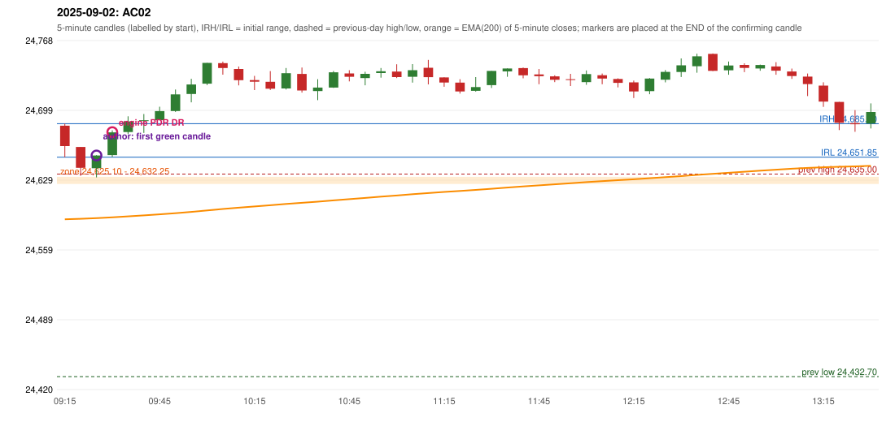

# 2025-09-02 - author's correction(s) against the engine

> Phase 5.1 date report. Evidence only; no rule was changed to produce a different outcome. Source image(s) are referenced under each correction.

## AC02 (PDF page 1, as written `20250902-1`, label `PDR`, ACTIVE)

### Author's observation

> Enter here | PDR Zone | Support from previous day resistance.

Suggested: **PDR (earlier entry)**; timing: earlier ('Enter here' is drawn above the zone); requirement stated: the zone is the previous day's resistance acting as support; entry where the arrow points. Drawing (my reading): Three candles (red, red, green) sit on top of a box labelled 'PDR Zone'; a horizontal line from the top of the candles ends in an arrow 'Enter here' at the level of the green candle's close.. Uncertain: which candle the arrow marks (the green candle's close vs the next candle) is read from the drawing, not stated in words. Image: `reports/phase5/phase51_author_corrections/pages/page_1_full.png (page 1 of docs/strategy_docs/corrected/Adobe Scan Nov 05, 2026.pdf)`.

### Original automated trade

20250902-1-PDR PDR PDR LONG signal 09:35 entry 24676.9 -> TARGET

Stop 24641.9, T1 24703.9, T2 24746.9; exits 09:51 / 10:05. Engine explanation: PDR LONG (body-based engine, A_HIGHEST_BODY_HIGH): the session opened 58.20 points above the previous close and 51.00 points above the previous-day highest BODY high 24,632.25 (zone [24,625.10, 24,632.25] from the 15:00 candle of 2025-09-01; the highest wick 24,635.00 is ignored). The 09:25 candle (24,631.65 - 24,653.90) tested the zone; the 09:30 candle (green, O 24,653.90 H 24,678.70 L 24,652.00 C 24,676.60) passed GOOD_GREEN_BODY and closed 44.35 points above the zone ceiling, confirming the entry at 09:35. The pattern thresholds and the zone's lower boundary are provisional research assumptions, not approved by the strategy author.

### Independent historical evidence

Session: open 24683.25, previous high/low/close 24635.0 / 24432.7 / 24625.05 (gap 58.2); first candle {'high': 24685.3, 'low': 24651.85, 'open': 24683.25, 'close': 24662.9}.

First green candle after the zone interaction ('enter in 1st green candle'): {"interaction_candle": "09:25", "first_green_close_above_ceiling": {"candle_start": "09:25", "signal_time": "09:30", "colour": "G", "body_pct": 57.3, "upper_wick_pct": 1.6, "lower_wick_pct": 41.1, "close": 24653.55, "points_above_ceiling": 21.3, "low_below_zone_floor": false}}

ORB records: Method 1 ENGINE_SETUP_INVALIDATED: CANDLE_QUALITY(not a strong body / wick too large); Method 2 ENGINE_SETUP_INVALIDATED: CANDLE_QUALITY

Chronological signal timeline (engine):

| time | strategy | method | dir | event | reason |
|---|---|---|---|---|---|
| 09:35 | PDR | PDR | LONG | EXECUTED | trade 1: TARGET |
| 10:35 | IRF | Method 2A | SHORT | IGNORED | DAY_FINISHED |
| 11:05 | IRF | Method 2B | SHORT | IGNORED | DAY_FINISHED |
| 12:20 | IRF | Method 2A | SHORT | IGNORED | DAY_FINISHED |
| 13:10 | IRF | Method 2A | SHORT | IGNORED | DAY_FINISHED |
| 13:30 | IRF | Method 1 | SHORT | IGNORED | DAY_FINISHED |
| 13:45 | IRF | Method 1 | SHORT | IGNORED | DAY_FINISHED |

Rejected / invalidated setups: 13:05 IRF Method 1/2: SESSION_ENDED_BEFORE_CONFIRMATION; 09:15 ORB Method 1: CANDLE_QUALITY(not a strong body / wick too large); 09:15 ORB Method 2: CANDLE_QUALITY; 13:50 PDR PDR: NO_QUALIFYING_CONFIRMATION_BEFORE_SESSION_END; 09:25 RF RF: GAP_UP_OUTSIDE_YESTERDAYS_RANGE

Applicable source rules:

* `PDR-007` (VERIFIED_QUALITATIVE): After the zone has been tested, wait for a green candle and take the long on that confirmation.

### Conclusion

* **Classification:** CANDLE_CONFIRMATION_MISMATCH, ENTRY_TIMING_MISMATCH   **Category:** C
* **Is the author correct under the existing rules?** Partly: the source rule PDR-007 says 'wait for a green candle after the test'; the drawing shows the green candle that itself tests the zone as the entry
* **Is the engine correct under the existing rules?** Yes under PDR-A07 (a proposal): the confirmation may not be the interaction candle
* **Missing requirement / root cause:** whether the green candle that tests the zone may itself be the confirmation (engine switch pdr_green_may_be_interaction_candle = False)
* **New rule required?** no new rule: an existing proposal switch   **Implementable objectively now?** yes (switch), but it is an owner decision   **Owner approval needed?** YES

Candles 09:15-13:00 (start, O, H, L, C, colour, body %, upper wick %, lower wick %, EMA200, close - EMA):

| start | O | H | L | C | col | body% | uw% | lw% | EMA | c-EMA |
|---|---|---|---|---|---|---|---|---|---|---|
| 09:15 | 24683.25 | 24685.3 | 24651.85 | 24662.9 | R | 60.8 | 6.1 | 33.0 | 24589.82 | 73.08 |
| 09:20 | 24662.05 | 24662.05 | 24633.2 | 24641.2 | R | 72.3 | 0.0 | 27.7 | 24590.33 | 50.87 |
| 09:25 | 24640.8 | 24653.9 | 24631.65 | 24653.55 | G | 57.3 | 1.6 | 41.1 | 24590.96 | 62.59 |
| 09:30 | 24653.9 | 24678.7 | 24652.0 | 24676.6 | G | 85.0 | 7.9 | 7.1 | 24591.81 | 84.79 |
| 09:35 | 24676.9 | 24692.65 | 24675.2 | 24687.55 | G | 61.0 | 29.2 | 9.7 | 24592.76 | 94.79 |
| 09:40 | 24688.25 | 24694.95 | 24676.1 | 24688.75 | G | 2.7 | 32.9 | 64.5 | 24593.72 | 95.03 |
| 09:45 | 24688.8 | 24702.25 | 24688.8 | 24697.9 | G | 67.7 | 32.3 | 0.0 | 24594.76 | 103.14 |
| 09:50 | 24698.0 | 24719.45 | 24697.05 | 24714.6 | G | 74.1 | 21.7 | 4.2 | 24595.95 | 118.65 |
| 09:55 | 24714.95 | 24730.15 | 24706.6 | 24724.45 | G | 40.3 | 24.2 | 35.5 | 24597.23 | 127.22 |
| 10:00 | 24725.3 | 24746.05 | 24723.9 | 24746.05 | G | 93.7 | 0.0 | 6.3 | 24598.71 | 147.34 |
| 10:05 | 24745.8 | 24747.3 | 24734.3 | 24740.95 | R | 37.3 | 11.5 | 51.2 | 24600.12 | 140.83 |
| 10:10 | 24739.95 | 24742.35 | 24723.6 | 24728.75 | R | 59.7 | 12.8 | 27.5 | 24601.4 | 127.35 |
| 10:15 | 24728.85 | 24733.05 | 24718.85 | 24727.2 | R | 11.6 | 29.6 | 58.8 | 24602.65 | 124.55 |
| 10:20 | 24727.1 | 24737.85 | 24718.95 | 24720.25 | R | 36.2 | 56.9 | 6.9 | 24603.82 | 116.43 |
| 10:25 | 24720.45 | 24740.95 | 24719.4 | 24735.7 | G | 70.8 | 24.4 | 4.9 | 24605.14 | 130.56 |
| 10:30 | 24735.0 | 24741.4 | 24716.35 | 24718.45 | R | 66.1 | 25.5 | 8.4 | 24606.26 | 112.19 |
| 10:35 | 24717.9 | 24729.75 | 24708.8 | 24721.4 | G | 16.7 | 39.9 | 43.4 | 24607.41 | 113.99 |
| 10:40 | 24721.45 | 24737.9 | 24721.05 | 24736.65 | G | 90.2 | 7.4 | 2.4 | 24608.7 | 127.95 |
| 10:45 | 24735.5 | 24738.7 | 24727.55 | 24732.2 | R | 29.6 | 28.7 | 41.7 | 24609.92 | 122.28 |
| 10:50 | 24730.9 | 24737.15 | 24723.65 | 24735.1 | G | 31.1 | 15.2 | 53.7 | 24611.17 | 123.93 |
| 10:55 | 24735.95 | 24740.95 | 24731.25 | 24737.7 | G | 18.0 | 33.5 | 48.5 | 24612.43 | 125.27 |
| 11:00 | 24737.35 | 24744.65 | 24730.9 | 24731.85 | R | 40.0 | 53.1 | 6.9 | 24613.62 | 118.23 |
| 11:05 | 24732.15 | 24744.8 | 24726.3 | 24738.7 | G | 35.4 | 33.0 | 31.6 | 24614.86 | 123.84 |
| 11:10 | 24741.15 | 24749.05 | 24724.55 | 24731.75 | R | 38.4 | 32.2 | 29.4 | 24616.03 | 115.72 |
| 11:15 | 24731.55 | 24731.6 | 24722.15 | 24726.45 | R | 54.0 | 0.5 | 45.5 | 24617.12 | 109.33 |
| 11:20 | 24726.3 | 24729.75 | 24715.35 | 24717.5 | R | 61.1 | 24.0 | 14.9 | 24618.12 | 99.38 |
| 11:25 | 24718.2 | 24731.85 | 24717.35 | 24721.9 | G | 25.5 | 68.6 | 5.9 | 24619.16 | 102.74 |
| 11:30 | 24723.8 | 24738.0 | 24721.0 | 24738.0 | G | 83.5 | 0.0 | 16.5 | 24620.34 | 117.66 |
| 11:35 | 24737.5 | 24740.5 | 24732.2 | 24740.4 | G | 34.9 | 1.2 | 63.9 | 24621.53 | 118.87 |
| 11:40 | 24740.85 | 24741.4 | 24730.65 | 24733.65 | R | 67.0 | 5.1 | 27.9 | 24622.65 | 111.0 |
| 11:45 | 24734.5 | 24739.9 | 24724.7 | 24732.7 | R | 11.8 | 35.5 | 52.6 | 24623.74 | 108.96 |
| 11:50 | 24732.6 | 24733.65 | 24726.85 | 24729.2 | R | 50.0 | 15.4 | 34.6 | 24624.79 | 104.41 |
| 11:55 | 24729.7 | 24735.1 | 24722.95 | 24729.3 | R | 3.3 | 44.4 | 52.3 | 24625.83 | 103.47 |
| 12:00 | 24726.8 | 24738.45 | 24724.1 | 24734.85 | G | 56.1 | 25.1 | 18.8 | 24626.92 | 107.93 |
| 12:05 | 24733.7 | 24735.4 | 24724.7 | 24730.35 | R | 31.3 | 15.9 | 52.8 | 24627.95 | 102.4 |
| 12:10 | 24729.95 | 24730.65 | 24721.55 | 24726.05 | R | 42.9 | 7.7 | 49.5 | 24628.92 | 97.13 |
| 12:15 | 24726.6 | 24728.35 | 24710.9 | 24717.55 | R | 51.9 | 10.0 | 38.1 | 24629.8 | 87.75 |
| 12:20 | 24717.85 | 24730.9 | 24714.75 | 24730.4 | G | 77.7 | 3.1 | 19.2 | 24630.81 | 99.59 |
| 12:25 | 24729.3 | 24738.9 | 24726.55 | 24737.05 | G | 62.8 | 15.0 | 22.3 | 24631.86 | 105.19 |
| 12:30 | 24736.95 | 24750.45 | 24731.95 | 24743.6 | G | 35.9 | 37.0 | 27.0 | 24632.97 | 110.63 |
| 12:35 | 24742.7 | 24755.15 | 24736.25 | 24752.55 | G | 52.1 | 13.8 | 34.1 | 24634.16 | 118.39 |
| 12:40 | 24755.0 | 24755.4 | 24737.8 | 24738.1 | R | 96.0 | 2.3 | 1.7 | 24635.2 | 102.9 |
| 12:45 | 24738.7 | 24747.4 | 24734.15 | 24743.45 | G | 35.8 | 29.8 | 34.3 | 24636.28 | 107.17 |
| 12:50 | 24744.0 | 24745.65 | 24736.75 | 24741.0 | R | 33.7 | 18.5 | 47.8 | 24637.32 | 103.68 |
| 12:55 | 24740.45 | 24744.35 | 24738.15 | 24743.95 | G | 56.5 | 6.5 | 37.1 | 24638.38 | 105.57 |
| 13:00 | 24742.45 | 24746.75 | 24734.2 | 24738.25 | R | 33.5 | 34.3 | 32.3 | 24639.37 | 98.88 |
