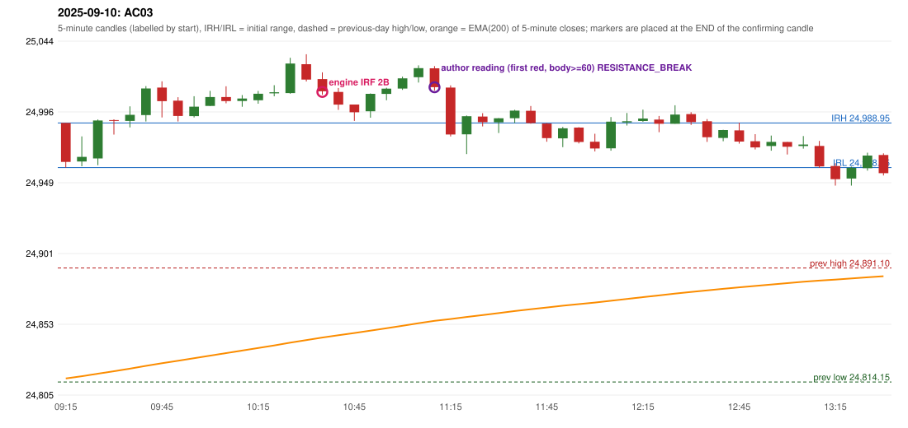

# 2025-09-10 - author's correction(s) against the engine

> Phase 5.1 date report. Evidence only; no rule was changed to produce a different outcome. Source image(s) are referenced under each correction.

## AC03 (PDF page 1, as written `20250910-1`, label `IRF`, ACTIVE)

### Author's observation

> The first red candle only should be considered. | This candle should be considered | only break of first red candle which is outside the 5 min range, only the red candles break of S/R should be entered.

Suggested: **IRF (same strategy, correct reference candle)**; timing: not stated; requirement stated: use ONLY the first red candle that lies outside the first 5-minute range; enter only on a break of THAT red candle's support/resistance (S/R). Drawing (my reading): Tall red and green candles on the left, then small candles near a line with an arrow pointing back (left) at the first red candle; the underlined words 'This candle should be considered' point to it.. Uncertain: 'S/R' read as support/resistance. Image: `reports/phase5/phase51_author_corrections/pages/page_1_full.png (page 1 of docs/strategy_docs/corrected/Adobe Scan Nov 05, 2026.pdf)`.

### Original automated trade

20250910-1-IRF IRF Method 2B SHORT signal 10:40 entry 25009.9 -> TARGET

Stop 25044.9, T1 24982.9, T2 24949.9; exits 11:19 / 13:16. Engine explanation: IRF Method 2B SHORT: the 09:25-09:30 candle closed at 24,990.65, above IRH 24,988.95, and the next candle did not close back inside the range, so the setup is Method 2 and price stayed above it until the trigger. Extension candle 09:30-09:35, red candle 09:45-09:50. The trigger came 14 candles after the breakout candle: a red candle closed back below the first-push resistance after price had traded above it (10:35-10:40); confirmed at 10:40 with close 25,010.40. Entry reference close 25,010.40 is 21.45 points above IRH 24,988.95.

### Independent historical evidence

Session: open 24988.95, previous high/low/close 24891.1 / 24814.15 / 24868.6 (gap 120.35); first candle {'high': 24988.95, 'low': 24958.85, 'open': 24988.95, 'close': 24962.65}.

Signal-candle measurements: signal_candle_start=10:35, colour=R, body_pct=54.3, upper_wick_pct=30.1, lower_wick_pct=15.6, signal_close=25010.4, ema200=24844.11, entry_minus_ema=166.29, ema_below_entry=True, ema_within_27_below_entry=False, ema_between_entry_and_target1=False, close_below_ema=False, session_low_before_candle=24958.85, close_below_prior_session_low=False, candle_low_at_or_below_prior_session_low=False, points_above_prior_session_low=51.55, body_pct_below_60=True, body_pct_below_50=False

Readings of the author's 'first red candle' wording (my formalisations, side by side):

| reading | first red candle | support | resistance | entry (signal time, close, trigger, body %) |
|---|---|---|---|---|
| FULLY_ABOVE|body>=60 | 09:45 | 24992.7 | 25017.1 | 11:15, 25013.1, RESISTANCE_BREAK, 77.3 |
| FULLY_ABOVE|body>=0 | 09:45 | 24992.7 | 25017.1 | 10:40, 25010.4, RESISTANCE_BREAK, 54.3 |
| CLOSE_ABOVE|body>=60 | 09:30 | 24981.15 | 24991.4 | 11:20, 24981.2, RESISTANCE_BREAK, 91.7 |
| CLOSE_ABOVE|body>=0 | 09:30 | 24981.15 | 24991.4 | 11:20, 24981.2, RESISTANCE_BREAK, 91.7 |

ORB records: Method 1 ENGINE_SETUP_INVALIDATED: CANDLE_QUALITY(not a strong body / wick too large); Method 2 ENGINE_SETUP_INVALIDATED: CANDLE_QUALITY

Chronological signal timeline (engine):

| time | strategy | method | dir | event | reason |
|---|---|---|---|---|---|
| 10:40 | IRF | Method 2B | SHORT | EXECUTED | trade 1: TARGET |
| 11:20 | IRF | Method 1 | SHORT | IGNORED | POSITION_ACTIVE (signal kept for diagnostics only; never reused) |
| 11:20 | IRF | Method 2A | SHORT | IGNORED | POSITION_ACTIVE (signal kept for diagnostics only; never reused) |
| 11:45 | IRF | Method 1 | SHORT | IGNORED | POSITION_ACTIVE (signal kept for diagnostics only; never reused) |
| 11:45 | IRF | Method 2B | SHORT | IGNORED | POSITION_ACTIVE (signal kept for diagnostics only; never reused) |
| 12:25 | IRF | Method 1 | SHORT | IGNORED | POSITION_ACTIVE (signal kept for diagnostics only; never reused) |
| 12:35 | IRF | Method 2B | SHORT | IGNORED | POSITION_ACTIVE (signal kept for diagnostics only; never reused) |
| 12:40 | IRF | Method 1 | SHORT | IGNORED | POSITION_ACTIVE (signal kept for diagnostics only; never reused) |

Rejected / invalidated setups: 09:15 ORB Method 1: CANDLE_QUALITY(not a strong body / wick too large); 09:15 ORB Method 2: CANDLE_QUALITY; 13:25 RF RF: GAP_UP_OUTSIDE_YESTERDAYS_RANGE

Applicable source rules:

* `IRF-M2A-001` (VERIFIED_QUALITATIVE): Confirmation A: recent support = a pullback low left behind by the extension.
* `IRF-M2B-001` (VERIFIED_QUALITATIVE): Confirmation B: recent resistance = top of the first push after the breakout.

### Conclusion

* **Classification:** MISSING_AUTHOR_RULE, SUPPORT_RESISTANCE_MISMATCH   **Category:** C
* **Is the author correct under the existing rules?** Cannot be decided: 'first red candle outside the 5-minute range' is not defined (fully above vs only the close above)
* **Is the engine correct under the existing rules?** Yes under the existing proposals (swing / first-push levels)
* **Missing requirement / root cause:** which red candle supplies S/R in Method 2
* **New rule required?** yes: 'S/R of the first red candle outside the range'   **Implementable objectively now?** no: two readings give 11:15 / 11:20 (and the engine 10:40)   **Owner approval needed?** YES

Candles 09:15-13:00 (start, O, H, L, C, colour, body %, upper wick %, lower wick %, EMA200, close - EMA):

| start | O | H | L | C | col | body% | uw% | lw% | EMA | c-EMA |
|---|---|---|---|---|---|---|---|---|---|---|
| 09:15 | 24988.95 | 24988.95 | 24958.85 | 24962.65 | R | 87.4 | 0.0 | 12.6 | 24816.51 | 146.14 |
| 09:20 | 24963.0 | 24979.9 | 24959.75 | 24966.1 | G | 15.4 | 68.5 | 16.1 | 24818.0 | 148.1 |
| 09:25 | 24965.05 | 24991.3 | 24960.5 | 24990.65 | G | 83.1 | 2.1 | 14.8 | 24819.72 | 170.93 |
| 09:30 | 24990.9 | 24991.4 | 24981.15 | 24990.45 | R | 4.4 | 4.9 | 90.7 | 24821.42 | 169.03 |
| 09:35 | 24990.35 | 25000.2 | 24985.95 | 24994.45 | G | 28.8 | 40.4 | 30.9 | 24823.14 | 171.31 |
| 09:40 | 24994.3 | 25013.85 | 24990.0 | 25012.25 | G | 75.3 | 6.7 | 18.0 | 24825.02 | 187.23 |
| 09:45 | 25012.85 | 25017.1 | 24992.7 | 25003.7 | R | 37.5 | 17.4 | 45.1 | 24826.8 | 176.9 |
| 09:50 | 25004.05 | 25006.35 | 24989.95 | 24993.7 | R | 63.1 | 14.0 | 22.9 | 24828.46 | 165.24 |
| 09:55 | 24993.55 | 25007.05 | 24992.7 | 24999.95 | G | 44.6 | 49.5 | 5.9 | 24830.17 | 169.78 |
| 10:00 | 25000.45 | 25010.65 | 25000.45 | 25006.45 | G | 58.8 | 41.2 | 0.0 | 24831.92 | 174.53 |
| 10:05 | 25006.5 | 25013.75 | 25002.25 | 25003.75 | R | 23.9 | 63.0 | 13.0 | 24833.63 | 170.12 |
| 10:10 | 25003.8 | 25007.8 | 24999.9 | 25005.45 | G | 20.9 | 29.7 | 49.4 | 24835.34 | 170.11 |
| 10:15 | 25004.3 | 25010.6 | 25002.0 | 25008.7 | G | 51.2 | 22.1 | 26.7 | 24837.06 | 171.64 |
| 10:20 | 25008.95 | 25014.45 | 25006.95 | 25009.7 | G | 10.0 | 63.3 | 26.7 | 24838.78 | 170.92 |
| 10:25 | 25009.15 | 25032.95 | 25008.7 | 25029.1 | G | 82.3 | 15.9 | 1.9 | 24840.68 | 188.42 |
| 10:30 | 25028.65 | 25035.35 | 25017.0 | 25018.25 | R | 56.7 | 36.5 | 6.8 | 24842.44 | 175.81 |
| 10:35 | 25018.6 | 25023.15 | 25008.05 | 25010.4 | R | 54.3 | 30.1 | 15.6 | 24844.11 | 166.29 |
| 10:40 | 25009.9 | 25012.6 | 24997.8 | 25001.35 | R | 57.8 | 18.2 | 24.0 | 24845.68 | 155.67 |
| 10:45 | 25001.4 | 25001.4 | 24990.35 | 24996.15 | R | 47.5 | 0.0 | 52.5 | 24847.18 | 148.97 |
| 10:50 | 24996.85 | 25008.9 | 24992.55 | 25008.65 | G | 72.2 | 1.5 | 26.3 | 24848.78 | 159.87 |
| 10:55 | 25008.6 | 25012.75 | 25004.3 | 25012.15 | G | 42.0 | 7.1 | 50.9 | 24850.41 | 161.74 |
| 11:00 | 25012.2 | 25020.25 | 25011.3 | 25019.1 | G | 77.1 | 12.8 | 10.1 | 24852.09 | 167.01 |
| 11:05 | 25019.85 | 25027.85 | 25016.25 | 25025.95 | G | 52.6 | 16.4 | 31.0 | 24853.82 | 172.13 |
| 11:10 | 25025.85 | 25027.35 | 25010.85 | 25013.1 | R | 77.3 | 9.1 | 13.6 | 24855.4 | 157.7 |
| 11:15 | 25012.85 | 25014.35 | 24979.85 | 24981.2 | R | 91.7 | 4.3 | 3.9 | 24856.65 | 124.55 |
| 11:20 | 24981.35 | 24994.05 | 24967.95 | 24993.55 | G | 46.7 | 1.9 | 51.3 | 24858.02 | 135.53 |
| 11:25 | 24993.3 | 24995.6 | 24986.65 | 24989.5 | R | 42.5 | 25.7 | 31.8 | 24859.32 | 130.18 |
| 11:30 | 24989.45 | 24992.25 | 24982.2 | 24992.15 | G | 26.9 | 1.0 | 72.1 | 24860.65 | 131.5 |
| 11:35 | 24992.2 | 24997.85 | 24988.95 | 24997.3 | G | 57.3 | 6.2 | 36.5 | 24862.01 | 135.29 |
| 11:40 | 24997.2 | 25000.4 | 24988.45 | 24988.9 | R | 69.5 | 26.8 | 3.8 | 24863.27 | 125.63 |
| 11:45 | 24988.6 | 24988.9 | 24976.3 | 24978.75 | R | 78.2 | 2.4 | 19.4 | 24864.42 | 114.33 |
| 11:50 | 24978.55 | 24986.3 | 24972.65 | 24985.35 | G | 49.8 | 7.0 | 43.2 | 24865.62 | 119.73 |
| 11:55 | 24985.85 | 24986.15 | 24975.15 | 24976.1 | R | 88.6 | 2.7 | 8.6 | 24866.72 | 109.38 |
| 12:00 | 24976.3 | 24981.7 | 24969.75 | 24971.75 | R | 38.1 | 45.2 | 16.7 | 24867.76 | 103.99 |
| 12:05 | 24971.85 | 24992.95 | 24970.25 | 24989.85 | G | 79.3 | 13.7 | 7.0 | 24868.98 | 120.87 |
| 12:10 | 24989.35 | 24995.7 | 24987.25 | 24990.15 | G | 9.5 | 65.7 | 24.9 | 24870.19 | 119.96 |
| 12:15 | 24990.3 | 24998.0 | 24989.75 | 24991.95 | G | 20.0 | 73.3 | 6.7 | 24871.4 | 120.55 |
| 12:20 | 24991.25 | 24993.7 | 24982.75 | 24988.4 | R | 26.0 | 22.4 | 51.6 | 24872.56 | 115.84 |
| 12:25 | 24988.45 | 25000.9 | 24988.45 | 24994.65 | G | 49.8 | 50.2 | 0.0 | 24873.78 | 120.87 |
| 12:30 | 24995.0 | 24996.25 | 24987.65 | 24989.6 | R | 62.8 | 14.5 | 22.7 | 24874.93 | 114.67 |
| 12:35 | 24990.15 | 24991.6 | 24976.2 | 24979.35 | R | 70.1 | 9.4 | 20.5 | 24875.97 | 103.38 |
| 12:40 | 24978.85 | 24984.35 | 24976.65 | 24984.2 | G | 69.5 | 1.9 | 28.6 | 24877.04 | 107.16 |
| 12:45 | 24984.0 | 24989.15 | 24975.05 | 24976.45 | R | 53.5 | 36.5 | 9.9 | 24878.03 | 98.42 |
| 12:50 | 24976.65 | 24981.4 | 24971.1 | 24972.5 | R | 40.3 | 46.1 | 13.6 | 24878.97 | 93.53 |
| 12:55 | 24973.4 | 24980.45 | 24970.25 | 24976.2 | G | 27.5 | 41.7 | 30.9 | 24879.94 | 96.26 |
| 13:00 | 24976.15 | 24976.15 | 24967.7 | 24972.95 | R | 37.9 | 0.0 | 62.1 | 24880.87 | 92.08 |
