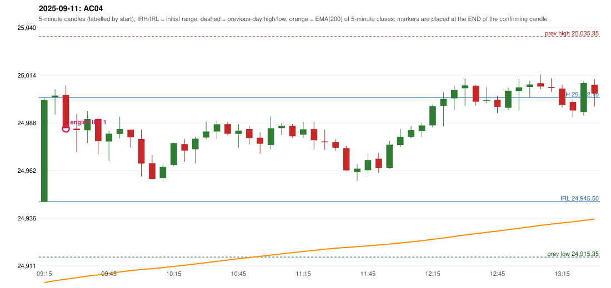

# 2025-09-11 - author's correction(s) against the engine

> Phase 5.1 date report. Evidence only; no rule was changed to produce a different outcome. Source image(s) are referenced under each correction.

## AC04 (PDF page 1, as written `20250911-1`, label `IRF`, ACTIVE)

### Author's observation

> This should be an ORB trade. | It is shown as IRF, ORB should activate Ep 30 pts SL.

Suggested: **ORB**; timing: not stated; requirement stated: ORB stop of 30 points is quoted as the reason ('Ep' is read as 'i.e.'). Drawing (my reading): none. Uncertain: 'Ep' (read as 'i.e.', also written in AC20). Image: `reports/phase5/phase51_author_corrections/pages/page_1_full.png (page 1 of docs/strategy_docs/corrected/Adobe Scan Nov 05, 2026.pdf)`.

### Original automated trade

20250911-1-IRF IRF Method 1 SHORT signal 09:30 entry 24985.2 -> T1_THEN_BUFFER_STOP

Stop 25020.2, T1 24958.2, T2 24925.2; exits 10:09 / 11:02. Engine explanation: IRF Method 1 SHORT: the completed 09:20 candle closed at 25,003.20, 1.10 points above the initial range high 25,002.10 (range [24,945.50, 25,002.10] from the 09:15 candle); the immediately following completed 09:25 candle closed at 24,985.45, back inside the range. The short signal was confirmed at 09:30 on that close. Entry reference close 24,985.45 is 16.65 points below IRH 25,002.10.

### Independent historical evidence

Session: open 24945.5, previous high/low/close 25035.35 / 24915.35 / 24973.1 (gap -27.6); first candle {'high': 25002.1, 'low': 24945.5, 'open': 24945.5, 'close': 25000.8}.

Signal-candle measurements: signal_candle_start=09:25, colour=R, body_pct=77.7, upper_wick_pct=22.3, lower_wick_pct=0.0, signal_close=24985.45, ema200=24903.28, entry_minus_ema=82.17, ema_below_entry=True, ema_within_27_below_entry=False, ema_between_entry_and_target1=False, close_below_ema=False, session_low_before_candle=24945.5, close_below_prior_session_low=False, candle_low_at_or_below_prior_session_low=False, points_above_prior_session_low=39.95, body_pct_below_60=False, body_pct_below_50=False

Readings of the author's 'first red candle' wording (my formalisations, side by side):

| reading | first red candle | support | resistance | entry (signal time, close, trigger, body %) |
|---|---|---|---|---|
| FULLY_ABOVE|body>=60 | 13:05 | 25006.5 | 25014.7 | none before 13:00 |
| FULLY_ABOVE|body>=0 | 13:05 | 25006.5 | 25014.7 | none before 13:00 |
| CLOSE_ABOVE|body>=60 | 13:05 | 25006.5 | 25014.7 | none before 13:00 |
| CLOSE_ABOVE|body>=0 | 13:05 | 25006.5 | 25014.7 | none before 13:00 |

ORB records: Method 2 ENGINE_SETUP_INVALIDATED: TRENDLINE_NOT_SUPPORTIVE

Chronological signal timeline (engine):

| time | strategy | method | dir | event | reason |
|---|---|---|---|---|---|
| 09:30 | IRF | Method 1 | SHORT | EXECUTED | trade 1: T1_THEN_BUFFER_STOP |
| 12:40 | IRF | Method 1 | SHORT | IGNORED | DAY_FINISHED |
| 13:10 | IRF | Method 2B | SHORT | IGNORED | DAY_FINISHED |
| 13:20 | IRF | Method 1 | SHORT | IGNORED | DAY_FINISHED |
| 14:00 | IRF | Method 2B | SHORT | IGNORED | DAY_FINISHED |
| 15:00 | IRF | Method 2B | SHORT | IGNORED | DAY_FINISHED |
| 15:15 | IRF | Method 1 | SHORT | IGNORED | DAY_FINISHED |

Rejected / invalidated setups: 14:55 IRF Method 1/2: SESSION_ENDED_BEFORE_CONFIRMATION; 09:15 ORB Method 2: TRENDLINE_NOT_SUPPORTIVE; 09:15 PDS Method 1/2/3: GAP_DOWN_OPEN_NOT_BELOW_ZONE

### Conclusion

* **Classification:** AUTHOR_DISCRETION_UNRESOLVED, SUPPORT_RESISTANCE_MISMATCH   **Category:** C
* **Is the author correct under the existing rules?** Cannot be decided: the ORB inner level / trendline have no objective construction (ORB-M2-LONG-001 UNRESOLVED)
* **Is the engine correct under the existing rules?** Not decidable either way: the ORB Method 2 inner level and trendline are not defined in the source (orb.py says so); the engine's PROPOSED trendline test invalidated it. No ORB signal existed, so the controller chose nothing wrongly
* **Missing requirement / root cause:** an objective inner level and trendline for ORB Method 2
* **New rule required?** yes: an objective ORB-M2 inner level / trendline   **Implementable objectively now?** no   **Owner approval needed?** YES

Candles 09:15-13:00 (start, O, H, L, C, colour, body %, upper wick %, lower wick %, EMA200, close - EMA):

| start | O | H | L | C | col | body% | uw% | lw% | EMA | c-EMA |
|---|---|---|---|---|---|---|---|---|---|---|
| 09:15 | 24945.5 | 25002.1 | 24945.5 | 25000.8 | G | 97.7 | 2.3 | 0.0 | 24901.44 | 99.36 |
| 09:20 | 25002.35 | 25006.7 | 24992.95 | 25003.2 | G | 6.2 | 25.5 | 68.4 | 24902.46 | 100.74 |
| 09:25 | 25003.55 | 25008.75 | 24985.45 | 24985.45 | R | 77.7 | 22.3 | 0.0 | 24903.28 | 82.17 |
| 09:30 | 24985.2 | 24993.25 | 24972.35 | 24984.4 | R | 3.8 | 38.5 | 57.7 | 24904.09 | 80.31 |
| 09:35 | 24984.3 | 24994.9 | 24977.45 | 24990.45 | G | 35.2 | 25.5 | 39.3 | 24904.95 | 85.5 |
| 09:40 | 24990.5 | 24990.65 | 24971.2 | 24978.45 | R | 62.0 | 0.8 | 37.3 | 24905.68 | 72.77 |
| 09:45 | 24978.2 | 24984.25 | 24967.4 | 24982.45 | G | 25.2 | 10.7 | 64.1 | 24906.44 | 76.01 |
| 09:50 | 24982.35 | 24991.65 | 24979.9 | 24985.0 | G | 22.6 | 56.6 | 20.9 | 24907.23 | 77.77 |
| 09:55 | 24984.65 | 24984.75 | 24974.8 | 24980.45 | R | 42.2 | 1.0 | 56.8 | 24907.95 | 72.5 |
| 10:00 | 24979.6 | 24984.65 | 24959.1 | 24966.2 | R | 52.4 | 19.8 | 27.8 | 24908.53 | 57.67 |
| 10:05 | 24966.4 | 24970.9 | 24957.7 | 24957.85 | R | 64.8 | 34.1 | 1.1 | 24909.02 | 48.83 |
| 10:10 | 24958.35 | 24966.55 | 24957.5 | 24964.5 | G | 68.0 | 22.7 | 9.4 | 24909.58 | 54.92 |
| 10:15 | 24965.45 | 24977.65 | 24964.75 | 24977.35 | G | 92.2 | 2.3 | 5.4 | 24910.25 | 67.1 |
| 10:20 | 24976.8 | 24979.7 | 24967.15 | 24973.3 | R | 27.9 | 23.1 | 49.0 | 24910.88 | 62.42 |
| 10:25 | 24974.0 | 24980.65 | 24966.3 | 24979.75 | G | 40.1 | 6.3 | 53.7 | 24911.56 | 68.19 |
| 10:30 | 24980.35 | 24989.05 | 24979.35 | 24983.65 | G | 34.0 | 55.7 | 10.3 | 24912.28 | 71.37 |
| 10:35 | 24983.65 | 24989.35 | 24979.55 | 24987.6 | G | 40.3 | 17.9 | 41.8 | 24913.03 | 74.57 |
| 10:40 | 24987.65 | 24988.85 | 24981.7 | 24982.4 | R | 73.4 | 16.8 | 9.8 | 24913.72 | 68.68 |
| 10:45 | 24982.35 | 24987.55 | 24974.95 | 24984.15 | G | 14.3 | 27.0 | 58.7 | 24914.42 | 69.73 |
| 10:50 | 24985.0 | 24986.7 | 24976.6 | 24980.1 | R | 48.5 | 16.8 | 34.7 | 24915.08 | 65.02 |
| 10:55 | 24980.25 | 24983.2 | 24971.6 | 24976.95 | R | 28.4 | 25.4 | 46.1 | 24915.69 | 61.26 |
| 11:00 | 24976.3 | 24991.8 | 24973.95 | 24985.45 | G | 51.3 | 35.6 | 13.2 | 24916.38 | 69.07 |
| 11:05 | 24985.5 | 24988.25 | 24981.65 | 24986.8 | G | 19.7 | 22.0 | 58.3 | 24917.09 | 69.71 |
| 11:10 | 24986.7 | 24987.65 | 24980.2 | 24981.0 | R | 76.5 | 12.8 | 10.7 | 24917.72 | 63.28 |
| 11:15 | 24982.0 | 24988.95 | 24980.2 | 24984.85 | G | 32.6 | 46.9 | 20.6 | 24918.39 | 66.46 |
| 11:20 | 24984.95 | 24989.0 | 24974.15 | 24978.85 | R | 41.1 | 27.3 | 31.6 | 24918.99 | 59.86 |
| 11:25 | 24978.25 | 24984.7 | 24973.7 | 24977.85 | R | 3.6 | 58.6 | 37.7 | 24919.58 | 58.27 |
| 11:30 | 24977.95 | 24979.5 | 24973.15 | 24974.8 | R | 49.6 | 24.4 | 26.0 | 24920.13 | 54.67 |
| 11:35 | 24974.6 | 24975.7 | 24962.4 | 24962.5 | R | 91.0 | 8.3 | 0.8 | 24920.55 | 41.95 |
| 11:40 | 24961.55 | 24965.9 | 24956.85 | 24963.45 | G | 21.0 | 27.1 | 51.9 | 24920.97 | 42.48 |
| 11:45 | 24962.6 | 24971.95 | 24960.85 | 24968.1 | G | 49.5 | 34.7 | 15.8 | 24921.44 | 46.66 |
| 11:50 | 24968.85 | 24972.05 | 24961.35 | 24963.85 | R | 46.7 | 29.9 | 23.4 | 24921.87 | 41.98 |
| 11:55 | 24963.9 | 24978.65 | 24963.15 | 24976.5 | G | 81.3 | 13.9 | 4.8 | 24922.41 | 54.09 |
| 12:00 | 24976.25 | 24984.95 | 24975.2 | 24980.8 | G | 46.7 | 42.6 | 10.8 | 24922.99 | 57.81 |
| 12:05 | 24980.65 | 24986.7 | 24980.0 | 24984.4 | G | 56.0 | 34.3 | 9.7 | 24923.6 | 60.8 |
| 12:10 | 24983.9 | 24988.35 | 24980.6 | 24986.95 | G | 39.4 | 18.1 | 42.6 | 24924.23 | 62.72 |
| 12:15 | 24987.0 | 24998.2 | 24985.95 | 24997.45 | G | 85.3 | 6.1 | 8.6 | 24924.96 | 72.49 |
| 12:20 | 24997.55 | 25004.95 | 24986.4 | 25001.45 | G | 21.0 | 18.9 | 60.1 | 24925.72 | 75.73 |
| 12:25 | 25001.7 | 25008.7 | 24995.45 | 25006.4 | G | 35.5 | 17.4 | 47.2 | 24926.52 | 79.88 |
| 12:30 | 25007.2 | 25012.45 | 24997.3 | 25008.7 | G | 9.9 | 24.8 | 65.3 | 24927.34 | 81.36 |
| 12:35 | 25008.6 | 25008.95 | 24997.75 | 24999.9 | R | 77.7 | 3.1 | 19.2 | 24928.06 | 71.84 |
| 12:40 | 25000.3 | 25007.75 | 24999.1 | 25000.8 | G | 5.8 | 80.3 | 13.9 | 24928.79 | 72.01 |
| 12:45 | 25000.95 | 25003.0 | 24993.6 | 24997.1 | R | 41.0 | 21.8 | 37.2 | 24929.47 | 67.63 |
| 12:50 | 24996.55 | 25007.55 | 24995.45 | 25005.85 | G | 76.9 | 14.0 | 9.1 | 24930.23 | 75.62 |
| 12:55 | 25005.7 | 25012.1 | 24995.0 | 25007.7 | G | 11.7 | 25.7 | 62.6 | 24931.0 | 76.7 |
| 13:00 | 25007.9 | 25011.2 | 25002.2 | 25009.25 | G | 15.0 | 21.7 | 63.3 | 24931.78 | 77.47 |
