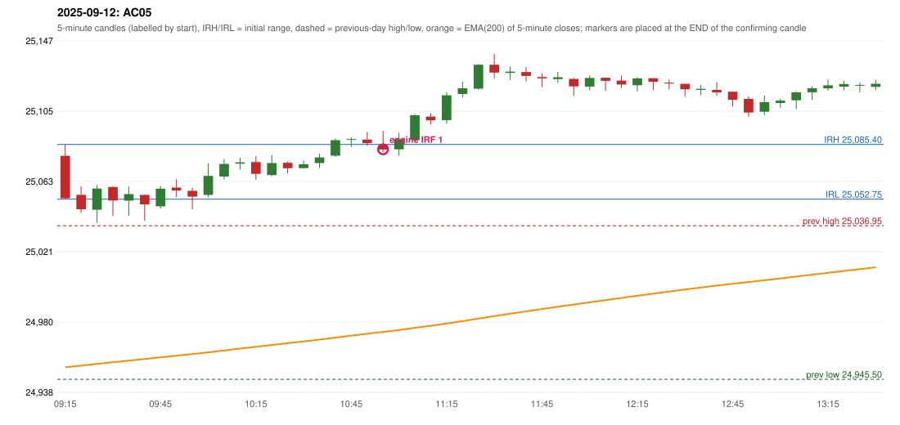

# 2025-09-12 - author's correction(s) against the engine

> Phase 5.1 date report. Evidence only; no rule was changed to produce a different outcome. Source image(s) are referenced under each correction.

## AC05 (PDF page 1, as written `20250912-1`, label `IRF`, ACTIVE)

### Author's observation

> This should be RF entry, IRF should not be taken as RF is activated.

Suggested: **RF**; timing: not stated; requirement stated: RF activation takes precedence over IRF on that day (as the author sees it). Drawing (my reading): none. Uncertain: none. Image: `reports/phase5/phase51_author_corrections/pages/page_1_full.png (page 1 of docs/strategy_docs/corrected/Adobe Scan Nov 05, 2026.pdf)`.

### Original automated trade

20250912-1-IRF IRF Method 1 SHORT signal 11:00 entry 25082.45 -> INITIAL_FULL_STOP

Stop 25117.45, T1 25055.45, T2 25022.45; exits 11:20 / 11:20. Engine explanation: IRF Method 1 SHORT: the completed 10:50 candle closed at 25,086.15, 0.75 points above the initial range high 25,085.40 (range [25,052.75, 25,085.40] from the 09:15 candle); the immediately following completed 10:55 candle closed at 25,082.35, back inside the range. The short signal was confirmed at 11:00 on that close. Entry reference close 25,082.35 is 3.05 points below IRH 25,085.40.

### Independent historical evidence

Session: open 25078.55, previous high/low/close 25036.95 / 24945.5 / 25005.5 (gap 73.05); first candle {'high': 25085.4, 'low': 25052.75, 'open': 25078.55, 'close': 25053.3}.

Signal-candle measurements: signal_candle_start=10:55, colour=R, body_pct=20.8, upper_wick_pct=67.2, lower_wick_pct=12.0, signal_close=25082.35, ema200=24973.72, entry_minus_ema=108.63, ema_below_entry=True, ema_within_27_below_entry=False, ema_between_entry_and_target1=False, close_below_ema=False, session_low_before_candle=25038.65, close_below_prior_session_low=False, candle_low_at_or_below_prior_session_low=False, points_above_prior_session_low=43.7, body_pct_below_60=True, body_pct_below_50=True

Readings of the author's 'first red candle' wording (my formalisations, side by side):

| reading | first red candle | support | resistance | entry (signal time, close, trigger, body %) |
|---|---|---|---|---|
| FULLY_ABOVE|body>=60 | 11:10 | 25097.15 | 25103.95 | none before 13:00 |
| FULLY_ABOVE|body>=0 | 11:10 | 25097.15 | 25103.95 | none before 13:00 |
| CLOSE_ABOVE|body>=60 | 10:50 | 25084.6 | 25092.85 | none before 13:00 |
| CLOSE_ABOVE|body>=0 | 10:50 | 25084.6 | 25092.85 | 11:00, 25082.35, SUPPORT_BREAK, 20.8 |

ORB records: Method 1 ENGINE_SETUP_INVALIDATED: CANDLE_QUALITY(not a strong body / wick too large); Method 2 ENGINE_SETUP_INVALIDATED: CANDLE_QUALITY

Chronological signal timeline (engine):

| time | strategy | method | dir | event | reason |
|---|---|---|---|---|---|
| 11:00 | IRF | Method 1 | SHORT | EXECUTED | trade 1: INITIAL_FULL_STOP |
| 12:50 | IRF | Method 2A | SHORT | REJECTED | SECOND_TRADE_RESTRICTED_TO_PDR_PDS |
| 13:45 | IRF | Method 2B | SHORT | REJECTED | SECOND_TRADE_RESTRICTED_TO_PDR_PDS |
| 14:40 | IRF | Method 2A | SHORT | REJECTED | SECOND_TRADE_RESTRICTED_TO_PDR_PDS |
| 15:25 | IRF | Method 2B | SHORT | REJECTED | SECOND_TRADE_RESTRICTED_TO_PDR_PDS |

Rejected / invalidated setups: 12:50 IRF Method 2A: SECOND_TRADE_RESTRICTED_TO_PDR_PDS; 13:45 IRF Method 2B: SECOND_TRADE_RESTRICTED_TO_PDR_PDS; 14:40 IRF Method 2A: SECOND_TRADE_RESTRICTED_TO_PDR_PDS; 15:25 IRF Method 2B: SECOND_TRADE_RESTRICTED_TO_PDR_PDS; 15:20 IRF Method 1/2: SESSION_ENDED_BEFORE_CONFIRMATION; 09:15 ORB Method 1: CANDLE_QUALITY(not a strong body / wick too large); 09:15 ORB Method 2: CANDLE_QUALITY; 09:25 RF RF: GAP_UP_OUTSIDE_YESTERDAYS_RANGE

Applicable source rules:

* `RF-004` (VERIFIED_EXPLICIT): The gap-up open must stay within yesterday's trading range; an open above yesterday's high is rejected.
* `RF-008` (VERIFIED_QUALITATIVE): A previous downtrend with a sudden large gap-up above the 200 EMA is rejected; gap up that exceeds yesterday's range is rejected.
* `RF-013` (VERIFIED_EXPLICIT): Gap up without the required break and return into the first 5-minute range gives no RF activation.

### Conclusion

* **Classification:** JOURNAL_INCONSISTENCY, AUTHOR_DISCRETION_UNRESOLVED   **Category:** C
* **Is the author correct under the existing rules?** No: RF-004 (explicit source rule) rejects a gap-up open above yesterday's high; the open is 41.6 points above it
* **Is the engine correct under the existing rules?** Yes: the RF engine applied RF-004
* **Missing requirement / root cause:** either the author reads 'yesterday's range' differently or RF-004 is not meant to apply
* **New rule required?** only if the owner/author withdraws or redefines RF-004   **Implementable objectively now?** no   **Owner approval needed?** YES

Candles 09:15-13:00 (start, O, H, L, C, colour, body %, upper wick %, lower wick %, EMA200, close - EMA):

| start | O | H | L | C | col | body% | uw% | lw% | EMA | c-EMA |
|---|---|---|---|---|---|---|---|---|---|---|
| 09:15 | 25078.55 | 25085.4 | 25052.75 | 25053.3 | R | 77.3 | 21.0 | 1.7 | 24952.7 | 100.6 |
| 09:20 | 25055.35 | 25060.3 | 25044.55 | 25046.75 | R | 54.6 | 31.4 | 14.0 | 24953.64 | 93.11 |
| 09:25 | 25046.5 | 25061.15 | 25038.65 | 25059.1 | G | 56.0 | 9.1 | 34.9 | 24954.69 | 104.41 |
| 09:30 | 25060.0 | 25060.5 | 25042.65 | 25051.95 | R | 45.1 | 2.8 | 52.1 | 24955.65 | 96.3 |
| 09:35 | 25051.9 | 25060.15 | 25042.85 | 25055.8 | G | 22.5 | 25.1 | 52.3 | 24956.65 | 99.15 |
| 09:40 | 25055.3 | 25055.6 | 25039.95 | 25049.7 | R | 35.8 | 1.9 | 62.3 | 24957.58 | 92.12 |
| 09:45 | 25048.55 | 25060.6 | 25047.2 | 25059.0 | G | 78.0 | 11.9 | 10.1 | 24958.58 | 100.42 |
| 09:50 | 25059.7 | 25064.7 | 25054.0 | 25057.95 | R | 16.4 | 46.7 | 36.9 | 24959.57 | 98.38 |
| 09:55 | 25057.75 | 25059.55 | 25046.65 | 25054.3 | R | 26.7 | 14.0 | 59.3 | 24960.52 | 93.78 |
| 10:00 | 25055.35 | 25073.95 | 25054.05 | 25066.65 | G | 56.8 | 36.7 | 6.5 | 24961.57 | 105.08 |
| 10:05 | 25066.25 | 25076.65 | 25064.6 | 25073.75 | G | 62.2 | 24.1 | 13.7 | 24962.69 | 111.06 |
| 10:10 | 25073.85 | 25077.6 | 25070.45 | 25074.7 | G | 11.9 | 40.6 | 47.6 | 24963.8 | 110.9 |
| 10:15 | 25074.85 | 25078.3 | 25064.2 | 25067.85 | R | 49.6 | 24.5 | 25.9 | 24964.84 | 103.01 |
| 10:20 | 25067.15 | 25079.15 | 25066.45 | 25074.3 | G | 56.3 | 38.2 | 5.5 | 24965.93 | 108.37 |
| 10:25 | 25074.45 | 25075.15 | 25068.0 | 25071.25 | R | 44.8 | 9.8 | 45.5 | 24966.98 | 104.27 |
| 10:30 | 25071.25 | 25075.75 | 25070.95 | 25073.55 | G | 47.9 | 45.8 | 6.2 | 24968.04 | 105.51 |
| 10:35 | 25074.3 | 25079.8 | 25071.3 | 25077.65 | G | 39.4 | 25.3 | 35.3 | 24969.13 | 108.52 |
| 10:40 | 25078.65 | 25088.9 | 25077.95 | 25087.9 | G | 84.5 | 9.1 | 6.4 | 24970.31 | 117.59 |
| 10:45 | 25088.5 | 25089.8 | 25083.9 | 25088.6 | G | 1.7 | 20.3 | 78.0 | 24971.49 | 117.11 |
| 10:50 | 25088.25 | 25092.85 | 25084.6 | 25086.15 | R | 25.5 | 55.8 | 18.8 | 24972.63 | 113.52 |
| 10:55 | 25084.95 | 25093.35 | 25080.85 | 25082.35 | R | 20.8 | 67.2 | 12.0 | 24973.72 | 108.63 |
| 11:00 | 25082.45 | 25092.35 | 25078.65 | 25088.5 | G | 44.2 | 28.1 | 27.7 | 24974.86 | 113.64 |
| 11:05 | 25088.05 | 25103.55 | 25086.9 | 25102.75 | G | 88.3 | 4.8 | 6.9 | 24976.13 | 126.62 |
| 11:10 | 25101.95 | 25103.95 | 25097.15 | 25099.75 | R | 32.4 | 29.4 | 38.2 | 24977.36 | 122.39 |
| 11:15 | 25099.8 | 25116.55 | 25097.7 | 25114.65 | G | 78.8 | 10.1 | 11.1 | 24978.73 | 135.92 |
| 11:20 | 25115.4 | 25122.95 | 25113.25 | 25118.8 | G | 35.1 | 42.8 | 22.2 | 24980.12 | 138.68 |
| 11:25 | 25118.6 | 25133.2 | 25118.0 | 25132.85 | G | 93.7 | 2.3 | 3.9 | 24981.64 | 151.21 |
| 11:30 | 25132.85 | 25139.3 | 25124.75 | 25128.2 | R | 32.0 | 44.3 | 23.7 | 24983.1 | 145.1 |
| 11:35 | 25127.95 | 25131.75 | 25123.6 | 25128.75 | G | 9.8 | 36.8 | 53.4 | 24984.55 | 144.2 |
| 11:40 | 25128.5 | 25131.45 | 25122.9 | 25126.15 | R | 27.5 | 34.5 | 38.0 | 24985.96 | 140.19 |
| 11:45 | 25125.5 | 25127.85 | 25119.45 | 25124.7 | R | 9.5 | 28.0 | 62.5 | 24987.34 | 137.36 |
| 11:50 | 25124.3 | 25128.55 | 25122.0 | 25125.4 | G | 16.8 | 48.1 | 35.1 | 24988.71 | 136.69 |
| 11:55 | 25124.35 | 25125.05 | 25114.4 | 25119.9 | R | 41.8 | 6.6 | 51.6 | 24990.02 | 129.88 |
| 12:00 | 25119.85 | 25126.4 | 25117.6 | 25124.95 | G | 58.0 | 16.5 | 25.6 | 24991.36 | 133.59 |
| 12:05 | 25125.1 | 25125.1 | 25117.25 | 25123.25 | R | 23.6 | 0.0 | 76.4 | 24992.67 | 130.58 |
| 12:10 | 25123.4 | 25126.35 | 25119.0 | 25121.05 | R | 32.0 | 40.1 | 27.9 | 24993.95 | 127.1 |
| 12:15 | 25120.6 | 25125.3 | 25116.85 | 25124.7 | G | 48.5 | 7.1 | 44.4 | 24995.25 | 129.45 |
| 12:20 | 25124.8 | 25124.8 | 25117.7 | 25122.65 | R | 30.3 | 0.0 | 69.7 | 24996.52 | 126.13 |
| 12:25 | 25122.2 | 25124.05 | 25118.3 | 25121.65 | R | 9.6 | 32.2 | 58.3 | 24997.76 | 123.89 |
| 12:30 | 25121.45 | 25121.6 | 25114.1 | 25118.25 | R | 42.7 | 2.0 | 55.3 | 24998.96 | 119.29 |
| 12:35 | 25117.85 | 25120.85 | 25114.7 | 25118.5 | G | 10.6 | 38.2 | 51.2 | 25000.15 | 118.35 |
| 12:40 | 25117.85 | 25122.35 | 25114.4 | 25116.4 | R | 18.2 | 56.6 | 25.2 | 25001.31 | 115.09 |
| 12:45 | 25116.8 | 25116.8 | 25108.0 | 25112.0 | R | 54.5 | 0.0 | 45.5 | 25002.41 | 109.59 |
| 12:50 | 25112.5 | 25113.95 | 25101.9 | 25104.35 | R | 67.6 | 12.0 | 20.3 | 25003.42 | 100.93 |
| 12:55 | 25104.85 | 25114.5 | 25102.7 | 25110.55 | G | 48.3 | 33.5 | 18.2 | 25004.49 | 106.06 |
| 13:00 | 25110.05 | 25112.6 | 25107.25 | 25111.45 | G | 26.2 | 21.5 | 52.3 | 25005.56 | 105.89 |
