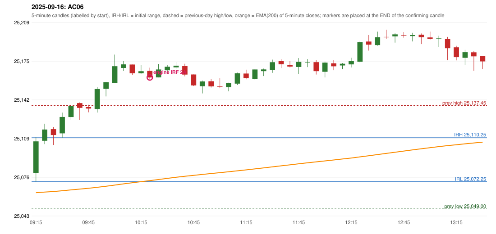

# 2025-09-16 - author's correction(s) against the engine

> Phase 5.1 date report. Evidence only; no rule was changed to produce a different outcome. Source image(s) are referenced under each correction.

## AC06 (PDF page 2, as written `20250916-1`, label `IRF`, ACTIVE)

### Author's observation

> IRF is taken, which is wrong. | ORB should take place in this condition[s]

Suggested: **ORB**; timing: not stated; requirement stated: IRF should not have been taken; ORB should apply. Drawing (my reading): none. Uncertain: last word cut by the page edge. Image: `reports/phase5/phase51_author_corrections/pages/page_2_full.png (page 2 of docs/strategy_docs/corrected/Adobe Scan Nov 05, 2026.pdf)`.

### Original automated trade

20250916-1-IRF IRF Method 2A SHORT signal 10:25 entry 25161.5 -> INITIAL_FULL_STOP

Stop 25196.5, T1 25134.5, T2 25101.5; exits 12:29 / 12:29. Engine explanation: IRF Method 2A SHORT: the 09:20-09:25 candle closed at 25,116.90, above IRH 25,110.25, and the next candle did not close back inside the range, so the setup is Method 2 and price stayed above it until the trigger. Extension candle 09:30-09:35, red candle 09:40-09:45. The trigger came 12 candles after the breakout candle: a completed candle closed below the recent pullback-low support (10:20-10:25); confirmed at 10:25 with close 25,161.45. Entry reference close 25,161.45 is 51.20 points above IRH 25,110.25.

### Independent historical evidence

Session: open 25079.5, previous high/low/close 25137.45 / 25049.0 / 25069.2 (gap 10.3); first candle {'high': 25110.25, 'low': 25072.25, 'open': 25079.5, 'close': 25106.75}.

Signal-candle measurements: signal_candle_start=10:20, colour=R, body_pct=51.6, upper_wick_pct=25.6, lower_wick_pct=22.8, signal_close=25161.45, ema200=25073.15, entry_minus_ema=88.3, ema_below_entry=True, ema_within_27_below_entry=False, ema_between_entry_and_target1=False, close_below_ema=False, session_low_before_candle=25072.25, close_below_prior_session_low=False, candle_low_at_or_below_prior_session_low=False, points_above_prior_session_low=89.2, body_pct_below_60=True, body_pct_below_50=False

Readings of the author's 'first red candle' wording (my formalisations, side by side):

| reading | first red candle | support | resistance | entry (signal time, close, trigger, body %) |
|---|---|---|---|---|
| FULLY_ABOVE|body>=60 | 09:40 | 25125.1 | 25140.1 | none before 13:00 |
| FULLY_ABOVE|body>=0 | 09:40 | 25125.1 | 25140.1 | none before 13:00 |
| CLOSE_ABOVE|body>=60 | 09:25 | 25103.7 | 25119.1 | none before 13:00 |
| CLOSE_ABOVE|body>=0 | 09:25 | 25103.7 | 25119.1 | none before 13:00 |

Chronological signal timeline (engine):

| time | strategy | method | dir | event | reason |
|---|---|---|---|---|---|
| 10:25 | IRF | Method 2A | SHORT | EXECUTED | trade 1: INITIAL_FULL_STOP |
| 10:45 | IRF | Method 2B | SHORT | IGNORED | POSITION_ACTIVE (signal kept for diagnostics only; never reused) |
| 13:15 | IRF | Method 2A | SHORT | REJECTED | SECOND_TRADE_RESTRICTED_TO_PDR_PDS |
| 14:10 | IRF | Method 2B | SHORT | REJECTED | SECOND_TRADE_RESTRICTED_TO_PDR_PDS |
| 15:00 | IRF | Method 2B | SHORT | REJECTED | SECOND_TRADE_RESTRICTED_TO_PDR_PDS |

Rejected / invalidated setups: 13:15 IRF Method 2A: SECOND_TRADE_RESTRICTED_TO_PDR_PDS; 14:10 IRF Method 2B: SECOND_TRADE_RESTRICTED_TO_PDR_PDS; 15:00 IRF Method 2B: SECOND_TRADE_RESTRICTED_TO_PDR_PDS; 14:55 IRF Method 1/2: SESSION_ENDED_BEFORE_CONFIRMATION; 09:15 PDR PDR: OPEN_NOT_STRICTLY_ABOVE_ZONE

Applicable source rules:

* `ORB-M1-LONG-002` (VERIFIED_EXPLICIT): The 09:20 candle breaks above AND closes above the level.
* `ORB-M2-LONG-001` (UNRESOLVED): Inner resistance inside the previous day's range is marked; a rising trendline through swing lows supports the trend.

### Conclusion

* **Classification:** AUTHOR_DISCRETION_UNRESOLVED   **Category:** C
* **Is the author correct under the existing rules?** Cannot be decided: no previous-day level was broken by the first candle and no ORB record was produced
* **Is the engine correct under the existing rules?** Not decidable: no ORB setup was produced, but Method 2's inner level / trendline is not source-defined, so the engine's silence follows from an undefined rule and does not show the author wrong
* **Missing requirement / root cause:** the level or condition the author used to see an ORB
* **New rule required?** unknown   **Implementable objectively now?** no   **Owner approval needed?** YES

Candles 09:15-13:00 (start, O, H, L, C, colour, body %, upper wick %, lower wick %, EMA200, close - EMA):

| start | O | H | L | C | col | body% | uw% | lw% | EMA | c-EMA |
|---|---|---|---|---|---|---|---|---|---|---|
| 09:15 | 25079.5 | 25110.25 | 25072.25 | 25106.75 | G | 71.7 | 9.2 | 19.1 | 25062.82 | 43.93 |
| 09:20 | 25107.25 | 25121.9 | 25104.4 | 25116.9 | G | 55.1 | 28.6 | 16.3 | 25063.35 | 53.55 |
| 09:25 | 25117.2 | 25119.1 | 25103.7 | 25112.2 | R | 32.5 | 12.3 | 55.2 | 25063.84 | 48.36 |
| 09:30 | 25113.6 | 25131.4 | 25109.95 | 25127.65 | G | 65.5 | 17.5 | 17.0 | 25064.47 | 63.18 |
| 09:35 | 25127.6 | 25137.15 | 25125.4 | 25137.15 | G | 81.3 | 0.0 | 18.7 | 25065.2 | 71.95 |
| 09:40 | 25139.5 | 25140.1 | 25125.1 | 25135.45 | R | 27.0 | 4.0 | 69.0 | 25065.9 | 69.55 |
| 09:45 | 25136.1 | 25138.1 | 25131.65 | 25134.85 | R | 19.4 | 31.0 | 49.6 | 25066.58 | 68.27 |
| 09:50 | 25134.5 | 25153.2 | 25131.45 | 25151.6 | G | 78.6 | 7.4 | 14.0 | 25067.43 | 84.17 |
| 09:55 | 25151.8 | 25157.7 | 25145.25 | 25157.45 | G | 45.4 | 2.0 | 52.6 | 25068.32 | 89.13 |
| 10:00 | 25156.8 | 25181.05 | 25156.8 | 25171.1 | G | 59.0 | 41.0 | 0.0 | 25069.35 | 101.75 |
| 10:05 | 25169.6 | 25175.6 | 25166.95 | 25172.65 | G | 35.3 | 34.1 | 30.6 | 25070.38 | 102.27 |
| 10:10 | 25172.55 | 25172.55 | 25163.55 | 25165.05 | R | 83.3 | 0.0 | 16.7 | 25071.32 | 93.73 |
| 10:15 | 25165.05 | 25172.05 | 25164.5 | 25166.8 | G | 23.2 | 69.5 | 7.3 | 25072.27 | 94.53 |
| 10:20 | 25167.1 | 25169.9 | 25158.95 | 25161.45 | R | 51.6 | 25.6 | 22.8 | 25073.15 | 88.3 |
| 10:25 | 25161.5 | 25173.0 | 25161.5 | 25168.3 | G | 59.1 | 40.9 | 0.0 | 25074.1 | 94.2 |
| 10:30 | 25167.6 | 25172.05 | 25164.4 | 25170.7 | G | 40.5 | 17.6 | 41.8 | 25075.06 | 95.64 |
| 10:35 | 25170.15 | 25174.7 | 25168.7 | 25171.6 | G | 24.2 | 51.7 | 24.2 | 25076.02 | 95.58 |
| 10:40 | 25171.15 | 25173.25 | 25162.4 | 25163.95 | R | 66.4 | 19.4 | 14.3 | 25076.9 | 87.05 |
| 10:45 | 25164.05 | 25164.05 | 25154.15 | 25154.7 | R | 94.4 | 0.0 | 5.6 | 25077.67 | 77.03 |
| 10:50 | 25153.95 | 25158.85 | 25147.8 | 25158.05 | G | 37.1 | 7.2 | 55.7 | 25078.47 | 79.58 |
| 10:55 | 25158.2 | 25160.2 | 25152.85 | 25153.8 | R | 59.9 | 27.2 | 12.9 | 25079.22 | 74.58 |
| 11:00 | 25154.15 | 25160.85 | 25152.25 | 25153.6 | R | 6.4 | 77.9 | 15.7 | 25079.96 | 73.64 |
| 11:05 | 25153.1 | 25157.0 | 25149.6 | 25156.55 | G | 46.6 | 6.1 | 47.3 | 25080.72 | 75.83 |
| 11:10 | 25156.2 | 25165.6 | 25155.0 | 25165.0 | G | 83.0 | 5.7 | 11.3 | 25081.56 | 83.44 |
| 11:15 | 25164.85 | 25168.15 | 25159.9 | 25160.9 | R | 47.9 | 40.0 | 12.1 | 25082.35 | 78.55 |
| 11:20 | 25160.25 | 25168.3 | 25159.8 | 25168.3 | G | 94.7 | 0.0 | 5.3 | 25083.21 | 85.09 |
| 11:25 | 25166.85 | 25169.1 | 25162.65 | 25168.35 | G | 23.3 | 11.6 | 65.1 | 25084.05 | 84.3 |
| 11:30 | 25168.05 | 25176.75 | 25165.45 | 25174.5 | G | 57.1 | 19.9 | 23.0 | 25084.95 | 89.55 |
| 11:35 | 25175.55 | 25177.2 | 25169.55 | 25172.8 | R | 35.9 | 21.6 | 42.5 | 25085.83 | 86.97 |
| 11:40 | 25171.95 | 25175.75 | 25170.1 | 25170.85 | R | 19.5 | 67.3 | 13.3 | 25086.67 | 84.18 |
| 11:45 | 25170.4 | 25178.05 | 25164.6 | 25174.85 | G | 33.1 | 23.8 | 43.1 | 25087.55 | 87.3 |
| 11:50 | 25174.05 | 25177.2 | 25170.3 | 25174.4 | G | 5.1 | 40.6 | 54.3 | 25088.42 | 85.98 |
| 11:55 | 25174.55 | 25176.4 | 25164.0 | 25166.85 | R | 62.1 | 14.9 | 23.0 | 25089.2 | 77.65 |
| 12:00 | 25166.35 | 25175.1 | 25161.5 | 25174.2 | G | 57.7 | 6.6 | 35.7 | 25090.04 | 84.16 |
| 12:05 | 25173.6 | 25176.55 | 25167.65 | 25171.0 | R | 29.2 | 33.1 | 37.6 | 25090.85 | 80.15 |
| 12:10 | 25171.75 | 25173.75 | 25168.55 | 25173.25 | G | 28.8 | 9.6 | 61.5 | 25091.67 | 81.58 |
| 12:15 | 25172.65 | 25178.35 | 25170.05 | 25175.75 | G | 37.3 | 31.3 | 31.3 | 25092.5 | 83.25 |
| 12:20 | 25175.0 | 25192.85 | 25174.2 | 25191.65 | G | 89.3 | 6.4 | 4.3 | 25093.49 | 98.16 |
| 12:25 | 25192.25 | 25197.8 | 25184.5 | 25189.6 | R | 19.9 | 41.7 | 38.3 | 25094.45 | 95.15 |
| 12:30 | 25189.2 | 25200.7 | 25188.7 | 25195.9 | G | 55.8 | 40.0 | 4.2 | 25095.46 | 100.44 |
| 12:35 | 25196.25 | 25202.4 | 25194.35 | 25196.1 | R | 1.9 | 76.4 | 21.7 | 25096.46 | 99.64 |
| 12:40 | 25196.65 | 25199.25 | 25191.3 | 25198.35 | G | 21.4 | 11.3 | 67.3 | 25097.47 | 100.88 |
| 12:45 | 25197.7 | 25200.35 | 25195.55 | 25197.3 | R | 8.3 | 55.2 | 36.5 | 25098.46 | 98.84 |
| 12:50 | 25196.9 | 25199.75 | 25192.3 | 25197.75 | G | 11.4 | 26.8 | 61.7 | 25099.45 | 98.3 |
| 12:55 | 25198.15 | 25199.15 | 25190.0 | 25196.0 | R | 23.5 | 10.9 | 65.6 | 25100.41 | 95.59 |
| 13:00 | 25195.75 | 25200.75 | 25193.9 | 25194.55 | R | 17.5 | 73.0 | 9.5 | 25101.35 | 93.2 |
