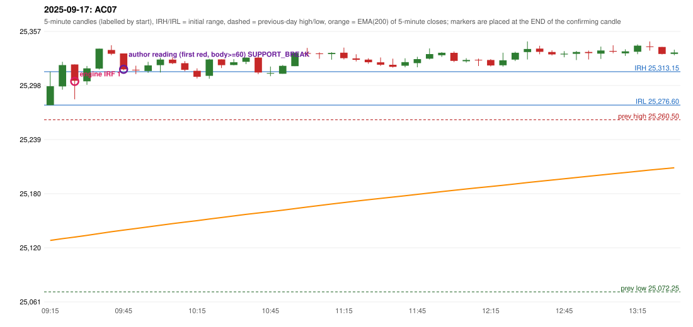

# 2025-09-17 - author's correction(s) against the engine

> Phase 5.1 date report. Evidence only; no rule was changed to produce a different outcome. Source image(s) are referenced under each correction.

## AC07 (PDF page 2, as written `20250917-1`, label `IRF`, ACTIVE)

### Author's observation

> IRF should be taken after 5 candles at 6th candle, because the entry candle body is 40% Wick is 60%. | entry should be activated here. | This should be ignored.

Suggested: **IRF (later candle)**; timing: later (the 6th candle instead of an earlier one); requirement stated: an entry candle whose body is 40% (wick 60%) is not valid; take the later candle. Drawing (my reading): Rising green candles, then a red candle and a small green one near two lines; an arrow 'This should be ignored' points to a red candle on the left; 'entry should be activated here' points to a later red candle on the right.. Uncertain: which candle 'the 6th' is counted from is not stated. Image: `reports/phase5/phase51_author_corrections/pages/page_2_full.png (page 2 of docs/strategy_docs/corrected/Adobe Scan Nov 05, 2026.pdf)`.

### Original automated trade

20250917-1-IRF IRF Method 1 SHORT signal 09:30 entry 25302.6 -> INITIAL_FULL_STOP

Stop 25337.6, T1 25275.6, T2 25242.6; exits 09:39 / 09:39. Engine explanation: IRF Method 1 SHORT: the completed 09:20 candle closed at 25,320.40, 7.25 points above the initial range high 25,313.15 (range [25,276.60, 25,313.15] from the 09:15 candle); the immediately following completed 09:25 candle closed at 25,303.20, back inside the range. The short signal was confirmed at 09:30 on that close. Entry reference close 25,303.20 is 9.95 points below IRH 25,313.15.

### Independent historical evidence

Session: open 25276.6, previous high/low/close 25260.5 / 25072.25 / 25239.1 (gap 37.5); first candle {'high': 25313.15, 'low': 25276.6, 'open': 25276.6, 'close': 25297.3}.

Signal-candle measurements: signal_candle_start=09:25, colour=R, body_pct=46.9, upper_wick_pct=0.0, lower_wick_pct=53.1, signal_close=25303.2, ema200=25132.19, entry_minus_ema=171.01, ema_below_entry=True, ema_within_27_below_entry=False, ema_between_entry_and_target1=False, close_below_ema=False, session_low_before_candle=25276.6, close_below_prior_session_low=False, candle_low_at_or_below_prior_session_low=False, points_above_prior_session_low=26.6, body_pct_below_60=True, body_pct_below_50=True

Readings of the author's 'first red candle' wording (my formalisations, side by side):

| reading | first red candle | support | resistance | entry (signal time, close, trigger, body %) |
|---|---|---|---|---|
| FULLY_ABOVE|body>=60 | 09:40 | 25331.25 | 25342.15 | 09:50, 25315.75, SUPPORT_BREAK, 94.1 |
| FULLY_ABOVE|body>=0 | 09:40 | 25331.25 | 25342.15 | 09:50, 25315.75, SUPPORT_BREAK, 94.1 |
| CLOSE_ABOVE|body>=60 | 09:40 | 25331.25 | 25342.15 | 09:50, 25315.75, SUPPORT_BREAK, 94.1 |
| CLOSE_ABOVE|body>=0 | 09:40 | 25331.25 | 25342.15 | 09:50, 25315.75, SUPPORT_BREAK, 94.1 |

ORB records: Method 1 ENGINE_SETUP_INVALIDATED: CANDLE_QUALITY(not a strong body / wick too large); Method 2 ENGINE_SETUP_INVALIDATED: CANDLE_QUALITY

Chronological signal timeline (engine):

| time | strategy | method | dir | event | reason |
|---|---|---|---|---|---|
| 09:30 | IRF | Method 1 | SHORT | EXECUTED | trade 1: INITIAL_FULL_STOP |
| 10:20 | IRF | Method 1 | SHORT | REJECTED | SECOND_TRADE_RESTRICTED_TO_PDR_PDS |
| 10:20 | IRF | Method 2A | SHORT | REJECTED | SECOND_TRADE_RESTRICTED_TO_PDR_PDS |
| 10:45 | IRF | Method 1 | SHORT | REJECTED | SECOND_TRADE_RESTRICTED_TO_PDR_PDS |
| 10:45 | IRF | Method 2B | SHORT | REJECTED | SECOND_TRADE_RESTRICTED_TO_PDR_PDS |
| 11:20 | IRF | Method 2B | SHORT | REJECTED | SECOND_TRADE_RESTRICTED_TO_PDR_PDS |
| 12:40 | IRF | Method 2B | SHORT | REJECTED | SECOND_TRADE_RESTRICTED_TO_PDR_PDS |
| 13:25 | IRF | Method 2B | SHORT | REJECTED | SECOND_TRADE_RESTRICTED_TO_PDR_PDS |
| 14:05 | IRF | Method 1 | SHORT | REJECTED | SECOND_TRADE_RESTRICTED_TO_PDR_PDS |
| 14:25 | IRF | Method 1 | SHORT | REJECTED | SECOND_TRADE_RESTRICTED_TO_PDR_PDS |
| 14:45 | IRF | Method 1 | SHORT | REJECTED | SECOND_TRADE_RESTRICTED_TO_PDR_PDS |

Rejected / invalidated setups: 10:20 IRF Method 1: SECOND_TRADE_RESTRICTED_TO_PDR_PDS; 10:20 IRF Method 2A: SECOND_TRADE_RESTRICTED_TO_PDR_PDS; 10:45 IRF Method 1: SECOND_TRADE_RESTRICTED_TO_PDR_PDS; 10:45 IRF Method 2B: SECOND_TRADE_RESTRICTED_TO_PDR_PDS; 11:20 IRF Method 2B: SECOND_TRADE_RESTRICTED_TO_PDR_PDS; 12:40 IRF Method 2B: SECOND_TRADE_RESTRICTED_TO_PDR_PDS; 13:25 IRF Method 2B: SECOND_TRADE_RESTRICTED_TO_PDR_PDS; 14:05 IRF Method 1: SECOND_TRADE_RESTRICTED_TO_PDR_PDS; 14:25 IRF Method 1: SECOND_TRADE_RESTRICTED_TO_PDR_PDS; 14:45 IRF Method 1: SECOND_TRADE_RESTRICTED_TO_PDR_PDS

Applicable source rules:

* `IRF-GLOBAL-005` (VERIFIED_QUALITATIVE): Apply only the rules of the method that is forming; one method's rules at a time. Applying one method's confirmation to the other is a common cause of poor execution.

### Conclusion

* **Classification:** ENTRY_TIMING_MISMATCH, CANDLE_CONFIRMATION_MISMATCH, MISSING_AUTHOR_RULE   **Category:** C
* **Is the author correct under the existing rules?** Consistent with the author's clarification: the engine's failure candle has a 46.9% body (she writes 40%), and under the first-red-candle reading the entry is the 09:45 candle (signal 09:50), i.e. later
* **Is the engine correct under the existing rules?** Yes under the guide (IRF-M1-004: no body test)
* **Missing requirement / root cause:** the entry-candle body threshold (60+ here, '<50' in AC32, 40% quoted here)
* **New rule required?** yes: entry-candle body threshold   **Implementable objectively now?** no: the threshold is stated three different ways   **Owner approval needed?** YES

Candles 09:15-13:00 (start, O, H, L, C, colour, body %, upper wick %, lower wick %, EMA200, close - EMA):

| start | O | H | L | C | col | body% | uw% | lw% | EMA | c-EMA |
|---|---|---|---|---|---|---|---|---|---|---|
| 09:15 | 25276.6 | 25313.15 | 25276.6 | 25297.3 | G | 56.6 | 43.4 | 0.0 | 25128.56 | 168.74 |
| 09:20 | 25297.05 | 25324.0 | 25293.5 | 25320.4 | G | 76.6 | 11.8 | 11.6 | 25130.47 | 189.93 |
| 09:25 | 25321.05 | 25321.05 | 25282.95 | 25303.2 | R | 46.9 | 0.0 | 53.1 | 25132.19 | 171.01 |
| 09:30 | 25302.6 | 25319.45 | 25298.8 | 25316.8 | G | 68.8 | 12.8 | 18.4 | 25134.03 | 182.77 |
| 09:35 | 25316.55 | 25338.35 | 25315.6 | 25338.35 | G | 95.8 | 0.0 | 4.2 | 25136.06 | 202.29 |
| 09:40 | 25336.9 | 25342.15 | 25331.25 | 25332.75 | R | 38.1 | 48.2 | 13.8 | 25138.02 | 194.73 |
| 09:45 | 25333.15 | 25333.15 | 25314.65 | 25315.75 | R | 94.1 | 0.0 | 5.9 | 25139.79 | 175.96 |
| 09:50 | 25315.3 | 25319.7 | 25310.45 | 25314.65 | R | 7.0 | 47.6 | 45.4 | 25141.53 | 173.12 |
| 09:55 | 25313.9 | 25323.95 | 25311.95 | 25320.05 | G | 51.2 | 32.5 | 16.3 | 25143.3 | 176.75 |
| 10:00 | 25320.35 | 25328.45 | 25312.25 | 25326.45 | G | 37.7 | 12.3 | 50.0 | 25145.13 | 181.32 |
| 10:05 | 25326.35 | 25328.95 | 25321.4 | 25322.4 | R | 52.3 | 34.4 | 13.2 | 25146.89 | 175.51 |
| 10:10 | 25322.45 | 25324.8 | 25313.75 | 25315.25 | R | 65.2 | 21.3 | 13.6 | 25148.56 | 166.69 |
| 10:15 | 25314.15 | 25316.8 | 25305.75 | 25307.6 | R | 59.3 | 24.0 | 16.7 | 25150.15 | 157.45 |
| 10:20 | 25308.6 | 25327.2 | 25305.45 | 25326.5 | G | 82.3 | 3.2 | 14.5 | 25151.9 | 174.6 |
| 10:25 | 25326.6 | 25326.75 | 25317.15 | 25320.35 | R | 65.1 | 1.6 | 33.3 | 25153.58 | 166.77 |
| 10:30 | 25320.5 | 25326.95 | 25320.15 | 25323.5 | G | 44.1 | 50.7 | 5.1 | 25155.27 | 168.23 |
| 10:35 | 25323.95 | 25328.6 | 25321.45 | 25328.55 | G | 64.3 | 0.7 | 35.0 | 25156.99 | 171.56 |
| 10:40 | 25328.55 | 25330.35 | 25310.4 | 25312.25 | R | 81.7 | 9.0 | 9.3 | 25158.54 | 153.71 |
| 10:45 | 25311.15 | 25318.8 | 25308.2 | 25311.65 | G | 4.7 | 67.5 | 27.8 | 25160.06 | 151.59 |
| 10:50 | 25310.9 | 25320.45 | 25310.9 | 25319.55 | G | 90.6 | 9.4 | 0.0 | 25161.65 | 157.9 |
| 10:55 | 25319.2 | 25334.05 | 25319.2 | 25333.65 | G | 97.3 | 2.7 | 0.0 | 25163.36 | 170.29 |
| 11:00 | 25333.45 | 25339.2 | 25329.9 | 25333.05 | R | 4.3 | 61.8 | 33.9 | 25165.05 | 168.0 |
| 11:05 | 25333.1 | 25334.35 | 25327.3 | 25332.75 | R | 5.0 | 17.7 | 77.3 | 25166.72 | 166.03 |
| 11:10 | 25332.45 | 25334.5 | 25326.3 | 25333.7 | G | 15.2 | 9.8 | 75.0 | 25168.38 | 165.32 |
| 11:15 | 25333.95 | 25339.5 | 25326.6 | 25327.95 | R | 46.5 | 43.0 | 10.5 | 25169.97 | 157.98 |
| 11:20 | 25327.7 | 25332.2 | 25324.4 | 25326.2 | R | 19.2 | 57.7 | 23.1 | 25171.52 | 154.68 |
| 11:25 | 25326.4 | 25327.9 | 25321.8 | 25323.5 | R | 47.5 | 24.6 | 27.9 | 25173.03 | 150.47 |
| 11:30 | 25323.45 | 25328.75 | 25319.5 | 25320.85 | R | 28.1 | 57.3 | 14.6 | 25174.5 | 146.35 |
| 11:35 | 25320.75 | 25327.4 | 25317.65 | 25318.5 | R | 23.1 | 68.2 | 8.7 | 25175.94 | 142.56 |
| 11:40 | 25319.7 | 25327.8 | 25318.0 | 25323.6 | G | 39.8 | 42.9 | 17.3 | 25177.41 | 146.19 |
| 11:45 | 25322.55 | 25329.45 | 25318.0 | 25326.95 | G | 38.4 | 21.8 | 39.7 | 25178.89 | 148.06 |
| 11:50 | 25327.45 | 25338.6 | 25326.6 | 25332.45 | G | 41.7 | 51.2 | 7.1 | 25180.42 | 152.03 |
| 11:55 | 25331.15 | 25334.6 | 25329.35 | 25333.85 | G | 51.4 | 14.3 | 34.3 | 25181.95 | 151.9 |
| 12:00 | 25333.8 | 25335.35 | 25323.7 | 25325.0 | R | 75.5 | 13.3 | 11.2 | 25183.37 | 141.63 |
| 12:05 | 25324.6 | 25327.95 | 25323.15 | 25326.0 | G | 29.2 | 40.6 | 30.2 | 25184.79 | 141.21 |
| 12:10 | 25326.2 | 25327.45 | 25319.35 | 25325.5 | R | 8.6 | 15.4 | 75.9 | 25186.19 | 139.31 |
| 12:15 | 25326.0 | 25326.9 | 25318.95 | 25320.0 | R | 75.5 | 11.3 | 13.2 | 25187.52 | 132.48 |
| 12:20 | 25320.15 | 25333.95 | 25318.75 | 25325.6 | G | 35.9 | 54.9 | 9.2 | 25188.9 | 136.7 |
| 12:25 | 25326.35 | 25334.95 | 25324.8 | 25333.85 | G | 73.9 | 10.8 | 15.3 | 25190.34 | 143.51 |
| 12:30 | 25334.65 | 25346.25 | 25326.55 | 25338.0 | G | 17.0 | 41.9 | 41.1 | 25191.81 | 146.19 |
| 12:35 | 25338.45 | 25341.55 | 25332.25 | 25334.95 | R | 37.6 | 33.3 | 29.0 | 25193.23 | 141.72 |
| 12:40 | 25334.7 | 25336.55 | 25330.95 | 25332.1 | R | 46.4 | 33.0 | 20.5 | 25194.61 | 137.49 |
| 12:45 | 25332.05 | 25335.7 | 25328.9 | 25332.85 | G | 11.8 | 41.9 | 46.3 | 25195.99 | 136.86 |
| 12:50 | 25332.7 | 25335.85 | 25325.9 | 25334.7 | G | 20.1 | 11.6 | 68.3 | 25197.37 | 137.33 |
| 12:55 | 25334.7 | 25336.3 | 25326.5 | 25333.5 | R | 12.2 | 16.3 | 71.4 | 25198.72 | 134.78 |
| 13:00 | 25332.9 | 25340.6 | 25327.15 | 25336.35 | G | 25.7 | 31.6 | 42.8 | 25200.09 | 136.26 |
