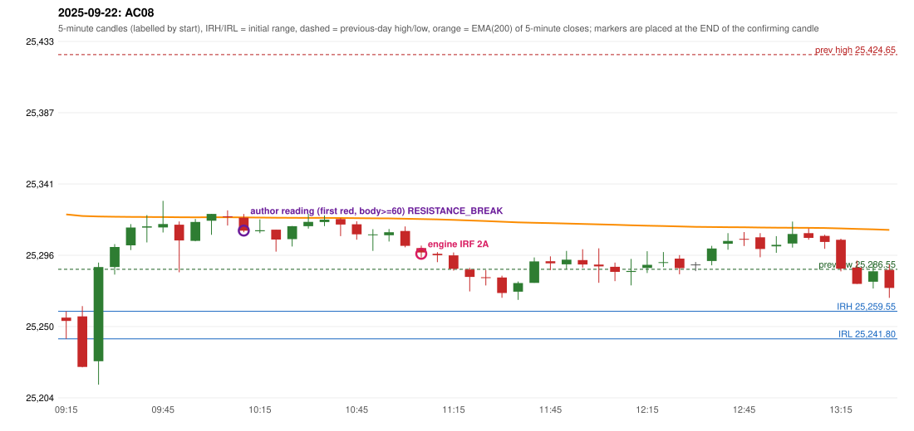

# 2025-09-22 - author's correction(s) against the engine

> Phase 5.1 date report. Evidence only; no rule was changed to produce a different outcome. Source image(s) are referenced under each correction.

## AC08 (PDF page 2, as written `20250922-1`, label `IRF`, ACTIVE)

### Author's observation

> Entry should have activated earlier, marking first red candles Support/Resista[nce]

Suggested: **IRF (earlier entry)**; timing: earlier; requirement stated: mark the support/resistance of the FIRST red candle. Drawing (my reading): none. Uncertain: end of the line cut by the page edge. Image: `reports/phase5/phase51_author_corrections/pages/page_2_full.png (page 2 of docs/strategy_docs/corrected/Adobe Scan Nov 05, 2026.pdf)`.

### Original automated trade

20250922-1-IRF IRF Method 2A SHORT signal 11:10 entry 25296.55 -> T1_THEN_BUFFER_STOP

Stop 25331.55, T1 25269.55, T2 25236.55; exits 11:32 / 12:40. Engine explanation: IRF Method 2A SHORT: the 09:25-09:30 candle closed at 25,288.00, above IRH 25,259.55, and the next candle did not close back inside the range, so the setup is Method 2 and price stayed above it until the trigger. Extension candle 09:30-09:35, red candle 09:50-09:55. The trigger came 20 candles after the breakout candle: a completed candle closed below the recent pullback-low support (11:05-11:10); confirmed at 11:10 with close 25,297.40. Entry reference close 25,297.40 is 37.85 points above IRH 25,259.55.

### Independent historical evidence

Session: open 25255.45, previous high/low/close 25424.65 / 25286.55 / 25327.05 (gap -71.6); first candle {'high': 25259.55, 'low': 25241.8, 'open': 25255.45, 'close': 25253.3}.

Signal-candle measurements: signal_candle_start=11:05, colour=R, body_pct=36.6, upper_wick_pct=20.9, lower_wick_pct=42.5, signal_close=25297.4, ema200=25318.88, entry_minus_ema=-21.48, ema_below_entry=False, ema_within_27_below_entry=False, ema_between_entry_and_target1=False, close_below_ema=True, session_low_before_candle=25212.35, close_below_prior_session_low=False, candle_low_at_or_below_prior_session_low=False, points_above_prior_session_low=85.05, body_pct_below_60=True, body_pct_below_50=True

Readings of the author's 'first red candle' wording (my formalisations, side by side):

| reading | first red candle | support | resistance | entry (signal time, close, trigger, body %) |
|---|---|---|---|---|
| FULLY_ABOVE|body>=60 | 09:50 | 25284.65 | 25317.35 | 10:15, 25311.45, RESISTANCE_BREAK, 71.4 |
| FULLY_ABOVE|body>=0 | 09:50 | 25284.65 | 25317.35 | 10:15, 25311.45, RESISTANCE_BREAK, 71.4 |
| CLOSE_ABOVE|body>=60 | 09:50 | 25284.65 | 25317.35 | 10:15, 25311.45, RESISTANCE_BREAK, 71.4 |
| CLOSE_ABOVE|body>=0 | 09:50 | 25284.65 | 25317.35 | 10:15, 25311.45, RESISTANCE_BREAK, 71.4 |

ORB records: Method 1 ENGINE_SETUP_INVALIDATED: TREND:EMA_PREV_SESSION_CLOSE wrong side; Method 2 ENGINE_SETUP_INVALIDATED: TREND:EMA_PREV_SESSION_CLOSE wrong side; Gap/200DMA ENGINE_SETUP_INVALIDATED: CANDLE_QUALITY_OR_REJECTION_WICK

Chronological signal timeline (engine):

| time | strategy | method | dir | event | reason |
|---|---|---|---|---|---|
| 11:10 | IRF | Method 2A | SHORT | EXECUTED | trade 1: T1_THEN_BUFFER_STOP |
| 11:25 | PDS | Method 3 | SHORT | IGNORED | POSITION_ACTIVE (signal kept for diagnostics only; never reused) |
| 12:55 | IRF | Method 2B | SHORT | IGNORED | DAY_FINISHED |
| 13:20 | PDS | Method 3 | SHORT | IGNORED | DAY_FINISHED |
| 13:25 | PDS | Method 1 | SHORT | IGNORED | DAY_FINISHED |
| 14:00 | IRF | Method 1 | SHORT | IGNORED | DAY_FINISHED |
| 14:00 | IRF | Method 2A | SHORT | IGNORED | DAY_FINISHED |
| 14:00 | PDS | Method 3 | SHORT | IGNORED | DAY_FINISHED |

Rejected / invalidated setups: 14:05 IRF Method 1/2: SESSION_ENDED_BEFORE_CONFIRMATION; 09:15 ORB Method 1: TREND:EMA_PREV_SESSION_CLOSE wrong side; 09:15 ORB Method 2: TREND:EMA_PREV_SESSION_CLOSE wrong side; 09:15 ORB Gap/200DMA: CANDLE_QUALITY_OR_REJECTION_WICK; 14:05 PDS Method 1/2/3: NO_QUALIFYING_ENTRY_BEFORE_SESSION_END; 13:55 RF RF: GAP_NOT_UP(DOWN)

### Conclusion

* **Classification:** ENTRY_TIMING_MISMATCH, SUPPORT_RESISTANCE_MISMATCH, MISSING_AUTHOR_RULE   **Category:** C
* **Is the author correct under the existing rules?** Consistent with the author's wording: the first-red-candle reading enters at 10:15, earlier than the engine's 11:10
* **Is the engine correct under the existing rules?** Yes under the existing proposals
* **Missing requirement / root cause:** S/R of the first red candle
* **New rule required?** yes: the first-red-candle rule   **Implementable objectively now?** no (ambiguous)   **Owner approval needed?** YES

Candles 09:15-13:00 (start, O, H, L, C, colour, body %, upper wick %, lower wick %, EMA200, close - EMA):

| start | O | H | L | C | col | body% | uw% | lw% | EMA | c-EMA |
|---|---|---|---|---|---|---|---|---|---|---|
| 09:15 | 25255.45 | 25259.55 | 25241.8 | 25253.3 | R | 12.1 | 23.1 | 64.8 | 25321.85 | -68.55 |
| 09:20 | 25256.25 | 25262.9 | 25223.5 | 25223.7 | R | 82.6 | 16.9 | 0.5 | 25320.87 | -97.17 |
| 09:25 | 25227.4 | 25290.9 | 25212.35 | 25288.0 | G | 77.1 | 3.7 | 19.2 | 25320.54 | -32.54 |
| 09:30 | 25288.0 | 25302.75 | 25283.15 | 25300.9 | G | 65.8 | 9.4 | 24.7 | 25320.35 | -19.45 |
| 09:35 | 25302.0 | 25315.6 | 25298.95 | 25313.45 | G | 68.8 | 12.9 | 18.3 | 25320.28 | -6.83 |
| 09:40 | 25313.4 | 25321.45 | 25303.85 | 25314.2 | G | 4.5 | 41.2 | 54.3 | 25320.22 | -6.02 |
| 09:45 | 25313.5 | 25330.6 | 25310.25 | 25315.7 | G | 10.8 | 73.2 | 16.0 | 25320.17 | -4.47 |
| 09:50 | 25315.25 | 25317.35 | 25284.65 | 25305.1 | R | 31.0 | 6.4 | 62.5 | 25320.02 | -14.92 |
| 09:55 | 25304.85 | 25318.9 | 25304.6 | 25317.0 | G | 85.0 | 13.3 | 1.7 | 25319.99 | -2.99 |
| 10:00 | 25317.85 | 25322.25 | 25308.75 | 25322.2 | G | 32.2 | 0.4 | 67.4 | 25320.02 | 2.18 |
| 10:05 | 25320.65 | 25324.45 | 25314.7 | 25320.05 | R | 6.2 | 39.0 | 54.9 | 25320.02 | 0.03 |
| 10:10 | 25319.8 | 25322.1 | 25310.4 | 25311.45 | R | 71.4 | 19.7 | 9.0 | 25319.93 | -8.48 |
| 10:15 | 25311.0 | 25318.65 | 25309.8 | 25311.65 | G | 7.3 | 79.1 | 13.6 | 25319.85 | -8.2 |
| 10:20 | 25312.05 | 25312.05 | 25297.9 | 25305.7 | R | 44.9 | 0.0 | 55.1 | 25319.71 | -14.01 |
| 10:25 | 25306.0 | 25314.4 | 25301.25 | 25314.3 | G | 63.1 | 0.8 | 36.1 | 25319.65 | -5.35 |
| 10:30 | 25314.3 | 25322.25 | 25312.75 | 25317.05 | G | 28.9 | 54.7 | 16.3 | 25319.63 | -2.58 |
| 10:35 | 25316.95 | 25321.2 | 25314.35 | 25318.5 | G | 22.6 | 39.4 | 38.0 | 25319.62 | -1.12 |
| 10:40 | 25318.85 | 25319.6 | 25307.9 | 25315.35 | R | 29.9 | 6.4 | 63.7 | 25319.57 | -4.22 |
| 10:45 | 25315.5 | 25317.45 | 25305.6 | 25309.05 | R | 54.4 | 16.5 | 29.1 | 25319.47 | -10.42 |
| 10:50 | 25308.5 | 25312.35 | 25298.4 | 25309.0 | G | 3.6 | 24.0 | 72.4 | 25319.37 | -10.37 |
| 10:55 | 25308.5 | 25312.45 | 25304.4 | 25310.4 | G | 23.6 | 25.5 | 50.9 | 25319.28 | -8.88 |
| 11:00 | 25311.2 | 25314.15 | 25300.7 | 25301.65 | R | 71.0 | 21.9 | 7.1 | 25319.1 | -17.45 |
| 11:05 | 25300.2 | 25301.8 | 25294.15 | 25297.4 | R | 36.6 | 20.9 | 42.5 | 25318.88 | -21.48 |
| 11:10 | 25296.55 | 25297.6 | 25291.15 | 25295.65 | R | 14.0 | 16.3 | 69.8 | 25318.65 | -23.0 |
| 11:15 | 25295.5 | 25297.4 | 25285.7 | 25286.85 | R | 73.9 | 16.2 | 9.8 | 25318.34 | -31.49 |
| 11:20 | 25286.4 | 25287.5 | 25272.3 | 25281.65 | R | 31.2 | 7.2 | 61.5 | 25317.97 | -36.32 |
| 11:25 | 25281.45 | 25286.1 | 25276.15 | 25281.2 | R | 2.5 | 46.7 | 50.8 | 25317.61 | -36.41 |
| 11:30 | 25281.3 | 25282.45 | 25268.2 | 25271.35 | R | 69.8 | 8.1 | 22.1 | 25317.15 | -45.8 |
| 11:35 | 25272.15 | 25278.7 | 25266.9 | 25277.7 | G | 47.0 | 8.5 | 44.5 | 25316.75 | -39.05 |
| 11:40 | 25277.85 | 25294.2 | 25277.85 | 25291.65 | G | 84.4 | 15.6 | 0.0 | 25316.5 | -24.85 |
| 11:45 | 25291.75 | 25294.9 | 25286.05 | 25290.4 | R | 15.3 | 35.6 | 49.2 | 25316.24 | -25.84 |
| 11:50 | 25289.75 | 25298.4 | 25286.6 | 25292.75 | G | 25.4 | 47.9 | 26.7 | 25316.01 | -23.26 |
| 11:55 | 25292.5 | 25299.45 | 25287.65 | 25289.65 | R | 24.2 | 58.9 | 16.9 | 25315.75 | -26.1 |
| 12:00 | 25289.6 | 25300.05 | 25277.85 | 25288.45 | R | 5.2 | 47.1 | 47.7 | 25315.48 | -27.03 |
| 12:05 | 25288.15 | 25290.9 | 25278.95 | 25284.9 | R | 27.2 | 23.0 | 49.8 | 25315.17 | -30.27 |
| 12:10 | 25284.85 | 25293.25 | 25276.2 | 25285.5 | G | 3.8 | 45.5 | 50.7 | 25314.88 | -29.38 |
| 12:15 | 25287.4 | 25298.2 | 25284.15 | 25289.45 | G | 14.6 | 62.3 | 23.1 | 25314.62 | -25.17 |
| 12:20 | 25290.95 | 25297.65 | 25288.0 | 25291.15 | G | 2.1 | 67.4 | 30.6 | 25314.39 | -23.24 |
| 12:25 | 25293.45 | 25295.7 | 25283.35 | 25287.3 | R | 49.8 | 18.2 | 32.0 | 25314.12 | -26.82 |
| 12:30 | 25289.65 | 25291.25 | 25285.4 | 25289.65 | D | 0.0 | 27.4 | 72.6 | 25313.88 | -24.23 |
| 12:35 | 25291.9 | 25301.65 | 25289.1 | 25299.95 | G | 64.1 | 13.5 | 22.3 | 25313.74 | -13.79 |
| 12:40 | 25303.0 | 25309.8 | 25299.15 | 25304.8 | G | 16.9 | 46.9 | 36.2 | 25313.65 | -8.85 |
| 12:45 | 25306.15 | 25310.5 | 25301.55 | 25305.65 | R | 5.6 | 48.6 | 45.8 | 25313.57 | -7.92 |
| 12:50 | 25307.15 | 25309.8 | 25294.3 | 25299.65 | R | 48.4 | 17.1 | 34.5 | 25313.43 | -13.78 |
| 12:55 | 25301.35 | 25307.9 | 25297.15 | 25302.3 | G | 8.8 | 52.1 | 39.1 | 25313.32 | -11.02 |
| 13:00 | 25303.15 | 25317.3 | 25300.55 | 25309.3 | G | 36.7 | 47.8 | 15.5 | 25313.28 | -3.98 |
