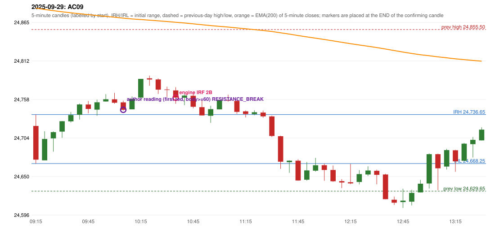

# 2025-09-29 - author's correction(s) against the engine

> Phase 5.1 date report. Evidence only; no rule was changed to produce a different outcome. Source image(s) are referenced under each correction.

## AC09 (PDF page 2, as written `20250929-1`, label `IRF`, ACTIVE)

### Author's observation

> Late entry, red candle should be marked, 1st red candle.

Suggested: **IRF (earlier entry)**; timing: earlier; requirement stated: the 1st red candle should be marked. Drawing (my reading): none. Uncertain: none. Image: `reports/phase5/phase51_author_corrections/pages/page_2_full.png (page 2 of docs/strategy_docs/corrected/Adobe Scan Nov 05, 2026.pdf)`.

### Original automated trade

20250929-1-IRF IRF Method 2B SHORT signal 10:40 entry 24760.25 -> TARGET

Stop 24795.25, T1 24733.25, T2 24700.25; exits 10:55 / 11:35. Engine explanation: IRF Method 2B SHORT: the 09:40-09:45 candle closed at 24,750.80, above IRH 24,736.65, and the next candle did not close back inside the range, so the setup is Method 2 and price stayed above it until the trigger. Extension candle 09:45-09:50, red candle 10:00-10:05. The trigger came 11 candles after the breakout candle: a red candle closed back below the first-push resistance after price had traded above it (10:35-10:40); confirmed at 10:40 with close 24,760.50. Entry reference close 24,760.50 is 23.85 points above IRH 24,736.65.

### Independent historical evidence

Session: open 24720.8, previous high/low/close 24855.5 / 24629.65 / 24654.7 (gap 66.1); first candle {'high': 24736.65, 'low': 24668.25, 'open': 24720.8, 'close': 24673.7}.

Signal-candle measurements: signal_candle_start=10:35, colour=R, body_pct=43.1, upper_wick_pct=19.3, lower_wick_pct=37.7, signal_close=24760.5, ema200=24865.65, entry_minus_ema=-105.15, ema_below_entry=False, ema_within_27_below_entry=False, ema_between_entry_and_target1=False, close_below_ema=True, session_low_before_candle=24668.25, close_below_prior_session_low=False, candle_low_at_or_below_prior_session_low=False, points_above_prior_session_low=92.25, body_pct_below_60=True, body_pct_below_50=True

Readings of the author's 'first red candle' wording (my formalisations, side by side):

| reading | first red candle | support | resistance | entry (signal time, close, trigger, body %) |
|---|---|---|---|---|
| FULLY_ABOVE|body>=60 | 09:45 | 24738.45 | 24755.65 | 10:10, 24743.4, RESISTANCE_BREAK, 72.8 |
| FULLY_ABOVE|body>=0 | 09:45 | 24738.45 | 24755.65 | 10:05, 24753.15, RESISTANCE_BREAK, 31.9 |
| CLOSE_ABOVE|body>=60 | 09:45 | 24738.45 | 24755.65 | 10:10, 24743.4, RESISTANCE_BREAK, 72.8 |
| CLOSE_ABOVE|body>=0 | 09:45 | 24738.45 | 24755.65 | 10:05, 24753.15, RESISTANCE_BREAK, 31.9 |

Chronological signal timeline (engine):

| time | strategy | method | dir | event | reason |
|---|---|---|---|---|---|
| 10:40 | IRF | Method 2B | SHORT | EXECUTED | trade 1: TARGET |
| 10:55 | IRF | Method 1 | SHORT | IGNORED | POSITION_ACTIVE (signal kept for diagnostics only; never reused) |
| 11:30 | IRF | Method 1 | SHORT | IGNORED | POSITION_ACTIVE (signal kept for diagnostics only; never reused) |

Rejected / invalidated setups: 10:35 IRF Method 1/2: SESSION_ENDED_BEFORE_CONFIRMATION; 09:15 PDR PDR: OPEN_NOT_STRICTLY_ABOVE_ZONE; 13:00 RF RF: TREND:EMA_PREV_SESSION_CLOSE wrong side

### Conclusion

* **Classification:** ENTRY_TIMING_MISMATCH, SUPPORT_RESISTANCE_MISMATCH, MISSING_AUTHOR_RULE   **Category:** C
* **Is the author correct under the existing rules?** Consistent with the author's wording: the first-red-candle reading enters at 10:05 / 10:10, earlier than the engine's 10:40
* **Is the engine correct under the existing rules?** Yes under the existing proposals
* **Missing requirement / root cause:** S/R of the first red candle
* **New rule required?** yes: the first-red-candle rule   **Implementable objectively now?** no (ambiguous)   **Owner approval needed?** YES

Candles 09:15-13:00 (start, O, H, L, C, colour, body %, upper wick %, lower wick %, EMA200, close - EMA):

| start | O | H | L | C | col | body% | uw% | lw% | EMA | c-EMA |
|---|---|---|---|---|---|---|---|---|---|---|
| 09:15 | 24720.8 | 24736.65 | 24668.25 | 24673.7 | R | 68.9 | 23.2 | 8.0 | 24885.39 | -211.69 |
| 09:20 | 24672.75 | 24713.35 | 24672.75 | 24702.6 | G | 73.5 | 26.5 | 0.0 | 24883.57 | -180.97 |
| 09:25 | 24703.4 | 24713.15 | 24684.8 | 24712.1 | G | 30.7 | 3.7 | 65.6 | 24881.87 | -169.77 |
| 09:30 | 24712.9 | 24727.65 | 24704.2 | 24727.4 | G | 61.8 | 1.1 | 37.1 | 24880.33 | -152.93 |
| 09:35 | 24727.25 | 24740.3 | 24725.6 | 24736.05 | G | 59.9 | 28.9 | 11.2 | 24878.89 | -142.84 |
| 09:40 | 24736.4 | 24752.1 | 24729.65 | 24750.8 | G | 64.1 | 5.8 | 30.1 | 24877.62 | -126.82 |
| 09:45 | 24750.75 | 24755.65 | 24738.45 | 24744.55 | R | 36.0 | 28.5 | 35.5 | 24876.3 | -131.75 |
| 09:50 | 24743.6 | 24757.45 | 24735.0 | 24753.85 | G | 45.7 | 16.0 | 38.3 | 24875.08 | -121.23 |
| 09:55 | 24755.0 | 24765.15 | 24754.75 | 24758.1 | G | 29.8 | 67.8 | 2.4 | 24873.91 | -115.81 |
| 10:00 | 24758.0 | 24767.05 | 24751.85 | 24753.15 | R | 31.9 | 59.5 | 8.6 | 24872.71 | -119.56 |
| 10:05 | 24753.7 | 24756.25 | 24742.1 | 24743.4 | R | 72.8 | 18.0 | 9.2 | 24871.42 | -128.02 |
| 10:10 | 24744.0 | 24762.05 | 24744.0 | 24758.4 | G | 79.8 | 20.2 | 0.0 | 24870.3 | -111.9 |
| 10:15 | 24760.35 | 24786.55 | 24756.7 | 24786.55 | G | 87.8 | 0.0 | 12.2 | 24869.47 | -82.92 |
| 10:20 | 24787.35 | 24791.15 | 24777.05 | 24785.75 | R | 11.3 | 27.0 | 61.7 | 24868.63 | -82.88 |
| 10:25 | 24785.75 | 24787.2 | 24765.5 | 24771.5 | R | 65.7 | 6.7 | 27.6 | 24867.67 | -96.17 |
| 10:30 | 24771.75 | 24775.65 | 24761.25 | 24771.05 | R | 4.9 | 27.1 | 68.1 | 24866.71 | -95.66 |
| 10:35 | 24770.45 | 24774.9 | 24751.8 | 24760.5 | R | 43.1 | 19.3 | 37.7 | 24865.65 | -105.15 |
| 10:40 | 24760.25 | 24765.6 | 24749.7 | 24763.25 | G | 18.9 | 14.8 | 66.4 | 24864.63 | -101.38 |
| 10:45 | 24763.0 | 24766.9 | 24745.45 | 24747.6 | R | 71.8 | 18.2 | 10.0 | 24863.47 | -115.87 |
| 10:50 | 24747.0 | 24756.6 | 24735.5 | 24735.5 | R | 54.5 | 45.5 | 0.0 | 24862.19 | -126.69 |
| 10:55 | 24735.0 | 24749.1 | 24725.1 | 24744.3 | G | 38.7 | 20.0 | 41.3 | 24861.02 | -116.72 |
| 11:00 | 24743.95 | 24757.15 | 24743.95 | 24757.15 | G | 100.0 | 0.0 | 0.0 | 24859.99 | -102.84 |
| 11:05 | 24756.8 | 24764.4 | 24754.8 | 24756.05 | R | 7.8 | 79.2 | 13.0 | 24858.95 | -102.9 |
| 11:10 | 24755.7 | 24757.7 | 24737.7 | 24740.45 | R | 76.2 | 10.0 | 13.8 | 24857.77 | -117.32 |
| 11:15 | 24741.2 | 24742.45 | 24732.75 | 24737.5 | R | 38.1 | 12.9 | 49.0 | 24856.58 | -119.08 |
| 11:20 | 24737.3 | 24742.65 | 24735.8 | 24739.9 | G | 38.0 | 40.1 | 21.9 | 24855.41 | -115.51 |
| 11:25 | 24739.5 | 24742.3 | 24732.25 | 24734.15 | R | 53.2 | 27.9 | 18.9 | 24854.21 | -120.06 |
| 11:30 | 24734.1 | 24735.3 | 24705.25 | 24706.75 | R | 91.0 | 4.0 | 5.0 | 24852.74 | -145.99 |
| 11:35 | 24706.45 | 24707.05 | 24660.85 | 24670.8 | R | 77.2 | 1.3 | 21.5 | 24850.93 | -180.13 |
| 11:40 | 24670.15 | 24672.75 | 24655.2 | 24672.25 | G | 12.0 | 2.8 | 85.2 | 24849.15 | -176.9 |
| 11:45 | 24672.25 | 24674.1 | 24644.25 | 24644.6 | R | 92.6 | 6.2 | 1.2 | 24847.12 | -202.52 |
| 11:50 | 24645.65 | 24670.35 | 24644.3 | 24658.65 | G | 49.9 | 44.9 | 5.2 | 24845.24 | -186.59 |
| 11:55 | 24658.25 | 24676.15 | 24656.95 | 24665.85 | G | 39.6 | 53.6 | 6.8 | 24843.46 | -177.61 |
| 12:00 | 24665.9 | 24668.0 | 24644.15 | 24659.25 | R | 27.9 | 8.8 | 63.3 | 24841.62 | -182.37 |
| 12:05 | 24659.3 | 24665.5 | 24642.7 | 24643.5 | R | 69.3 | 27.2 | 3.5 | 24839.65 | -196.15 |
| 12:10 | 24643.6 | 24646.45 | 24633.95 | 24641.7 | R | 15.2 | 22.8 | 62.0 | 24837.68 | -195.98 |
| 12:15 | 24642.15 | 24667.75 | 24639.4 | 24640.5 | R | 5.8 | 90.3 | 3.9 | 24835.72 | -195.22 |
| 12:20 | 24642.45 | 24659.1 | 24639.1 | 24653.5 | G | 55.2 | 28.0 | 16.8 | 24833.91 | -180.41 |
| 12:25 | 24652.95 | 24664.35 | 24650.95 | 24658.55 | G | 41.8 | 43.3 | 14.9 | 24832.16 | -173.61 |
| 12:30 | 24658.1 | 24659.7 | 24639.2 | 24652.45 | R | 27.6 | 7.8 | 64.6 | 24830.37 | -177.92 |
| 12:35 | 24652.95 | 24653.95 | 24618.45 | 24618.45 | R | 97.2 | 2.8 | 0.0 | 24828.27 | -209.82 |
| 12:40 | 24617.7 | 24622.1 | 24610.35 | 24613.5 | R | 35.7 | 37.4 | 26.8 | 24826.13 | -212.63 |
| 12:45 | 24614.4 | 24633.05 | 24606.2 | 24616.45 | G | 7.6 | 61.8 | 30.5 | 24824.04 | -207.59 |
| 12:50 | 24614.95 | 24631.6 | 24609.7 | 24627.3 | G | 56.4 | 19.6 | 24.0 | 24822.09 | -194.79 |
| 12:55 | 24627.9 | 24645.25 | 24627.9 | 24640.05 | G | 70.0 | 30.0 | 0.0 | 24820.27 | -180.22 |
| 13:00 | 24640.4 | 24682.4 | 24633.25 | 24681.35 | G | 83.3 | 2.1 | 14.5 | 24818.89 | -137.54 |
