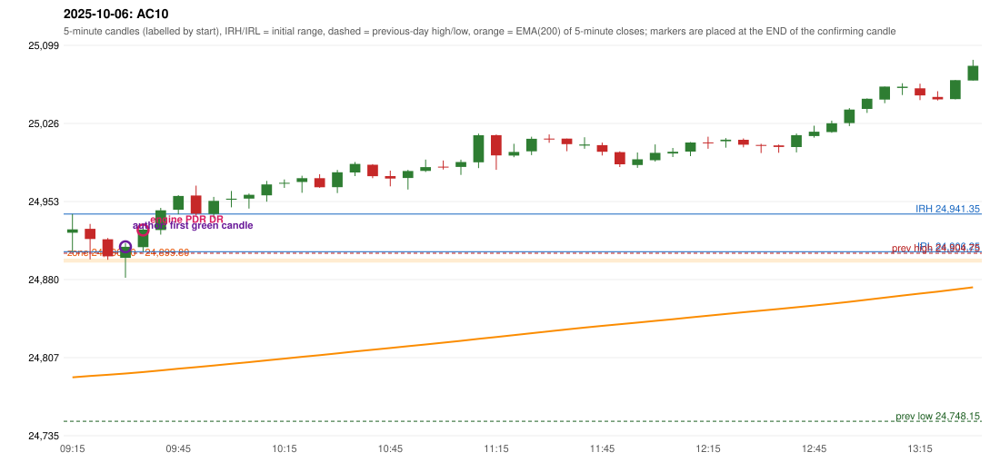

# 2025-10-06 - author's correction(s) against the engine

> Phase 5.1 date report. Evidence only; no rule was changed to produce a different outcome. Source image(s) are referenced under each correction.

## AC10 (PDF page 2, as written `20251006-1`, label `PDR`, ACTIVE)

### Author's observation

> Long. | Enter in 1st green candle.

Suggested: **PDR (earlier entry)**; timing: earlier (first green candle); requirement stated: enter in the 1st green candle. Drawing (my reading): Red and green candles above a box labelled PDR; an arrow from a green candle's top is labelled 'Long.'. Uncertain: none. Image: `reports/phase5/phase51_author_corrections/pages/page_2_full.png (page 2 of docs/strategy_docs/corrected/Adobe Scan Nov 05, 2026.pdf)`.

### Original automated trade

20251006-1-PDR PDR PDR LONG signal 09:40 entry 24926.45 -> TARGET

Stop 24891.45, T1 24953.45, T2 24996.45; exits 09:45 / 11:12. Engine explanation: PDR LONG (body-based engine, A_HIGHEST_BODY_HIGH): the session opened 29.65 points above the previous close and 24.10 points above the previous-day highest BODY high 24,899.80 (zone [24,896.10, 24,899.80] from the 15:05 candle of 2025-10-03; the highest wick 24,904.75 is ignored). The 09:20 candle (24,899.05 - 24,932.15) tested the zone; the 09:35 candle (green, O 24,910.45 H 24,931.05 L 24,906.30 C 24,926.85) passed GOOD_GREEN_BODY and closed 27.05 points above the zone ceiling, confirming the entry at 09:40. The pattern thresholds and the zone's lower boundary are provisional research assumptions, not approved by the strategy author.

### Independent historical evidence

Session: open 24923.9, previous high/low/close 24904.75 / 24748.15 / 24894.25 (gap 29.65); first candle {'high': 24941.35, 'low': 24906.25, 'open': 24923.9, 'close': 24927.05}.

First green candle after the zone interaction ('enter in 1st green candle'): {"interaction_candle": "09:20", "first_green_close_above_ceiling": {"candle_start": "09:30", "signal_time": "09:35", "colour": "G", "body_pct": 31.9, "upper_wick_pct": 10.9, "lower_wick_pct": 57.2, "close": 24910.8, "points_above_ceiling": 11.0, "low_below_zone_floor": true}}

ORB records: Method 1 ENGINE_SETUP_INVALIDATED: CANDLE_QUALITY(not a strong body / wick too large); Method 2 ENGINE_SETUP_INVALIDATED: TRENDLINE_NOT_SUPPORTIVE

Chronological signal timeline (engine):

| time | strategy | method | dir | event | reason |
|---|---|---|---|---|---|
| 09:40 | PDR | PDR | LONG | EXECUTED | trade 1: TARGET |
| 10:30 | IRF | Method 2B | SHORT | IGNORED | POSITION_ACTIVE (signal kept for diagnostics only; never reused) |
| 11:05 | IRF | Method 2B | SHORT | IGNORED | POSITION_ACTIVE (signal kept for diagnostics only; never reused) |
| 11:50 | IRF | Method 2A | SHORT | IGNORED | DAY_FINISHED |
| 12:30 | IRF | Method 2B | SHORT | IGNORED | DAY_FINISHED |
| 13:50 | IRF | Method 2B | SHORT | IGNORED | DAY_FINISHED |
| 14:30 | IRF | Method 2A | SHORT | IGNORED | DAY_FINISHED |
| 14:50 | IRF | Method 2B | SHORT | IGNORED | DAY_FINISHED |

Rejected / invalidated setups: 14:45 IRF Method 1/2: SESSION_ENDED_BEFORE_CONFIRMATION; 09:15 ORB Method 1: CANDLE_QUALITY(not a strong body / wick too large); 09:15 ORB Method 2: TRENDLINE_NOT_SUPPORTIVE; 09:30 RF RF: GAP_UP_OUTSIDE_YESTERDAYS_RANGE

Applicable source rules:

* `PDR-007` (VERIFIED_QUALITATIVE): After the zone has been tested, wait for a green candle and take the long on that confirmation.

### Conclusion

* **Classification:** CANDLE_CONFIRMATION_MISMATCH, ENTRY_TIMING_MISMATCH   **Category:** C
* **Is the author correct under the existing rules?** Consistent with the legacy PDR-007 wording ('wait for a green candle', replaced by PDR-A04 in Phase 3.4) and with the author's 'first green candle': the 09:30 candle is the first green candle that closes above the zone ceiling
* **Is the engine correct under the existing rules?** Yes under the PDR-A04 thresholds (proposed): the 09:30 candle is no 'good green body' (31.9%) and no 2x hammer (1.8x)
* **Missing requirement / root cause:** the numeric thresholds of 'good green body / hammer' (proposals, not given by the author)
* **New rule required?** yes: replace / loosen the pattern thresholds   **Implementable objectively now?** no   **Owner approval needed?** YES

Candles 09:15-13:00 (start, O, H, L, C, colour, body %, upper wick %, lower wick %, EMA200, close - EMA):

| start | O | H | L | C | col | body% | uw% | lw% | EMA | c-EMA |
|---|---|---|---|---|---|---|---|---|---|---|
| 09:15 | 24923.9 | 24941.35 | 24906.25 | 24927.05 | G | 9.0 | 40.7 | 50.3 | 24789.1 | 137.95 |
| 09:20 | 24927.5 | 24932.15 | 24899.05 | 24918.0 | R | 28.7 | 14.0 | 57.3 | 24790.38 | 127.62 |
| 09:25 | 24917.8 | 24919.0 | 24898.65 | 24901.85 | R | 78.4 | 5.9 | 15.7 | 24791.49 | 110.36 |
| 09:30 | 24900.45 | 24914.35 | 24881.9 | 24910.8 | G | 31.9 | 10.9 | 57.2 | 24792.68 | 118.12 |
| 09:35 | 24910.45 | 24931.05 | 24906.3 | 24926.85 | G | 66.3 | 17.0 | 16.8 | 24794.02 | 132.83 |
| 09:40 | 24926.45 | 24947.1 | 24922.15 | 24944.8 | G | 73.5 | 9.2 | 17.2 | 24795.52 | 149.28 |
| 09:45 | 24945.3 | 24958.9 | 24941.05 | 24958.15 | G | 72.0 | 4.2 | 23.8 | 24797.13 | 161.02 |
| 09:50 | 24958.6 | 24967.85 | 24940.0 | 24941.7 | R | 60.7 | 33.2 | 6.1 | 24798.57 | 143.13 |
| 09:55 | 24941.4 | 24957.35 | 24937.3 | 24953.6 | G | 60.8 | 18.7 | 20.4 | 24800.11 | 153.49 |
| 10:00 | 24954.7 | 24962.85 | 24947.6 | 24955.65 | G | 6.2 | 47.2 | 46.6 | 24801.66 | 153.99 |
| 10:05 | 24955.75 | 24960.45 | 24946.45 | 24959.3 | G | 25.4 | 8.2 | 66.4 | 24803.23 | 156.07 |
| 10:10 | 24958.75 | 24972.2 | 24952.85 | 24968.9 | G | 52.5 | 17.1 | 30.5 | 24804.88 | 164.02 |
| 10:15 | 24969.65 | 24973.6 | 24965.7 | 24970.45 | G | 10.1 | 39.9 | 50.0 | 24806.53 | 163.92 |
| 10:20 | 24971.25 | 24977.05 | 24961.1 | 24974.8 | G | 22.3 | 14.1 | 63.6 | 24808.2 | 166.6 |
| 10:25 | 24974.75 | 24978.45 | 24965.8 | 24966.3 | R | 66.8 | 29.2 | 4.0 | 24809.77 | 156.53 |
| 10:30 | 24966.45 | 24982.5 | 24960.85 | 24980.3 | G | 64.0 | 10.2 | 25.9 | 24811.47 | 168.83 |
| 10:35 | 24980.1 | 24989.8 | 24976.7 | 24988.05 | G | 60.7 | 13.4 | 26.0 | 24813.23 | 174.82 |
| 10:40 | 24987.25 | 24987.9 | 24974.75 | 24976.6 | R | 81.0 | 4.9 | 14.1 | 24814.85 | 161.75 |
| 10:45 | 24976.75 | 24981.75 | 24967.15 | 24974.5 | R | 15.4 | 34.2 | 50.3 | 24816.44 | 158.06 |
| 10:50 | 24974.95 | 24982.55 | 24964.2 | 24981.45 | G | 35.4 | 6.0 | 58.6 | 24818.08 | 163.37 |
| 10:55 | 24981.5 | 24992.1 | 24980.55 | 24985.05 | G | 30.7 | 61.0 | 8.2 | 24819.75 | 165.3 |
| 11:00 | 24985.5 | 24991.3 | 24982.8 | 24985.35 | R | 1.8 | 68.2 | 30.0 | 24821.39 | 163.96 |
| 11:05 | 24985.3 | 24992.05 | 24977.85 | 24989.85 | G | 32.0 | 15.5 | 52.5 | 24823.07 | 166.78 |
| 11:10 | 24989.55 | 25016.3 | 24984.2 | 25014.8 | G | 78.7 | 4.7 | 16.7 | 24824.98 | 189.82 |
| 11:15 | 25014.9 | 25015.45 | 24982.55 | 24996.0 | R | 57.4 | 1.7 | 40.9 | 24826.68 | 169.32 |
| 11:20 | 24995.85 | 25006.8 | 24994.3 | 24999.2 | G | 26.8 | 60.8 | 12.4 | 24828.4 | 170.8 |
| 11:25 | 24999.85 | 25013.4 | 24996.3 | 25011.5 | G | 68.1 | 11.1 | 20.8 | 24830.22 | 181.28 |
| 11:30 | 25011.65 | 25015.55 | 25007.8 | 25010.8 | R | 11.0 | 50.3 | 38.7 | 24832.01 | 178.79 |
| 11:35 | 25011.7 | 25011.7 | 24999.9 | 25006.55 | R | 43.6 | 0.0 | 56.4 | 24833.75 | 172.8 |
| 11:40 | 25005.2 | 25012.95 | 25002.15 | 25006.2 | G | 9.3 | 62.5 | 28.2 | 24835.47 | 170.73 |
| 11:45 | 25005.6 | 25007.95 | 24995.9 | 24999.45 | R | 51.0 | 19.5 | 29.5 | 24837.1 | 162.35 |
| 11:50 | 24999.05 | 24999.8 | 24985.2 | 24987.75 | R | 77.4 | 5.1 | 17.5 | 24838.6 | 149.15 |
| 11:55 | 24987.0 | 24998.75 | 24984.45 | 24992.35 | G | 37.4 | 44.8 | 17.8 | 24840.13 | 152.22 |
| 12:00 | 24991.55 | 25006.25 | 24990.25 | 24998.4 | G | 42.8 | 49.1 | 8.1 | 24841.7 | 156.7 |
| 12:05 | 24997.75 | 25002.95 | 24994.45 | 24999.4 | G | 19.4 | 41.8 | 38.8 | 24843.27 | 156.13 |
| 12:10 | 24999.55 | 25008.45 | 24995.3 | 25008.05 | G | 64.6 | 3.0 | 32.3 | 24844.91 | 163.14 |
| 12:15 | 25008.15 | 25013.45 | 25002.2 | 25008.1 | R | 0.4 | 47.1 | 52.4 | 24846.53 | 161.57 |
| 12:20 | 25009.25 | 25012.15 | 25003.2 | 25010.65 | G | 15.6 | 16.8 | 67.6 | 24848.17 | 162.48 |
| 12:25 | 25010.6 | 25011.8 | 25003.5 | 25006.0 | R | 55.4 | 14.5 | 30.1 | 24849.74 | 156.26 |
| 12:30 | 25005.75 | 25006.8 | 24998.2 | 25005.65 | R | 1.2 | 12.2 | 86.6 | 24851.29 | 154.36 |
| 12:35 | 25005.35 | 25006.2 | 24998.5 | 25003.9 | R | 18.8 | 11.0 | 70.1 | 24852.81 | 151.09 |
| 12:40 | 25003.85 | 25016.4 | 24998.8 | 25014.9 | G | 62.8 | 8.5 | 28.7 | 24854.42 | 160.48 |
| 12:45 | 25014.05 | 25023.7 | 25012.6 | 25018.1 | G | 36.5 | 50.5 | 13.1 | 24856.05 | 162.05 |
| 12:50 | 25017.75 | 25028.4 | 25017.1 | 25026.0 | G | 73.0 | 21.2 | 5.8 | 24857.74 | 168.26 |
| 12:55 | 25026.1 | 25040.1 | 25023.35 | 25038.75 | G | 75.5 | 8.1 | 16.4 | 24859.54 | 179.21 |
| 13:00 | 25039.4 | 25049.15 | 25035.6 | 25048.85 | G | 69.7 | 2.2 | 28.0 | 24861.43 | 187.42 |
