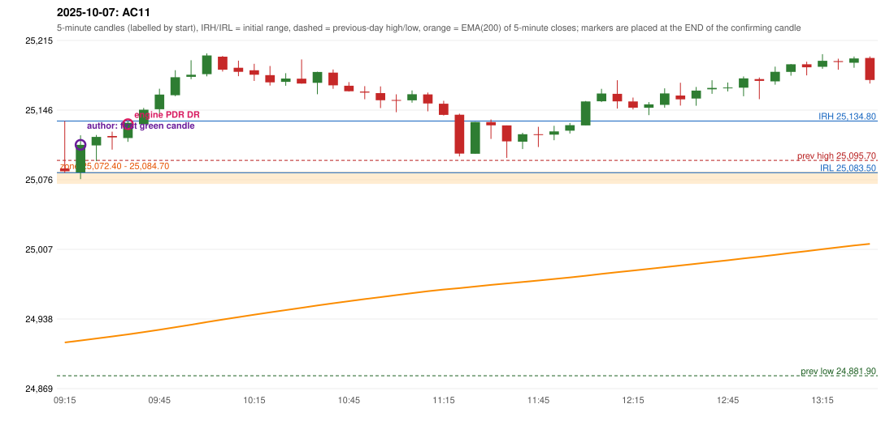

# 2025-10-07 - author's correction(s) against the engine

> Phase 5.1 date report. Evidence only; no rule was changed to produce a different outcome. Source image(s) are referenced under each correction.

## AC11 (PDF page 2, as written `20251007-1`, label `PDR`, ACTIVE)

### Author's observation

> Entry in 1st green candle.

Suggested: **PDR (earlier entry)**; timing: earlier (first green candle); requirement stated: enter in the 1st green candle. Drawing (my reading): none. Uncertain: none. Image: `reports/phase5/phase51_author_corrections/pages/page_2_full.png (page 2 of docs/strategy_docs/corrected/Adobe Scan Nov 05, 2026.pdf)`.

### Original automated trade

20251007-1-PDR PDR PDR LONG signal 09:40 entry 25131.6 -> TARGET

Stop 25096.6, T1 25158.6, T2 25201.6; exits 09:48 / 10:04. Engine explanation: PDR LONG (body-based engine, A_HIGHEST_BODY_HIGH): the session opened 9.90 points above the previous close and 2.85 points above the previous-day highest BODY high 25,084.70 (zone [25,072.40, 25,084.70] from the 15:00 candle of 2025-10-06; the highest wick 25,095.70 is ignored). The 09:15 candle (25,083.50 - 25,134.80) tested the zone; the 09:35 candle (green, O 25,117.90 H 25,134.45 L 25,114.15 C 25,133.10) passed GOOD_GREEN_BODY and closed 48.40 points above the zone ceiling, confirming the entry at 09:40. The pattern thresholds and the zone's lower boundary are provisional research assumptions, not approved by the strategy author.

### Independent historical evidence

Session: open 25087.55, previous high/low/close 25095.7 / 24881.9 / 25077.65 (gap 9.9); first candle {'high': 25134.8, 'low': 25083.5, 'open': 25087.55, 'close': 25084.9}.

First green candle after the zone interaction ('enter in 1st green candle'): {"interaction_candle": "09:15", "first_green_close_above_ceiling": {"candle_start": "09:20", "signal_time": "09:25", "colour": "G", "body_pct": 63.1, "upper_wick_pct": 21.7, "lower_wick_pct": 15.2, "close": 25111.15, "points_above_ceiling": 26.45, "low_below_zone_floor": false}}

ORB records: Method 2 ENGINE_SETUP_INVALIDATED: TRENDLINE_NOT_SUPPORTIVE

Chronological signal timeline (engine):

| time | strategy | method | dir | event | reason |
|---|---|---|---|---|---|
| 09:40 | PDR | PDR | LONG | EXECUTED | trade 1: TARGET |
| 11:00 | IRF | Method 2A | SHORT | IGNORED | DAY_FINISHED |
| 11:25 | IRF | Method 1 | SHORT | IGNORED | DAY_FINISHED |
| 12:15 | IRF | Method 2B | SHORT | IGNORED | DAY_FINISHED |
| 13:00 | IRF | Method 2B | SHORT | IGNORED | DAY_FINISHED |
| 13:35 | IRF | Method 2A | SHORT | IGNORED | DAY_FINISHED |
| 14:00 | IRF | Method 2B | SHORT | IGNORED | DAY_FINISHED |
| 14:30 | IRF | Method 2A | SHORT | IGNORED | DAY_FINISHED |
| 14:45 | IRF | Method 1 | SHORT | IGNORED | DAY_FINISHED |
| 15:05 | IRF | Method 1 | SHORT | IGNORED | DAY_FINISHED |

Rejected / invalidated setups: 14:25 IRF Method 1/2: SESSION_ENDED_BEFORE_CONFIRMATION; 09:15 ORB Method 2: TRENDLINE_NOT_SUPPORTIVE

### Conclusion

* **Classification:** CANDLE_CONFIRMATION_MISMATCH, ENTRY_TIMING_MISMATCH   **Category:** C
* **Is the author correct under the existing rules?** Consistent: the 09:20 candle is green, body 63.1%, closes 26.45 points above the ceiling
* **Is the engine correct under the existing rules?** Yes under the proposed thresholds: its upper wick is 21.7% (limit 20%)
* **Missing requirement / root cause:** the upper-wick limit of 'good green body' (proposal)
* **New rule required?** yes: loosen the thresholds   **Implementable objectively now?** no   **Owner approval needed?** YES

Candles 09:15-13:00 (start, O, H, L, C, colour, body %, upper wick %, lower wick %, EMA200, close - EMA):

| start | O | H | L | C | col | body% | uw% | lw% | EMA | c-EMA |
|---|---|---|---|---|---|---|---|---|---|---|
| 09:15 | 25087.55 | 25134.8 | 25083.5 | 25084.9 | R | 5.2 | 92.1 | 2.7 | 24914.89 | 170.01 |
| 09:20 | 25083.7 | 25120.6 | 25077.1 | 25111.15 | G | 63.1 | 21.7 | 15.2 | 24916.85 | 194.3 |
| 09:25 | 25110.6 | 25120.95 | 25094.9 | 25119.05 | G | 32.4 | 7.3 | 60.3 | 24918.86 | 200.19 |
| 09:30 | 25119.9 | 25124.2 | 25106.4 | 25118.55 | R | 7.6 | 24.2 | 68.3 | 24920.84 | 197.71 |
| 09:35 | 25117.9 | 25134.45 | 25114.15 | 25133.1 | G | 74.9 | 6.7 | 18.5 | 24922.96 | 210.14 |
| 09:40 | 25131.6 | 25147.8 | 25131.6 | 25146.05 | G | 89.2 | 10.8 | 0.0 | 24925.18 | 220.87 |
| 09:45 | 25146.5 | 25166.85 | 25142.5 | 25161.05 | G | 59.8 | 23.8 | 16.4 | 24927.52 | 233.53 |
| 09:50 | 25160.4 | 25185.25 | 25159.35 | 25178.25 | G | 68.9 | 27.0 | 4.1 | 24930.02 | 248.23 |
| 09:55 | 25178.7 | 25195.1 | 25176.3 | 25180.75 | G | 10.9 | 76.3 | 12.8 | 24932.51 | 248.24 |
| 10:00 | 25181.35 | 25201.95 | 25179.15 | 25199.9 | G | 81.4 | 9.0 | 9.6 | 24935.17 | 264.73 |
| 10:05 | 25198.7 | 25199.4 | 25183.9 | 25185.75 | R | 83.5 | 4.5 | 11.9 | 24937.67 | 248.08 |
| 10:10 | 25187.7 | 25194.75 | 25179.3 | 25183.65 | R | 26.2 | 45.6 | 28.2 | 24940.11 | 243.54 |
| 10:15 | 25185.15 | 25191.6 | 25174.55 | 25180.7 | R | 26.1 | 37.8 | 36.1 | 24942.51 | 238.19 |
| 10:20 | 25180.35 | 25189.45 | 25170.0 | 25173.2 | R | 36.8 | 46.8 | 16.5 | 24944.8 | 228.4 |
| 10:25 | 25173.7 | 25182.3 | 25169.85 | 25177.0 | G | 26.5 | 42.6 | 30.9 | 24947.11 | 229.89 |
| 10:30 | 25176.85 | 25195.95 | 25171.85 | 25172.0 | R | 20.1 | 79.3 | 0.6 | 24949.35 | 222.65 |
| 10:35 | 25172.7 | 25183.7 | 25161.35 | 25183.45 | G | 48.1 | 1.1 | 50.8 | 24951.68 | 231.77 |
| 10:40 | 25182.85 | 25185.95 | 25166.75 | 25170.2 | R | 65.9 | 16.1 | 18.0 | 24953.86 | 216.34 |
| 10:45 | 25169.8 | 25173.45 | 25164.0 | 25164.35 | R | 57.7 | 38.6 | 3.7 | 24955.95 | 208.4 |
| 10:50 | 25164.0 | 25169.45 | 25156.4 | 25162.95 | R | 8.0 | 41.8 | 50.2 | 24958.01 | 204.94 |
| 10:55 | 25162.5 | 25169.15 | 25147.6 | 25155.45 | R | 32.7 | 30.9 | 36.4 | 24959.97 | 195.48 |
| 11:00 | 25155.7 | 25161.3 | 25143.5 | 25155.05 | R | 3.7 | 31.5 | 64.9 | 24961.92 | 193.13 |
| 11:05 | 25155.3 | 25165.15 | 25153.0 | 25161.35 | G | 49.8 | 31.3 | 18.9 | 24963.9 | 197.45 |
| 11:10 | 25161.2 | 25163.1 | 25144.4 | 25152.2 | R | 48.1 | 10.2 | 41.7 | 24965.77 | 186.43 |
| 11:15 | 25152.0 | 25154.9 | 25140.25 | 25140.9 | R | 75.8 | 19.8 | 4.4 | 24967.52 | 173.38 |
| 11:20 | 25141.0 | 25142.05 | 25099.65 | 25102.45 | R | 90.9 | 2.5 | 6.6 | 24968.86 | 133.59 |
| 11:25 | 25102.25 | 25133.8 | 25102.25 | 25133.8 | G | 100.0 | 0.0 | 0.0 | 24970.5 | 163.3 |
| 11:30 | 25133.7 | 25136.35 | 25117.0 | 25130.45 | R | 16.8 | 13.7 | 69.5 | 24972.09 | 158.36 |
| 11:35 | 25130.4 | 25130.4 | 25098.2 | 25114.6 | R | 49.1 | 0.0 | 50.9 | 24973.51 | 141.09 |
| 11:40 | 25114.3 | 25123.15 | 25106.95 | 25121.7 | G | 45.7 | 9.0 | 45.4 | 24974.98 | 146.72 |
| 11:45 | 25121.65 | 25129.05 | 25109.0 | 25121.3 | R | 1.7 | 36.9 | 61.3 | 24976.44 | 144.86 |
| 11:50 | 25121.25 | 25130.0 | 25115.7 | 25124.45 | G | 22.4 | 38.8 | 38.8 | 24977.91 | 146.54 |
| 11:55 | 25125.2 | 25132.9 | 25122.35 | 25130.65 | G | 51.7 | 21.3 | 27.0 | 24979.43 | 151.22 |
| 12:00 | 25130.45 | 25154.7 | 25130.45 | 25154.25 | G | 98.1 | 1.9 | 0.0 | 24981.17 | 173.08 |
| 12:05 | 25154.4 | 25166.75 | 25153.55 | 25162.1 | G | 58.3 | 35.2 | 6.4 | 24982.97 | 179.13 |
| 12:10 | 25161.8 | 25175.3 | 25147.15 | 25154.3 | R | 26.6 | 48.0 | 25.4 | 24984.68 | 169.62 |
| 12:15 | 25154.25 | 25158.1 | 25146.25 | 25148.1 | R | 51.9 | 32.5 | 15.6 | 24986.3 | 161.8 |
| 12:20 | 25147.95 | 25153.6 | 25140.6 | 25151.35 | G | 26.2 | 17.3 | 56.5 | 24987.95 | 163.4 |
| 12:25 | 25150.85 | 25167.25 | 25148.05 | 25162.15 | G | 58.9 | 26.6 | 14.6 | 24989.68 | 172.47 |
| 12:30 | 25160.1 | 25172.8 | 25150.1 | 25156.3 | R | 16.7 | 55.9 | 27.3 | 24991.34 | 164.96 |
| 12:35 | 25157.15 | 25168.65 | 25150.0 | 25165.0 | G | 42.1 | 19.6 | 38.3 | 24993.06 | 171.94 |
| 12:40 | 25166.25 | 25175.25 | 25161.8 | 25167.65 | G | 10.4 | 56.5 | 33.1 | 24994.8 | 172.85 |
| 12:45 | 25167.4 | 25173.0 | 25164.2 | 25168.05 | G | 7.4 | 56.3 | 36.4 | 24996.53 | 171.52 |
| 12:50 | 25167.9 | 25179.1 | 25159.35 | 25177.15 | G | 46.8 | 9.9 | 43.3 | 24998.32 | 178.83 |
| 12:55 | 25176.4 | 25178.0 | 25156.45 | 25174.6 | R | 8.4 | 7.4 | 84.2 | 25000.08 | 174.52 |
| 13:00 | 25174.2 | 25188.8 | 25170.85 | 25183.65 | G | 52.6 | 28.7 | 18.7 | 25001.9 | 181.75 |
