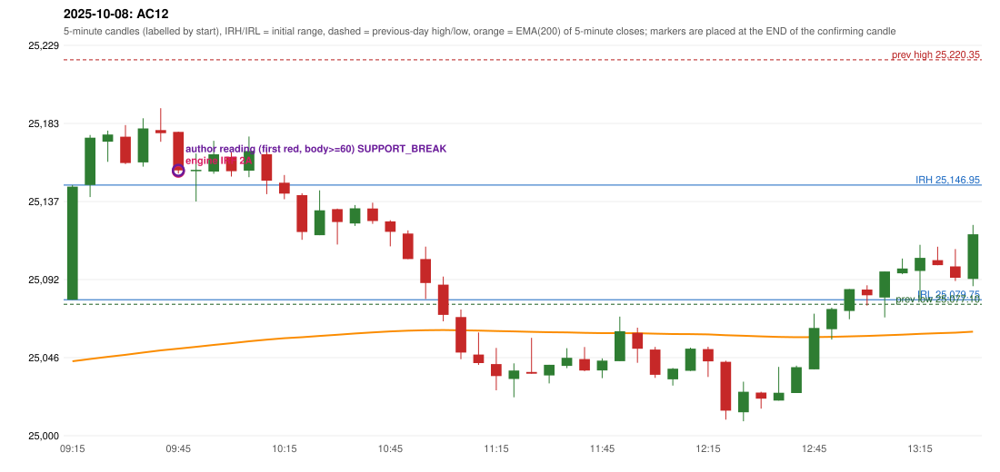

# 2025-10-08 - author's correction(s) against the engine

> Phase 5.1 date report. Evidence only; no rule was changed to produce a different outcome. Source image(s) are referenced under each correction.

## AC12 (PDF page 3, as written `20251008-1`, label `IRF`, ACTIVE)

### Author's observation

> This should be an ORB trade, but is shown as IRF. | ORB should activate, Instead IRF is activated.

Suggested: **ORB**; timing: not stated; requirement stated: ORB should have activated. Drawing (my reading): none. Uncertain: none. Image: `reports/phase5/phase51_author_corrections/pages/page_3_full.png (page 3 of docs/strategy_docs/corrected/Adobe Scan Nov 05, 2026.pdf)`.

### Original automated trade

20251008-1-IRF IRF Method 2A SHORT signal 09:50 entry 25155.1 -> TARGET

Stop 25190.1, T1 25128.1, T2 25095.1; exits 10:22 / 10:57. Engine explanation: IRF Method 2A SHORT: the 09:20-09:25 candle closed at 25,174.70, above IRH 25,146.95, and the next candle did not close back inside the range, so the setup is Method 2 and price stayed above it until the trigger. Extension candle 09:25-09:30, red candle 09:30-09:35. The trigger came 5 candles after the breakout candle: a completed candle closed below the recent pullback-low support (09:45-09:50); confirmed at 09:50 with close 25,155.60. Entry reference close 25,155.60 is 8.65 points above IRH 25,146.95.

### Independent historical evidence

Session: open 25079.75, previous high/low/close 25220.35 / 25077.1 / 25108.3 (gap -28.55); first candle {'high': 25146.95, 'low': 25079.75, 'open': 25079.75, 'close': 25146.05}.

Signal-candle measurements: signal_candle_start=09:45, colour=R, body_pct=91.7, upper_wick_pct=0.6, lower_wick_pct=7.7, signal_close=25155.6, ema200=25051.11, entry_minus_ema=104.49, ema_below_entry=True, ema_within_27_below_entry=False, ema_between_entry_and_target1=False, close_below_ema=False, session_low_before_candle=25079.75, close_below_prior_session_low=False, candle_low_at_or_below_prior_session_low=False, points_above_prior_session_low=75.85, body_pct_below_60=False, body_pct_below_50=False

Readings of the author's 'first red candle' wording (my formalisations, side by side):

| reading | first red candle | support | resistance | entry (signal time, close, trigger, body %) |
|---|---|---|---|---|
| FULLY_ABOVE|body>=60 | 09:30 | 25159.25 | 25182.1 | 09:50, 25155.6, SUPPORT_BREAK, 91.7 |
| FULLY_ABOVE|body>=0 | 09:30 | 25159.25 | 25182.1 | 09:45, 25177.4, RESISTANCE_BREAK, 9.2 |
| CLOSE_ABOVE|body>=60 | 09:30 | 25159.25 | 25182.1 | 09:50, 25155.6, SUPPORT_BREAK, 91.7 |
| CLOSE_ABOVE|body>=0 | 09:30 | 25159.25 | 25182.1 | 09:45, 25177.4, RESISTANCE_BREAK, 9.2 |

Chronological signal timeline (engine):

| time | strategy | method | dir | event | reason |
|---|---|---|---|---|---|
| 09:50 | IRF | Method 2A | SHORT | EXECUTED | trade 1: TARGET |
| 10:15 | IRF | Method 2B | SHORT | IGNORED | POSITION_ACTIVE (signal kept for diagnostics only; never reused) |
| 10:20 | IRF | Method 1 | SHORT | IGNORED | POSITION_ACTIVE (signal kept for diagnostics only; never reused) |

Rejected / invalidated setups: 09:15 PDS Method 1/2/3: GAP_DOWN_OPEN_NOT_BELOW_ZONE; 12:55 RF RF: GAP_NOT_UP(DOWN)

Applicable source rules:

* `ORB-M2-LONG-001` (UNRESOLVED): Inner resistance inside the previous day's range is marked; a rising trendline through swing lows supports the trend.

### Conclusion

* **Classification:** AUTHOR_DISCRETION_UNRESOLVED   **Category:** C
* **Is the author correct under the existing rules?** Cannot be decided: no previous-day level was broken and no ORB record exists
* **Is the engine correct under the existing rules?** Not decidable: no ORB setup was produced, but Method 2's inner level / trendline is not source-defined (the first candle is green with a 98.7% body)
* **Missing requirement / root cause:** the level or trend condition the author used
* **New rule required?** unknown   **Implementable objectively now?** no   **Owner approval needed?** YES

Candles 09:15-13:00 (start, O, H, L, C, colour, body %, upper wick %, lower wick %, EMA200, close - EMA):

| start | O | H | L | C | col | body% | uw% | lw% | EMA | c-EMA |
|---|---|---|---|---|---|---|---|---|---|---|
| 09:15 | 25079.75 | 25146.95 | 25079.75 | 25146.05 | G | 98.7 | 1.3 | 0.0 | 25043.72 | 102.33 |
| 09:20 | 25147.0 | 25176.3 | 25139.95 | 25174.7 | G | 76.2 | 4.4 | 19.4 | 25045.02 | 129.68 |
| 09:25 | 25172.4 | 25178.85 | 25160.55 | 25176.6 | G | 23.0 | 12.3 | 64.8 | 25046.33 | 130.27 |
| 09:30 | 25175.3 | 25182.1 | 25159.25 | 25159.85 | R | 67.6 | 29.8 | 2.6 | 25047.46 | 112.39 |
| 09:35 | 25160.25 | 25186.1 | 25157.75 | 25180.15 | G | 70.2 | 21.0 | 8.8 | 25048.78 | 131.37 |
| 09:40 | 25179.2 | 25192.0 | 25172.35 | 25177.4 | R | 9.2 | 65.1 | 25.7 | 25050.06 | 127.34 |
| 09:45 | 25178.15 | 25178.3 | 25153.7 | 25155.6 | R | 91.7 | 0.6 | 7.7 | 25051.11 | 104.49 |
| 09:50 | 25155.1 | 25165.45 | 25137.3 | 25155.9 | G | 2.8 | 33.9 | 63.2 | 25052.16 | 103.74 |
| 09:55 | 25154.9 | 25172.9 | 25153.6 | 25165.0 | G | 52.3 | 40.9 | 6.7 | 25053.28 | 111.72 |
| 10:00 | 25163.5 | 25166.2 | 25151.95 | 25155.1 | R | 58.9 | 18.9 | 22.1 | 25054.29 | 100.81 |
| 10:05 | 25155.4 | 25175.4 | 25151.6 | 25166.9 | G | 48.3 | 35.7 | 16.0 | 25055.41 | 111.49 |
| 10:10 | 25165.05 | 25168.05 | 25141.65 | 25149.55 | R | 58.7 | 11.4 | 29.9 | 25056.35 | 93.2 |
| 10:15 | 25148.35 | 25152.85 | 25138.65 | 25141.95 | R | 45.1 | 31.7 | 23.2 | 25057.2 | 84.75 |
| 10:20 | 25141.05 | 25142.15 | 25114.9 | 25119.45 | R | 79.3 | 4.0 | 16.7 | 25057.82 | 61.63 |
| 10:25 | 25117.6 | 25143.85 | 25117.6 | 25132.15 | G | 55.4 | 44.6 | 0.0 | 25058.56 | 73.59 |
| 10:30 | 25132.85 | 25133.15 | 25112.1 | 25125.3 | R | 35.9 | 1.4 | 62.7 | 25059.22 | 66.08 |
| 10:35 | 25124.45 | 25135.25 | 25123.0 | 25133.35 | G | 72.7 | 15.5 | 11.8 | 25059.96 | 73.39 |
| 10:40 | 25133.25 | 25136.65 | 25124.25 | 25125.9 | R | 59.3 | 27.4 | 13.3 | 25060.62 | 65.28 |
| 10:45 | 25125.65 | 25126.35 | 25111.05 | 25119.55 | R | 39.9 | 4.6 | 55.6 | 25061.2 | 58.35 |
| 10:50 | 25118.55 | 25120.4 | 25103.55 | 25103.6 | R | 88.7 | 11.0 | 0.3 | 25061.63 | 41.97 |
| 10:55 | 25103.6 | 25110.9 | 25080.2 | 25089.55 | R | 45.8 | 23.8 | 30.5 | 25061.9 | 27.65 |
| 11:00 | 25088.6 | 25093.35 | 25067.1 | 25070.9 | R | 67.4 | 18.1 | 14.5 | 25061.99 | 8.91 |
| 11:05 | 25069.6 | 25074.0 | 25044.9 | 25048.8 | R | 71.5 | 15.1 | 13.4 | 25061.86 | -13.06 |
| 11:10 | 25047.65 | 25060.55 | 25041.55 | 25042.65 | R | 26.3 | 67.9 | 5.8 | 25061.67 | -19.02 |
| 11:15 | 25042.05 | 25051.5 | 25026.65 | 25035.05 | R | 28.2 | 38.0 | 33.8 | 25061.41 | -26.36 |
| 11:20 | 25033.3 | 25042.45 | 25022.6 | 25038.25 | G | 24.9 | 21.2 | 53.9 | 25061.18 | -22.93 |
| 11:25 | 25037.4 | 25057.4 | 25036.4 | 25036.4 | R | 4.8 | 95.2 | 0.0 | 25060.93 | -24.53 |
| 11:30 | 25035.35 | 25041.6 | 25030.7 | 25041.6 | G | 57.3 | 0.0 | 42.7 | 25060.74 | -19.14 |
| 11:35 | 25040.95 | 25051.35 | 25039.65 | 25045.7 | G | 40.6 | 48.3 | 11.1 | 25060.59 | -14.89 |
| 11:40 | 25045.0 | 25052.05 | 25037.9 | 25038.3 | R | 47.3 | 49.8 | 2.8 | 25060.37 | -22.07 |
| 11:45 | 25038.3 | 25045.4 | 25033.8 | 25044.05 | G | 49.6 | 11.6 | 38.8 | 25060.2 | -16.15 |
| 11:50 | 25043.75 | 25069.85 | 25043.75 | 25061.3 | G | 67.2 | 32.8 | 0.0 | 25060.21 | 1.09 |
| 11:55 | 25060.35 | 25063.4 | 25042.8 | 25051.05 | R | 45.1 | 14.8 | 40.0 | 25060.12 | -9.07 |
| 12:00 | 25050.55 | 25052.1 | 25033.95 | 25035.75 | R | 81.5 | 8.5 | 9.9 | 25059.88 | -24.13 |
| 12:05 | 25033.1 | 25039.75 | 25029.45 | 25039.35 | G | 60.7 | 3.9 | 35.4 | 25059.68 | -20.33 |
| 12:10 | 25038.1 | 25051.7 | 25038.0 | 25051.1 | G | 94.9 | 4.4 | 0.7 | 25059.59 | -8.49 |
| 12:15 | 25050.85 | 25052.2 | 25034.5 | 25043.65 | R | 40.7 | 7.6 | 51.7 | 25059.43 | -15.78 |
| 12:20 | 25043.4 | 25044.0 | 25009.5 | 25014.8 | R | 82.9 | 1.7 | 15.4 | 25058.99 | -44.19 |
| 12:25 | 25013.8 | 25031.75 | 25008.55 | 25025.8 | G | 51.7 | 25.6 | 22.6 | 25058.66 | -32.86 |
| 12:30 | 25025.35 | 25025.8 | 25015.95 | 25021.8 | R | 36.0 | 4.6 | 59.4 | 25058.29 | -36.49 |
| 12:35 | 25020.65 | 25040.4 | 25020.65 | 25025.25 | G | 23.3 | 76.7 | 0.0 | 25057.96 | -32.71 |
| 12:40 | 25025.1 | 25041.15 | 25025.1 | 25040.25 | G | 94.4 | 5.6 | 0.0 | 25057.79 | -17.54 |
| 12:45 | 25038.95 | 25071.55 | 25038.95 | 25063.2 | G | 74.4 | 25.6 | 0.0 | 25057.84 | 5.36 |
| 12:50 | 25062.5 | 25075.15 | 25056.4 | 25074.35 | G | 63.2 | 4.3 | 32.5 | 25058.0 | 16.35 |
| 12:55 | 25073.2 | 25086.0 | 25068.35 | 25086.0 | G | 72.5 | 0.0 | 27.5 | 25058.28 | 27.72 |
| 13:00 | 25085.75 | 25088.2 | 25076.3 | 25082.4 | R | 28.2 | 20.6 | 51.3 | 25058.52 | 23.88 |
