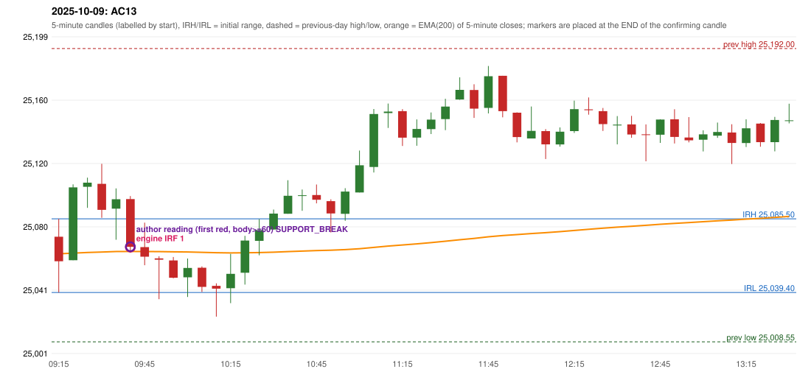

# 2025-10-09 - author's correction(s) against the engine

> Phase 5.1 date report. Evidence only; no rule was changed to produce a different outcome. Source image(s) are referenced under each correction.

## AC13 (PDF page 3, as written `20251009-1`, label `IRF`, ACTIVE)

### Author's observation

> Wait for EMA. | The candle should close below EMA when the space btn. the entry candle is less than 27. | Wait. | 200 EMA [5 min TF] | Entry.

Suggested: **IRF (later entry)**; timing: later (wait for the EMA break); requirement stated: if the space between the entry candle and the 200 EMA (5-minute) is less than 27, wait for a candle to close below the EMA. Drawing (my reading): A yellow rising curve labelled '200 EMA [5 min TF]'; candles sit on a line above it; 'Wait.' at the upper candle; 'Entry' at a lower red candle that crosses the EMA.. Uncertain: 'the space btn. the entry candle' - the distance is not explicitly 'to the EMA' (read so from the drawing). Image: `reports/phase5/phase51_author_corrections/pages/page_3_full.png (page 3 of docs/strategy_docs/corrected/Adobe Scan Nov 05, 2026.pdf)`.

### Original automated trade

20251009-1-IRF IRF Method 1 SHORT signal 09:45 entry 25067.8 -> T1_THEN_BUFFER_STOP

Stop 25102.8, T1 25040.8, T2 25007.8; exits 09:53 / 10:24. Engine explanation: IRF Method 1 SHORT: the completed 09:35 candle closed at 25,097.75, 12.25 points above the initial range high 25,085.50 (range [25,039.40, 25,085.50] from the 09:15 candle); the immediately following completed 09:40 candle closed at 25,068.00, back inside the range. The short signal was confirmed at 09:45 on that close. Entry reference close 25,068.00 is 17.50 points below IRH 25,085.50.

### Independent historical evidence

Session: open 25074.3, previous high/low/close 25192.0 / 25008.55 / 25046.15 (gap 28.15); first candle {'high': 25085.5, 'low': 25039.4, 'open': 25074.3, 'close': 25058.95}.

Signal-candle measurements: signal_candle_start=09:40, colour=R, body_pct=84.2, upper_wick_pct=5.2, lower_wick_pct=10.6, signal_close=25068.0, ema200=25065.07, entry_minus_ema=2.93, ema_below_entry=True, ema_within_27_below_entry=True, ema_between_entry_and_target1=True, close_below_ema=False, session_low_before_candle=25039.4, close_below_prior_session_low=False, candle_low_at_or_below_prior_session_low=False, points_above_prior_session_low=28.6, body_pct_below_60=False, body_pct_below_50=False

Readings of the author's 'first red candle' wording (my formalisations, side by side):

| reading | first red candle | support | resistance | entry (signal time, close, trigger, body %) |
|---|---|---|---|---|
| FULLY_ABOVE|body>=60 | 09:30 | 25086.15 | 25119.9 | 09:45, 25068.0, SUPPORT_BREAK, 84.2 |
| FULLY_ABOVE|body>=0 | 09:30 | 25086.15 | 25119.9 | 09:45, 25068.0, SUPPORT_BREAK, 84.2 |
| CLOSE_ABOVE|body>=60 | 09:30 | 25086.15 | 25119.9 | 09:45, 25068.0, SUPPORT_BREAK, 84.2 |
| CLOSE_ABOVE|body>=0 | 09:30 | 25086.15 | 25119.9 | 09:45, 25068.0, SUPPORT_BREAK, 84.2 |

ORB records: Gap/200DMA ENGINE_SETUP_INVALIDATED: CLOSE_NOT_BEYOND_MA

Chronological signal timeline (engine):

| time | strategy | method | dir | event | reason |
|---|---|---|---|---|---|
| 09:45 | IRF | Method 1 | SHORT | EXECUTED | trade 1: T1_THEN_BUFFER_STOP |
| 12:00 | IRF | Method 2A | SHORT | IGNORED | DAY_FINISHED |
| 12:25 | IRF | Method 2B | SHORT | IGNORED | DAY_FINISHED |
| 14:15 | IRF | Method 2A | SHORT | IGNORED | DAY_FINISHED |
| 14:15 | IRF | Method 2B | SHORT | IGNORED | DAY_FINISHED |

Rejected / invalidated setups: 14:10 IRF Method 1/2: SESSION_ENDED_BEFORE_CONFIRMATION; 09:15 ORB Gap/200DMA: CLOSE_NOT_BEYOND_MA; 09:15 PDR PDR: OPEN_NOT_STRICTLY_ABOVE_ZONE

### Conclusion

* **Classification:** EMA_FILTER_MISMATCH, MISSING_AUTHOR_RULE, ENTRY_TIMING_MISMATCH   **Category:** B
* **Is the author correct under the existing rules?** Yes, measurably: the engine's entry (09:45) is 2.93 points above the 5-minute EMA(200), which lies between the entry and target 1
* **Is the engine correct under the existing rules?** Yes under the written rules: no EMA-distance rule exists for IRF
* **Missing requirement / root cause:** an IRF short whose EMA(200) lies less than 27 points below the entry must wait for a close below the EMA
* **New rule required?** yes: 'EMA space < 27 -> wait for the EMA break'   **Implementable objectively now?** partly: 'skip' vs 'defer until the EMA break' are different rules   **Owner approval needed?** YES

Candles 09:15-13:00 (start, O, H, L, C, colour, body %, upper wick %, lower wick %, EMA200, close - EMA):

| start | O | H | L | C | col | body% | uw% | lw% | EMA | c-EMA |
|---|---|---|---|---|---|---|---|---|---|---|
| 09:15 | 25074.3 | 25085.5 | 25039.4 | 25058.95 | R | 33.3 | 24.3 | 42.4 | 25063.6 | -4.65 |
| 09:20 | 25059.6 | 25107.05 | 25059.6 | 25105.15 | G | 96.0 | 4.0 | 0.0 | 25064.01 | 41.14 |
| 09:25 | 25105.5 | 25111.25 | 25092.35 | 25108.1 | G | 13.8 | 16.7 | 69.6 | 25064.45 | 43.65 |
| 09:30 | 25107.35 | 25119.9 | 25086.15 | 25091.1 | R | 48.1 | 37.2 | 14.7 | 25064.72 | 26.38 |
| 09:35 | 25091.85 | 25104.5 | 25072.4 | 25097.75 | G | 18.4 | 21.0 | 60.6 | 25065.04 | 32.71 |
| 09:40 | 25097.85 | 25099.7 | 25064.25 | 25068.0 | R | 84.2 | 5.2 | 10.6 | 25065.07 | 2.93 |
| 09:45 | 25067.8 | 25083.1 | 25056.45 | 25061.8 | R | 22.5 | 57.4 | 20.1 | 25065.04 | -3.24 |
| 09:50 | 25060.75 | 25062.1 | 25035.2 | 25059.9 | R | 3.2 | 5.0 | 91.8 | 25064.99 | -5.09 |
| 09:55 | 25059.45 | 25061.6 | 25048.3 | 25048.6 | R | 81.6 | 16.2 | 2.3 | 25064.83 | -16.23 |
| 10:00 | 25048.9 | 25060.65 | 25036.6 | 25054.75 | G | 24.3 | 24.5 | 51.1 | 25064.73 | -9.98 |
| 10:05 | 25054.9 | 25055.7 | 25039.75 | 25042.9 | R | 75.2 | 5.0 | 19.7 | 25064.51 | -21.61 |
| 10:10 | 25043.55 | 25045.1 | 25024.3 | 25041.8 | R | 8.4 | 7.5 | 84.1 | 25064.28 | -22.48 |
| 10:15 | 25042.05 | 25063.55 | 25032.75 | 25051.05 | G | 29.2 | 40.6 | 30.2 | 25064.15 | -13.1 |
| 10:20 | 25051.75 | 25074.85 | 25044.35 | 25071.9 | G | 66.1 | 9.7 | 24.3 | 25064.23 | 7.67 |
| 10:25 | 25071.7 | 25085.3 | 25062.7 | 25078.45 | G | 29.9 | 30.3 | 39.8 | 25064.37 | 14.08 |
| 10:30 | 25078.8 | 25091.3 | 25078.8 | 25088.75 | G | 79.6 | 20.4 | 0.0 | 25064.61 | 24.14 |
| 10:35 | 25088.65 | 25109.65 | 25088.65 | 25099.9 | G | 53.6 | 46.4 | 0.0 | 25064.96 | 34.94 |
| 10:40 | 25099.8 | 25103.8 | 25090.5 | 25100.25 | G | 3.4 | 26.7 | 69.9 | 25065.32 | 34.93 |
| 10:45 | 25100.35 | 25106.95 | 25095.15 | 25097.4 | R | 25.0 | 55.9 | 19.1 | 25065.63 | 31.77 |
| 10:50 | 25096.55 | 25097.7 | 25076.95 | 25088.85 | R | 37.1 | 5.5 | 57.3 | 25065.87 | 22.98 |
| 10:55 | 25088.65 | 25104.65 | 25084.25 | 25102.55 | G | 68.1 | 10.3 | 21.6 | 25066.23 | 36.32 |
| 11:00 | 25102.0 | 25128.2 | 25102.0 | 25119.0 | G | 64.9 | 35.1 | 0.0 | 25066.76 | 52.24 |
| 11:05 | 25117.9 | 25154.2 | 25114.45 | 25151.05 | G | 83.4 | 7.9 | 8.7 | 25067.59 | 83.46 |
| 11:10 | 25151.65 | 25157.6 | 25142.35 | 25152.55 | G | 5.9 | 33.1 | 61.0 | 25068.44 | 84.11 |
| 11:15 | 25152.85 | 25154.1 | 25131.05 | 25136.25 | R | 72.0 | 5.4 | 22.6 | 25069.11 | 67.14 |
| 11:20 | 25136.3 | 25147.7 | 25131.2 | 25141.7 | G | 32.7 | 36.4 | 30.9 | 25069.84 | 71.86 |
| 11:25 | 25141.6 | 25152.0 | 25138.5 | 25147.55 | G | 44.1 | 33.0 | 23.0 | 25070.61 | 76.94 |
| 11:30 | 25147.85 | 25160.6 | 25140.95 | 25155.7 | G | 39.9 | 24.9 | 35.1 | 25071.46 | 84.24 |
| 11:35 | 25160.1 | 25174.0 | 25159.95 | 25166.15 | G | 43.1 | 55.9 | 1.1 | 25072.4 | 93.75 |
| 11:40 | 25166.05 | 25169.65 | 25148.6 | 25154.4 | R | 55.3 | 17.1 | 27.6 | 25073.21 | 81.19 |
| 11:45 | 25154.9 | 25181.1 | 25151.4 | 25174.7 | G | 66.7 | 21.5 | 11.8 | 25074.22 | 100.48 |
| 11:50 | 25174.95 | 25174.95 | 25149.0 | 25152.85 | R | 85.2 | 0.0 | 14.8 | 25075.01 | 77.84 |
| 11:55 | 25151.9 | 25152.1 | 25133.3 | 25136.65 | R | 81.1 | 1.1 | 17.8 | 25075.62 | 61.03 |
| 12:00 | 25135.75 | 25155.75 | 25135.75 | 25140.5 | G | 23.8 | 76.2 | 0.0 | 25076.27 | 64.23 |
| 12:05 | 25140.35 | 25141.6 | 25122.9 | 25132.05 | R | 44.4 | 6.7 | 48.9 | 25076.82 | 55.23 |
| 12:10 | 25132.05 | 25142.65 | 25130.65 | 25140.0 | G | 66.3 | 22.1 | 11.7 | 25077.45 | 62.55 |
| 12:15 | 25140.35 | 25159.45 | 25139.2 | 25154.1 | G | 67.9 | 26.4 | 5.7 | 25078.21 | 75.89 |
| 12:20 | 25153.95 | 25161.4 | 25150.65 | 25153.45 | R | 4.7 | 69.3 | 26.0 | 25078.96 | 74.49 |
| 12:25 | 25152.85 | 25154.85 | 25140.45 | 25144.75 | R | 56.2 | 13.9 | 29.9 | 25079.62 | 65.13 |
| 12:30 | 25143.9 | 25149.75 | 25132.05 | 25144.4 | G | 2.8 | 30.2 | 66.9 | 25080.26 | 64.14 |
| 12:35 | 25144.55 | 25149.9 | 25136.15 | 25138.25 | R | 45.8 | 38.9 | 15.3 | 25080.84 | 57.41 |
| 12:40 | 25138.35 | 25144.55 | 25121.45 | 25138.3 | R | 0.2 | 26.8 | 72.9 | 25081.41 | 56.89 |
| 12:45 | 25138.1 | 25147.8 | 25133.0 | 25147.6 | G | 64.2 | 1.4 | 34.5 | 25082.07 | 65.53 |
| 12:50 | 25147.75 | 25154.05 | 25132.6 | 25136.75 | R | 51.3 | 29.4 | 19.3 | 25082.61 | 54.14 |
| 12:55 | 25136.35 | 25149.1 | 25133.3 | 25134.6 | R | 11.1 | 80.7 | 8.2 | 25083.13 | 51.47 |
| 13:00 | 25135.0 | 25140.85 | 25127.65 | 25138.35 | G | 25.4 | 18.9 | 55.7 | 25083.68 | 54.67 |
