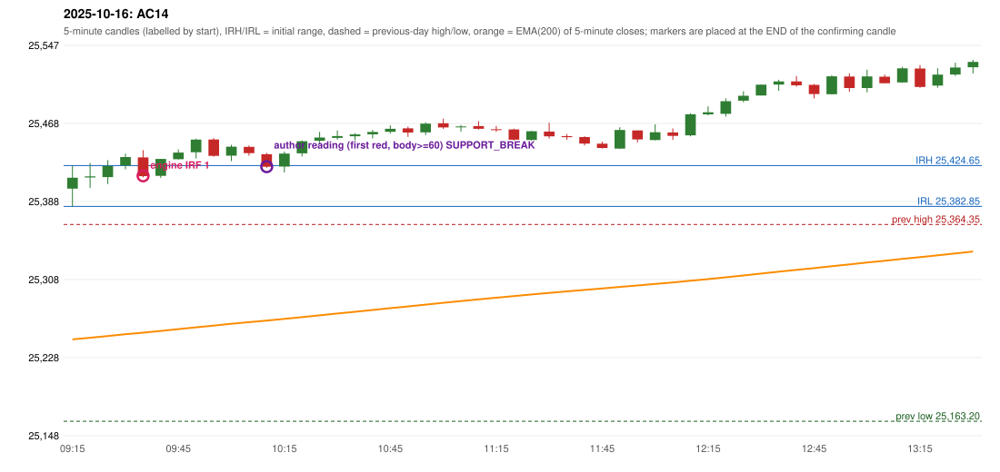

# 2025-10-16 - author's correction(s) against the engine

> Phase 5.1 date report. Evidence only; no rule was changed to produce a different outcome. Source image(s) are referenced under each correction.

## AC14 (PDF page 3, as written `20251016-1`, label `IRF`, ACTIVE)

### Author's observation

> ORB should have activated, instead IRF is activated.

Suggested: **ORB**; timing: not stated; requirement stated: ORB should have activated. Drawing (my reading): none. Uncertain: none. Image: `reports/phase5/phase51_author_corrections/pages/page_3_full.png (page 3 of docs/strategy_docs/corrected/Adobe Scan Nov 05, 2026.pdf)`.

### Original automated trade

20251016-1-IRF IRF Method 1 SHORT signal 09:40 entry 25414.1 -> INITIAL_FULL_STOP

Stop 25449.1, T1 25387.1, T2 25354.1; exits 09:53 / 09:53. Engine explanation: IRF Method 1 SHORT: the completed 09:30 candle closed at 25,433.35, 8.70 points above the initial range high 25,424.65 (range [25,382.85, 25,424.65] from the 09:15 candle); the immediately following completed 09:35 candle closed at 25,413.80, back inside the range. The short signal was confirmed at 09:40 on that close. Entry reference close 25,413.80 is 10.85 points below IRH 25,424.65.

### Independent historical evidence

Session: open 25401.0, previous high/low/close 25364.35 / 25163.2 / 25323.55 (gap 77.45); first candle {'high': 25424.65, 'low': 25382.85, 'open': 25401.0, 'close': 25412.15}.

Signal-candle measurements: signal_candle_start=09:35, colour=R, body_pct=69.1, upper_wick_pct=26.4, lower_wick_pct=4.5, signal_close=25413.8, ema200=25253.75, entry_minus_ema=160.05, ema_below_entry=True, ema_within_27_below_entry=False, ema_between_entry_and_target1=False, close_below_ema=False, session_low_before_candle=25382.85, close_below_prior_session_low=False, candle_low_at_or_below_prior_session_low=False, points_above_prior_session_low=30.95, body_pct_below_60=False, body_pct_below_50=False

Readings of the author's 'first red candle' wording (my formalisations, side by side):

| reading | first red candle | support | resistance | entry (signal time, close, trigger, body %) |
|---|---|---|---|---|
| FULLY_ABOVE|body>=60 | 09:55 | 25433.65 | 25452.75 | 10:15, 25423.45, SUPPORT_BREAK, 83.9 |
| FULLY_ABOVE|body>=0 | 09:55 | 25433.65 | 25452.75 | 10:15, 25423.45, SUPPORT_BREAK, 83.9 |
| CLOSE_ABOVE|body>=60 | 09:55 | 25433.65 | 25452.75 | 10:15, 25423.45, SUPPORT_BREAK, 83.9 |
| CLOSE_ABOVE|body>=0 | 09:55 | 25433.65 | 25452.75 | 10:15, 25423.45, SUPPORT_BREAK, 83.9 |

ORB records: Method 1 ENGINE_SETUP_INVALIDATED: CANDLE_QUALITY(not a strong body / wick too large); Method 2 ENGINE_SETUP_INVALIDATED: TRENDLINE_NOT_SUPPORTIVE

Chronological signal timeline (engine):

| time | strategy | method | dir | event | reason |
|---|---|---|---|---|---|
| 09:40 | IRF | Method 1 | SHORT | EXECUTED | trade 1: INITIAL_FULL_STOP |
| 10:15 | IRF | Method 1 | SHORT | REJECTED | SECOND_TRADE_RESTRICTED_TO_PDR_PDS |
| 10:15 | IRF | Method 2A | SHORT | REJECTED | SECOND_TRADE_RESTRICTED_TO_PDR_PDS |
| 10:55 | IRF | Method 2B | SHORT | REJECTED | SECOND_TRADE_RESTRICTED_TO_PDR_PDS |
| 11:25 | IRF | Method 2A | SHORT | REJECTED | SECOND_TRADE_RESTRICTED_TO_PDR_PDS |
| 11:45 | IRF | Method 2A | SHORT | REJECTED | SECOND_TRADE_RESTRICTED_TO_PDR_PDS |
| 12:10 | IRF | Method 2B | SHORT | REJECTED | SECOND_TRADE_RESTRICTED_TO_PDR_PDS |
| 13:00 | IRF | Method 2B | SHORT | REJECTED | SECOND_TRADE_RESTRICTED_TO_PDR_PDS |
| 13:20 | IRF | Method 2B | SHORT | REJECTED | SECOND_TRADE_RESTRICTED_TO_PDR_PDS |
| 15:15 | IRF | Method 2A | SHORT | REJECTED | SECOND_TRADE_RESTRICTED_TO_PDR_PDS |

Rejected / invalidated setups: 10:15 IRF Method 1: SECOND_TRADE_RESTRICTED_TO_PDR_PDS; 10:15 IRF Method 2A: SECOND_TRADE_RESTRICTED_TO_PDR_PDS; 10:55 IRF Method 2B: SECOND_TRADE_RESTRICTED_TO_PDR_PDS; 11:25 IRF Method 2A: SECOND_TRADE_RESTRICTED_TO_PDR_PDS; 11:45 IRF Method 2A: SECOND_TRADE_RESTRICTED_TO_PDR_PDS; 12:10 IRF Method 2B: SECOND_TRADE_RESTRICTED_TO_PDR_PDS; 13:00 IRF Method 2B: SECOND_TRADE_RESTRICTED_TO_PDR_PDS; 13:20 IRF Method 2B: SECOND_TRADE_RESTRICTED_TO_PDR_PDS; 15:15 IRF Method 2A: SECOND_TRADE_RESTRICTED_TO_PDR_PDS; 15:10 IRF Method 1/2: SESSION_ENDED_BEFORE_CONFIRMATION

Applicable source rules:

* `ORB-M1-LONG-003` (VERIFIED_QUALITATIVE): Candle quality: strong green body and small upper wick; reject strong upper-wick rejection.
* `ORB-CANDLE-001` (VERIFIED_QUALITATIVE): Preferred / conditional / rejected candle shapes, 'across all three setups' (p.9); a pin bar's shape alone is never sufficient (p.10). Methods 1/2 text only says 'strong body'; the conditional pin bar is applied to them as a PROPOSAL (orb_pin_bar_in_methods_1_

### Conclusion

* **Classification:** CANDLE_CONFIRMATION_MISMATCH   **Category:** C
* **Is the author correct under the existing rules?** Cannot be decided: the ORB candle-strength thresholds are proposals (body 26.7%, upper wick 29.9%)
* **Is the engine correct under the existing rules?** Yes under the proposed 60% / 20% thresholds
* **Missing requirement / root cause:** the ORB strength thresholds
* **New rule required?** yes: ORB strength thresholds   **Implementable objectively now?** no   **Owner approval needed?** YES

Candles 09:15-13:00 (start, O, H, L, C, colour, body %, upper wick %, lower wick %, EMA200, close - EMA):

| start | O | H | L | C | col | body% | uw% | lw% | EMA | c-EMA |
|---|---|---|---|---|---|---|---|---|---|---|
| 09:15 | 25401.0 | 25424.65 | 25382.85 | 25412.15 | G | 26.7 | 29.9 | 43.4 | 25246.91 | 165.24 |
| 09:20 | 25412.5 | 25427.2 | 25401.65 | 25413.6 | G | 4.3 | 53.2 | 42.5 | 25248.57 | 165.03 |
| 09:25 | 25412.8 | 25430.15 | 25405.7 | 25424.2 | G | 46.6 | 24.3 | 29.0 | 25250.32 | 173.88 |
| 09:30 | 25424.75 | 25436.85 | 25420.8 | 25433.35 | G | 53.6 | 21.8 | 24.6 | 25252.14 | 181.21 |
| 09:35 | 25433.0 | 25440.35 | 25412.55 | 25413.8 | R | 69.1 | 26.4 | 4.5 | 25253.75 | 160.05 |
| 09:40 | 25414.1 | 25431.45 | 25412.0 | 25431.4 | G | 88.9 | 0.3 | 10.8 | 25255.51 | 175.89 |
| 09:45 | 25431.05 | 25441.1 | 25430.7 | 25437.85 | G | 65.4 | 31.3 | 3.4 | 25257.33 | 180.52 |
| 09:50 | 25438.25 | 25452.1 | 25431.85 | 25451.15 | G | 63.7 | 4.7 | 31.6 | 25259.26 | 191.89 |
| 09:55 | 25451.25 | 25452.75 | 25433.65 | 25434.55 | R | 87.4 | 7.9 | 4.7 | 25261.0 | 173.55 |
| 10:00 | 25434.75 | 25445.75 | 25429.2 | 25443.95 | G | 55.6 | 10.9 | 33.5 | 25262.82 | 181.13 |
| 10:05 | 25443.7 | 25445.1 | 25434.75 | 25437.3 | R | 61.8 | 13.5 | 24.6 | 25264.56 | 172.74 |
| 10:10 | 25436.25 | 25437.6 | 25422.35 | 25423.45 | R | 83.9 | 8.9 | 7.2 | 25266.14 | 157.31 |
| 10:15 | 25423.65 | 25438.9 | 25417.55 | 25436.9 | G | 62.1 | 9.4 | 28.6 | 25267.84 | 169.06 |
| 10:20 | 25437.2 | 25450.3 | 25433.85 | 25449.5 | G | 74.8 | 4.9 | 20.4 | 25269.64 | 179.86 |
| 10:25 | 25449.9 | 25459.1 | 25447.35 | 25453.25 | G | 28.5 | 49.8 | 21.7 | 25271.47 | 181.78 |
| 10:30 | 25452.9 | 25460.5 | 25451.05 | 25454.8 | G | 20.1 | 60.3 | 19.6 | 25273.3 | 181.5 |
| 10:35 | 25454.55 | 25457.6 | 25450.55 | 25456.45 | G | 27.0 | 16.3 | 56.7 | 25275.12 | 181.33 |
| 10:40 | 25456.5 | 25460.95 | 25452.35 | 25458.95 | G | 28.5 | 23.3 | 48.3 | 25276.95 | 182.0 |
| 10:45 | 25459.15 | 25465.75 | 25457.3 | 25462.2 | G | 36.1 | 42.0 | 21.9 | 25278.79 | 183.41 |
| 10:50 | 25462.7 | 25464.4 | 25453.9 | 25458.4 | R | 41.0 | 16.2 | 42.9 | 25280.58 | 177.82 |
| 10:55 | 25458.55 | 25468.75 | 25455.8 | 25467.5 | G | 69.1 | 9.7 | 21.2 | 25282.44 | 185.06 |
| 11:00 | 25467.85 | 25472.6 | 25462.1 | 25463.55 | R | 41.0 | 45.2 | 13.8 | 25284.24 | 179.31 |
| 11:05 | 25464.6 | 25466.0 | 25459.45 | 25464.65 | G | 0.8 | 20.6 | 78.6 | 25286.04 | 178.61 |
| 11:10 | 25465.0 | 25469.95 | 25461.45 | 25462.25 | R | 32.4 | 58.2 | 9.4 | 25287.79 | 174.46 |
| 11:15 | 25461.75 | 25465.15 | 25459.1 | 25461.2 | R | 9.1 | 56.2 | 34.7 | 25289.51 | 171.69 |
| 11:20 | 25461.5 | 25462.4 | 25450.25 | 25451.0 | R | 86.4 | 7.4 | 6.2 | 25291.12 | 159.88 |
| 11:25 | 25450.75 | 25460.15 | 25450.0 | 25459.65 | G | 87.7 | 4.9 | 7.4 | 25292.8 | 166.85 |
| 11:30 | 25459.3 | 25468.45 | 25452.3 | 25454.5 | R | 29.7 | 56.7 | 13.6 | 25294.41 | 160.09 |
| 11:35 | 25454.7 | 25456.85 | 25450.95 | 25453.65 | R | 17.8 | 36.4 | 45.8 | 25295.99 | 157.66 |
| 11:40 | 25453.75 | 25454.6 | 25445.25 | 25447.1 | R | 71.1 | 9.1 | 19.8 | 25297.49 | 149.61 |
| 11:45 | 25447.0 | 25449.0 | 25442.0 | 25442.65 | R | 62.1 | 28.6 | 9.3 | 25298.94 | 143.71 |
| 11:50 | 25442.0 | 25463.8 | 25441.6 | 25461.0 | G | 85.6 | 12.6 | 1.8 | 25300.55 | 160.45 |
| 11:55 | 25460.55 | 25460.55 | 25448.3 | 25451.35 | R | 75.1 | 0.0 | 24.9 | 25302.05 | 149.3 |
| 12:00 | 25450.65 | 25466.75 | 25450.45 | 25458.65 | G | 49.1 | 49.7 | 1.2 | 25303.61 | 155.04 |
| 12:05 | 25458.5 | 25462.6 | 25450.85 | 25455.0 | R | 29.8 | 34.9 | 35.3 | 25305.12 | 149.88 |
| 12:10 | 25455.45 | 25478.05 | 25454.45 | 25477.0 | G | 91.3 | 4.4 | 4.2 | 25306.83 | 170.17 |
| 12:15 | 25476.9 | 25485.1 | 25475.9 | 25479.05 | G | 23.4 | 65.8 | 10.9 | 25308.54 | 170.51 |
| 12:20 | 25477.55 | 25493.35 | 25474.75 | 25490.45 | G | 69.4 | 15.6 | 15.1 | 25310.35 | 180.1 |
| 12:25 | 25491.0 | 25500.6 | 25489.3 | 25496.0 | G | 44.2 | 40.7 | 15.0 | 25312.2 | 183.8 |
| 12:30 | 25496.25 | 25507.7 | 25496.25 | 25507.25 | G | 96.1 | 3.9 | 0.0 | 25314.14 | 193.11 |
| 12:35 | 25507.4 | 25512.35 | 25500.95 | 25510.65 | G | 28.5 | 14.9 | 56.6 | 25316.09 | 194.56 |
| 12:40 | 25510.65 | 25516.25 | 25505.25 | 25506.65 | R | 36.4 | 50.9 | 12.7 | 25317.99 | 188.66 |
| 12:45 | 25507.1 | 25507.95 | 25493.35 | 25497.7 | R | 64.4 | 5.8 | 29.8 | 25319.78 | 177.92 |
| 12:50 | 25497.55 | 25516.95 | 25497.4 | 25515.8 | G | 93.4 | 5.9 | 0.8 | 25321.73 | 194.07 |
| 12:55 | 25515.65 | 25518.85 | 25500.15 | 25503.85 | R | 63.1 | 17.1 | 19.8 | 25323.54 | 180.31 |
| 13:00 | 25503.8 | 25522.7 | 25499.4 | 25515.7 | G | 51.1 | 30.0 | 18.9 | 25325.45 | 190.25 |
