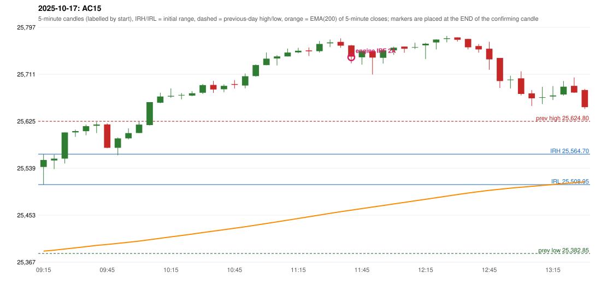

# 2025-10-17 - author's correction(s) against the engine

> Phase 5.1 date report. Evidence only; no rule was changed to produce a different outcome. Source image(s) are referenced under each correction.

## AC15 (PDF page 3, as written `20251017-1`, label `IRF`, ACTIVE)

### Author's observation

> ORB should have activated, instead IRF is activated.

Suggested: **ORB**; timing: not stated; requirement stated: ORB should have activated. Drawing (my reading): none. Uncertain: none. Image: `reports/phase5/phase51_author_corrections/pages/page_3_full.png (page 3 of docs/strategy_docs/corrected/Adobe Scan Nov 05, 2026.pdf)`.

### Original automated trade

20251017-1-IRF IRF Method 2A SHORT signal 11:45 entry 25742.05 -> T1_THEN_BUFFER_STOP

Stop 25777.05, T1 25715.05, T2 25682.05; exits 11:52 / 11:56. Engine explanation: IRF Method 2A SHORT: the 09:25-09:30 candle closed at 25,604.40, above IRH 25,564.70, and the next candle did not close back inside the range, so the setup is Method 2 and price stayed above it until the trigger. Extension candle 09:30-09:35, red candle 09:45-09:50. The trigger came 27 candles after the breakout candle: a completed candle closed below the recent pullback-low support (11:40-11:45); confirmed at 11:45 with close 25,743.35. Entry reference close 25,743.35 is 178.65 points above IRH 25,564.70.

### Independent historical evidence

Session: open 25541.3, previous high/low/close 25624.8 / 25382.85 / 25585.3 (gap -44.0); first candle {'high': 25564.7, 'low': 25508.95, 'open': 25541.3, 'close': 25554.05}.

Signal-candle measurements: signal_candle_start=11:40, colour=R, body_pct=60.0, upper_wick_pct=2.9, lower_wick_pct=37.0, signal_close=25743.35, ema200=25462.15, entry_minus_ema=281.2, ema_below_entry=True, ema_within_27_below_entry=False, ema_between_entry_and_target1=False, close_below_ema=False, session_low_before_candle=25508.95, close_below_prior_session_low=False, candle_low_at_or_below_prior_session_low=False, points_above_prior_session_low=234.4, body_pct_below_60=False, body_pct_below_50=False

Readings of the author's 'first red candle' wording (my formalisations, side by side):

| reading | first red candle | support | resistance | entry (signal time, close, trigger, body %) |
|---|---|---|---|---|
| FULLY_ABOVE|body>=60 | 09:45 | 25575.55 | 25620.85 | none before 13:00 |
| FULLY_ABOVE|body>=0 | 09:45 | 25575.55 | 25620.85 | none before 13:00 |
| CLOSE_ABOVE|body>=60 | 09:45 | 25575.55 | 25620.85 | none before 13:00 |
| CLOSE_ABOVE|body>=0 | 09:45 | 25575.55 | 25620.85 | none before 13:00 |

ORB records: Method 2 ENGINE_SETUP_INVALIDATED: TREND:EMA_PREV_SESSION_CLOSE wrong side

Chronological signal timeline (engine):

| time | strategy | method | dir | event | reason |
|---|---|---|---|---|---|
| 11:45 | IRF | Method 2A | SHORT | EXECUTED | trade 1: T1_THEN_BUFFER_STOP |
| 12:40 | IRF | Method 2B | SHORT | IGNORED | DAY_FINISHED |

Rejected / invalidated setups: 12:35 IRF Method 1/2: SESSION_ENDED_BEFORE_CONFIRMATION; 09:15 ORB Method 2: TREND:EMA_PREV_SESSION_CLOSE wrong side; 09:15 PDS Method 1/2/3: GAP_DOWN_OPEN_NOT_BELOW_ZONE

Applicable source rules:

* `TREND-EMA-001` (USER_APPROVED): Approved research variant A of the ORB/RF trend: the five-minute EMA(200) price location only (previous session's last close above/below its EMA(200); for RF the trend must exist BEFORE the opening gap, so the gap day contributes nothing). Not claimed to repro

### Conclusion

* **Classification:** EMA_FILTER_MISMATCH, CANDLE_CONFIRMATION_MISMATCH   **Category:** C
* **Is the author correct under the existing rules?** Cannot be decided: the 'established trend' is a proposal; the first candle's body is 22.9%
* **Is the engine correct under the existing rules?** Yes under the approved trend variant (TREND-EMA-001: previous close vs EMA)
* **Missing requirement / root cause:** the trend filter and the strength threshold
* **New rule required?** yes   **Implementable objectively now?** no   **Owner approval needed?** YES

Candles 09:15-13:00 (start, O, H, L, C, colour, body %, upper wick %, lower wick %, EMA200, close - EMA):

| start | O | H | L | C | col | body% | uw% | lw% | EMA | c-EMA |
|---|---|---|---|---|---|---|---|---|---|---|
| 09:15 | 25541.3 | 25564.7 | 25508.95 | 25554.05 | G | 22.9 | 19.1 | 58.0 | 25387.17 | 166.88 |
| 09:20 | 25553.2 | 25563.7 | 25537.3 | 25556.45 | G | 12.3 | 27.5 | 60.2 | 25388.85 | 167.6 |
| 09:25 | 25556.5 | 25604.4 | 25547.55 | 25604.4 | G | 84.3 | 0.0 | 15.7 | 25391.0 | 213.4 |
| 09:30 | 25604.55 | 25609.55 | 25596.25 | 25606.9 | G | 17.7 | 19.9 | 62.4 | 25393.15 | 213.75 |
| 09:35 | 25606.75 | 25618.75 | 25599.3 | 25615.9 | G | 47.0 | 14.7 | 38.3 | 25395.36 | 220.54 |
| 09:40 | 25616.7 | 25623.6 | 25603.2 | 25618.9 | G | 10.8 | 23.0 | 66.2 | 25397.59 | 221.31 |
| 09:45 | 25619.05 | 25620.85 | 25575.55 | 25576.3 | R | 94.4 | 4.0 | 1.7 | 25399.37 | 176.93 |
| 09:50 | 25576.25 | 25595.2 | 25562.55 | 25593.45 | G | 52.7 | 5.4 | 42.0 | 25401.3 | 192.15 |
| 09:55 | 25593.65 | 25611.85 | 25591.65 | 25603.2 | G | 47.3 | 42.8 | 9.9 | 25403.31 | 199.89 |
| 10:00 | 25603.35 | 25624.25 | 25603.15 | 25618.75 | G | 73.0 | 26.1 | 0.9 | 25405.45 | 213.3 |
| 10:05 | 25617.85 | 25659.85 | 25617.05 | 25659.85 | G | 98.1 | 0.0 | 1.9 | 25407.98 | 251.87 |
| 10:10 | 25658.75 | 25677.0 | 25658.0 | 25670.15 | G | 60.0 | 36.1 | 3.9 | 25410.59 | 259.56 |
| 10:15 | 25670.15 | 25685.05 | 25667.9 | 25671.4 | G | 7.3 | 79.6 | 13.1 | 25413.18 | 258.22 |
| 10:20 | 25672.75 | 25676.5 | 25665.1 | 25673.05 | G | 2.6 | 30.3 | 67.1 | 25415.77 | 257.28 |
| 10:25 | 25671.95 | 25679.95 | 25670.7 | 25676.1 | G | 44.9 | 41.6 | 13.5 | 25418.36 | 257.74 |
| 10:30 | 25677.1 | 25693.05 | 25674.65 | 25691.1 | G | 76.1 | 10.6 | 13.3 | 25421.07 | 270.03 |
| 10:35 | 25691.35 | 25698.8 | 25676.8 | 25683.1 | R | 37.5 | 33.9 | 28.6 | 25423.68 | 259.42 |
| 10:40 | 25683.5 | 25692.5 | 25678.05 | 25689.7 | G | 42.9 | 19.4 | 37.7 | 25426.33 | 263.37 |
| 10:45 | 25692.95 | 25700.25 | 25684.9 | 25691.6 | R | 8.8 | 47.6 | 43.6 | 25428.97 | 262.63 |
| 10:50 | 25690.25 | 25712.25 | 25685.05 | 25707.25 | G | 62.5 | 18.4 | 19.1 | 25431.74 | 275.51 |
| 10:55 | 25707.6 | 25728.95 | 25706.5 | 25727.75 | G | 89.8 | 5.3 | 4.9 | 25434.68 | 293.07 |
| 11:00 | 25727.7 | 25750.65 | 25727.5 | 25739.5 | G | 51.0 | 48.2 | 0.9 | 25437.72 | 301.78 |
| 11:05 | 25739.8 | 25745.95 | 25727.05 | 25743.55 | G | 19.8 | 12.7 | 67.5 | 25440.76 | 302.79 |
| 11:10 | 25743.55 | 25757.95 | 25743.55 | 25750.65 | G | 49.3 | 50.7 | 0.0 | 25443.84 | 306.81 |
| 11:15 | 25751.05 | 25759.35 | 25749.45 | 25754.0 | G | 29.8 | 54.0 | 16.2 | 25446.93 | 307.07 |
| 11:20 | 25754.45 | 25759.9 | 25744.25 | 25753.0 | R | 9.3 | 34.8 | 55.9 | 25449.97 | 303.03 |
| 11:25 | 25753.25 | 25771.75 | 25750.55 | 25766.4 | G | 62.0 | 25.2 | 12.7 | 25453.12 | 313.28 |
| 11:30 | 25767.65 | 25774.55 | 25760.7 | 25769.2 | G | 11.2 | 38.6 | 50.2 | 25456.27 | 312.93 |
| 11:35 | 25770.2 | 25776.7 | 25759.35 | 25763.3 | R | 39.8 | 37.5 | 22.8 | 25459.32 | 303.98 |
| 11:40 | 25763.7 | 25764.7 | 25730.8 | 25743.35 | R | 60.0 | 2.9 | 37.0 | 25462.15 | 281.2 |
| 11:45 | 25742.05 | 25754.1 | 25728.5 | 25753.5 | G | 44.7 | 2.3 | 52.9 | 25465.05 | 288.45 |
| 11:50 | 25752.9 | 25752.9 | 25710.4 | 25741.55 | R | 26.7 | 0.0 | 73.3 | 25467.8 | 273.75 |
| 11:55 | 25741.05 | 25756.9 | 25730.5 | 25754.85 | G | 52.3 | 7.8 | 40.0 | 25470.65 | 284.2 |
| 12:00 | 25754.75 | 25761.35 | 25746.35 | 25759.6 | G | 32.3 | 11.7 | 56.0 | 25473.53 | 286.07 |
| 12:05 | 25761.55 | 25761.55 | 25750.25 | 25757.7 | R | 34.1 | 0.0 | 65.9 | 25476.36 | 281.34 |
| 12:10 | 25759.7 | 25768.65 | 25757.2 | 25760.6 | G | 7.9 | 70.3 | 21.8 | 25479.19 | 281.41 |
| 12:15 | 25763.95 | 25768.5 | 25738.7 | 25766.9 | G | 9.9 | 5.4 | 84.7 | 25482.05 | 284.85 |
| 12:20 | 25769.2 | 25774.75 | 25756.35 | 25774.45 | G | 28.5 | 1.6 | 69.8 | 25484.96 | 289.49 |
| 12:25 | 25775.45 | 25780.95 | 25769.25 | 25776.75 | G | 11.1 | 35.9 | 53.0 | 25487.86 | 288.89 |
| 12:30 | 25778.4 | 25778.55 | 25770.8 | 25774.1 | R | 55.5 | 1.9 | 42.6 | 25490.71 | 283.39 |
| 12:35 | 25775.55 | 25775.55 | 25756.45 | 25760.25 | R | 80.1 | 0.0 | 19.9 | 25493.39 | 266.86 |
| 12:40 | 25762.55 | 25766.3 | 25750.5 | 25756.4 | R | 38.9 | 23.7 | 37.3 | 25496.01 | 260.39 |
| 12:45 | 25757.65 | 25770.4 | 25719.15 | 25738.2 | R | 38.0 | 24.9 | 37.2 | 25498.42 | 239.78 |
| 12:50 | 25740.75 | 25740.75 | 25685.85 | 25698.45 | R | 77.0 | 0.0 | 23.0 | 25500.41 | 198.04 |
| 12:55 | 25700.9 | 25708.15 | 25684.75 | 25701.2 | G | 1.3 | 29.7 | 69.0 | 25502.41 | 198.79 |
| 13:00 | 25703.45 | 25716.25 | 25672.2 | 25674.85 | R | 64.9 | 29.1 | 6.0 | 25504.12 | 170.73 |
