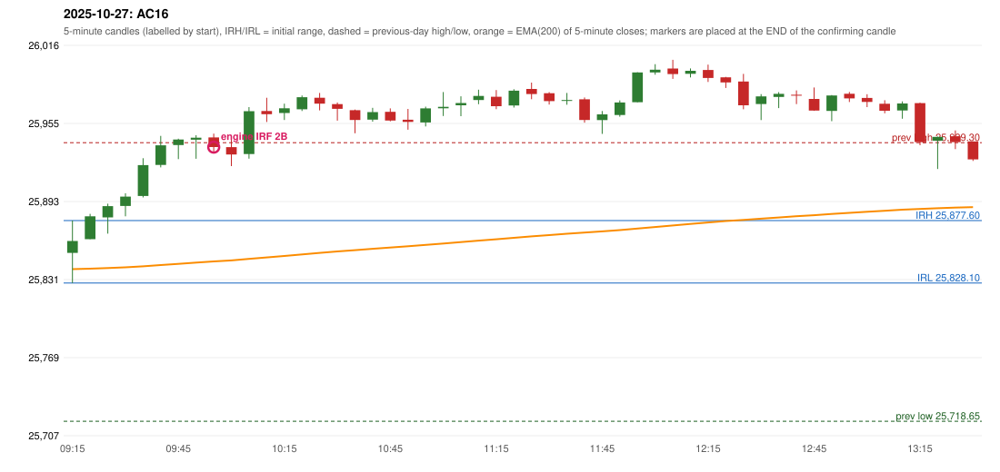

# 2025-10-27 - author's correction(s) against the engine

> Phase 5.1 date report. Evidence only; no rule was changed to produce a different outcome. Source image(s) are referenced under each correction.

## AC16 (PDF page 3, as written `20251027-1`, label `IRF`, ACTIVE)

### Author's observation

> ORB should have activated, instead IRF is activated. | IRF activation is also wrong.

Suggested: **ORB**; timing: not stated; requirement stated: ORB should have activated; the IRF activation itself is also wrong. Drawing (my reading): none. Uncertain: the closing stroke of 'wrong.' is a descender / underline, not a strike-through. Image: `reports/phase5/phase51_author_corrections/pages/page_3_full.png (page 3 of docs/strategy_docs/corrected/Adobe Scan Nov 05, 2026.pdf)`.

### Original automated trade

20251027-1-IRF IRF Method 2B SHORT signal 10:00 entry 25935.75 -> INITIAL_FULL_STOP

Stop 25970.75, T1 25908.75, T2 25875.75; exits 10:10 / 10:10. Engine explanation: IRF Method 2B SHORT: the 09:20-09:25 candle closed at 25,880.95, above IRH 25,877.60, and the next candle did not close back inside the range, so the setup is Method 2 and price stayed above it until the trigger. Extension candle 09:25-09:30, red candle 09:55-10:00. The trigger came 7 candles after the breakout candle: a red candle closed back below the first-push resistance after price had traded above it (09:55-10:00); confirmed at 10:00 with close 25,935.85. Entry reference close 25,935.85 is 58.25 points above IRH 25,877.60.

### Independent historical evidence

Session: open 25851.95, previous high/low/close 25939.3 / 25718.65 / 25795.15 (gap 56.8); first candle {'high': 25877.6, 'low': 25828.1, 'open': 25851.95, 'close': 25861.4}.

Signal-candle measurements: signal_candle_start=09:55, colour=R, body_pct=51.4, upper_wick_pct=20.3, lower_wick_pct=28.4, signal_close=25935.85, ema200=25845.22, entry_minus_ema=90.63, ema_below_entry=True, ema_within_27_below_entry=False, ema_between_entry_and_target1=False, close_below_ema=False, session_low_before_candle=25828.1, close_below_prior_session_low=False, candle_low_at_or_below_prior_session_low=False, points_above_prior_session_low=107.75, body_pct_below_60=True, body_pct_below_50=False

Readings of the author's 'first red candle' wording (my formalisations, side by side):

| reading | first red candle | support | resistance | entry (signal time, close, trigger, body %) |
|---|---|---|---|---|
| FULLY_ABOVE|body>=60 | 09:55 | 25931.65 | 25946.45 | none before 13:00 |
| FULLY_ABOVE|body>=0 | 09:55 | 25931.65 | 25946.45 | 10:05, 25929.95, SUPPORT_BREAK, 26.7 |
| CLOSE_ABOVE|body>=60 | 09:55 | 25931.65 | 25946.45 | none before 13:00 |
| CLOSE_ABOVE|body>=0 | 09:55 | 25931.65 | 25946.45 | 10:05, 25929.95, SUPPORT_BREAK, 26.7 |

ORB records: Method 2 ENGINE_SETUP_INVALIDATED: TREND:EMA_PREV_SESSION_CLOSE wrong side; Gap/200DMA ENGINE_SETUP_INVALIDATED: CANDLE_QUALITY_OR_REJECTION_WICK

Chronological signal timeline (engine):

| time | strategy | method | dir | event | reason |
|---|---|---|---|---|---|
| 10:00 | IRF | Method 2B | SHORT | EXECUTED | trade 1: INITIAL_FULL_STOP |
| 11:45 | IRF | Method 2A | SHORT | REJECTED | SECOND_TRADE_RESTRICTED_TO_PDR_PDS |
| 12:25 | IRF | Method 2A | SHORT | REJECTED | SECOND_TRADE_RESTRICTED_TO_PDR_PDS |
| 13:20 | IRF | Method 2A | SHORT | REJECTED | SECOND_TRADE_RESTRICTED_TO_PDR_PDS |
| 14:15 | IRF | Method 2B | SHORT | REJECTED | SECOND_TRADE_RESTRICTED_TO_PDR_PDS |
| 14:40 | IRF | Method 2B | SHORT | REJECTED | SECOND_TRADE_RESTRICTED_TO_PDR_PDS |

Rejected / invalidated setups: 11:45 IRF Method 2A: SECOND_TRADE_RESTRICTED_TO_PDR_PDS; 12:25 IRF Method 2A: SECOND_TRADE_RESTRICTED_TO_PDR_PDS; 13:20 IRF Method 2A: SECOND_TRADE_RESTRICTED_TO_PDR_PDS; 14:15 IRF Method 2B: SECOND_TRADE_RESTRICTED_TO_PDR_PDS; 14:40 IRF Method 2B: SECOND_TRADE_RESTRICTED_TO_PDR_PDS; 14:35 IRF Method 1/2: SESSION_ENDED_BEFORE_CONFIRMATION; 09:15 ORB Method 2: TREND:EMA_PREV_SESSION_CLOSE wrong side; 09:15 ORB Gap/200DMA: CANDLE_QUALITY_OR_REJECTION_WICK; 09:15 PDR PDR: OPEN_NOT_STRICTLY_ABOVE_ZONE

Applicable source rules:

* `ORB-TREND-001` (VERIFIED_QUALITATIVE): An established trend in the trade direction is required for Methods 1 and 2 (not for the Gap/200DMA setup if its conditions qualify).
* `ORB-GAP-LONG-004` (VERIFIED_QUALITATIVE): Candle quality: strong green body, or a suitable bullish pin-bar-type candle (position and close must support the breakout).

### Conclusion

* **Classification:** EMA_FILTER_MISMATCH, CANDLE_CONFIRMATION_MISMATCH, AUTHOR_DISCRETION_UNRESOLVED   **Category:** C
* **Is the author correct under the existing rules?** Cannot be decided (ORB); the remark 'IRF activation is also wrong' names no reason
* **Is the engine correct under the existing rules?** Yes under the written rules
* **Missing requirement / root cause:** trend filter / candle strength for ORB; the reason the IRF is wrong is not stated
* **New rule required?** unknown   **Implementable objectively now?** no   **Owner approval needed?** YES

Candles 09:15-13:00 (start, O, H, L, C, colour, body %, upper wick %, lower wick %, EMA200, close - EMA):

| start | O | H | L | C | col | body% | uw% | lw% | EMA | c-EMA |
|---|---|---|---|---|---|---|---|---|---|---|
| 09:15 | 25851.95 | 25877.6 | 25828.1 | 25861.4 | G | 19.1 | 32.7 | 48.2 | 25839.1 | 22.3 |
| 09:20 | 25862.85 | 25882.9 | 25862.85 | 25880.95 | G | 90.3 | 9.7 | 0.0 | 25839.51 | 41.44 |
| 09:25 | 25880.1 | 25891.0 | 25867.25 | 25889.05 | G | 37.7 | 8.2 | 54.1 | 25840.0 | 49.05 |
| 09:30 | 25889.15 | 25899.25 | 25880.95 | 25896.55 | G | 40.4 | 14.8 | 44.8 | 25840.57 | 55.98 |
| 09:35 | 25897.05 | 25927.0 | 25895.95 | 25921.5 | G | 78.7 | 17.7 | 3.5 | 25841.37 | 80.13 |
| 09:40 | 25921.7 | 25944.65 | 25919.75 | 25937.2 | G | 62.2 | 29.9 | 7.8 | 25842.33 | 94.87 |
| 09:45 | 25937.4 | 25942.45 | 25926.3 | 25941.8 | G | 27.2 | 4.0 | 68.7 | 25843.32 | 98.48 |
| 09:50 | 25941.65 | 25945.2 | 25926.55 | 25943.25 | G | 8.6 | 10.5 | 81.0 | 25844.31 | 98.94 |
| 09:55 | 25943.45 | 25946.45 | 25931.65 | 25935.85 | R | 51.4 | 20.3 | 28.4 | 25845.22 | 90.63 |
| 10:00 | 25935.75 | 25942.4 | 25920.7 | 25929.95 | R | 26.7 | 30.6 | 42.6 | 25846.06 | 83.89 |
| 10:05 | 25930.25 | 25967.45 | 25926.6 | 25964.2 | G | 83.1 | 8.0 | 8.9 | 25847.24 | 116.96 |
| 10:10 | 25964.35 | 25974.85 | 25955.7 | 25961.85 | R | 13.1 | 54.8 | 32.1 | 25848.38 | 113.47 |
| 10:15 | 25962.75 | 25970.2 | 25957.25 | 25966.5 | G | 29.0 | 28.6 | 42.5 | 25849.56 | 116.94 |
| 10:20 | 25965.75 | 25976.65 | 25964.35 | 25975.3 | G | 77.6 | 11.0 | 11.4 | 25850.81 | 124.49 |
| 10:25 | 25974.9 | 25978.65 | 25964.9 | 25970.25 | R | 33.8 | 27.3 | 38.9 | 25851.99 | 118.26 |
| 10:30 | 25969.8 | 25971.15 | 25956.75 | 25966.05 | R | 26.0 | 9.4 | 64.6 | 25853.13 | 112.92 |
| 10:35 | 25965.05 | 25965.55 | 25946.75 | 25957.3 | R | 41.2 | 2.7 | 56.1 | 25854.17 | 103.13 |
| 10:40 | 25957.5 | 25966.9 | 25955.95 | 25963.5 | G | 54.8 | 31.1 | 14.2 | 25855.25 | 108.25 |
| 10:45 | 25963.75 | 25966.45 | 25956.2 | 25956.85 | R | 67.3 | 26.3 | 6.3 | 25856.27 | 100.58 |
| 10:50 | 25957.5 | 25966.0 | 25949.55 | 25955.8 | R | 10.3 | 51.7 | 38.0 | 25857.26 | 98.54 |
| 10:55 | 25955.3 | 25967.8 | 25952.15 | 25966.45 | G | 71.2 | 8.6 | 20.1 | 25858.34 | 108.11 |
| 11:00 | 25966.55 | 25979.4 | 25960.45 | 25967.7 | G | 6.1 | 61.7 | 32.2 | 25859.43 | 108.27 |
| 11:05 | 25968.9 | 25976.05 | 25960.3 | 25970.7 | G | 11.4 | 34.0 | 54.6 | 25860.54 | 110.16 |
| 11:10 | 25973.1 | 25981.3 | 25969.75 | 25976.3 | G | 27.7 | 43.3 | 29.0 | 25861.69 | 114.61 |
| 11:15 | 25975.65 | 25980.95 | 25965.8 | 25968.2 | R | 49.2 | 35.0 | 15.8 | 25862.75 | 105.45 |
| 11:20 | 25968.7 | 25981.65 | 25967.1 | 25980.45 | G | 80.8 | 8.2 | 11.0 | 25863.92 | 116.53 |
| 11:25 | 25981.85 | 25986.9 | 25973.7 | 25977.85 | R | 30.3 | 38.3 | 31.4 | 25865.05 | 112.8 |
| 11:30 | 25978.45 | 25979.35 | 25969.5 | 25972.2 | R | 63.5 | 9.1 | 27.4 | 25866.12 | 106.08 |
| 11:35 | 25972.4 | 25978.65 | 25969.3 | 25973.05 | G | 7.0 | 59.9 | 33.2 | 25867.18 | 105.87 |
| 11:40 | 25973.65 | 25975.1 | 25955.15 | 25957.25 | R | 82.2 | 7.3 | 10.5 | 25868.08 | 89.17 |
| 11:45 | 25957.2 | 25964.35 | 25946.25 | 25961.7 | G | 24.9 | 14.6 | 60.5 | 25869.01 | 92.69 |
| 11:50 | 25961.15 | 25972.8 | 25959.85 | 25971.1 | G | 76.8 | 13.1 | 10.0 | 25870.03 | 101.07 |
| 11:55 | 25971.3 | 25995.1 | 25971.3 | 25994.9 | G | 99.2 | 0.8 | 0.0 | 25871.27 | 123.63 |
| 12:00 | 25994.95 | 26001.45 | 25993.15 | 25997.1 | G | 25.9 | 52.4 | 21.7 | 25872.52 | 124.58 |
| 12:05 | 25998.0 | 26004.9 | 25989.8 | 25993.65 | R | 28.8 | 45.7 | 25.5 | 25873.73 | 119.92 |
| 12:10 | 25993.85 | 25998.1 | 25990.95 | 25996.25 | G | 33.6 | 25.9 | 40.6 | 25874.95 | 121.3 |
| 12:15 | 25996.85 | 26001.1 | 25987.35 | 25990.5 | R | 46.2 | 30.9 | 22.9 | 25876.1 | 114.4 |
| 12:20 | 25991.05 | 25991.4 | 25982.6 | 25987.0 | R | 46.0 | 4.0 | 50.0 | 25877.2 | 109.8 |
| 12:25 | 25987.75 | 25993.8 | 25965.7 | 25968.9 | R | 67.1 | 21.5 | 11.4 | 25878.11 | 90.79 |
| 12:30 | 25969.9 | 25977.75 | 25957.15 | 25975.95 | G | 29.4 | 8.7 | 61.9 | 25879.09 | 96.86 |
| 12:35 | 25975.5 | 25979.3 | 25966.7 | 25977.95 | G | 19.4 | 10.7 | 69.8 | 25880.07 | 97.88 |
| 12:40 | 25977.25 | 25980.7 | 25969.8 | 25976.85 | R | 3.7 | 31.7 | 64.7 | 25881.03 | 95.82 |
| 12:45 | 25973.9 | 25983.0 | 25964.5 | 25964.7 | R | 49.7 | 49.2 | 1.1 | 25881.86 | 82.84 |
| 12:50 | 25964.45 | 25977.05 | 25956.3 | 25976.65 | G | 58.8 | 1.9 | 39.3 | 25882.81 | 93.84 |
| 12:55 | 25978.0 | 25979.5 | 25971.5 | 25974.3 | R | 46.3 | 18.8 | 35.0 | 25883.72 | 90.58 |
| 13:00 | 25974.7 | 25977.65 | 25967.45 | 25971.55 | R | 30.9 | 28.9 | 40.2 | 25884.59 | 86.96 |
