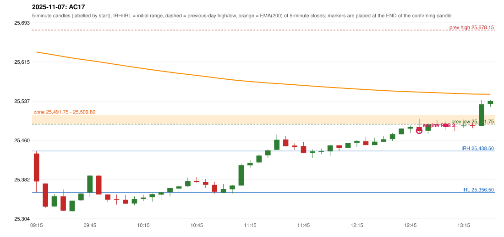

# 2025-11-07 - author's correction(s) against the engine

> Phase 5.1 date report. Evidence only; no rule was changed to produce a different outcome. Source image(s) are referenced under each correction.

## AC17 (PDF page 3, as written `20251107-2`, label `PDS`, ACTIVE)

### Author's observation

> IRF should activate first which gives an SL. | 2nd trade should be PDS.

Suggested: **IRF first (it stops out), then PDS as the 2nd trade**; timing: earlier (IRF before the PDS); requirement stated: IRF first; the second trade should be the PDS. Drawing (my reading): none. Uncertain: none. Image: `reports/phase5/phase51_author_corrections/pages/page_3_full.png (page 3 of docs/strategy_docs/corrected/Adobe Scan Nov 05, 2026.pdf)`.

### Original automated trade

20251107-2-PDS PDS Method 2 SHORT signal 12:55 entry 25478.7 -> INITIAL_FULL_STOP

Stop 25513.7, T1 25451.7, T2 25408.7; exits 13:26 / 13:26. Engine explanation: PDS Method 2 SHORT: the session opened 58.20 points below the previous-day-low zone [25,491.75, 25,509.80]; price rose to the zone at 12:50 and the first red candle at the zone (12:50, close 25,478.45) was a higher-price-rejection pin bar; confirmed 12:55.

### Independent historical evidence

Session: open 25433.55, previous high/low/close 25678.15 / 25491.75 / 25509.7 (gap -76.15); first candle {'high': 25438.5, 'low': 25356.5, 'open': 25433.55, 'close': 25378.15}.

ORB records: Method 1 ENGINE_SETUP_INVALIDATED: CANDLE_QUALITY(not a strong body / wick too large); Method 2 ENGINE_SETUP_INVALIDATED: TRENDLINE_NOT_SUPPORTIVE

Chronological signal timeline (engine):

| time | strategy | method | dir | event | reason |
|---|---|---|---|---|---|
| 11:50 | IRF | Method 1 | SHORT | EXECUTED | trade 1: INITIAL_FULL_STOP |
| 12:55 | PDS | Method 2 | SHORT | EXECUTED | trade 2: INITIAL_FULL_STOP |
| 13:05 | PDS | Method 2 | SHORT | IGNORED | POSITION_ACTIVE (signal kept for diagnostics only; never reused) |
| 14:05 | IRF | Method 2A | SHORT | IGNORED | DAY_FINISHED |
| 14:05 | IRF | Method 2B | SHORT | IGNORED | DAY_FINISHED |
| 14:05 | PDS | Method 3 | SHORT | IGNORED | DAY_FINISHED |

Rejected / invalidated setups: 14:00 IRF Method 1/2: SESSION_ENDED_BEFORE_CONFIRMATION; 09:15 ORB Method 1: CANDLE_QUALITY(not a strong body / wick too large); 09:15 ORB Method 2: TRENDLINE_NOT_SUPPORTIVE; 14:20 PDS Method 1/2/3: NO_QUALIFYING_ENTRY_BEFORE_SESSION_END; 09:45 RF RF: TREND:EMA_PREV_SESSION_CLOSE wrong side

Applicable source rules:

* `DAY-SL-001` (USER_APPROVED): If the first trade hits its ORIGINAL full stop-loss before Target 1 (INITIAL_FULL_STOP), exactly one additional trade is permitted, and only a PDR or PDS trade from a valid, independently confirmed signal confirmed after the first trade has fully stopped out.

### Conclusion

* **Classification:** NO_DISCREPANCY_FOUND   **Category:** N
* **Is the author correct under the existing rules?** Yes - and the engine did exactly this
* **Is the engine correct under the existing rules?** Yes: 20251107-1 is an IRF Method 1 trade (stopped out), 20251107-2 a PDS Method 2 second trade
* **Missing requirement / root cause:** none found; the red-star sentence beneath it is incomplete on the scan
* **New rule required?** none   **Implementable objectively now?** n/a   **Owner approval needed?** NO (but see G01)

Candles 09:15-13:00 (start, O, H, L, C, colour, body %, upper wick %, lower wick %, EMA200, close - EMA):

| start | O | H | L | C | col | body% | uw% | lw% | EMA | c-EMA |
|---|---|---|---|---|---|---|---|---|---|---|
| 09:15 | 25433.55 | 25438.5 | 25356.5 | 25378.15 | R | 67.6 | 6.0 | 26.4 | 25634.62 | -256.47 |
| 09:20 | 25374.2 | 25374.2 | 25325.45 | 25328.2 | R | 94.4 | 0.0 | 5.6 | 25631.57 | -303.37 |
| 09:25 | 25328.55 | 25352.9 | 25328.3 | 25348.95 | G | 82.9 | 16.1 | 1.0 | 25628.76 | -279.81 |
| 09:30 | 25348.85 | 25362.35 | 25319.4 | 25320.2 | R | 66.7 | 31.4 | 1.9 | 25625.69 | -305.49 |
| 09:35 | 25319.25 | 25340.9 | 25318.65 | 25340.0 | G | 93.3 | 4.0 | 2.7 | 25622.85 | -282.85 |
| 09:40 | 25340.9 | 25356.5 | 25339.15 | 25354.25 | G | 76.9 | 13.0 | 10.1 | 25620.18 | -265.93 |
| 09:45 | 25356.15 | 25391.15 | 25347.4 | 25389.8 | G | 76.9 | 3.1 | 20.0 | 25617.88 | -228.08 |
| 09:50 | 25389.6 | 25390.95 | 25352.45 | 25352.45 | R | 96.5 | 3.5 | 0.0 | 25615.24 | -262.79 |
| 09:55 | 25352.5 | 25352.5 | 25336.95 | 25342.25 | R | 65.9 | 0.0 | 34.1 | 25612.53 | -270.28 |
| 10:00 | 25342.9 | 25352.3 | 25332.45 | 25341.5 | R | 7.1 | 47.4 | 45.6 | 25609.83 | -268.33 |
| 10:05 | 25341.9 | 25351.95 | 25333.5 | 25334.3 | R | 41.2 | 54.5 | 4.3 | 25607.09 | -272.79 |
| 10:10 | 25334.45 | 25348.5 | 25331.05 | 25343.25 | G | 50.4 | 30.1 | 19.5 | 25604.46 | -261.21 |
| 10:15 | 25343.95 | 25352.15 | 25339.35 | 25346.25 | G | 18.0 | 46.1 | 35.9 | 25601.89 | -255.64 |
| 10:20 | 25347.1 | 25354.5 | 25338.2 | 25352.85 | G | 35.3 | 10.1 | 54.6 | 25599.41 | -246.56 |
| 10:25 | 25352.15 | 25357.25 | 25342.3 | 25356.8 | G | 31.1 | 3.0 | 65.9 | 25597.0 | -240.2 |
| 10:30 | 25357.0 | 25364.95 | 25348.65 | 25364.95 | G | 48.8 | 0.0 | 51.2 | 25594.69 | -229.74 |
| 10:35 | 25364.2 | 25371.95 | 25356.3 | 25368.5 | G | 27.5 | 22.0 | 50.5 | 25592.44 | -223.94 |
| 10:40 | 25368.85 | 25385.9 | 25366.65 | 25379.1 | G | 53.2 | 35.3 | 11.4 | 25590.32 | -211.22 |
| 10:45 | 25379.3 | 25386.55 | 25375.75 | 25377.25 | R | 19.0 | 67.1 | 13.9 | 25588.2 | -210.95 |
| 10:50 | 25377.3 | 25382.85 | 25365.45 | 25371.4 | R | 33.9 | 31.9 | 34.2 | 25586.04 | -214.64 |
| 10:55 | 25371.45 | 25377.75 | 25354.2 | 25357.75 | R | 58.2 | 26.8 | 15.1 | 25583.77 | -226.02 |
| 11:00 | 25355.95 | 25373.0 | 25355.95 | 25362.95 | G | 41.1 | 58.9 | 0.0 | 25581.57 | -218.62 |
| 11:05 | 25362.7 | 25371.45 | 25354.4 | 25370.2 | G | 44.0 | 7.3 | 48.7 | 25579.47 | -209.27 |
| 11:10 | 25370.2 | 25413.8 | 25369.65 | 25410.55 | G | 91.4 | 7.4 | 1.2 | 25577.79 | -167.24 |
| 11:15 | 25410.25 | 25420.75 | 25405.15 | 25415.1 | G | 31.1 | 36.2 | 32.7 | 25576.17 | -161.07 |
| 11:20 | 25415.95 | 25432.3 | 25413.15 | 25429.55 | G | 71.0 | 14.4 | 14.6 | 25574.71 | -145.16 |
| 11:25 | 25429.95 | 25441.75 | 25424.65 | 25439.7 | G | 57.0 | 12.0 | 31.0 | 25573.37 | -133.67 |
| 11:30 | 25440.85 | 25471.05 | 25439.9 | 25460.8 | G | 64.0 | 32.9 | 3.0 | 25572.25 | -111.45 |
| 11:35 | 25461.25 | 25467.7 | 25447.75 | 25447.75 | R | 67.7 | 32.3 | 0.0 | 25571.01 | -123.26 |
| 11:40 | 25449.3 | 25453.7 | 25440.75 | 25446.95 | R | 18.1 | 34.0 | 47.9 | 25569.77 | -122.82 |
| 11:45 | 25447.85 | 25456.25 | 25434.1 | 25434.7 | R | 59.4 | 37.9 | 2.7 | 25568.43 | -133.73 |
| 11:50 | 25434.7 | 25441.55 | 25425.1 | 25437.7 | G | 18.2 | 23.4 | 58.4 | 25567.13 | -129.43 |
| 11:55 | 25437.55 | 25443.15 | 25432.25 | 25437.95 | G | 3.7 | 47.7 | 48.6 | 25565.84 | -127.89 |
| 12:00 | 25437.75 | 25451.0 | 25429.05 | 25449.55 | G | 53.8 | 6.6 | 39.6 | 25564.69 | -115.14 |
| 12:05 | 25449.75 | 25449.75 | 25438.0 | 25444.55 | R | 44.3 | 0.0 | 55.7 | 25563.49 | -118.94 |
| 12:10 | 25444.45 | 25460.05 | 25441.6 | 25454.2 | G | 52.8 | 31.7 | 15.4 | 25562.4 | -108.2 |
| 12:15 | 25454.85 | 25460.6 | 25447.05 | 25457.8 | G | 21.8 | 20.7 | 57.6 | 25561.36 | -103.56 |
| 12:20 | 25457.7 | 25466.15 | 25449.9 | 25450.3 | R | 45.5 | 52.0 | 2.5 | 25560.26 | -109.96 |
| 12:25 | 25450.25 | 25465.0 | 25450.25 | 25457.15 | G | 46.8 | 53.2 | 0.0 | 25559.23 | -102.08 |
| 12:30 | 25456.9 | 25468.7 | 25456.85 | 25461.8 | G | 41.4 | 58.2 | 0.4 | 25558.26 | -96.46 |
| 12:35 | 25462.1 | 25474.25 | 25458.2 | 25471.95 | G | 61.4 | 14.3 | 24.3 | 25557.4 | -85.45 |
| 12:40 | 25471.8 | 25483.65 | 25471.3 | 25483.05 | G | 91.1 | 4.9 | 4.0 | 25556.66 | -73.61 |
| 12:45 | 25482.8 | 25488.9 | 25474.5 | 25486.25 | G | 24.0 | 18.4 | 57.6 | 25555.96 | -69.71 |
| 12:50 | 25486.2 | 25502.35 | 25474.75 | 25478.45 | R | 28.1 | 58.5 | 13.4 | 25555.19 | -76.74 |
| 12:55 | 25478.7 | 25492.95 | 25472.55 | 25491.25 | G | 61.5 | 8.3 | 30.1 | 25554.56 | -63.31 |
| 13:00 | 25491.5 | 25499.8 | 25488.9 | 25491.25 | R | 2.3 | 76.1 | 21.6 | 25553.93 | -62.68 |
