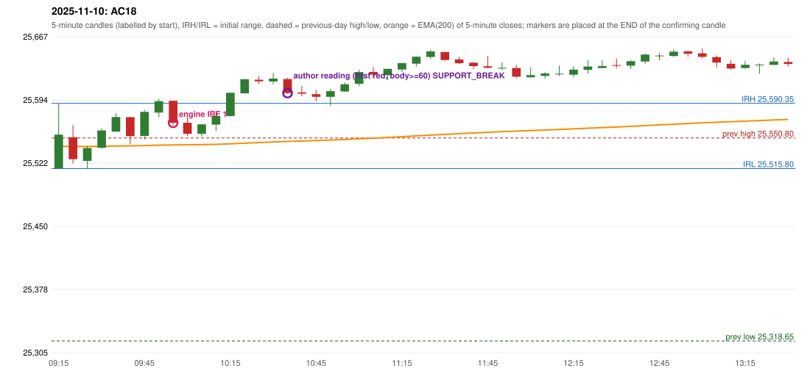

# 2025-11-10 - author's correction(s) against the engine

> Phase 5.1 date report. Evidence only; no rule was changed to produce a different outcome. Source image(s) are referenced under each correction.

## AC18 (PDF page 4, as written `20251110-1`, label `IRF`, ACTIVE)

### Author's observation

> Should be ignored as Tgt 1 is not above EMA, tgt 1 is less than 27. | Should wait until EMA break.

Suggested: **IRF (later entry, or none)**; timing: later (wait until the EMA is broken); requirement stated: ignore the entry when target 1 is not above the EMA, i.e. the EMA is within 27 of the entry ('tgt 1 is less than 27'); wait until the EMA breaks. Drawing (my reading): none. Uncertain: 'Tgt 1 is not above EMA' - read as: the EMA lies between the entry and target 1; 'tgt 1 is less than 27' read as: the distance to the EMA is under 27. Image: `reports/phase5/phase51_author_corrections/pages/page_4_full.png (page 4 of docs/strategy_docs/corrected/Adobe Scan Nov 05, 2026.pdf)`.

### Original automated trade

20251110-1-IRF IRF Method 1 SHORT signal 10:00 entry 25568.2 -> INITIAL_FULL_STOP

Stop 25603.2, T1 25541.2, T2 25508.2; exits 10:20 / 10:20. Engine explanation: IRF Method 1 SHORT: the completed 09:50 candle closed at 25,592.90, 2.55 points above the initial range high 25,590.35 (range [25,515.80, 25,590.35] from the 09:15 candle); the immediately following completed 09:55 candle closed at 25,568.10, back inside the range. The short signal was confirmed at 10:00 on that close. Entry reference close 25,568.10 is 22.25 points below IRH 25,590.35.

### Independent historical evidence

Session: open 25515.8, previous high/low/close 25550.8 / 25318.65 / 25492.3 (gap 23.5); first candle {'high': 25590.35, 'low': 25515.8, 'open': 25515.8, 'close': 25554.6}.

Signal-candle measurements: signal_candle_start=09:55, colour=R, body_pct=88.1, upper_wick_pct=1.2, lower_wick_pct=10.7, signal_close=25568.1, ema200=25542.83, entry_minus_ema=25.27, ema_below_entry=True, ema_within_27_below_entry=True, ema_between_entry_and_target1=True, close_below_ema=False, session_low_before_candle=25515.3, close_below_prior_session_low=False, candle_low_at_or_below_prior_session_low=False, points_above_prior_session_low=52.8, body_pct_below_60=False, body_pct_below_50=False

Readings of the author's 'first red candle' wording (my formalisations, side by side):

| reading | first red candle | support | resistance | entry (signal time, close, trigger, body %) |
|---|---|---|---|---|
| FULLY_ABOVE|body>=60 | 10:25 | 25612.25 | 25621.75 | 10:40, 25602.1, SUPPORT_BREAK, 86.3 |
| FULLY_ABOVE|body>=0 | 10:25 | 25612.25 | 25621.75 | 10:40, 25602.1, SUPPORT_BREAK, 86.3 |
| CLOSE_ABOVE|body>=60 | 10:25 | 25612.25 | 25621.75 | 10:40, 25602.1, SUPPORT_BREAK, 86.3 |
| CLOSE_ABOVE|body>=0 | 10:25 | 25612.25 | 25621.75 | 10:40, 25602.1, SUPPORT_BREAK, 86.3 |

ORB records: Method 1 ENGINE_SETUP_INVALIDATED: TREND:EMA_PREV_SESSION_CLOSE wrong side; Method 2 ENGINE_SETUP_INVALIDATED: TREND:EMA_PREV_SESSION_CLOSE wrong side

Chronological signal timeline (engine):

| time | strategy | method | dir | event | reason |
|---|---|---|---|---|---|
| 10:00 | IRF | Method 1 | SHORT | EXECUTED | trade 1: INITIAL_FULL_STOP |
| 11:10 | IRF | Method 2B | SHORT | REJECTED | SECOND_TRADE_RESTRICTED_TO_PDR_PDS |
| 11:50 | IRF | Method 2B | SHORT | REJECTED | SECOND_TRADE_RESTRICTED_TO_PDR_PDS |
| 13:05 | IRF | Method 2B | SHORT | REJECTED | SECOND_TRADE_RESTRICTED_TO_PDR_PDS |

Rejected / invalidated setups: 11:10 IRF Method 2B: SECOND_TRADE_RESTRICTED_TO_PDR_PDS; 11:50 IRF Method 2B: SECOND_TRADE_RESTRICTED_TO_PDR_PDS; 13:05 IRF Method 2B: SECOND_TRADE_RESTRICTED_TO_PDR_PDS; 13:00 IRF Method 1/2: SESSION_ENDED_BEFORE_CONFIRMATION; 09:15 ORB Method 1: TREND:EMA_PREV_SESSION_CLOSE wrong side; 09:15 ORB Method 2: TREND:EMA_PREV_SESSION_CLOSE wrong side; 09:15 PDR PDR: OPEN_NOT_STRICTLY_ABOVE_ZONE

### Conclusion

* **Classification:** EMA_FILTER_MISMATCH, MISSING_AUTHOR_RULE, ENTRY_TIMING_MISMATCH   **Category:** B
* **Is the author correct under the existing rules?** Yes, measurably: the EMA is 25.27 points below the engine's entry, i.e. between entry and target 1
* **Is the engine correct under the existing rules?** Yes under the written rules
* **Missing requirement / root cause:** the same EMA-space rule as AC13 (written twice, consistently)
* **New rule required?** yes: the AC13 / AC18 rule   **Implementable objectively now?** partly (skip vs defer)   **Owner approval needed?** YES

Candles 09:15-13:00 (start, O, H, L, C, colour, body %, upper wick %, lower wick %, EMA200, close - EMA):

| start | O | H | L | C | col | body% | uw% | lw% | EMA | c-EMA |
|---|---|---|---|---|---|---|---|---|---|---|
| 09:15 | 25515.8 | 25590.35 | 25515.8 | 25554.6 | G | 52.0 | 48.0 | 0.0 | 25541.22 | 13.38 |
| 09:20 | 25551.65 | 25565.7 | 25521.5 | 25526.55 | R | 56.8 | 31.8 | 11.4 | 25541.07 | -14.52 |
| 09:25 | 25524.45 | 25541.3 | 25515.3 | 25539.25 | G | 56.9 | 7.9 | 35.2 | 25541.06 | -1.81 |
| 09:30 | 25539.6 | 25561.9 | 25538.65 | 25559.35 | G | 84.9 | 11.0 | 4.1 | 25541.24 | 18.11 |
| 09:35 | 25558.0 | 25579.15 | 25558.0 | 25574.7 | G | 79.0 | 21.0 | 0.0 | 25541.57 | 33.13 |
| 09:40 | 25574.55 | 25575.05 | 25543.55 | 25552.75 | R | 69.2 | 1.6 | 29.2 | 25541.68 | 11.07 |
| 09:45 | 25553.2 | 25583.15 | 25548.7 | 25580.65 | G | 79.7 | 7.3 | 13.1 | 25542.07 | 38.58 |
| 09:50 | 25579.75 | 25595.5 | 25574.45 | 25592.9 | G | 62.5 | 12.4 | 25.2 | 25542.58 | 50.32 |
| 09:55 | 25593.3 | 25593.65 | 25565.05 | 25568.1 | R | 88.1 | 1.2 | 10.7 | 25542.83 | 25.27 |
| 10:00 | 25568.2 | 25575.35 | 25553.1 | 25555.6 | R | 56.6 | 32.1 | 11.2 | 25542.96 | 12.64 |
| 10:05 | 25555.55 | 25566.85 | 25552.3 | 25566.35 | G | 74.2 | 3.4 | 22.3 | 25543.19 | 23.16 |
| 10:10 | 25566.05 | 25579.55 | 25558.65 | 25576.0 | G | 47.6 | 17.0 | 35.4 | 25543.52 | 32.48 |
| 10:15 | 25575.9 | 25602.45 | 25575.2 | 25602.45 | G | 97.4 | 0.0 | 2.6 | 25544.1 | 58.35 |
| 10:20 | 25601.85 | 25618.05 | 25601.85 | 25618.05 | G | 100.0 | 0.0 | 0.0 | 25544.84 | 73.21 |
| 10:25 | 25617.45 | 25621.75 | 25612.25 | 25615.6 | R | 19.5 | 45.3 | 35.3 | 25545.54 | 70.06 |
| 10:30 | 25615.35 | 25625.1 | 25612.05 | 25618.65 | G | 25.3 | 49.4 | 25.3 | 25546.27 | 72.38 |
| 10:35 | 25618.15 | 25619.7 | 25601.1 | 25602.1 | R | 86.3 | 8.3 | 5.4 | 25546.83 | 55.27 |
| 10:40 | 25602.85 | 25610.35 | 25598.45 | 25601.45 | R | 11.8 | 63.0 | 25.2 | 25547.37 | 54.08 |
| 10:45 | 25600.85 | 25605.8 | 25592.6 | 25597.85 | R | 22.7 | 37.5 | 39.8 | 25547.87 | 49.98 |
| 10:50 | 25597.85 | 25606.9 | 25587.75 | 25604.3 | G | 33.7 | 13.6 | 52.7 | 25548.43 | 55.87 |
| 10:55 | 25604.0 | 25614.45 | 25603.25 | 25612.2 | G | 73.2 | 20.1 | 6.7 | 25549.07 | 63.13 |
| 11:00 | 25612.8 | 25628.85 | 25610.25 | 25626.2 | G | 72.0 | 14.2 | 13.7 | 25549.84 | 76.36 |
| 11:05 | 25626.35 | 25631.8 | 25619.55 | 25623.3 | R | 24.9 | 44.5 | 30.6 | 25550.57 | 72.73 |
| 11:10 | 25622.65 | 25629.9 | 25617.1 | 25629.9 | G | 56.6 | 0.0 | 43.4 | 25551.36 | 78.54 |
| 11:15 | 25629.1 | 25636.95 | 25625.95 | 25636.35 | G | 65.9 | 5.5 | 28.6 | 25552.2 | 84.15 |
| 11:20 | 25635.8 | 25644.3 | 25632.4 | 25643.75 | G | 66.8 | 4.6 | 28.6 | 25553.11 | 90.64 |
| 11:25 | 25643.45 | 25651.45 | 25641.15 | 25649.8 | G | 61.7 | 16.0 | 22.3 | 25554.07 | 95.73 |
| 11:30 | 25649.1 | 25649.35 | 25639.2 | 25639.95 | R | 90.1 | 2.5 | 7.4 | 25554.93 | 85.02 |
| 11:35 | 25640.65 | 25643.9 | 25635.6 | 25636.3 | R | 52.4 | 39.2 | 8.4 | 25555.74 | 80.56 |
| 11:40 | 25636.85 | 25637.85 | 25629.75 | 25633.0 | R | 47.5 | 12.3 | 40.1 | 25556.51 | 76.49 |
| 11:45 | 25632.75 | 25644.5 | 25630.45 | 25631.05 | R | 12.1 | 83.6 | 4.3 | 25557.25 | 73.8 |
| 11:50 | 25630.8 | 25637.55 | 25628.5 | 25631.0 | G | 2.2 | 72.4 | 25.4 | 25557.98 | 73.02 |
| 11:55 | 25630.8 | 25634.35 | 25619.05 | 25620.85 | R | 65.0 | 23.2 | 11.8 | 25558.61 | 62.24 |
| 12:00 | 25620.2 | 25631.45 | 25620.2 | 25622.65 | G | 21.8 | 78.2 | 0.0 | 25559.25 | 63.4 |
| 12:05 | 25621.8 | 25626.2 | 25618.75 | 25624.6 | G | 37.6 | 21.5 | 40.9 | 25559.9 | 64.7 |
| 12:10 | 25624.05 | 25633.5 | 25621.75 | 25624.3 | G | 2.1 | 78.3 | 19.6 | 25560.54 | 63.76 |
| 12:15 | 25623.1 | 25632.85 | 25620.3 | 25628.9 | G | 46.2 | 31.5 | 22.3 | 25561.22 | 67.68 |
| 12:20 | 25628.65 | 25639.8 | 25624.3 | 25632.45 | G | 24.5 | 47.4 | 28.1 | 25561.93 | 70.52 |
| 12:25 | 25630.8 | 25639.7 | 25630.8 | 25633.05 | G | 25.3 | 74.7 | 0.0 | 25562.63 | 70.42 |
| 12:30 | 25634.15 | 25641.9 | 25630.55 | 25634.0 | R | 1.3 | 68.3 | 30.4 | 25563.34 | 70.66 |
| 12:35 | 25633.5 | 25639.65 | 25629.7 | 25638.6 | G | 51.3 | 10.6 | 38.2 | 25564.09 | 74.51 |
| 12:40 | 25638.25 | 25647.3 | 25635.7 | 25646.15 | G | 68.1 | 9.9 | 22.0 | 25564.91 | 81.24 |
| 12:45 | 25644.3 | 25648.05 | 25639.45 | 25645.1 | G | 9.3 | 34.3 | 56.4 | 25565.71 | 79.39 |
| 12:50 | 25644.6 | 25652.0 | 25643.55 | 25649.55 | G | 58.6 | 29.0 | 12.4 | 25566.54 | 83.01 |
| 12:55 | 25649.9 | 25650.8 | 25643.8 | 25647.2 | R | 38.6 | 12.9 | 48.6 | 25567.34 | 79.86 |
| 13:00 | 25647.55 | 25653.2 | 25641.9 | 25643.5 | R | 35.8 | 50.0 | 14.2 | 25568.1 | 75.4 |
