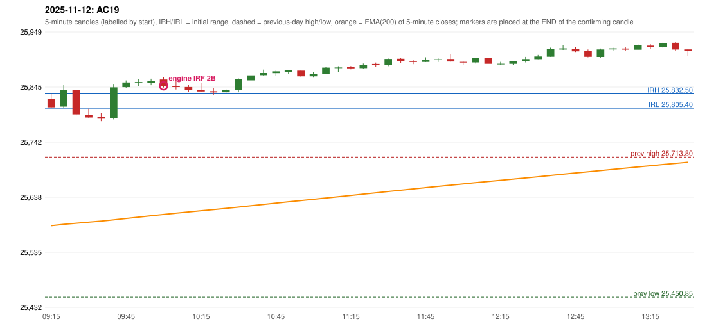

# 2025-11-12 - author's correction(s) against the engine

> Phase 5.1 date report. Evidence only; no rule was changed to produce a different outcome. Source image(s) are referenced under each correction.

## AC19 (PDF page 4, as written `20251112-1`, label `IRF`, ACTIVE)

### Author's observation

> This day trading should be completely stopped as IRF is already activate[d] Ep entry is below days low.

Suggested: **no trade (IRF should not have been taken at the day's low)**; timing: not at all; requirement stated: trading for the day should stop because the IRF activation is below the day's low. Drawing (my reading): none. Uncertain: 'activate[d]' cut by the page edge; 'Ep' read as 'i.e.'; 'completely stopped' - whether all strategies stop or only IRF is not stated. Image: `reports/phase5/phase51_author_corrections/pages/page_4_full.png (page 4 of docs/strategy_docs/corrected/Adobe Scan Nov 05, 2026.pdf)`.

### Original automated trade

20251112-1-IRF IRF Method 2B SHORT signal 10:05 entry 25847.5 -> INITIAL_FULL_STOP

Stop 25882.5, T1 25820.5, T2 25787.5; exits 11:09 / 11:09. Engine explanation: IRF Method 2B SHORT: the 09:20-09:25 candle closed at 25,839.55, above IRH 25,832.50, and the next candle did not close back inside the range, so the setup is Method 2 but price closed back at or below IRH 3 time(s) before the trigger (the engine does not require it to hold). Extension candle 09:40-09:45, red candle 10:00-10:05. The trigger came 8 candles after the breakout candle: a red candle closed back below the first-push resistance after price had traded above it (10:00-10:05); confirmed at 10:05 with close 25,847.30. Entry reference close 25,847.30 is 14.80 points above IRH 25,832.50.

### Independent historical evidence

Session: open 25822.6, previous high/low/close 25713.8 / 25450.85 / 25694.95 (gap 127.65); first candle {'high': 25832.5, 'low': 25805.4, 'open': 25822.6, 'close': 25807.2}.

Signal-candle measurements: signal_candle_start=10:00, colour=R, body_pct=61.9, upper_wick_pct=22.8, lower_wick_pct=15.3, signal_close=25847.3, ema200=25606.14, entry_minus_ema=241.16, ema_below_entry=True, ema_within_27_below_entry=False, ema_between_entry_and_target1=False, close_below_ema=False, session_low_before_candle=25781.25, close_below_prior_session_low=False, candle_low_at_or_below_prior_session_low=False, points_above_prior_session_low=66.05, body_pct_below_60=False, body_pct_below_50=False

Readings of the author's 'first red candle' wording (my formalisations, side by side):

| reading | first red candle | support | resistance | entry (signal time, close, trigger, body %) |
|---|---|---|---|---|
| FULLY_ABOVE|body>=60 | 10:00 | 25844.3 | 25863.85 | none before 13:00 |
| FULLY_ABOVE|body>=0 | 10:00 | 25844.3 | 25863.85 | 10:15, 25839.85, SUPPORT_BREAK, 42.3 |
| CLOSE_ABOVE|body>=60 | 10:00 | 25844.3 | 25863.85 | none before 13:00 |
| CLOSE_ABOVE|body>=0 | 10:00 | 25844.3 | 25863.85 | 10:15, 25839.85, SUPPORT_BREAK, 42.3 |

ORB records: Method 1 ENGINE_SETUP_INVALIDATED: CANDLE_QUALITY(not a strong body / wick too large); Method 2 ENGINE_SETUP_INVALIDATED: CANDLE_QUALITY

Chronological signal timeline (engine):

| time | strategy | method | dir | event | reason |
|---|---|---|---|---|---|
| 10:05 | IRF | Method 2B | SHORT | EXECUTED | trade 1: INITIAL_FULL_STOP |
| 14:10 | IRF | Method 2A | SHORT | REJECTED | SECOND_TRADE_RESTRICTED_TO_PDR_PDS |

Rejected / invalidated setups: 14:10 IRF Method 2A: SECOND_TRADE_RESTRICTED_TO_PDR_PDS; 14:05 IRF Method 1/2: SESSION_ENDED_BEFORE_CONFIRMATION; 09:15 ORB Method 1: CANDLE_QUALITY(not a strong body / wick too large); 09:15 ORB Method 2: CANDLE_QUALITY; 09:25 RF RF: NO_RETURN_INSIDE_BEFORE_SESSION_END

Applicable source rules:

* `IRF-M1-002` (VERIFIED_EXPLICIT): The very next candle closes back inside the initial range (close below IRH, within the range).
* `IRF-M1-003` (UNRESOLVED): Boundary handling of the failure candle close (exactly IRH; below IRL) is not defined.

### Conclusion

* **Classification:** MISSING_AUTHOR_RULE, AUTHOR_DISCRETION_UNRESOLVED   **Category:** C
* **Is the author correct under the existing rules?** Partly: the 09:25 candle closes below the initial-range low (and the session low), a boundary the guide leaves undefined (IRF-M1-003)
* **Is the engine correct under the existing rules?** Yes only under the proposal default m1_close_below_irl_counts_as_inside = False (IRF-M1-003 is unresolved in the source)
* **Missing requirement / root cause:** (a) whether a failure candle closing BELOW the initial range counts as the Method 1 activation, and (b) whether an IRF activation at the day's low ends the day's trading
* **New rule required?** yes   **Implementable objectively now?** no: scope of 'completely stopped' is not stated   **Owner approval needed?** YES

Candles 09:15-13:00 (start, O, H, L, C, colour, body %, upper wick %, lower wick %, EMA200, close - EMA):

| start | O | H | L | C | col | body% | uw% | lw% | EMA | c-EMA |
|---|---|---|---|---|---|---|---|---|---|---|
| 09:15 | 25822.6 | 25832.5 | 25805.4 | 25807.2 | R | 56.8 | 36.5 | 6.6 | 25585.07 | 222.13 |
| 09:20 | 25808.6 | 25848.8 | 25805.95 | 25839.55 | G | 72.2 | 21.6 | 6.2 | 25587.6 | 251.95 |
| 09:25 | 25839.4 | 25839.95 | 25791.9 | 25794.0 | R | 94.5 | 1.1 | 4.4 | 25589.66 | 204.34 |
| 09:30 | 25792.75 | 25804.7 | 25786.9 | 25788.05 | R | 26.4 | 67.1 | 6.5 | 25591.63 | 196.42 |
| 09:35 | 25788.85 | 25796.0 | 25781.25 | 25786.0 | R | 19.3 | 48.5 | 32.2 | 25593.56 | 192.44 |
| 09:40 | 25786.35 | 25851.1 | 25784.6 | 25844.75 | G | 87.8 | 9.5 | 2.6 | 25596.06 | 248.69 |
| 09:45 | 25845.0 | 25857.7 | 25843.7 | 25853.8 | G | 62.9 | 27.9 | 9.3 | 25598.63 | 255.17 |
| 09:50 | 25852.9 | 25860.65 | 25846.5 | 25854.6 | G | 12.0 | 42.8 | 45.2 | 25601.17 | 253.43 |
| 09:55 | 25853.35 | 25860.95 | 25848.7 | 25856.85 | G | 28.6 | 33.5 | 38.0 | 25603.72 | 253.13 |
| 10:00 | 25859.4 | 25863.85 | 25844.3 | 25847.3 | R | 61.9 | 22.8 | 15.3 | 25606.14 | 241.16 |
| 10:05 | 25847.5 | 25858.05 | 25840.7 | 25845.25 | R | 13.0 | 60.8 | 26.2 | 25608.52 | 236.73 |
| 10:10 | 25845.35 | 25849.2 | 25836.2 | 25839.85 | R | 42.3 | 29.6 | 28.1 | 25610.82 | 229.03 |
| 10:15 | 25839.75 | 25852.55 | 25835.95 | 25836.95 | R | 16.9 | 77.1 | 6.0 | 25613.07 | 223.88 |
| 10:20 | 25837.45 | 25843.75 | 25829.95 | 25835.15 | R | 16.7 | 45.7 | 37.7 | 25615.28 | 219.87 |
| 10:25 | 25835.55 | 25841.35 | 25833.05 | 25840.3 | G | 57.2 | 12.7 | 30.1 | 25617.52 | 222.78 |
| 10:30 | 25840.2 | 25861.4 | 25835.45 | 25860.0 | G | 76.3 | 5.4 | 18.3 | 25619.93 | 240.07 |
| 10:35 | 25857.85 | 25869.45 | 25852.85 | 25867.2 | G | 56.3 | 13.6 | 30.1 | 25622.4 | 244.8 |
| 10:40 | 25867.6 | 25878.0 | 25866.8 | 25871.65 | G | 36.2 | 56.7 | 7.1 | 25624.88 | 246.77 |
| 10:45 | 25871.4 | 25876.1 | 25866.65 | 25874.8 | G | 36.0 | 13.8 | 50.3 | 25627.36 | 247.44 |
| 10:50 | 25874.05 | 25877.15 | 25869.85 | 25876.95 | G | 39.7 | 2.7 | 57.5 | 25629.85 | 247.1 |
| 10:55 | 25876.1 | 25876.85 | 25863.9 | 25865.35 | R | 83.0 | 5.8 | 11.2 | 25632.19 | 233.16 |
| 11:00 | 25865.35 | 25873.9 | 25862.95 | 25869.2 | G | 35.2 | 42.9 | 21.9 | 25634.55 | 234.65 |
| 11:05 | 25869.95 | 25882.85 | 25869.95 | 25881.7 | G | 91.1 | 8.9 | 0.0 | 25637.01 | 244.69 |
| 11:10 | 25881.75 | 25884.2 | 25873.65 | 25881.9 | G | 1.4 | 21.8 | 76.8 | 25639.44 | 242.46 |
| 11:15 | 25882.6 | 25884.65 | 25878.5 | 25880.3 | R | 37.4 | 33.3 | 29.3 | 25641.84 | 238.46 |
| 11:20 | 25880.7 | 25889.25 | 25878.9 | 25887.1 | G | 61.8 | 20.8 | 17.4 | 25644.28 | 242.82 |
| 11:25 | 25888.6 | 25891.2 | 25882.85 | 25887.1 | R | 18.0 | 31.1 | 50.9 | 25646.7 | 240.4 |
| 11:30 | 25886.85 | 25898.8 | 25884.35 | 25898.0 | G | 77.2 | 5.5 | 17.3 | 25649.2 | 248.8 |
| 11:35 | 25898.3 | 25900.35 | 25889.85 | 25893.95 | R | 41.4 | 19.5 | 39.0 | 25651.63 | 242.32 |
| 11:40 | 25894.1 | 25895.65 | 25888.25 | 25892.35 | R | 23.6 | 20.9 | 55.4 | 25654.03 | 238.32 |
| 11:45 | 25892.4 | 25901.1 | 25892.25 | 25896.3 | G | 44.1 | 54.2 | 1.7 | 25656.44 | 239.86 |
| 11:50 | 25896.15 | 25899.2 | 25892.35 | 25897.3 | G | 16.8 | 27.7 | 55.5 | 25658.83 | 238.47 |
| 11:55 | 25897.85 | 25907.6 | 25892.65 | 25893.15 | R | 31.4 | 65.2 | 3.3 | 25661.17 | 231.98 |
| 12:00 | 25892.5 | 25894.15 | 25886.7 | 25891.2 | R | 17.4 | 22.1 | 60.4 | 25663.45 | 227.75 |
| 12:05 | 25891.45 | 25900.45 | 25889.25 | 25899.45 | G | 71.4 | 8.9 | 19.6 | 25665.8 | 233.65 |
| 12:10 | 25899.5 | 25901.3 | 25886.1 | 25888.75 | R | 70.7 | 11.8 | 17.4 | 25668.02 | 220.73 |
| 12:15 | 25887.9 | 25892.55 | 25887.15 | 25888.9 | G | 18.5 | 67.6 | 13.9 | 25670.22 | 218.68 |
| 12:20 | 25888.9 | 25894.4 | 25887.2 | 25893.55 | G | 64.6 | 11.8 | 23.6 | 25672.44 | 221.11 |
| 12:25 | 25893.35 | 25901.8 | 25891.5 | 25897.75 | G | 42.7 | 39.3 | 18.0 | 25674.68 | 223.07 |
| 12:30 | 25897.6 | 25905.55 | 25897.6 | 25902.55 | G | 62.3 | 37.7 | 0.0 | 25676.95 | 225.6 |
| 12:35 | 25902.05 | 25919.05 | 25902.05 | 25916.7 | G | 86.2 | 13.8 | 0.0 | 25679.34 | 237.36 |
| 12:40 | 25915.6 | 25923.9 | 25914.9 | 25917.75 | G | 23.9 | 68.3 | 7.8 | 25681.71 | 236.04 |
| 12:45 | 25917.1 | 25920.35 | 25911.05 | 25912.35 | R | 51.1 | 34.9 | 14.0 | 25684.0 | 228.35 |
| 12:50 | 25912.65 | 25915.75 | 25901.05 | 25901.95 | R | 72.8 | 21.1 | 6.1 | 25686.17 | 215.78 |
| 12:55 | 25901.65 | 25917.55 | 25900.2 | 25915.7 | G | 81.0 | 10.7 | 8.4 | 25688.46 | 227.24 |
| 13:00 | 25915.8 | 25919.0 | 25912.55 | 25917.75 | G | 30.2 | 19.4 | 50.4 | 25690.74 | 227.01 |
