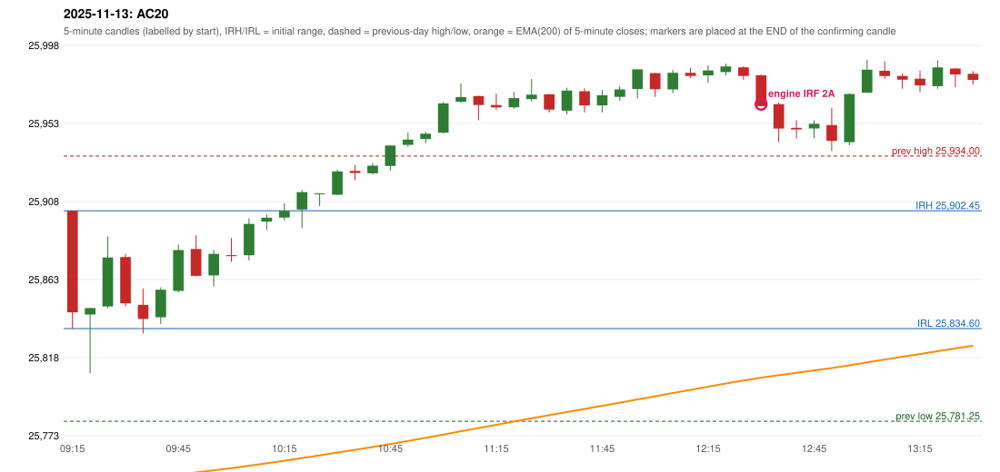

# 2025-11-13 - author's correction(s) against the engine

> Phase 5.1 date report. Evidence only; no rule was changed to produce a different outcome. Source image(s) are referenced under each correction.

## AC20 (PDF page 4, as written `20251113-1`, label `IRF`, ACTIVE)

### Author's observation

> First red candle only should be considered.

Suggested: **IRF (same strategy, correct reference candle)**; timing: not stated; requirement stated: use only the first red candle. Drawing (my reading): none. Uncertain: none. Image: `reports/phase5/phase51_author_corrections/pages/page_4_full.png (page 4 of docs/strategy_docs/corrected/Adobe Scan Nov 05, 2026.pdf)`.

### Original automated trade

20251113-1-IRF IRF Method 2A SHORT signal 12:35 entry 25963.85 -> T1_THEN_BUFFER_STOP

Stop 25998.85, T1 25936.85, T2 25903.85; exits 12:54 / 12:59. Engine explanation: IRF Method 2A SHORT: the 10:20-10:25 candle closed at 25,913.20, above IRH 25,902.45, and the next candle did not close back inside the range, so the setup is Method 2 and price stayed above it until the trigger. Extension candle 10:30-10:35, red candle 10:35-10:40. The trigger came 26 candles after the breakout candle: a completed candle closed below the recent pullback-low support (12:30-12:35); confirmed at 12:35 with close 25,962.75. Entry reference close 25,962.75 is 60.30 points above IRH 25,902.45.

### Independent historical evidence

Session: open 25902.45, previous high/low/close 25934.0 / 25781.25 / 25875.8 (gap 26.65); first candle {'high': 25902.45, 'low': 25834.6, 'open': 25902.45, 'close': 25843.95}.

Signal-candle measurements: signal_candle_start=12:30, colour=R, body_pct=98.1, upper_wick_pct=1.9, lower_wick_pct=0.0, signal_close=25962.75, ema200=25806.31, entry_minus_ema=156.44, ema_below_entry=True, ema_within_27_below_entry=False, ema_between_entry_and_target1=False, close_below_ema=False, session_low_before_candle=25809.0, close_below_prior_session_low=False, candle_low_at_or_below_prior_session_low=False, points_above_prior_session_low=153.75, body_pct_below_60=False, body_pct_below_50=False

Readings of the author's 'first red candle' wording (my formalisations, side by side):

| reading | first red candle | support | resistance | entry (signal time, close, trigger, body %) |
|---|---|---|---|---|
| FULLY_ABOVE|body>=60 | 10:35 | 25920.25 | 25928.85 | none before 13:00 |
| FULLY_ABOVE|body>=0 | 10:35 | 25920.25 | 25928.85 | none before 13:00 |
| CLOSE_ABOVE|body>=60 | 10:35 | 25920.25 | 25928.85 | none before 13:00 |
| CLOSE_ABOVE|body>=0 | 10:35 | 25920.25 | 25928.85 | none before 13:00 |

ORB records: Method 2 ENGINE_SETUP_INVALIDATED: TREND:EMA_PREV_SESSION_CLOSE wrong side

Chronological signal timeline (engine):

| time | strategy | method | dir | event | reason |
|---|---|---|---|---|---|
| 12:35 | IRF | Method 2A | SHORT | EXECUTED | trade 1: T1_THEN_BUFFER_STOP |
| 13:50 | IRF | Method 2B | SHORT | IGNORED | DAY_FINISHED |
| 14:10 | IRF | Method 1 | SHORT | IGNORED | DAY_FINISHED |
| 14:50 | IRF | Method 2B | SHORT | IGNORED | DAY_FINISHED |
| 14:55 | IRF | Method 1 | SHORT | IGNORED | DAY_FINISHED |

Rejected / invalidated setups: 15:15 IRF Method 3: WICK_SHARE_OUT_OF_BAND; 09:15 ORB Method 2: TREND:EMA_PREV_SESSION_CLOSE wrong side; 09:15 PDR PDR: OPEN_NOT_STRICTLY_ABOVE_ZONE

### Conclusion

* **Classification:** MISSING_AUTHOR_RULE, SUPPORT_RESISTANCE_MISMATCH   **Category:** C
* **Is the author correct under the existing rules?** Cannot be decided: under the first-red-candle readings no entry exists before the cutoff
* **Is the engine correct under the existing rules?** Yes under the existing proposals
* **Missing requirement / root cause:** S/R of the first red candle
* **New rule required?** yes   **Implementable objectively now?** no (ambiguous)   **Owner approval needed?** YES

Candles 09:15-13:00 (start, O, H, L, C, colour, body %, upper wick %, lower wick %, EMA200, close - EMA):

| start | O | H | L | C | col | body% | uw% | lw% | EMA | c-EMA |
|---|---|---|---|---|---|---|---|---|---|---|
| 09:15 | 25902.45 | 25902.45 | 25834.6 | 25843.95 | R | 86.2 | 0.0 | 13.8 | 25743.97 | 99.98 |
| 09:20 | 25842.75 | 25846.45 | 25809.0 | 25846.45 | G | 9.9 | 0.0 | 90.1 | 25744.99 | 101.46 |
| 09:25 | 25847.35 | 25887.75 | 25846.4 | 25875.55 | G | 68.2 | 29.5 | 2.3 | 25746.29 | 129.26 |
| 09:30 | 25875.8 | 25877.75 | 25847.4 | 25849.15 | R | 87.8 | 6.4 | 5.8 | 25747.31 | 101.84 |
| 09:35 | 25848.25 | 25857.7 | 25831.9 | 25840.2 | R | 31.2 | 36.6 | 32.2 | 25748.23 | 91.97 |
| 09:40 | 25841.15 | 25858.4 | 25837.3 | 25857.0 | G | 75.1 | 6.6 | 18.2 | 25749.32 | 107.68 |
| 09:45 | 25856.3 | 25882.95 | 25855.55 | 25879.85 | G | 85.9 | 11.3 | 2.7 | 25750.61 | 129.24 |
| 09:50 | 25880.45 | 25888.4 | 25864.8 | 25864.95 | R | 65.7 | 33.7 | 0.6 | 25751.75 | 113.2 |
| 09:55 | 25865.25 | 25880.0 | 25858.8 | 25877.65 | G | 58.5 | 11.1 | 30.4 | 25753.0 | 124.65 |
| 10:00 | 25876.9 | 25886.8 | 25873.05 | 25876.35 | R | 4.0 | 72.0 | 24.0 | 25754.23 | 122.12 |
| 10:05 | 25876.85 | 25898.2 | 25873.9 | 25894.9 | G | 74.3 | 13.6 | 12.1 | 25755.63 | 139.27 |
| 10:10 | 25896.2 | 25900.25 | 25891.45 | 25898.5 | G | 26.1 | 19.9 | 54.0 | 25757.05 | 141.45 |
| 10:15 | 25898.55 | 25906.85 | 25896.8 | 25902.4 | G | 38.3 | 44.3 | 17.4 | 25758.5 | 143.9 |
| 10:20 | 25903.2 | 25914.5 | 25892.45 | 25913.2 | G | 45.4 | 5.9 | 48.8 | 25760.04 | 153.16 |
| 10:25 | 25912.15 | 25912.6 | 25905.1 | 25912.45 | G | 4.0 | 2.0 | 94.0 | 25761.56 | 150.89 |
| 10:30 | 25911.7 | 25926.2 | 25911.5 | 25925.1 | G | 91.2 | 7.5 | 1.4 | 25763.18 | 161.92 |
| 10:35 | 25925.4 | 25928.85 | 25920.25 | 25924.2 | R | 14.0 | 40.1 | 45.9 | 25764.78 | 159.42 |
| 10:40 | 25924.05 | 25929.9 | 25923.45 | 25928.45 | G | 68.2 | 22.5 | 9.3 | 25766.41 | 162.04 |
| 10:45 | 25928.3 | 25940.05 | 25925.6 | 25940.05 | G | 81.3 | 0.0 | 18.7 | 25768.14 | 171.91 |
| 10:50 | 25940.4 | 25947.55 | 25939.25 | 25943.45 | G | 36.7 | 49.4 | 13.9 | 25769.89 | 173.56 |
| 10:55 | 25943.75 | 25947.95 | 25941.45 | 25946.85 | G | 47.7 | 16.9 | 35.4 | 25771.65 | 175.2 |
| 11:00 | 25947.4 | 25965.15 | 25947.0 | 25964.3 | G | 93.1 | 4.7 | 2.2 | 25773.56 | 190.74 |
| 11:05 | 25965.3 | 25975.75 | 25964.75 | 25967.95 | G | 24.1 | 70.9 | 5.0 | 25775.5 | 192.45 |
| 11:10 | 25968.55 | 25968.8 | 25954.6 | 25963.35 | R | 36.6 | 1.8 | 61.6 | 25777.37 | 185.98 |
| 11:15 | 25963.4 | 25969.95 | 25960.55 | 25962.05 | R | 14.4 | 69.7 | 16.0 | 25779.2 | 182.85 |
| 11:20 | 25962.05 | 25970.95 | 25961.2 | 25967.35 | G | 54.4 | 36.9 | 8.7 | 25781.08 | 186.27 |
| 11:25 | 25966.8 | 25978.4 | 25965.35 | 25969.35 | G | 19.5 | 69.3 | 11.1 | 25782.95 | 186.4 |
| 11:30 | 25969.55 | 25969.75 | 25959.15 | 25960.75 | R | 83.0 | 1.9 | 15.1 | 25784.72 | 176.03 |
| 11:35 | 25960.15 | 25973.35 | 25958.05 | 25971.7 | G | 75.5 | 10.8 | 13.7 | 25786.58 | 185.12 |
| 11:40 | 25971.35 | 25973.1 | 25959.05 | 25963.2 | R | 58.0 | 12.5 | 29.5 | 25788.34 | 174.86 |
| 11:45 | 25963.15 | 25972.05 | 25959.1 | 25968.95 | G | 44.8 | 23.9 | 31.3 | 25790.13 | 178.82 |
| 11:50 | 25968.05 | 25974.15 | 25965.9 | 25972.35 | G | 52.1 | 21.8 | 26.1 | 25791.95 | 180.4 |
| 11:55 | 25972.6 | 25983.95 | 25967.2 | 25983.95 | G | 67.8 | 0.0 | 32.2 | 25793.86 | 190.09 |
| 12:00 | 25981.75 | 25981.95 | 25968.1 | 25972.5 | R | 66.8 | 1.4 | 31.8 | 25795.63 | 176.87 |
| 12:05 | 25972.4 | 25983.65 | 25970.25 | 25981.95 | G | 71.3 | 12.7 | 16.0 | 25797.49 | 184.46 |
| 12:10 | 25981.95 | 25984.75 | 25978.9 | 25980.1 | R | 31.6 | 47.9 | 20.5 | 25799.31 | 180.79 |
| 12:15 | 25980.5 | 25986.25 | 25976.15 | 25983.3 | G | 27.7 | 29.2 | 43.1 | 25801.14 | 182.16 |
| 12:20 | 25982.35 | 25987.25 | 25980.4 | 25985.6 | G | 47.4 | 24.1 | 28.5 | 25802.97 | 182.63 |
| 12:25 | 25985.1 | 25985.7 | 25977.9 | 25980.15 | R | 63.5 | 7.7 | 28.8 | 25804.73 | 175.42 |
| 12:30 | 25980.55 | 25980.9 | 25962.75 | 25962.75 | R | 98.1 | 1.9 | 0.0 | 25806.31 | 156.44 |
| 12:35 | 25963.85 | 25964.9 | 25942.05 | 25949.85 | R | 61.3 | 4.6 | 34.1 | 25807.74 | 142.11 |
| 12:40 | 25950.25 | 25954.6 | 25944.15 | 25949.3 | R | 9.1 | 41.6 | 49.3 | 25809.14 | 140.16 |
| 12:45 | 25949.9 | 25954.6 | 25944.25 | 25952.55 | G | 25.6 | 19.8 | 54.6 | 25810.57 | 141.98 |
| 12:50 | 25951.8 | 25961.8 | 25936.85 | 25942.7 | R | 36.5 | 40.1 | 23.4 | 25811.89 | 130.81 |
| 12:55 | 25942.0 | 25970.2 | 25940.15 | 25969.7 | G | 92.2 | 1.7 | 6.2 | 25813.46 | 156.24 |
| 13:00 | 25970.45 | 25989.4 | 25970.45 | 25983.7 | G | 69.9 | 30.1 | 0.0 | 25815.15 | 168.55 |
