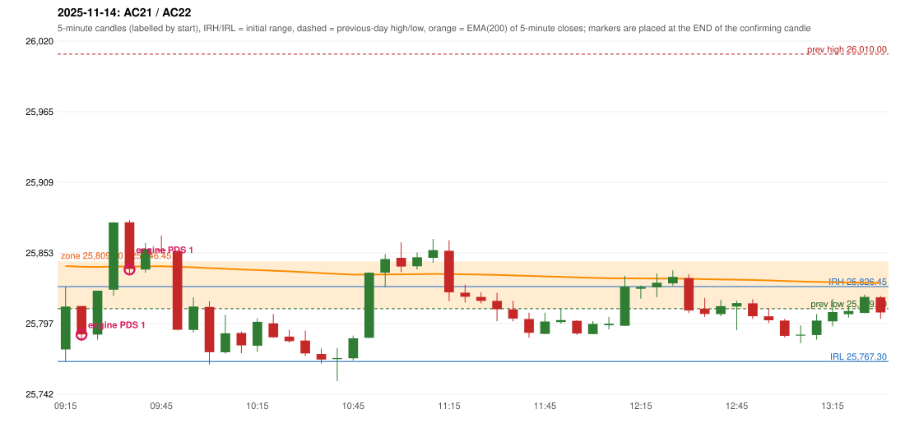

# 2025-11-14 - author's correction(s) against the engine

> Phase 5.1 date report. Evidence only; no rule was changed to produce a different outcome. Source image(s) are referenced under each correction.

## AC21 (PDF page 4, as written `20251114-1`, label `PDS`, ACTIVE)

### Author's observation

> The IRF should be activated instead of PDS. | PDS criteria is not satisfying.

Suggested: **IRF**; timing: not stated; requirement stated: PDS criteria are not met. Drawing (my reading): none. Uncertain: none. Image: `reports/phase5/phase51_author_corrections/pages/page_4_full.png (page 4 of docs/strategy_docs/corrected/Adobe Scan Nov 05, 2026.pdf)`.

### Original automated trade

20251114-1-PDS PDS Method 1 SHORT signal 09:25 entry 25788.55 -> INITIAL_FULL_STOP

Stop 25823.55, T1 25761.55, T2 25718.55; exits 09:30 / 09:30. Engine explanation: PDS Method 1 SHORT: the session opened 32.15 points below the previous-day-low zone [25,809.00, 25,846.45]; price rose to the zone at 09:15 and the first red candle at the zone (09:20, close 25,788.70) had a good body; confirmed 09:25.

### Independent historical evidence

Session: open 25776.85, previous high/low/close 26010.0 / 25809.0 / 25879.15 (gap -102.3); first candle {'high': 25826.45, 'low': 25767.3, 'open': 25776.85, 'close': 25810.7}.

ORB records: Method 2 ENGINE_SETUP_INVALIDATED: TREND:EMA_PREV_SESSION_CLOSE wrong side; Gap/200DMA ENGINE_SETUP_INVALIDATED: CANDLE_QUALITY_OR_REJECTION_WICK

Chronological signal timeline (engine):

| time | strategy | method | dir | event | reason |
|---|---|---|---|---|---|
| 09:25 | PDS | Method 1 | SHORT | EXECUTED | trade 1: INITIAL_FULL_STOP |
| 09:40 | PDS | Method 1 | SHORT | EXECUTED | trade 2: TARGET |
| 09:55 | IRF | Method 1 | SHORT | IGNORED | POSITION_ACTIVE (signal kept for diagnostics only; never reused) |
| 09:55 | PDS | Method 1 | SHORT | IGNORED | POSITION_ACTIVE (signal kept for diagnostics only; never reused) |
| 10:05 | PDS | Method 1 | SHORT | IGNORED | DAY_FINISHED |
| 11:20 | IRF | Method 1 | SHORT | IGNORED | DAY_FINISHED |
| 12:35 | IRF | Method 1 | SHORT | IGNORED | DAY_FINISHED |
| 13:05 | IRF | Method 2A | SHORT | IGNORED | DAY_FINISHED |
| 13:05 | PDS | Method 3 | SHORT | IGNORED | DAY_FINISHED |

Rejected / invalidated setups: 15:00 IRF Method 1/2: SESSION_ENDED_BEFORE_CONFIRMATION; 09:15 ORB Method 2: TREND:EMA_PREV_SESSION_CLOSE wrong side; 09:15 ORB Gap/200DMA: CANDLE_QUALITY_OR_REJECTION_WICK; 13:15 PDS Method 1/2/3: NO_QUALIFYING_ENTRY_BEFORE_SESSION_END; 14:05 RF RF: GAP_NOT_UP(DOWN)

Applicable source rules:

* `PDS-ZONE-002` (PROPOSED_FOR_REVIEW): PROPOSED zone-marking candidates for the previous-day support zone (A absolute lowest-low candle; B latest confirmed swing low with a bullish reversal candle; C lowest cluster of >=2 swing lows). Not assumed to be an exact mirror of PDR; the selection is NOT d
* `PDS-002` (VERIFIED_QUALITATIVE): Zone: a rectangle covering the relevant candle body and the lower wick (never a single line), extended forward.
* `PDS-005` (VERIFIED_QUALITATIVE): Valid interaction: wick touches / body touches / enters the rectangle / comes very close.

### Conclusion

* **Classification:** SUPPORT_RESISTANCE_MISMATCH, AUTHOR_DISCRETION_UNRESOLVED   **Category:** C
* **Is the author correct under the existing rules?** Cannot be decided: the engine's zone is [25,809.00, 25,846.45], 37.45 points tall (zone method A_LOWEST_LOW with ZONE_FULL, both proposals); the author says the criteria are not met
* **Is the engine correct under the existing rules?** Yes under the proposed zone
* **Missing requirement / root cause:** the PDS zone construction (author's candle selection, PDS-ZONE-002 UNRESOLVED)
* **New rule required?** yes: the PDS zone   **Implementable objectively now?** no   **Owner approval needed?** YES

## AC22 (PDF page 4, as written `20251114-2`, label `PDS`, ACTIVE)

### Author's observation

> IRF should activate. | Same day 2nd trade, ig it's glitch.

Suggested: **IRF**; timing: not stated; requirement stated: a second trade on the same day is called a glitch ('ig' read as 'I guess'). Drawing (my reading): none. Uncertain: 'ig' (read as 'I guess'). Image: `reports/phase5/phase51_author_corrections/pages/page_4_full.png (page 4 of docs/strategy_docs/corrected/Adobe Scan Nov 05, 2026.pdf)`.

### Original automated trade

20251114-2-PDS PDS Method 1 SHORT signal 09:40 entry 25839.95 -> TARGET

Stop 25874.95, T1 25812.95, T2 25769.95; exits 09:52 / 10:03. Engine explanation: PDS Method 1 SHORT: the session opened 32.15 points below the previous-day-low zone [25,809.00, 25,846.45]; price rose to the zone at 09:25 and the first red candle at the zone (09:35, close 25,840.40) had a good body; confirmed 09:40.

### Independent historical evidence

Session: open 25776.85, previous high/low/close 26010.0 / 25809.0 / 25879.15 (gap -102.3); first candle {'high': 25826.45, 'low': 25767.3, 'open': 25776.85, 'close': 25810.7}.

ORB records: Method 2 ENGINE_SETUP_INVALIDATED: TREND:EMA_PREV_SESSION_CLOSE wrong side; Gap/200DMA ENGINE_SETUP_INVALIDATED: CANDLE_QUALITY_OR_REJECTION_WICK

Chronological signal timeline (engine):

| time | strategy | method | dir | event | reason |
|---|---|---|---|---|---|
| 09:25 | PDS | Method 1 | SHORT | EXECUTED | trade 1: INITIAL_FULL_STOP |
| 09:40 | PDS | Method 1 | SHORT | EXECUTED | trade 2: TARGET |
| 09:55 | IRF | Method 1 | SHORT | IGNORED | POSITION_ACTIVE (signal kept for diagnostics only; never reused) |
| 09:55 | PDS | Method 1 | SHORT | IGNORED | POSITION_ACTIVE (signal kept for diagnostics only; never reused) |
| 10:05 | PDS | Method 1 | SHORT | IGNORED | DAY_FINISHED |
| 11:20 | IRF | Method 1 | SHORT | IGNORED | DAY_FINISHED |
| 12:35 | IRF | Method 1 | SHORT | IGNORED | DAY_FINISHED |
| 13:05 | IRF | Method 2A | SHORT | IGNORED | DAY_FINISHED |
| 13:05 | PDS | Method 3 | SHORT | IGNORED | DAY_FINISHED |

Rejected / invalidated setups: 15:00 IRF Method 1/2: SESSION_ENDED_BEFORE_CONFIRMATION; 09:15 ORB Method 2: TREND:EMA_PREV_SESSION_CLOSE wrong side; 09:15 ORB Gap/200DMA: CANDLE_QUALITY_OR_REJECTION_WICK; 13:15 PDS Method 1/2/3: NO_QUALIFYING_ENTRY_BEFORE_SESSION_END; 14:05 RF RF: GAP_NOT_UP(DOWN)

Applicable source rules:

* `DAY-SL-001` (USER_APPROVED): If the first trade hits its ORIGINAL full stop-loss before Target 1 (INITIAL_FULL_STOP), exactly one additional trade is permitted, and only a PDR or PDS trade from a valid, independently confirmed signal confirmed after the first trade has fully stopped out.
* `DAY-MAX-001` (USER_APPROVED): At most 2 entries per day; after the second trade, whatever its outcome, no further trade.

### Conclusion

* **Classification:** JOURNAL_INCONSISTENCY, AUTHOR_DISCRETION_UNRESOLVED   **Category:** C
* **Is the author correct under the existing rules?** No: a second trade after an initial full stop, restricted to PDR/PDS, is the owner-approved rule
* **Is the engine correct under the existing rules?** Yes: the second PDS trade is allowed by DAY-SL-001 (not a glitch)
* **Missing requirement / root cause:** the author's belief that no second trade should occur on that day conflicts with the approved portfolio rule
* **New rule required?** unknown   **Implementable objectively now?** no   **Owner approval needed?** YES

Candles 09:15-13:00 (start, O, H, L, C, colour, body %, upper wick %, lower wick %, EMA200, close - EMA):

| start | O | H | L | C | col | body% | uw% | lw% | EMA | c-EMA |
|---|---|---|---|---|---|---|---|---|---|---|
| 09:15 | 25776.85 | 25826.45 | 25767.3 | 25810.7 | G | 57.2 | 26.6 | 16.1 | 25842.66 | -31.96 |
| 09:20 | 25811.1 | 25811.1 | 25783.55 | 25788.7 | R | 81.3 | 0.0 | 18.7 | 25842.12 | -53.42 |
| 09:25 | 25788.55 | 25823.2 | 25784.6 | 25823.2 | G | 89.8 | 0.0 | 10.2 | 25841.94 | -18.74 |
| 09:30 | 25824.0 | 25877.25 | 25819.0 | 25877.1 | G | 91.2 | 0.3 | 8.6 | 25842.29 | 34.81 |
| 09:35 | 25877.2 | 25878.95 | 25835.95 | 25840.4 | R | 85.6 | 4.1 | 10.3 | 25842.27 | -1.87 |
| 09:40 | 25839.95 | 25860.95 | 25837.45 | 25856.2 | G | 69.1 | 20.2 | 10.6 | 25842.41 | 13.79 |
| 09:45 | 25855.5 | 25866.75 | 25852.35 | 25854.7 | R | 5.6 | 78.1 | 16.3 | 25842.53 | 12.17 |
| 09:50 | 25854.7 | 25854.7 | 25791.85 | 25792.35 | R | 99.2 | 0.0 | 0.8 | 25842.03 | -49.68 |
| 09:55 | 25792.25 | 25818.0 | 25790.2 | 25810.7 | G | 66.4 | 26.3 | 7.4 | 25841.72 | -31.02 |
| 10:00 | 25810.35 | 25814.85 | 25765.0 | 25774.65 | R | 71.6 | 9.0 | 19.4 | 25841.05 | -66.4 |
| 10:05 | 25774.65 | 25804.15 | 25773.4 | 25789.6 | G | 48.6 | 47.3 | 4.1 | 25840.54 | -50.94 |
| 10:10 | 25789.85 | 25790.95 | 25773.85 | 25780.05 | R | 57.3 | 6.4 | 36.3 | 25839.94 | -59.89 |
| 10:15 | 25779.7 | 25801.45 | 25774.9 | 25798.65 | G | 71.4 | 10.5 | 18.1 | 25839.53 | -40.88 |
| 10:20 | 25797.4 | 25804.8 | 25786.0 | 25786.35 | R | 58.8 | 39.4 | 1.9 | 25839.0 | -52.65 |
| 10:25 | 25787.0 | 25792.35 | 25782.2 | 25783.35 | R | 36.0 | 52.7 | 11.3 | 25838.44 | -55.09 |
| 10:30 | 25783.85 | 25791.8 | 25771.5 | 25773.65 | R | 50.2 | 39.2 | 10.6 | 25837.8 | -64.15 |
| 10:35 | 25773.3 | 25777.6 | 25765.7 | 25768.85 | R | 37.4 | 36.1 | 26.5 | 25837.11 | -68.26 |
| 10:40 | 25769.2 | 25777.95 | 25751.85 | 25770.1 | G | 3.4 | 30.1 | 66.5 | 25836.45 | -66.35 |
| 10:45 | 25769.85 | 25787.75 | 25768.1 | 25785.6 | G | 80.2 | 10.9 | 8.9 | 25835.94 | -50.34 |
| 10:50 | 25786.0 | 25837.8 | 25786.0 | 25837.4 | G | 99.2 | 0.8 | 0.0 | 25835.95 | 1.45 |
| 10:55 | 25837.45 | 25852.15 | 25826.2 | 25848.15 | G | 41.2 | 15.4 | 43.4 | 25836.08 | 12.07 |
| 11:00 | 25849.15 | 25861.4 | 25837.8 | 25842.3 | R | 29.0 | 51.9 | 19.1 | 25836.14 | 6.16 |
| 11:05 | 25842.5 | 25853.4 | 25839.95 | 25849.6 | G | 52.8 | 28.3 | 19.0 | 25836.27 | 13.33 |
| 11:10 | 25849.15 | 25864.05 | 25845.3 | 25855.25 | G | 32.5 | 46.9 | 20.5 | 25836.46 | 18.79 |
| 11:15 | 25854.75 | 25863.1 | 25814.95 | 25821.95 | R | 68.1 | 17.3 | 14.5 | 25836.32 | -14.37 |
| 11:20 | 25821.65 | 25828.0 | 25813.95 | 25818.4 | R | 23.1 | 45.2 | 31.7 | 25836.14 | -17.74 |
| 11:25 | 25818.3 | 25821.9 | 25813.15 | 25815.2 | R | 35.4 | 41.1 | 23.4 | 25835.93 | -20.73 |
| 11:30 | 25815.2 | 25821.6 | 25799.1 | 25808.6 | R | 29.3 | 28.4 | 42.2 | 25835.66 | -27.06 |
| 11:35 | 25808.5 | 25815.15 | 25799.05 | 25801.15 | R | 45.7 | 41.3 | 13.0 | 25835.31 | -34.16 |
| 11:40 | 25800.85 | 25805.9 | 25786.15 | 25789.95 | R | 55.2 | 25.6 | 19.2 | 25834.86 | -44.91 |
| 11:45 | 25789.1 | 25805.75 | 25788.9 | 25798.9 | G | 58.2 | 40.7 | 1.2 | 25834.5 | -35.6 |
| 11:50 | 25798.45 | 25809.05 | 25797.0 | 25800.0 | G | 12.9 | 75.1 | 12.0 | 25834.16 | -34.16 |
| 11:55 | 25799.45 | 25800.0 | 25788.3 | 25789.45 | R | 85.5 | 4.7 | 9.8 | 25833.72 | -44.27 |
| 12:00 | 25788.95 | 25799.25 | 25788.8 | 25796.95 | G | 76.6 | 22.0 | 1.4 | 25833.35 | -36.4 |
| 12:05 | 25795.95 | 25802.55 | 25792.55 | 25797.1 | G | 11.5 | 54.5 | 34.0 | 25832.99 | -35.89 |
| 12:10 | 25795.55 | 25834.95 | 25795.55 | 25826.4 | G | 78.3 | 21.7 | 0.0 | 25832.92 | -6.52 |
| 12:15 | 25824.75 | 25827.4 | 25816.95 | 25826.15 | G | 13.4 | 12.0 | 74.6 | 25832.86 | -6.71 |
| 12:20 | 25825.9 | 25836.85 | 25818.1 | 25829.5 | G | 19.2 | 39.2 | 41.6 | 25832.82 | -3.32 |
| 12:25 | 25829.0 | 25839.25 | 25827.25 | 25834.1 | G | 42.5 | 42.9 | 14.6 | 25832.84 | 1.26 |
| 12:30 | 25833.15 | 25836.3 | 25805.6 | 25807.6 | R | 83.2 | 10.3 | 6.5 | 25832.59 | -24.99 |
| 12:35 | 25808.95 | 25817.5 | 25802.5 | 25804.85 | R | 27.3 | 57.0 | 15.7 | 25832.31 | -27.46 |
| 12:40 | 25804.75 | 25816.0 | 25803.15 | 25811.05 | G | 49.0 | 38.5 | 12.5 | 25832.1 | -21.05 |
| 12:45 | 25810.75 | 25815.25 | 25792.05 | 25813.45 | G | 11.6 | 7.8 | 80.6 | 25831.91 | -18.46 |
| 12:50 | 25813.25 | 25816.4 | 25800.9 | 25803.05 | R | 65.8 | 20.3 | 13.9 | 25831.62 | -28.57 |
| 12:55 | 25803.0 | 25809.45 | 25797.7 | 25799.9 | R | 26.4 | 54.9 | 18.7 | 25831.31 | -31.41 |
| 13:00 | 25799.65 | 25800.9 | 25786.3 | 25787.6 | R | 82.5 | 8.6 | 8.9 | 25830.87 | -43.27 |
