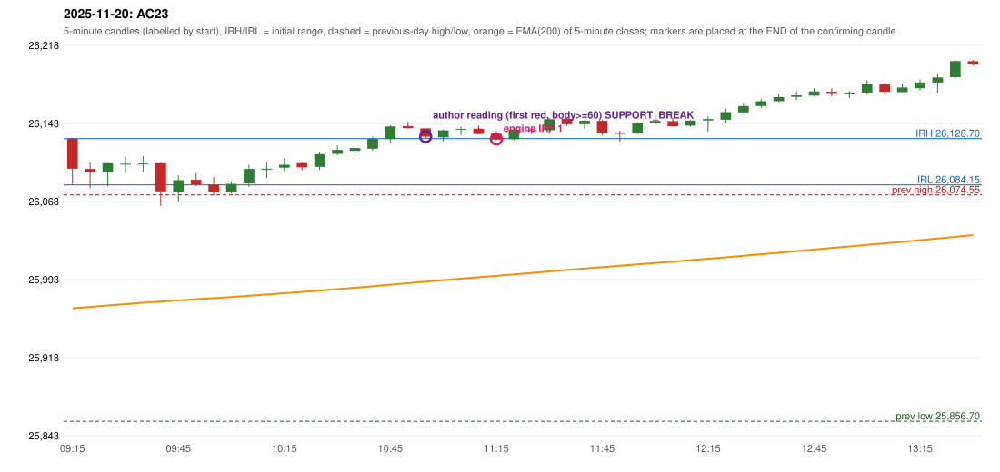

# 2025-11-20 - author's correction(s) against the engine

> Phase 5.1 date report. Evidence only; no rule was changed to produce a different outcome. Source image(s) are referenced under each correction.

## AC23 (PDF page 4, as written `20251120-1`, label `IRF`, CROSSED_OUT)

### Author's observation

> [crossed out:] RF should be activated + Or PDR should be activated as it Sab[?]

Suggested: **(crossed out - not an active instruction)**; timing: n/a; requirement stated: n/a. Drawing (my reading): none. Uncertain: heavily scribbled out; the last word is illegible ('Sab...' / 'Gap(?)'). Image: `reports/phase5/phase51_author_corrections/pages/page_4_full.png (page 4 of docs/strategy_docs/corrected/Adobe Scan Nov 05, 2026.pdf)`.

### Original automated trade

20251120-1-IRF IRF Method 1 SHORT signal 11:20 entry 26128.2 -> INITIAL_FULL_STOP

Stop 26163.2, T1 26101.2, T2 26068.2; exits 12:32 / 12:32. Engine explanation: IRF Method 1 SHORT: the completed 11:10 candle closed at 26,133.10, 4.40 points above the initial range high 26,128.70 (range [26,084.15, 26,128.70] from the 09:15 candle); the immediately following completed 11:15 candle closed at 26,127.80, back inside the range. The short signal was confirmed at 11:20 on that close. Entry reference close 26,127.80 is 0.90 points below IRH 26,128.70.

### Independent historical evidence

Session: open 26128.7, previous high/low/close 26074.55 / 25856.7 / 26052.65 (gap 76.05); first candle {'high': 26128.7, 'low': 26084.15, 'open': 26128.7, 'close': 26099.7}.

Signal-candle measurements: signal_candle_start=11:15, colour=R, body_pct=62.2, upper_wick_pct=28.3, lower_wick_pct=9.4, signal_close=26127.8, ema200=25996.62, entry_minus_ema=131.18, ema_below_entry=True, ema_within_27_below_entry=False, ema_between_entry_and_target1=False, close_below_ema=False, session_low_before_candle=26064.05, close_below_prior_session_low=False, candle_low_at_or_below_prior_session_low=False, points_above_prior_session_low=63.75, body_pct_below_60=False, body_pct_below_50=False

Readings of the author's 'first red candle' wording (my formalisations, side by side):

| reading | first red candle | support | resistance | entry (signal time, close, trigger, body %) |
|---|---|---|---|---|
| FULLY_ABOVE|body>=60 | 10:50 | 26138.25 | 26144.85 | 11:00, 26130.55, SUPPORT_BREAK, 77.9 |
| FULLY_ABOVE|body>=0 | 10:50 | 26138.25 | 26144.85 | 11:00, 26130.55, SUPPORT_BREAK, 77.9 |
| CLOSE_ABOVE|body>=60 | 10:50 | 26138.25 | 26144.85 | 11:00, 26130.55, SUPPORT_BREAK, 77.9 |
| CLOSE_ABOVE|body>=0 | 10:50 | 26138.25 | 26144.85 | 11:00, 26130.55, SUPPORT_BREAK, 77.9 |

ORB records: Method 1 ENGINE_SETUP_INVALIDATED: CANDLE_QUALITY(not a strong body / wick too large); Method 2 ENGINE_SETUP_INVALIDATED: CANDLE_QUALITY

Chronological signal timeline (engine):

| time | strategy | method | dir | event | reason |
|---|---|---|---|---|---|
| 11:20 | IRF | Method 1 | SHORT | EXECUTED | trade 1: INITIAL_FULL_STOP |
| 11:40 | IRF | Method 2B | SHORT | IGNORED | POSITION_ACTIVE (signal kept for diagnostics only; never reused) |
| 14:30 | IRF | Method 2A | SHORT | REJECTED | SECOND_TRADE_RESTRICTED_TO_PDR_PDS |

Rejected / invalidated setups: 14:30 IRF Method 2A: SECOND_TRADE_RESTRICTED_TO_PDR_PDS; 14:25 IRF Method 1/2: SESSION_ENDED_BEFORE_CONFIRMATION; 09:15 ORB Method 1: CANDLE_QUALITY(not a strong body / wick too large); 09:15 ORB Method 2: CANDLE_QUALITY; 09:45 RF RF: GAP_UP_OUTSIDE_YESTERDAYS_RANGE

### Conclusion

* **Classification:** not active (crossed out)   **Category:** n/a
* **Is the author correct under the existing rules?** crossed out: not an active instruction
* **Is the engine correct under the existing rules?** n/a
* **Missing requirement / root cause:** none
* **New rule required?** none   **Implementable objectively now?** n/a   **Owner approval needed?** NO

Candles 09:15-13:00 (start, O, H, L, C, colour, body %, upper wick %, lower wick %, EMA200, close - EMA):

| start | O | H | L | C | col | body% | uw% | lw% | EMA | c-EMA |
|---|---|---|---|---|---|---|---|---|---|---|
| 09:15 | 26128.7 | 26128.7 | 26084.15 | 26099.7 | R | 65.1 | 0.0 | 34.9 | 25965.42 | 134.28 |
| 09:20 | 26099.45 | 26105.4 | 26081.1 | 26096.3 | R | 13.0 | 24.5 | 62.6 | 25966.72 | 129.58 |
| 09:25 | 26096.4 | 26104.95 | 26082.9 | 26104.95 | G | 38.8 | 0.0 | 61.2 | 25968.1 | 136.85 |
| 09:30 | 26103.7 | 26111.4 | 26095.85 | 26104.5 | G | 5.1 | 44.4 | 50.5 | 25969.46 | 135.04 |
| 09:35 | 26104.4 | 26111.9 | 26096.3 | 26104.6 | G | 1.3 | 46.8 | 51.9 | 25970.8 | 133.8 |
| 09:40 | 26105.0 | 26105.35 | 26064.05 | 26077.95 | R | 65.5 | 0.8 | 33.7 | 25971.87 | 106.08 |
| 09:45 | 26077.5 | 26093.2 | 26068.2 | 26088.65 | G | 44.6 | 18.2 | 37.2 | 25973.03 | 115.62 |
| 09:50 | 26089.0 | 26095.55 | 26083.25 | 26084.4 | R | 37.4 | 53.3 | 9.3 | 25974.14 | 110.26 |
| 09:55 | 26084.25 | 26091.95 | 26074.1 | 26077.2 | R | 39.5 | 43.1 | 17.4 | 25975.16 | 102.04 |
| 10:00 | 26076.95 | 26087.7 | 26076.15 | 26085.05 | G | 70.1 | 22.9 | 6.9 | 25976.26 | 108.79 |
| 10:05 | 26085.55 | 26103.45 | 26082.4 | 26099.45 | G | 66.0 | 19.0 | 15.0 | 25977.48 | 121.97 |
| 10:10 | 26099.6 | 26105.9 | 26090.45 | 26099.65 | G | 0.3 | 40.5 | 59.2 | 25978.7 | 120.95 |
| 10:15 | 26100.7 | 26109.35 | 26097.4 | 26103.5 | G | 23.4 | 49.0 | 27.6 | 25979.94 | 123.56 |
| 10:20 | 26105.1 | 26106.2 | 26098.25 | 26101.0 | R | 51.6 | 13.8 | 34.6 | 25981.14 | 119.86 |
| 10:25 | 26101.55 | 26115.25 | 26098.6 | 26113.75 | G | 73.3 | 9.0 | 17.7 | 25982.46 | 131.29 |
| 10:30 | 26114.0 | 26121.95 | 26112.75 | 26117.8 | G | 41.3 | 45.1 | 13.6 | 25983.81 | 133.99 |
| 10:35 | 26116.9 | 26121.75 | 26114.55 | 26119.6 | G | 37.5 | 29.9 | 32.6 | 25985.16 | 134.44 |
| 10:40 | 26119.0 | 26130.85 | 26117.0 | 26128.4 | G | 67.9 | 17.7 | 14.4 | 25986.59 | 141.81 |
| 10:45 | 26128.25 | 26141.45 | 26124.1 | 26140.4 | G | 70.0 | 6.1 | 23.9 | 25988.12 | 152.28 |
| 10:50 | 26140.75 | 26144.85 | 26138.25 | 26138.8 | R | 29.5 | 62.1 | 8.3 | 25989.62 | 149.18 |
| 10:55 | 26138.5 | 26138.9 | 26128.7 | 26130.55 | R | 77.9 | 3.9 | 18.1 | 25991.02 | 139.53 |
| 11:00 | 26129.85 | 26137.1 | 26126.05 | 26136.6 | G | 61.1 | 4.5 | 34.4 | 25992.47 | 144.13 |
| 11:05 | 26137.5 | 26140.4 | 26131.95 | 26138.05 | G | 6.5 | 27.8 | 65.7 | 25993.92 | 144.13 |
| 11:10 | 26138.15 | 26141.3 | 26133.1 | 26133.1 | R | 61.6 | 38.4 | 0.0 | 25995.3 | 137.8 |
| 11:15 | 26133.4 | 26135.95 | 26126.95 | 26127.8 | R | 62.2 | 28.3 | 9.4 | 25996.62 | 131.18 |
| 11:20 | 26128.2 | 26138.05 | 26126.85 | 26137.35 | G | 81.7 | 6.3 | 12.1 | 25998.02 | 139.33 |
| 11:25 | 26136.8 | 26140.3 | 26133.0 | 26136.6 | R | 2.7 | 47.9 | 49.3 | 25999.4 | 137.2 |
| 11:30 | 26136.7 | 26148.5 | 26133.15 | 26147.35 | G | 69.4 | 7.5 | 23.1 | 26000.87 | 146.48 |
| 11:35 | 26147.75 | 26148.4 | 26141.2 | 26142.55 | R | 72.2 | 9.0 | 18.7 | 26002.28 | 140.27 |
| 11:40 | 26142.5 | 26146.6 | 26138.55 | 26145.75 | G | 40.4 | 10.6 | 49.1 | 26003.71 | 142.04 |
| 11:45 | 26145.75 | 26146.45 | 26132.0 | 26134.1 | R | 80.6 | 4.8 | 14.5 | 26005.01 | 129.09 |
| 11:50 | 26134.05 | 26136.25 | 26125.85 | 26133.5 | R | 5.3 | 21.2 | 73.6 | 26006.28 | 127.22 |
| 11:55 | 26133.75 | 26144.35 | 26133.0 | 26143.5 | G | 85.9 | 7.5 | 6.6 | 26007.65 | 135.85 |
| 12:00 | 26143.75 | 26152.6 | 26142.15 | 26145.7 | G | 18.7 | 66.0 | 15.3 | 26009.02 | 136.68 |
| 12:05 | 26145.5 | 26148.55 | 26140.15 | 26140.65 | R | 57.7 | 36.3 | 6.0 | 26010.33 | 130.32 |
| 12:10 | 26141.15 | 26146.45 | 26140.15 | 26146.05 | G | 77.8 | 6.3 | 15.9 | 26011.68 | 134.37 |
| 12:15 | 26146.15 | 26150.0 | 26135.35 | 26147.45 | G | 8.9 | 17.4 | 73.7 | 26013.03 | 134.42 |
| 12:20 | 26146.8 | 26157.7 | 26142.9 | 26154.15 | G | 49.7 | 24.0 | 26.4 | 26014.44 | 139.71 |
| 12:25 | 26153.9 | 26162.1 | 26153.0 | 26160.0 | G | 67.0 | 23.1 | 9.9 | 26015.89 | 144.11 |
| 12:30 | 26160.05 | 26167.0 | 26158.2 | 26164.65 | G | 52.3 | 26.7 | 21.0 | 26017.37 | 147.28 |
| 12:35 | 26164.6 | 26171.15 | 26164.0 | 26168.55 | G | 55.2 | 36.4 | 8.4 | 26018.87 | 149.68 |
| 12:40 | 26168.9 | 26174.25 | 26165.65 | 26170.35 | G | 16.9 | 45.3 | 37.8 | 26020.38 | 149.97 |
| 12:45 | 26170.05 | 26177.1 | 26169.6 | 26174.1 | G | 54.0 | 40.0 | 6.0 | 26021.91 | 152.19 |
| 12:50 | 26173.75 | 26176.95 | 26169.25 | 26171.65 | R | 27.3 | 41.6 | 31.2 | 26023.4 | 148.25 |
| 12:55 | 26171.6 | 26174.6 | 26167.6 | 26172.15 | G | 7.9 | 35.0 | 57.1 | 26024.88 | 147.27 |
| 13:00 | 26172.7 | 26184.7 | 26171.0 | 26181.2 | G | 62.0 | 25.5 | 12.4 | 26026.43 | 154.77 |
