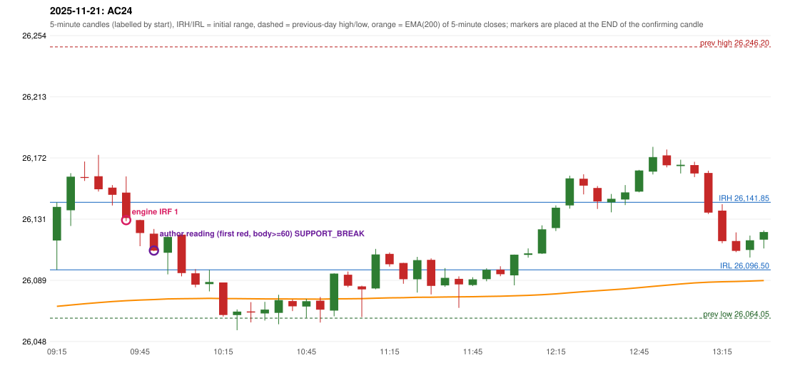

# 2025-11-21 - author's correction(s) against the engine

> Phase 5.1 date report. Evidence only; no rule was changed to produce a different outcome. Source image(s) are referenced under each correction.

## AC24 (PDF page 4, as written `20251121-1`, label `IRF`, ACTIVE)

### Author's observation

> ORB should have activated, but IRF is activated

Suggested: **ORB**; timing: not stated; requirement stated: ORB should have activated. Drawing (my reading): none. Uncertain: none. Image: `reports/phase5/phase51_author_corrections/pages/page_4_full.png (page 4 of docs/strategy_docs/corrected/Adobe Scan Nov 05, 2026.pdf)`.

### Original automated trade

20251121-1-IRF IRF Method 1 SHORT signal 09:45 entry 26129.9 -> TARGET

Stop 26164.9, T1 26102.9, T2 26069.9; exits 09:55 / 10:18. Engine explanation: IRF Method 1 SHORT: the completed 09:35 candle closed at 26,146.85, 5.00 points above the initial range high 26,141.85 (range [26,096.50, 26,141.85] from the 09:15 candle); the immediately following completed 09:40 candle closed at 26,131.30, back inside the range. The short signal was confirmed at 09:45 on that close. Entry reference close 26,131.30 is 10.55 points below IRH 26,141.85.

### Independent historical evidence

Session: open 26116.2, previous high/low/close 26246.2 / 26064.05 / 26192.15 (gap -75.95); first candle {'high': 26141.85, 'low': 26096.5, 'open': 26116.2, 'close': 26138.75}.

Signal-candle measurements: signal_candle_start=09:40, colour=R, body_pct=56.6, upper_wick_pct=36.2, lower_wick_pct=7.1, signal_close=26131.3, ema200=26075.75, entry_minus_ema=55.55, ema_below_entry=True, ema_within_27_below_entry=False, ema_between_entry_and_target1=False, close_below_ema=False, session_low_before_candle=26096.5, close_below_prior_session_low=False, candle_low_at_or_below_prior_session_low=False, points_above_prior_session_low=34.8, body_pct_below_60=True, body_pct_below_50=False

Readings of the author's 'first red candle' wording (my formalisations, side by side):

| reading | first red candle | support | resistance | entry (signal time, close, trigger, body %) |
|---|---|---|---|---|
| FULLY_ABOVE|body>=60 | 09:25 | 26156.2 | 26169.25 | 09:55, 26109.45, SUPPORT_BREAK, 76.2 |
| FULLY_ABOVE|body>=0 | 09:25 | 26156.2 | 26169.25 | 09:35, 26150.6, SUPPORT_BREAK, 35.5 |
| CLOSE_ABOVE|body>=60 | 09:25 | 26156.2 | 26169.25 | 09:55, 26109.45, SUPPORT_BREAK, 76.2 |
| CLOSE_ABOVE|body>=0 | 09:25 | 26156.2 | 26169.25 | 09:35, 26150.6, SUPPORT_BREAK, 35.5 |

ORB records: Method 2 ENGINE_SETUP_INVALIDATED: TREND:EMA_PREV_SESSION_CLOSE wrong side

Chronological signal timeline (engine):

| time | strategy | method | dir | event | reason |
|---|---|---|---|---|---|
| 09:45 | IRF | Method 1 | SHORT | EXECUTED | trade 1: TARGET |
| 13:00 | IRF | Method 2B | SHORT | IGNORED | DAY_FINISHED |
| 13:15 | IRF | Method 1 | SHORT | IGNORED | DAY_FINISHED |
| 14:20 | IRF | Method 1 | SHORT | IGNORED | DAY_FINISHED |
| 14:45 | IRF | Method 1 | SHORT | IGNORED | DAY_FINISHED |
| 14:50 | IRF | Method 2B | SHORT | IGNORED | DAY_FINISHED |

Rejected / invalidated setups: 09:15 ORB Method 2: TREND:EMA_PREV_SESSION_CLOSE wrong side; 09:15 PDS Method 1/2/3: GAP_DOWN_OPEN_NOT_BELOW_ZONE; 11:10 RF RF: GAP_NOT_UP(DOWN)

Applicable source rules:

* `TREND-EMA-001` (USER_APPROVED): Approved research variant A of the ORB/RF trend: the five-minute EMA(200) price location only (previous session's last close above/below its EMA(200); for RF the trend must exist BEFORE the opening gap, so the gap day contributes nothing). Not claimed to repro
* `ORB-TREND-001` (VERIFIED_QUALITATIVE): An established trend in the trade direction is required for Methods 1 and 2 (not for the Gap/200DMA setup if its conditions qualify).

### Conclusion

* **Classification:** EMA_FILTER_MISMATCH   **Category:** C
* **Is the author correct under the existing rules?** Cannot be decided: ORB Method 2 failed the approved trend variant (previous close on the wrong side of its EMA); the first candle's body is 49.7%
* **Is the engine correct under the existing rules?** Yes under TREND-EMA-001
* **Missing requirement / root cause:** the trend definition
* **New rule required?** yes   **Implementable objectively now?** no   **Owner approval needed?** YES

Candles 09:15-13:00 (start, O, H, L, C, colour, body %, upper wick %, lower wick %, EMA200, close - EMA):

| start | O | H | L | C | col | body% | uw% | lw% | EMA | c-EMA |
|---|---|---|---|---|---|---|---|---|---|---|
| 09:15 | 26116.2 | 26141.85 | 26096.5 | 26138.75 | G | 49.7 | 6.8 | 43.4 | 26071.99 | 66.76 |
| 09:20 | 26136.5 | 26161.4 | 26125.95 | 26159.05 | G | 63.6 | 6.6 | 29.8 | 26072.86 | 86.19 |
| 09:25 | 26158.8 | 26169.25 | 26156.2 | 26158.2 | R | 4.6 | 80.1 | 15.3 | 26073.71 | 84.49 |
| 09:30 | 26159.35 | 26173.7 | 26149.05 | 26150.6 | R | 35.5 | 58.2 | 6.3 | 26074.47 | 76.13 |
| 09:35 | 26151.7 | 26153.4 | 26139.7 | 26146.85 | R | 35.4 | 12.4 | 52.2 | 26075.19 | 71.66 |
| 09:40 | 26148.35 | 26159.25 | 26129.15 | 26131.3 | R | 56.6 | 36.2 | 7.1 | 26075.75 | 55.55 |
| 09:45 | 26129.9 | 26130.15 | 26112.35 | 26121.2 | R | 48.9 | 1.4 | 49.7 | 26076.2 | 45.0 |
| 09:50 | 26120.8 | 26123.95 | 26109.05 | 26109.45 | R | 76.2 | 21.1 | 2.7 | 26076.53 | 32.92 |
| 09:55 | 26108.0 | 26120.35 | 26093.45 | 26118.55 | G | 39.2 | 6.7 | 54.1 | 26076.95 | 41.6 |
| 10:00 | 26120.1 | 26120.7 | 26092.1 | 26094.3 | R | 90.2 | 2.1 | 7.7 | 26077.12 | 17.18 |
| 10:05 | 26094.15 | 26096.95 | 26084.75 | 26086.5 | R | 62.7 | 23.0 | 14.3 | 26077.22 | 9.28 |
| 10:10 | 26086.9 | 26096.5 | 26082.05 | 26088.35 | G | 10.0 | 56.4 | 33.6 | 26077.33 | 11.02 |
| 10:15 | 26088.0 | 26088.0 | 26065.1 | 26066.15 | R | 95.4 | 0.0 | 4.6 | 26077.22 | -11.07 |
| 10:20 | 26066.1 | 26069.9 | 26055.95 | 26068.45 | G | 16.8 | 10.4 | 72.8 | 26077.13 | -8.68 |
| 10:25 | 26068.55 | 26074.8 | 26061.2 | 26067.85 | R | 5.1 | 46.0 | 48.9 | 26077.04 | -9.19 |
| 10:30 | 26067.2 | 26075.0 | 26062.45 | 26069.8 | G | 20.7 | 41.4 | 37.8 | 26076.97 | -7.17 |
| 10:35 | 26067.6 | 26079.75 | 26059.95 | 26076.15 | G | 43.2 | 18.2 | 38.6 | 26076.96 | -0.81 |
| 10:40 | 26075.55 | 26076.65 | 26068.8 | 26072.0 | R | 45.2 | 14.0 | 40.8 | 26076.91 | -4.91 |
| 10:45 | 26071.85 | 26077.0 | 26064.25 | 26075.45 | G | 28.2 | 12.2 | 59.6 | 26076.89 | -1.44 |
| 10:50 | 26075.75 | 26078.25 | 26061.1 | 26069.75 | R | 35.0 | 14.6 | 50.4 | 26076.82 | -7.07 |
| 10:55 | 26069.1 | 26094.15 | 26065.3 | 26093.95 | G | 86.1 | 0.7 | 13.2 | 26076.99 | 16.96 |
| 11:00 | 26093.2 | 26095.35 | 26084.85 | 26085.8 | R | 70.5 | 20.5 | 9.0 | 26077.08 | 8.72 |
| 11:05 | 26085.35 | 26085.85 | 26064.8 | 26083.35 | R | 9.5 | 2.4 | 88.1 | 26077.14 | 6.21 |
| 11:10 | 26084.0 | 26110.55 | 26083.4 | 26106.85 | G | 84.2 | 13.6 | 2.2 | 26077.44 | 29.41 |
| 11:15 | 26107.2 | 26108.15 | 26098.65 | 26100.2 | R | 73.7 | 10.0 | 16.3 | 26077.67 | 22.53 |
| 11:20 | 26101.1 | 26101.2 | 26087.15 | 26090.2 | R | 77.6 | 0.7 | 21.7 | 26077.79 | 12.41 |
| 11:25 | 26090.15 | 26105.2 | 26081.2 | 26103.0 | G | 53.5 | 9.2 | 37.3 | 26078.04 | 24.96 |
| 11:30 | 26103.2 | 26104.2 | 26079.95 | 26085.7 | R | 72.2 | 4.1 | 23.7 | 26078.12 | 7.58 |
| 11:35 | 26086.05 | 26097.65 | 26085.1 | 26091.1 | G | 40.2 | 52.2 | 7.6 | 26078.25 | 12.85 |
| 11:40 | 26090.45 | 26092.1 | 26070.95 | 26086.7 | R | 17.7 | 7.8 | 74.5 | 26078.33 | 8.37 |
| 11:45 | 26086.3 | 26091.55 | 26085.6 | 26090.1 | G | 63.9 | 24.4 | 11.8 | 26078.45 | 11.65 |
| 11:50 | 26090.25 | 26097.5 | 26088.8 | 26096.55 | G | 72.4 | 10.9 | 16.7 | 26078.63 | 17.92 |
| 11:55 | 26096.65 | 26098.9 | 26092.2 | 26093.55 | R | 46.3 | 33.6 | 20.1 | 26078.78 | 14.77 |
| 12:00 | 26092.8 | 26106.75 | 26086.1 | 26106.7 | G | 67.3 | 0.2 | 32.4 | 26079.05 | 27.65 |
| 12:05 | 26106.55 | 26110.9 | 26104.7 | 26107.55 | G | 16.1 | 54.0 | 29.8 | 26079.34 | 28.21 |
| 12:10 | 26107.45 | 26126.35 | 26107.15 | 26123.7 | G | 84.6 | 13.8 | 1.6 | 26079.78 | 43.92 |
| 12:15 | 26124.55 | 26139.75 | 26122.55 | 26138.2 | G | 79.4 | 9.0 | 11.6 | 26080.36 | 57.84 |
| 12:20 | 26139.75 | 26159.7 | 26137.6 | 26157.9 | G | 82.1 | 8.1 | 9.7 | 26081.13 | 76.77 |
| 12:25 | 26157.65 | 26160.7 | 26147.15 | 26153.0 | R | 34.3 | 22.5 | 43.2 | 26081.85 | 71.15 |
| 12:30 | 26151.45 | 26152.75 | 26137.35 | 26142.4 | R | 58.8 | 8.4 | 32.8 | 26082.45 | 59.95 |
| 12:35 | 26141.8 | 26147.45 | 26135.1 | 26144.2 | G | 19.4 | 26.3 | 54.3 | 26083.06 | 61.14 |
| 12:40 | 26143.7 | 26153.4 | 26140.0 | 26148.5 | G | 35.8 | 36.6 | 27.6 | 26083.71 | 64.79 |
| 12:45 | 26149.0 | 26163.6 | 26148.55 | 26163.2 | G | 94.4 | 2.7 | 3.0 | 26084.51 | 78.69 |
| 12:50 | 26162.45 | 26179.1 | 26160.55 | 26172.2 | G | 52.6 | 37.2 | 10.2 | 26085.38 | 86.82 |
| 12:55 | 26173.35 | 26177.3 | 26165.3 | 26166.7 | R | 55.4 | 32.9 | 11.7 | 26086.19 | 80.51 |
| 13:00 | 26166.2 | 26170.45 | 26161.2 | 26167.05 | G | 9.2 | 36.8 | 54.1 | 26086.99 | 80.06 |
