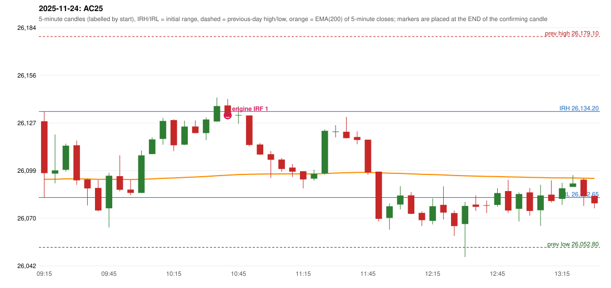

# 2025-11-24 - author's correction(s) against the engine

> Phase 5.1 date report. Evidence only; no rule was changed to produce a different outcome. Source image(s) are referenced under each correction.

## AC25 (PDF page 5, as written `20251124-1`, label `IRF`, ACTIVE)

### Author's observation

> RF should be activated, but IRF is entered

Suggested: **RF**; timing: not stated; requirement stated: RF should have activated. Drawing (my reading): none. Uncertain: none. Image: `reports/phase5/phase51_author_corrections/pages/page_5_full.png (page 5 of docs/strategy_docs/corrected/Adobe Scan Nov 05, 2026.pdf)`.

### Original automated trade

20251124-1-IRF IRF Method 1 SHORT signal 10:45 entry 26131.9 -> TARGET

Stop 26166.9, T1 26104.9, T2 26071.9; exits 11:01 / 11:54. Engine explanation: IRF Method 1 SHORT: the completed 10:35 candle closed at 26,137.45, 3.25 points above the initial range high 26,134.20 (range [26,082.65, 26,134.20] from the 09:15 candle); the immediately following completed 10:40 candle closed at 26,130.95, back inside the range. The short signal was confirmed at 10:45 on that close. Entry reference close 26,130.95 is 3.25 points below IRH 26,134.20.

### Independent historical evidence

Session: open 26128.3, previous high/low/close 26179.1 / 26052.8 / 26068.15 (gap 60.15); first candle {'high': 26134.2, 'low': 26082.65, 'open': 26128.3, 'close': 26097.25}.

Signal-candle measurements: signal_candle_start=10:40, colour=R, body_pct=60.9, upper_wick_pct=35.1, lower_wick_pct=4.0, signal_close=26130.95, ema200=26096.04, entry_minus_ema=34.91, ema_below_entry=True, ema_within_27_below_entry=False, ema_between_entry_and_target1=False, close_below_ema=False, session_low_before_candle=26064.7, close_below_prior_session_low=False, candle_low_at_or_below_prior_session_low=False, points_above_prior_session_low=66.25, body_pct_below_60=False, body_pct_below_50=False

Readings of the author's 'first red candle' wording (my formalisations, side by side):

| reading | first red candle | support | resistance | entry (signal time, close, trigger, body %) |
|---|---|---|---|---|
| FULLY_ABOVE|body>=60 | - | - | - | none before 13:00 |
| FULLY_ABOVE|body>=0 | - | - | - | none before 13:00 |
| CLOSE_ABOVE|body>=60 | - | - | - | none before 13:00 |
| CLOSE_ABOVE|body>=0 | - | - | - | none before 13:00 |

ORB records: Method 2 ENGINE_SETUP_INVALIDATED: TREND:EMA_PREV_SESSION_CLOSE wrong side; Gap/200DMA ENGINE_SETUP_INVALIDATED: CANDLE_QUALITY_OR_REJECTION_WICK; Method 2 ENGINE_SETUP_INVALIDATED: TRENDLINE_NOT_SUPPORTIVE

Chronological signal timeline (engine):

| time | strategy | method | dir | event | reason |
|---|---|---|---|---|---|
| 10:45 | IRF | Method 1 | SHORT | EXECUTED | trade 1: TARGET |

Rejected / invalidated setups: 09:15 ORB Method 2: TREND:EMA_PREV_SESSION_CLOSE wrong side; 09:15 ORB Gap/200DMA: CANDLE_QUALITY_OR_REJECTION_WICK; 09:15 ORB Method 2: TRENDLINE_NOT_SUPPORTIVE; 09:15 PDR PDR: OPEN_NOT_STRICTLY_ABOVE_ZONE; 09:45 RF RF: TREND:EMA_PREV_SESSION_CLOSE wrong side

Applicable source rules:

* `RF-001` (VERIFIED_QUALITATIVE): RF is only for an established uptrend; 200 EMA above is a basic filter but never sole proof.
* `RF-008` (VERIFIED_QUALITATIVE): A previous downtrend with a sudden large gap-up above the 200 EMA is rejected; gap up that exceeds yesterday's range is rejected.
* `TREND-EMA-001` (USER_APPROVED): Approved research variant A of the ORB/RF trend: the five-minute EMA(200) price location only (previous session's last close above/below its EMA(200); for RF the trend must exist BEFORE the opening gap, so the gap day contributes nothing). Not claimed to repro

### Conclusion

* **Classification:** EMA_FILTER_MISMATCH   **Category:** C
* **Is the author correct under the existing rules?** Cannot be decided: RF is rejected by the approved trend variant (previous session close vs EMA); RF-001 'established uptrend' is undefined
* **Is the engine correct under the existing rules?** Yes under TREND-EMA-001
* **Missing requirement / root cause:** the RF trend definition
* **New rule required?** yes   **Implementable objectively now?** no   **Owner approval needed?** YES

Candles 09:15-13:00 (start, O, H, L, C, colour, body %, upper wick %, lower wick %, EMA200, close - EMA):

| start | O | H | L | C | col | body% | uw% | lw% | EMA | c-EMA |
|---|---|---|---|---|---|---|---|---|---|---|
| 09:15 | 26128.3 | 26134.2 | 26082.65 | 26097.25 | R | 60.2 | 11.4 | 28.3 | 26093.55 | 3.7 |
| 09:20 | 26096.95 | 26120.4 | 26091.15 | 26098.9 | G | 6.7 | 73.5 | 19.8 | 26093.6 | 5.3 |
| 09:25 | 26099.25 | 26114.9 | 26098.2 | 26113.7 | G | 86.5 | 7.2 | 6.3 | 26093.8 | 19.9 |
| 09:30 | 26113.95 | 26116.8 | 26090.25 | 26092.95 | R | 79.1 | 10.7 | 10.2 | 26093.79 | -0.84 |
| 09:35 | 26093.45 | 26093.9 | 26077.95 | 26088.1 | R | 33.5 | 2.8 | 63.6 | 26093.74 | -5.64 |
| 09:40 | 26088.4 | 26093.25 | 26074.4 | 26074.9 | R | 71.6 | 25.7 | 2.7 | 26093.55 | -18.65 |
| 09:45 | 26076.2 | 26097.45 | 26064.7 | 26095.7 | G | 59.5 | 5.3 | 35.1 | 26093.57 | 2.13 |
| 09:50 | 26095.45 | 26107.9 | 26086.3 | 26087.25 | R | 38.0 | 57.6 | 4.4 | 26093.51 | -6.26 |
| 09:55 | 26087.4 | 26093.25 | 26084.0 | 26085.4 | R | 21.6 | 63.2 | 15.1 | 26093.43 | -8.03 |
| 10:00 | 26085.4 | 26110.9 | 26085.4 | 26107.9 | G | 88.2 | 11.8 | 0.0 | 26093.57 | 14.33 |
| 10:05 | 26108.65 | 26118.7 | 26108.65 | 26117.45 | G | 87.6 | 12.4 | 0.0 | 26093.81 | 23.64 |
| 10:10 | 26117.75 | 26130.35 | 26114.25 | 26128.5 | G | 66.8 | 11.5 | 21.7 | 26094.16 | 34.34 |
| 10:15 | 26129.05 | 26129.55 | 26110.5 | 26113.95 | R | 79.3 | 2.6 | 18.1 | 26094.35 | 19.6 |
| 10:20 | 26114.3 | 26128.7 | 26114.05 | 26125.15 | G | 74.1 | 24.2 | 1.7 | 26094.66 | 30.49 |
| 10:25 | 26125.2 | 26128.8 | 26121.25 | 26121.25 | R | 52.3 | 47.7 | 0.0 | 26094.92 | 26.33 |
| 10:30 | 26121.25 | 26130.6 | 26117.0 | 26129.4 | G | 59.9 | 8.8 | 31.3 | 26095.27 | 34.13 |
| 10:35 | 26128.2 | 26142.5 | 26128.2 | 26137.45 | G | 64.7 | 35.3 | 0.0 | 26095.69 | 41.76 |
| 10:40 | 26137.8 | 26141.75 | 26130.5 | 26130.95 | R | 60.9 | 35.1 | 4.0 | 26096.04 | 34.91 |
| 10:45 | 26131.9 | 26137.3 | 26126.85 | 26132.05 | G | 1.4 | 50.2 | 48.3 | 26096.4 | 35.65 |
| 10:50 | 26131.8 | 26131.8 | 26113.3 | 26114.1 | R | 95.7 | 0.0 | 4.3 | 26096.57 | 17.53 |
| 10:55 | 26114.4 | 26115.3 | 26108.15 | 26108.4 | R | 83.9 | 12.6 | 3.5 | 26096.69 | 11.71 |
| 11:00 | 26108.6 | 26110.5 | 26094.4 | 26105.25 | R | 20.8 | 11.8 | 67.4 | 26096.77 | 8.48 |
| 11:05 | 26105.4 | 26106.35 | 26098.1 | 26099.75 | R | 68.5 | 11.5 | 20.0 | 26096.8 | 2.95 |
| 11:10 | 26100.6 | 26102.7 | 26094.95 | 26098.1 | R | 32.3 | 27.1 | 40.6 | 26096.82 | 1.28 |
| 11:15 | 26098.4 | 26098.4 | 26088.1 | 26093.5 | R | 47.6 | 0.0 | 52.4 | 26096.78 | -3.28 |
| 11:20 | 26093.95 | 26099.35 | 26092.75 | 26096.8 | G | 43.2 | 38.6 | 18.2 | 26096.78 | 0.02 |
| 11:25 | 26097.1 | 26123.45 | 26096.4 | 26122.6 | G | 94.3 | 3.1 | 2.6 | 26097.04 | 25.56 |
| 11:30 | 26122.2 | 26126.0 | 26118.65 | 26122.2 | D | 0.0 | 51.7 | 48.3 | 26097.29 | 24.91 |
| 11:35 | 26122.05 | 26130.95 | 26117.95 | 26118.25 | R | 29.2 | 68.5 | 2.3 | 26097.5 | 20.75 |
| 11:40 | 26118.9 | 26122.25 | 26114.6 | 26117.15 | R | 22.9 | 43.8 | 33.3 | 26097.7 | 19.45 |
| 11:45 | 26117.3 | 26117.3 | 26096.3 | 26097.65 | R | 93.6 | 0.0 | 6.4 | 26097.69 | -0.04 |
| 11:50 | 26098.15 | 26098.15 | 26068.3 | 26069.85 | R | 94.8 | 0.0 | 5.2 | 26097.42 | -27.57 |
| 11:55 | 26070.4 | 26079.1 | 26063.4 | 26077.4 | G | 44.6 | 10.8 | 44.6 | 26097.22 | -19.82 |
| 12:00 | 26078.45 | 26089.5 | 26075.45 | 26083.85 | G | 38.4 | 40.2 | 21.4 | 26097.09 | -13.24 |
| 12:05 | 26083.95 | 26085.85 | 26072.65 | 26072.9 | R | 83.7 | 14.4 | 1.9 | 26096.84 | -23.94 |
| 12:10 | 26073.45 | 26074.4 | 26065.6 | 26069.1 | R | 49.4 | 10.8 | 39.8 | 26096.57 | -27.47 |
| 12:15 | 26068.65 | 26082.1 | 26066.55 | 26077.45 | G | 56.6 | 29.9 | 13.5 | 26096.38 | -18.93 |
| 12:20 | 26078.25 | 26089.35 | 26069.45 | 26073.65 | R | 23.1 | 55.8 | 21.1 | 26096.15 | -22.5 |
| 12:25 | 26073.35 | 26074.85 | 26059.55 | 26065.55 | R | 51.0 | 9.8 | 39.2 | 26095.85 | -30.3 |
| 12:30 | 26066.75 | 26080.1 | 26047.0 | 26077.6 | G | 32.8 | 7.6 | 59.7 | 26095.67 | -18.07 |
| 12:35 | 26078.4 | 26083.85 | 26074.65 | 26077.05 | R | 14.7 | 59.2 | 26.1 | 26095.48 | -18.43 |
| 12:40 | 26078.05 | 26080.85 | 26073.3 | 26078.0 | R | 0.7 | 37.1 | 62.3 | 26095.31 | -17.31 |
| 12:45 | 26078.2 | 26088.2 | 26077.15 | 26085.3 | G | 64.3 | 26.2 | 9.5 | 26095.21 | -9.91 |
| 12:50 | 26086.5 | 26093.3 | 26073.45 | 26074.85 | R | 58.7 | 34.3 | 7.1 | 26095.0 | -20.15 |
| 12:55 | 26075.9 | 26085.7 | 26068.3 | 26084.75 | G | 50.9 | 5.5 | 43.7 | 26094.9 | -10.15 |
| 13:00 | 26085.7 | 26088.35 | 26071.75 | 26074.6 | R | 66.9 | 16.0 | 17.2 | 26094.7 | -20.1 |
