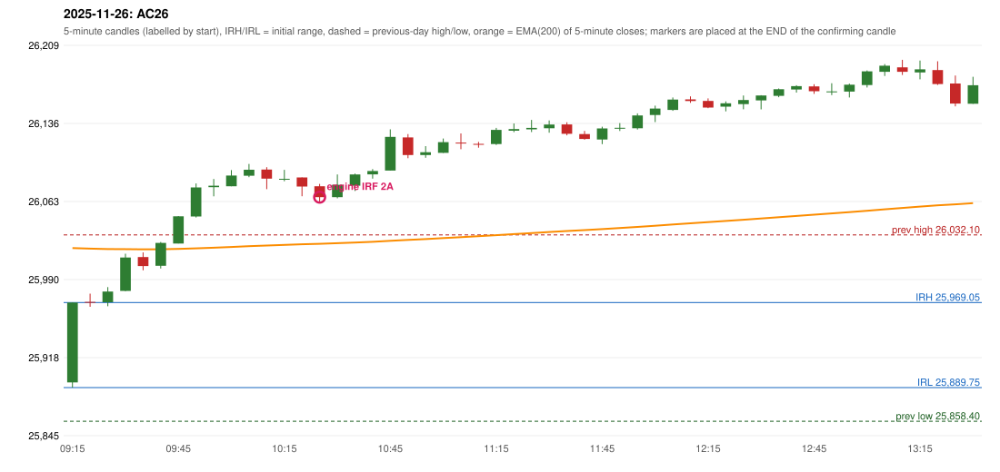

# 2025-11-26 - author's correction(s) against the engine

> Phase 5.1 date report. Evidence only; no rule was changed to produce a different outcome. Source image(s) are referenced under each correction.

## AC26 (PDF page 5, as written `20251126-1`, label `IRF`, ACTIVE)

### Author's observation

> First red candle should be considered

Suggested: **IRF (same strategy, correct reference candle)**; timing: not stated; requirement stated: use the first red candle. Drawing (my reading): none. Uncertain: none. Image: `reports/phase5/phase51_author_corrections/pages/page_5_full.png (page 5 of docs/strategy_docs/corrected/Adobe Scan Nov 05, 2026.pdf)`.

### Original automated trade

20251126-1-IRF IRF Method 2A SHORT signal 10:30 entry 26067.3 -> INITIAL_FULL_STOP

Stop 26102.3, T1 26040.3, T2 26007.3; exits 10:45 / 10:45. Engine explanation: IRF Method 2A SHORT: the 09:20-09:25 candle closed at 25,969.35, above IRH 25,969.05, and the next candle did not close back inside the range, so the setup is Method 2 and price stayed above it until the trigger. Extension candle 09:25-09:30, red candle 09:35-09:40. The trigger came 13 candles after the breakout candle: a completed candle closed below the recent pullback-low support (10:25-10:30); confirmed at 10:30 with close 26,067.25. Entry reference close 26,067.25 is 98.20 points above IRH 25,969.05.

### Independent historical evidence

Session: open 25894.6, previous high/low/close 26032.1 / 25858.4 / 25884.8 (gap 9.8); first candle {'high': 25969.05, 'low': 25889.75, 'open': 25894.6, 'close': 25969.05}.

Signal-candle measurements: signal_candle_start=10:25, colour=R, body_pct=57.2, upper_wick_pct=12.7, lower_wick_pct=30.1, signal_close=26067.25, ema200=26023.78, entry_minus_ema=43.47, ema_below_entry=True, ema_within_27_below_entry=False, ema_between_entry_and_target1=False, close_below_ema=False, session_low_before_candle=25889.75, close_below_prior_session_low=False, candle_low_at_or_below_prior_session_low=False, points_above_prior_session_low=177.5, body_pct_below_60=True, body_pct_below_50=False

Readings of the author's 'first red candle' wording (my formalisations, side by side):

| reading | first red candle | support | resistance | entry (signal time, close, trigger, body %) |
|---|---|---|---|---|
| FULLY_ABOVE|body>=60 | 09:35 | 25999.1 | 26015.75 | none before 13:00 |
| FULLY_ABOVE|body>=0 | 09:35 | 25999.1 | 26015.75 | none before 13:00 |
| CLOSE_ABOVE|body>=60 | 09:35 | 25999.1 | 26015.75 | none before 13:00 |
| CLOSE_ABOVE|body>=0 | 09:35 | 25999.1 | 26015.75 | none before 13:00 |

Chronological signal timeline (engine):

| time | strategy | method | dir | event | reason |
|---|---|---|---|---|---|
| 10:30 | IRF | Method 2A | SHORT | EXECUTED | trade 1: INITIAL_FULL_STOP |
| 11:40 | IRF | Method 2B | SHORT | REJECTED | SECOND_TRADE_RESTRICTED_TO_PDR_PDS |
| 13:30 | IRF | Method 2A | SHORT | REJECTED | SECOND_TRADE_RESTRICTED_TO_PDR_PDS |
| 13:30 | IRF | Method 2B | SHORT | REJECTED | SECOND_TRADE_RESTRICTED_TO_PDR_PDS |
| 14:20 | IRF | Method 2B | SHORT | REJECTED | SECOND_TRADE_RESTRICTED_TO_PDR_PDS |

Rejected / invalidated setups: 11:40 IRF Method 2B: SECOND_TRADE_RESTRICTED_TO_PDR_PDS; 13:30 IRF Method 2A: SECOND_TRADE_RESTRICTED_TO_PDR_PDS; 13:30 IRF Method 2B: SECOND_TRADE_RESTRICTED_TO_PDR_PDS; 14:20 IRF Method 2B: SECOND_TRADE_RESTRICTED_TO_PDR_PDS; 14:15 IRF Method 1/2: SESSION_ENDED_BEFORE_CONFIRMATION; 09:15 PDR PDR: OPEN_NOT_STRICTLY_ABOVE_ZONE

### Conclusion

* **Classification:** MISSING_AUTHOR_RULE, SUPPORT_RESISTANCE_MISMATCH   **Category:** C
* **Is the author correct under the existing rules?** Cannot be decided: under the first-red-candle readings no entry exists before the cutoff
* **Is the engine correct under the existing rules?** Yes under the existing proposals
* **Missing requirement / root cause:** S/R of the first red candle
* **New rule required?** yes   **Implementable objectively now?** no (ambiguous)   **Owner approval needed?** YES

Candles 09:15-13:00 (start, O, H, L, C, colour, body %, upper wick %, lower wick %, EMA200, close - EMA):

| start | O | H | L | C | col | body% | uw% | lw% | EMA | c-EMA |
|---|---|---|---|---|---|---|---|---|---|---|
| 09:15 | 25894.6 | 25969.05 | 25889.75 | 25969.05 | G | 93.9 | 0.0 | 6.1 | 26019.79 | -50.74 |
| 09:20 | 25969.65 | 25977.35 | 25965.1 | 25969.35 | R | 2.4 | 62.9 | 34.7 | 26019.29 | -49.94 |
| 09:25 | 25969.3 | 25983.4 | 25965.6 | 25979.3 | G | 56.2 | 23.0 | 20.8 | 26018.89 | -39.59 |
| 09:30 | 25979.9 | 26014.55 | 25979.6 | 26011.0 | G | 89.0 | 10.2 | 0.9 | 26018.81 | -7.81 |
| 09:35 | 26011.45 | 26015.75 | 25999.1 | 26003.1 | R | 50.2 | 25.8 | 24.0 | 26018.66 | -15.56 |
| 09:40 | 26003.3 | 26025.45 | 26000.8 | 26024.6 | G | 86.4 | 3.4 | 10.1 | 26018.72 | 5.88 |
| 09:45 | 26024.1 | 26049.65 | 26024.1 | 26049.45 | G | 99.2 | 0.8 | 0.0 | 26019.02 | 30.43 |
| 09:50 | 26049.2 | 26080.05 | 26048.3 | 26076.3 | G | 85.4 | 11.8 | 2.8 | 26019.59 | 56.71 |
| 09:55 | 26076.6 | 26084.15 | 26068.05 | 26077.95 | G | 8.4 | 38.5 | 53.1 | 26020.17 | 57.78 |
| 10:00 | 26077.45 | 26092.45 | 26077.45 | 26087.4 | G | 66.3 | 33.7 | 0.0 | 26020.84 | 66.56 |
| 10:05 | 26087.25 | 26098.2 | 26085.9 | 26092.8 | G | 45.1 | 43.9 | 11.0 | 26021.56 | 71.24 |
| 10:10 | 26092.95 | 26095.2 | 26074.75 | 26084.5 | R | 41.3 | 11.0 | 47.7 | 26022.18 | 62.32 |
| 10:15 | 26084.25 | 26092.7 | 26082.05 | 26084.35 | G | 0.9 | 78.4 | 20.7 | 26022.8 | 61.55 |
| 10:20 | 26085.6 | 26085.6 | 26068.15 | 26077.1 | R | 48.7 | 0.0 | 51.3 | 26023.34 | 53.76 |
| 10:25 | 26077.4 | 26079.65 | 26061.9 | 26067.25 | R | 57.2 | 12.7 | 30.1 | 26023.78 | 43.47 |
| 10:30 | 26067.3 | 26088.45 | 26066.2 | 26078.8 | G | 51.7 | 43.4 | 4.9 | 26024.33 | 54.47 |
| 10:35 | 26077.95 | 26089.2 | 26073.0 | 26088.4 | G | 64.5 | 4.9 | 30.6 | 26024.97 | 63.43 |
| 10:40 | 26088.5 | 26093.4 | 26084.55 | 26091.65 | G | 35.6 | 19.8 | 44.6 | 26025.63 | 66.02 |
| 10:45 | 26092.1 | 26130.5 | 26092.1 | 26123.45 | G | 81.6 | 18.4 | 0.0 | 26026.6 | 96.85 |
| 10:50 | 26122.95 | 26126.1 | 26103.55 | 26106.55 | R | 72.7 | 14.0 | 13.3 | 26027.4 | 79.15 |
| 10:55 | 26106.55 | 26114.8 | 26103.95 | 26109.15 | G | 24.0 | 52.1 | 24.0 | 26028.21 | 80.94 |
| 11:00 | 26108.5 | 26121.9 | 26108.5 | 26118.5 | G | 74.6 | 25.4 | 0.0 | 26029.11 | 89.39 |
| 11:05 | 26118.1 | 26126.7 | 26111.95 | 26117.45 | R | 4.4 | 58.3 | 37.3 | 26029.99 | 87.46 |
| 11:10 | 26116.95 | 26118.75 | 26113.4 | 26116.5 | R | 8.4 | 33.6 | 57.9 | 26030.85 | 85.65 |
| 11:15 | 26116.75 | 26131.8 | 26115.9 | 26129.95 | G | 83.0 | 11.6 | 5.3 | 26031.84 | 98.11 |
| 11:20 | 26129.25 | 26135.95 | 26127.85 | 26130.75 | G | 18.5 | 64.2 | 17.3 | 26032.82 | 97.93 |
| 11:25 | 26130.45 | 26139.25 | 26127.9 | 26131.8 | G | 11.9 | 65.6 | 22.5 | 26033.8 | 98.0 |
| 11:30 | 26131.45 | 26138.75 | 26127.3 | 26134.95 | G | 30.6 | 33.2 | 36.2 | 26034.81 | 100.14 |
| 11:35 | 26135.0 | 26137.1 | 26124.9 | 26126.25 | R | 71.7 | 17.2 | 11.1 | 26035.72 | 90.53 |
| 11:40 | 26126.1 | 26129.05 | 26120.85 | 26121.5 | R | 56.1 | 36.0 | 7.9 | 26036.57 | 84.93 |
| 11:45 | 26121.05 | 26132.9 | 26116.7 | 26131.35 | G | 63.6 | 9.6 | 26.9 | 26037.52 | 93.83 |
| 11:50 | 26131.6 | 26136.3 | 26128.95 | 26131.9 | G | 4.1 | 59.9 | 36.1 | 26038.46 | 93.44 |
| 11:55 | 26131.45 | 26145.35 | 26130.3 | 26143.4 | G | 79.4 | 13.0 | 7.6 | 26039.5 | 103.9 |
| 12:00 | 26143.8 | 26152.55 | 26137.2 | 26149.8 | G | 39.1 | 17.9 | 43.0 | 26040.6 | 109.2 |
| 12:05 | 26148.55 | 26160.15 | 26147.75 | 26158.2 | G | 77.8 | 15.7 | 6.5 | 26041.77 | 116.43 |
| 12:10 | 26158.4 | 26161.2 | 26155.2 | 26156.85 | R | 25.8 | 46.7 | 27.5 | 26042.91 | 113.94 |
| 12:15 | 26156.95 | 26159.35 | 26150.2 | 26150.8 | R | 67.2 | 26.2 | 6.6 | 26043.99 | 106.81 |
| 12:20 | 26151.65 | 26156.55 | 26147.25 | 26154.75 | G | 33.3 | 19.4 | 47.3 | 26045.09 | 109.66 |
| 12:25 | 26154.0 | 26162.05 | 26149.15 | 26157.8 | G | 29.5 | 32.9 | 37.6 | 26046.21 | 111.59 |
| 12:30 | 26157.45 | 26162.25 | 26149.05 | 26162.0 | G | 34.5 | 1.9 | 63.6 | 26047.36 | 114.64 |
| 12:35 | 26161.7 | 26168.55 | 26160.4 | 26167.9 | G | 76.1 | 8.0 | 16.0 | 26048.56 | 119.34 |
| 12:40 | 26167.6 | 26171.6 | 26164.7 | 26170.7 | G | 44.9 | 13.0 | 42.0 | 26049.78 | 120.92 |
| 12:45 | 26170.45 | 26172.5 | 26163.55 | 26165.95 | R | 50.3 | 22.9 | 26.8 | 26050.93 | 115.02 |
| 12:50 | 26165.55 | 26173.45 | 26162.4 | 26165.85 | G | 2.7 | 68.8 | 28.5 | 26052.08 | 113.77 |
| 12:55 | 26165.65 | 26173.1 | 26160.15 | 26172.05 | G | 49.4 | 8.1 | 42.5 | 26053.27 | 118.78 |
| 13:00 | 26171.7 | 26185.4 | 26169.45 | 26184.5 | G | 80.3 | 5.6 | 14.1 | 26054.58 | 129.92 |
