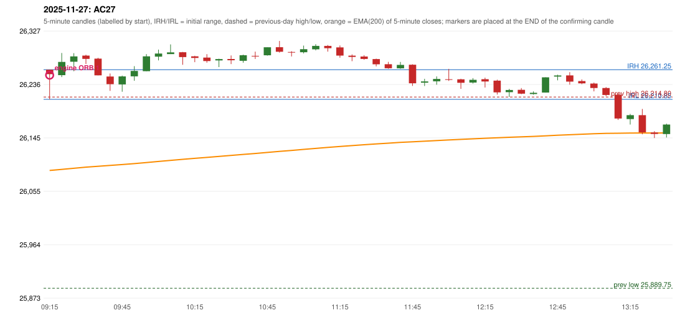

# 2025-11-27 - author's correction(s) against the engine

> Phase 5.1 date report. Evidence only; no rule was changed to produce a different outcome. Source image(s) are referenced under each correction.

## AC27 (PDF page 5, as written `20251127-1`, label `(none written)`, ACTIVE)

### Author's observation

> ORB is activated on a red candle for long side, which is wrong. ORB for long should be in green closing.

Suggested: **ORB (long only on a green close)**; timing: not stated; requirement stated: an ORB long must close green (a red first candle must not give a long). Drawing (my reading): none. Uncertain: no strategy label is written beside the date; the text is about ORB; a scribbled-over word sits between 'long' and 'side'. Image: `reports/phase5/phase51_author_corrections/pages/page_5_full.png (page 5 of docs/strategy_docs/corrected/Adobe Scan Nov 05, 2026.pdf)`.

### Original automated trade

20251127-1-ORB ORB Method 1 LONG signal 09:20 entry 26251.95 -> T1_THEN_BUFFER_STOP

Stop 26221.95, T1 26278.95, T2 26311.95; exits 09:22 / 09:40. Engine explanation: ORB Method 1 LONG: the first completed 5-minute candle (09:15-09:20) closed at 26,253.60, 38.80 points above the previous-day high 26,214.80; its body occupied 15.18% of its range and its upper wick 0.00% (thresholds 60% / 20%): the strong-candle test FAILED; the candle was admitted through the conditional PIN-BAR alternative instead (the lower wick 42.75 points is 5.59 x the body, required 2x; the close is 15.18% of the range from the high, allowed 30%). Note: the candle is bearish, i.e. against the trade direction; the pin route accepts it because the level break and close beyond it carry the direction; the EMA-only trend filter passed. Entry decision at 09:20.

### Independent historical evidence

Session: open 26261.25, previous high/low/close 26214.8 / 25889.75 / 26205.3 (gap 55.95); first candle {'high': 26261.25, 'low': 26210.85, 'open': 26261.25, 'close': 26253.6}.

ORB records: Method 2 ENGINE_SETUP_INVALIDATED: TRENDLINE_NOT_SUPPORTIVE

Chronological signal timeline (engine):

| time | strategy | method | dir | event | reason |
|---|---|---|---|---|---|
| 09:20 | ORB | Method 1 | LONG | EXECUTED | trade 1: T1_THEN_BUFFER_STOP |
| 09:40 | IRF | Method 1 | SHORT | IGNORED | POSITION_ACTIVE (signal kept for diagnostics only; never reused) |
| 10:00 | PDR | PDR | LONG | IGNORED | DAY_FINISHED |
| 10:15 | IRF | Method 2B | SHORT | IGNORED | DAY_FINISHED |
| 10:45 | IRF | Method 2B | SHORT | IGNORED | DAY_FINISHED |
| 11:25 | IRF | Method 2A | SHORT | IGNORED | DAY_FINISHED |
| 11:50 | IRF | Method 1 | SHORT | IGNORED | DAY_FINISHED |

Rejected / invalidated setups: 12:00 IRF Method 3: WICK_SHARE_OUT_OF_BAND; 11:20 IRF Method 1/2: SESSION_ENDED_BEFORE_CONFIRMATION; 09:15 ORB Method 2: TRENDLINE_NOT_SUPPORTIVE; 13:10 PDR PDR: NO_QUALIFYING_CONFIRMATION_BEFORE_SESSION_END; 14:35 RF RF: GAP_UP_OUTSIDE_YESTERDAYS_RANGE

Applicable source rules:

* `ORB-GLOBAL-002` (VERIFIED_EXPLICIT): Same rules in both directions: bullish breakouts in an uptrend, bearish breakdowns in a downtrend.
* `ORB-GAP-LONG-004` (VERIFIED_QUALITATIVE): Candle quality: strong green body, or a suitable bullish pin-bar-type candle (position and close must support the breakout).
* `ORB-M1-LONG-003` (VERIFIED_QUALITATIVE): Candle quality: strong green body and small upper wick; reject strong upper-wick rejection.

### Conclusion

* **Classification:** MISSING_AUTHOR_RULE, CANDLE_CONFIRMATION_MISMATCH   **Category:** B
* **Is the author correct under the existing rules?** Yes: a long should close green; the engine's own explanation records that the candle was bearish and admitted by the pin-bar route
* **Is the engine correct under the existing rules?** Yes under its proposals (conditional pin bar, no colour test). The source phrase 'a suitable bullish pin-bar-type candle' is in the Gap setup (ORB-GAP-LONG-004); for Method 1 the pin bar enters through 'candle quality across all three setups' (ORB-CANDLE-001, pp. 9-10) and the proposal flag orb_pin_bar_in_methods_1_2, and the same page says a pin bar's close must support the breakout - the engine assumed the level break guarantees that, which is arguably what the author contests
* **Missing requirement / root cause:** the colour of an ORB long's first candle
* **New rule required?** yes: ORB long needs a green close (short, by ORB-GLOBAL-002, a red close)   **Implementable objectively now?** YES - implemented as an opt-in variant (strategies/orb_colour.py); NOT the active baseline   **Owner approval needed?** YES before it becomes the baseline

Candles 09:15-13:00 (start, O, H, L, C, colour, body %, upper wick %, lower wick %, EMA200, close - EMA):

| start | O | H | L | C | col | body% | uw% | lw% | EMA | c-EMA |
|---|---|---|---|---|---|---|---|---|---|---|
| 09:15 | 26261.25 | 26261.25 | 26210.85 | 26253.6 | R | 15.2 | 0.0 | 84.8 | 26089.96 | 163.64 |
| 09:20 | 26251.95 | 26289.6 | 26248.65 | 26274.4 | G | 54.8 | 37.1 | 8.1 | 26091.79 | 182.61 |
| 09:25 | 26274.7 | 26289.25 | 26258.65 | 26283.8 | G | 29.7 | 17.8 | 52.5 | 26093.7 | 190.1 |
| 09:30 | 26285.15 | 26286.6 | 26270.95 | 26279.6 | R | 35.5 | 9.3 | 55.3 | 26095.55 | 184.05 |
| 09:35 | 26279.95 | 26281.5 | 26251.55 | 26251.55 | R | 94.8 | 5.2 | 0.0 | 26097.1 | 154.45 |
| 09:40 | 26249.55 | 26254.75 | 26225.2 | 26236.6 | R | 43.8 | 17.6 | 38.6 | 26098.49 | 138.11 |
| 09:45 | 26236.15 | 26251.2 | 26223.7 | 26249.75 | G | 49.5 | 5.3 | 45.3 | 26100.0 | 149.75 |
| 09:50 | 26249.9 | 26267.2 | 26242.4 | 26259.1 | G | 37.1 | 32.7 | 30.2 | 26101.58 | 157.52 |
| 09:55 | 26258.7 | 26287.75 | 26258.7 | 26283.9 | G | 86.7 | 13.3 | 0.0 | 26103.39 | 180.51 |
| 10:00 | 26283.4 | 26295.35 | 26277.05 | 26288.65 | G | 28.7 | 36.6 | 34.7 | 26105.24 | 183.41 |
| 10:05 | 26287.75 | 26304.15 | 26287.75 | 26290.7 | G | 18.0 | 82.0 | 0.0 | 26107.08 | 183.62 |
| 10:10 | 26290.9 | 26291.35 | 26269.5 | 26282.7 | R | 37.5 | 2.1 | 60.4 | 26108.83 | 173.87 |
| 10:15 | 26283.9 | 26284.8 | 26273.95 | 26281.15 | R | 25.3 | 8.3 | 66.4 | 26110.54 | 170.61 |
| 10:20 | 26281.75 | 26287.6 | 26273.1 | 26275.85 | R | 40.7 | 40.3 | 19.0 | 26112.19 | 163.66 |
| 10:25 | 26276.95 | 26279.85 | 26265.65 | 26279.25 | G | 16.2 | 4.2 | 79.6 | 26113.85 | 165.4 |
| 10:30 | 26279.4 | 26285.4 | 26270.75 | 26277.25 | R | 14.7 | 41.0 | 44.4 | 26115.48 | 161.77 |
| 10:35 | 26276.35 | 26286.8 | 26273.15 | 26285.8 | G | 69.2 | 7.3 | 23.4 | 26117.17 | 168.63 |
| 10:40 | 26284.75 | 26291.9 | 26279.45 | 26284.55 | R | 1.6 | 57.4 | 41.0 | 26118.84 | 165.71 |
| 10:45 | 26285.75 | 26299.4 | 26285.1 | 26299.35 | G | 95.1 | 0.3 | 4.5 | 26120.63 | 178.72 |
| 10:50 | 26299.45 | 26310.05 | 26290.2 | 26291.75 | R | 38.8 | 53.4 | 7.8 | 26122.34 | 169.41 |
| 10:55 | 26291.3 | 26292.65 | 26283.65 | 26291.05 | R | 2.8 | 15.0 | 82.2 | 26124.02 | 167.03 |
| 11:00 | 26290.9 | 26302.15 | 26288.85 | 26296.05 | G | 38.7 | 45.9 | 15.4 | 26125.73 | 170.32 |
| 11:05 | 26295.75 | 26304.5 | 26294.0 | 26301.6 | G | 55.7 | 27.6 | 16.7 | 26127.48 | 174.12 |
| 11:10 | 26301.6 | 26303.1 | 26291.9 | 26297.65 | R | 35.3 | 13.4 | 51.3 | 26129.17 | 168.48 |
| 11:15 | 26299.15 | 26302.35 | 26281.6 | 26285.25 | R | 67.0 | 15.4 | 17.6 | 26130.72 | 154.53 |
| 11:20 | 26285.1 | 26287.2 | 26275.65 | 26282.95 | R | 18.6 | 18.2 | 63.2 | 26132.24 | 150.71 |
| 11:25 | 26283.6 | 26285.9 | 26278.1 | 26279.45 | R | 53.2 | 29.5 | 17.3 | 26133.7 | 145.75 |
| 11:30 | 26279.25 | 26280.0 | 26266.8 | 26270.4 | R | 67.0 | 5.7 | 27.3 | 26135.06 | 135.34 |
| 11:35 | 26270.5 | 26274.55 | 26262.75 | 26263.6 | R | 58.5 | 34.3 | 7.2 | 26136.34 | 127.26 |
| 11:40 | 26263.45 | 26274.4 | 26262.75 | 26269.3 | G | 50.2 | 43.8 | 6.0 | 26137.67 | 131.63 |
| 11:45 | 26269.6 | 26270.35 | 26233.7 | 26238.0 | R | 86.2 | 2.0 | 11.7 | 26138.66 | 99.34 |
| 11:50 | 26239.1 | 26245.65 | 26233.45 | 26241.2 | G | 17.2 | 36.5 | 46.3 | 26139.68 | 101.52 |
| 11:55 | 26241.4 | 26249.8 | 26235.65 | 26245.45 | G | 28.6 | 30.7 | 40.6 | 26140.74 | 104.71 |
| 12:00 | 26244.95 | 26262.55 | 26242.1 | 26244.75 | R | 1.0 | 86.1 | 13.0 | 26141.77 | 102.98 |
| 12:05 | 26244.8 | 26245.8 | 26228.65 | 26238.85 | R | 34.7 | 5.8 | 59.5 | 26142.74 | 96.11 |
| 12:10 | 26239.35 | 26246.85 | 26237.8 | 26244.0 | G | 51.4 | 31.5 | 17.1 | 26143.74 | 100.26 |
| 12:15 | 26245.0 | 26247.7 | 26230.9 | 26241.05 | R | 23.5 | 16.1 | 60.4 | 26144.71 | 96.34 |
| 12:20 | 26242.65 | 26244.25 | 26219.0 | 26222.7 | R | 79.0 | 6.3 | 14.7 | 26145.49 | 77.21 |
| 12:25 | 26223.0 | 26228.55 | 26214.95 | 26226.65 | G | 26.8 | 14.0 | 59.2 | 26146.3 | 80.35 |
| 12:30 | 26227.05 | 26230.0 | 26219.6 | 26220.55 | R | 62.5 | 28.4 | 9.1 | 26147.04 | 73.51 |
| 12:35 | 26219.85 | 26224.35 | 26218.8 | 26221.95 | G | 37.8 | 43.2 | 18.9 | 26147.78 | 74.17 |
| 12:40 | 26222.3 | 26248.2 | 26222.2 | 26248.2 | G | 99.6 | 0.0 | 0.4 | 26148.78 | 99.42 |
| 12:45 | 26249.5 | 26252.65 | 26243.15 | 26251.35 | G | 19.5 | 13.7 | 66.8 | 26149.8 | 101.55 |
| 12:50 | 26251.5 | 26256.95 | 26235.8 | 26240.9 | R | 50.1 | 25.8 | 24.1 | 26150.71 | 90.19 |
| 12:55 | 26241.85 | 26244.6 | 26236.6 | 26237.9 | R | 49.4 | 34.4 | 16.3 | 26151.57 | 86.33 |
| 13:00 | 26237.65 | 26239.4 | 26224.4 | 26230.05 | R | 50.7 | 11.7 | 37.7 | 26152.36 | 77.69 |
