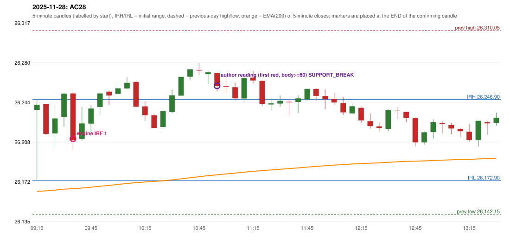

# 2025-11-28 - author's correction(s) against the engine

> Phase 5.1 date report. Evidence only; no rule was changed to produce a different outcome. Source image(s) are referenced under each correction.

## AC28 (PDF page 5, as written `20251128-1`, label `IRF`, ACTIVE)

### Author's observation

> ORB should be activated instead of IRF

Suggested: **ORB**; timing: not stated; requirement stated: ORB should have activated. Drawing (my reading): none. Uncertain: none. Image: `reports/phase5/phase51_author_corrections/pages/page_5_full.png (page 5 of docs/strategy_docs/corrected/Adobe Scan Nov 05, 2026.pdf)`.

### Original automated trade

20251128-1-IRF IRF Method 1 SHORT signal 09:40 entry 26211.0 -> INITIAL_FULL_STOP

Stop 26246.0, T1 26184.0, T2 26151.0; exits 09:50 / 09:50. Engine explanation: IRF Method 1 SHORT: the completed 09:30 candle closed at 26,252.35, 5.45 points above the initial range high 26,246.90 (range [26,172.90, 26,246.90] from the 09:15 candle); the immediately following completed 09:35 candle closed at 26,209.55, back inside the range. The short signal was confirmed at 09:40 on that close. Entry reference close 26,209.55 is 37.35 points below IRH 26,246.90.

### Independent historical evidence

Session: open 26237.45, previous high/low/close 26310.05 / 26142.15 / 26215.55 (gap 21.9); first candle {'high': 26246.9, 'low': 26172.9, 'open': 26237.45, 'close': 26242.15}.

Signal-candle measurements: signal_candle_start=09:35, colour=R, body_pct=81.3, upper_wick_pct=3.8, lower_wick_pct=15.0, signal_close=26209.55, ema200=26165.47, entry_minus_ema=44.08, ema_below_entry=True, ema_within_27_below_entry=False, ema_between_entry_and_target1=False, close_below_ema=False, session_low_before_candle=26172.9, close_below_prior_session_low=False, candle_low_at_or_below_prior_session_low=False, points_above_prior_session_low=36.65, body_pct_below_60=False, body_pct_below_50=False

Readings of the author's 'first red candle' wording (my formalisations, side by side):

| reading | first red candle | support | resistance | entry (signal time, close, trigger, body %) |
|---|---|---|---|---|
| FULLY_ABOVE|body>=60 | 10:45 | 26269.3 | 26280.2 | 11:00, 26259.4, SUPPORT_BREAK, 68.8 |
| FULLY_ABOVE|body>=0 | 10:45 | 26269.3 | 26280.2 | 11:00, 26259.4, SUPPORT_BREAK, 68.8 |
| CLOSE_ABOVE|body>=60 | 09:55 | 26242.1 | 26254.75 | 10:15, 26240.4, SUPPORT_BREAK, 92.4 |
| CLOSE_ABOVE|body>=0 | 09:55 | 26242.1 | 26254.75 | 10:15, 26240.4, SUPPORT_BREAK, 92.4 |

ORB records: Method 2 ENGINE_SETUP_INVALIDATED: TRENDLINE_NOT_SUPPORTIVE

Chronological signal timeline (engine):

| time | strategy | method | dir | event | reason |
|---|---|---|---|---|---|
| 09:40 | IRF | Method 1 | SHORT | EXECUTED | trade 1: INITIAL_FULL_STOP |
| 10:15 | IRF | Method 1 | SHORT | REJECTED | SECOND_TRADE_RESTRICTED_TO_PDR_PDS |
| 11:00 | IRF | Method 2B | SHORT | REJECTED | SECOND_TRADE_RESTRICTED_TO_PDR_PDS |
| 11:25 | IRF | Method 1 | SHORT | REJECTED | SECOND_TRADE_RESTRICTED_TO_PDR_PDS |
| 11:30 | IRF | Method 2A | SHORT | REJECTED | SECOND_TRADE_RESTRICTED_TO_PDR_PDS |
| 12:05 | IRF | Method 1 | SHORT | REJECTED | SECOND_TRADE_RESTRICTED_TO_PDR_PDS |
| 12:10 | IRF | Method 2A | SHORT | REJECTED | SECOND_TRADE_RESTRICTED_TO_PDR_PDS |

Rejected / invalidated setups: 10:15 IRF Method 1: SECOND_TRADE_RESTRICTED_TO_PDR_PDS; 11:00 IRF Method 2B: SECOND_TRADE_RESTRICTED_TO_PDR_PDS; 11:25 IRF Method 1: SECOND_TRADE_RESTRICTED_TO_PDR_PDS; 11:30 IRF Method 2A: SECOND_TRADE_RESTRICTED_TO_PDR_PDS; 12:05 IRF Method 1: SECOND_TRADE_RESTRICTED_TO_PDR_PDS; 12:10 IRF Method 2A: SECOND_TRADE_RESTRICTED_TO_PDR_PDS; 09:15 ORB Method 2: TRENDLINE_NOT_SUPPORTIVE; 09:15 PDR PDR: OPEN_NOT_STRICTLY_ABOVE_ZONE

Applicable source rules:

* `ORB-M2-LONG-001` (UNRESOLVED): Inner resistance inside the previous day's range is marked; a rising trendline through swing lows supports the trend.

### Conclusion

* **Classification:** AUTHOR_DISCRETION_UNRESOLVED, SUPPORT_RESISTANCE_MISMATCH   **Category:** C
* **Is the author correct under the existing rules?** Cannot be decided: Method 2 failed the proposed trendline test; the first candle is a green doji-like hammer (body 6.4%)
* **Is the engine correct under the existing rules?** Yes under the encoded rules
* **Missing requirement / root cause:** objective ORB inner level / trendline
* **New rule required?** yes   **Implementable objectively now?** no   **Owner approval needed?** YES

Candles 09:15-13:00 (start, O, H, L, C, colour, body %, upper wick %, lower wick %, EMA200, close - EMA):

| start | O | H | L | C | col | body% | uw% | lw% | EMA | c-EMA |
|---|---|---|---|---|---|---|---|---|---|---|
| 09:15 | 26237.45 | 26246.9 | 26172.9 | 26242.15 | G | 6.4 | 6.4 | 87.2 | 26162.97 | 79.18 |
| 09:20 | 26242.95 | 26242.95 | 26214.35 | 26215.45 | R | 96.2 | 0.0 | 3.8 | 26163.49 | 51.96 |
| 09:25 | 26215.9 | 26241.0 | 26202.3 | 26229.65 | G | 35.5 | 29.3 | 35.1 | 26164.15 | 65.5 |
| 09:30 | 26231.0 | 26252.6 | 26222.0 | 26252.35 | G | 69.8 | 0.8 | 29.4 | 26165.03 | 87.32 |
| 09:35 | 26252.45 | 26254.45 | 26201.65 | 26209.55 | R | 81.3 | 3.8 | 15.0 | 26165.47 | 44.08 |
| 09:40 | 26211.0 | 26240.35 | 26209.15 | 26225.1 | G | 45.2 | 48.9 | 5.9 | 26166.07 | 59.03 |
| 09:45 | 26224.9 | 26241.75 | 26213.75 | 26238.7 | G | 49.3 | 10.9 | 39.8 | 26166.79 | 71.91 |
| 09:50 | 26240.05 | 26253.6 | 26232.6 | 26252.45 | G | 59.0 | 5.5 | 35.5 | 26167.64 | 84.81 |
| 09:55 | 26254.05 | 26254.75 | 26242.1 | 26250.65 | R | 26.9 | 5.5 | 67.6 | 26168.47 | 82.18 |
| 10:00 | 26252.1 | 26261.7 | 26247.65 | 26257.15 | G | 35.9 | 32.4 | 31.7 | 26169.35 | 87.8 |
| 10:05 | 26257.05 | 26267.2 | 26256.7 | 26262.1 | G | 48.1 | 48.6 | 3.3 | 26170.27 | 91.83 |
| 10:10 | 26263.05 | 26263.8 | 26239.3 | 26240.4 | R | 92.4 | 3.1 | 4.5 | 26170.97 | 69.43 |
| 10:15 | 26240.65 | 26245.45 | 26227.25 | 26232.65 | R | 44.0 | 26.4 | 29.7 | 26171.58 | 61.07 |
| 10:20 | 26232.45 | 26233.9 | 26220.85 | 26220.85 | R | 88.9 | 11.1 | 0.0 | 26172.08 | 48.77 |
| 10:25 | 26221.85 | 26239.05 | 26218.8 | 26236.2 | G | 70.9 | 14.1 | 15.1 | 26172.71 | 63.49 |
| 10:30 | 26235.8 | 26256.05 | 26234.55 | 26250.75 | G | 69.5 | 24.7 | 5.8 | 26173.49 | 77.26 |
| 10:35 | 26250.5 | 26269.9 | 26250.5 | 26267.65 | G | 88.4 | 11.6 | 0.0 | 26174.43 | 93.22 |
| 10:40 | 26267.85 | 26274.45 | 26264.35 | 26274.45 | G | 65.3 | 0.0 | 34.7 | 26175.42 | 99.03 |
| 10:45 | 26273.95 | 26280.2 | 26269.3 | 26273.45 | R | 4.6 | 57.3 | 38.1 | 26176.4 | 97.05 |
| 10:50 | 26270.25 | 26272.75 | 26260.95 | 26271.9 | G | 14.0 | 7.2 | 78.8 | 26177.35 | 94.55 |
| 10:55 | 26271.2 | 26271.5 | 26254.35 | 26259.4 | R | 68.8 | 1.7 | 29.4 | 26178.16 | 81.24 |
| 11:00 | 26259.4 | 26268.9 | 26252.25 | 26258.65 | R | 4.5 | 57.1 | 38.4 | 26178.96 | 79.69 |
| 11:05 | 26258.05 | 26262.45 | 26246.1 | 26247.95 | R | 61.8 | 26.9 | 11.3 | 26179.65 | 68.3 |
| 11:10 | 26247.8 | 26267.4 | 26245.15 | 26266.5 | G | 84.0 | 4.0 | 11.9 | 26180.52 | 85.98 |
| 11:15 | 26266.9 | 26273.25 | 26261.6 | 26264.25 | R | 22.7 | 54.5 | 22.7 | 26181.35 | 82.9 |
| 11:20 | 26263.75 | 26264.5 | 26240.95 | 26242.9 | R | 88.5 | 3.2 | 8.3 | 26181.96 | 60.94 |
| 11:25 | 26242.35 | 26247.95 | 26236.75 | 26243.4 | G | 9.4 | 40.6 | 50.0 | 26182.57 | 60.83 |
| 11:30 | 26243.15 | 26250.7 | 26240.55 | 26245.7 | G | 25.1 | 49.3 | 25.6 | 26183.2 | 62.5 |
| 11:35 | 26244.85 | 26246.55 | 26232.6 | 26244.4 | R | 3.2 | 12.2 | 84.6 | 26183.81 | 60.59 |
| 11:40 | 26244.65 | 26250.9 | 26234.35 | 26247.95 | G | 19.9 | 17.8 | 62.2 | 26184.45 | 63.5 |
| 11:45 | 26246.95 | 26256.9 | 26246.0 | 26256.7 | G | 89.4 | 1.8 | 8.7 | 26185.17 | 71.53 |
| 11:50 | 26256.6 | 26257.1 | 26245.8 | 26250.25 | R | 56.2 | 4.4 | 39.4 | 26185.81 | 64.44 |
| 11:55 | 26250.1 | 26256.25 | 26238.05 | 26247.1 | R | 16.5 | 33.8 | 49.7 | 26186.42 | 60.68 |
| 12:00 | 26247.4 | 26253.15 | 26242.05 | 26244.25 | R | 28.4 | 51.8 | 19.8 | 26187.0 | 57.25 |
| 12:05 | 26243.7 | 26249.4 | 26232.85 | 26235.2 | R | 51.4 | 34.4 | 14.2 | 26187.48 | 47.72 |
| 12:10 | 26234.25 | 26243.4 | 26233.3 | 26240.75 | G | 64.4 | 26.2 | 9.4 | 26188.01 | 52.74 |
| 12:15 | 26239.35 | 26240.55 | 26225.4 | 26227.85 | R | 75.9 | 7.9 | 16.2 | 26188.41 | 39.44 |
| 12:20 | 26227.2 | 26234.2 | 26220.3 | 26222.6 | R | 33.1 | 50.4 | 16.5 | 26188.75 | 33.85 |
| 12:25 | 26222.35 | 26225.9 | 26217.85 | 26220.9 | R | 18.0 | 44.1 | 37.9 | 26189.07 | 31.83 |
| 12:30 | 26220.05 | 26237.9 | 26218.0 | 26237.2 | G | 86.2 | 3.5 | 10.3 | 26189.54 | 47.66 |
| 12:35 | 26236.75 | 26240.15 | 26228.95 | 26236.2 | R | 4.9 | 30.4 | 64.7 | 26190.01 | 46.19 |
| 12:40 | 26235.65 | 26235.75 | 26226.15 | 26230.0 | R | 58.9 | 1.0 | 40.1 | 26190.41 | 39.59 |
| 12:45 | 26229.85 | 26230.65 | 26204.0 | 26207.8 | R | 82.7 | 3.0 | 14.3 | 26190.58 | 17.22 |
| 12:50 | 26207.75 | 26217.7 | 26205.75 | 26217.0 | G | 77.4 | 5.9 | 16.7 | 26190.84 | 26.16 |
| 12:55 | 26217.15 | 26228.75 | 26211.3 | 26226.1 | G | 51.3 | 15.2 | 33.5 | 26191.19 | 34.91 |
| 13:00 | 26225.5 | 26227.4 | 26216.1 | 26224.45 | R | 9.3 | 16.8 | 73.9 | 26191.52 | 32.93 |
