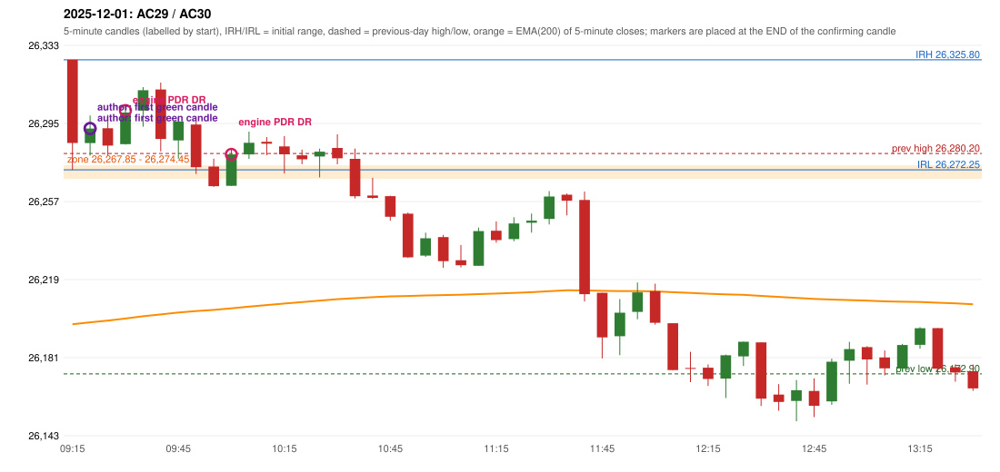

# 2025-12-01 - author's correction(s) against the engine

> Phase 5.1 date report. Evidence only; no rule was changed to produce a different outcome. Source image(s) are referenced under each correction.

## AC29 (PDF page 5, as written `20251201-1`, label `PDR`, ACTIVE)

### Author's observation

> Early entry should take place in 1st green candle

Suggested: **PDR (earlier entry)**; timing: earlier (first green candle); requirement stated: enter in the 1st green candle. Drawing (my reading): none. Uncertain: none. Image: `reports/phase5/phase51_author_corrections/pages/page_5_full.png (page 5 of docs/strategy_docs/corrected/Adobe Scan Nov 05, 2026.pdf)`.

### Original automated trade

20251201-1-PDR PDR PDR LONG signal 09:35 entry 26301.1 -> INITIAL_FULL_STOP

Stop 26266.1, T1 26328.1, T2 26371.1; exits 09:59 / 09:59. Engine explanation: PDR LONG (body-based engine, A_HIGHEST_BODY_HIGH): the session opened 122.85 points above the previous close and 51.35 points above the previous-day highest BODY high 26,274.45 (zone [26,267.85, 26,274.45] from the 10:40 candle of 2025-11-28; the highest wick 26,280.20 is ignored). The 09:15 candle (26,272.25 - 26,325.80) tested the zone; the 09:30 candle (green, O 26,284.75 H 26,303.95 L 26,284.55 C 26,300.15) passed GOOD_GREEN_BODY and closed 25.70 points above the zone ceiling, confirming the entry at 09:35. The pattern thresholds and the zone's lower boundary are provisional research assumptions, not approved by the strategy author.

### Independent historical evidence

Session: open 26325.8, previous high/low/close 26280.2 / 26172.9 / 26202.95 (gap 122.85); first candle {'high': 26325.8, 'low': 26272.25, 'open': 26325.8, 'close': 26285.3}.

First green candle after the zone interaction ('enter in 1st green candle'): {"interaction_candle": "09:15", "first_green_close_above_ceiling": {"candle_start": "09:20", "signal_time": "09:25", "colour": "G", "body_pct": 36.2, "upper_wick_pct": 32.6, "lower_wick_pct": 31.3, "close": 26292.35, "points_above_ceiling": 17.9, "low_below_zone_floor": false}}

ORB records: Method 1 ENGINE_SETUP_INVALIDATED: CANDLE_QUALITY(not a strong body / wick too large); Method 2 ENGINE_SETUP_INVALIDATED: CANDLE_QUALITY

Chronological signal timeline (engine):

| time | strategy | method | dir | event | reason |
|---|---|---|---|---|---|
| 09:35 | PDR | PDR | LONG | EXECUTED | trade 1: INITIAL_FULL_STOP |
| 10:05 | PDR | PDR | LONG | EXECUTED | trade 2: INITIAL_FULL_STOP |
| 10:30 | PDR | PDR | LONG | IGNORED | POSITION_ACTIVE (signal kept for diagnostics only; never reused) |

Rejected / invalidated setups: 09:15 ORB Method 1: CANDLE_QUALITY(not a strong body / wick too large); 09:15 ORB Method 2: CANDLE_QUALITY; 10:35 PDR PDR: NO_QUALIFYING_CONFIRMATION_BEFORE_SESSION_END; 10:00 RF RF: GAP_UP_OUTSIDE_YESTERDAYS_RANGE

Applicable source rules:

* `PDR-007` (VERIFIED_QUALITATIVE): After the zone has been tested, wait for a green candle and take the long on that confirmation.

### Conclusion

* **Classification:** CANDLE_CONFIRMATION_MISMATCH, ENTRY_TIMING_MISMATCH   **Category:** C
* **Is the author correct under the existing rules?** Consistent with the legacy PDR-007 wording (replaced by PDR-A04 in Phase 3.4): the 09:20 candle is the first green candle closing above the ceiling
* **Is the engine correct under the existing rules?** Yes under the proposed thresholds: that candle's body is 36.2% (neither a good body nor a hammer)
* **Missing requirement / root cause:** the numeric thresholds of the patterns
* **New rule required?** yes   **Implementable objectively now?** no   **Owner approval needed?** YES

## AC30 (PDF page 5, as written `20251201-2`, label `PDR`, ACTIVE)

### Author's observation

> 2nd entry should be ignored.

Suggested: **no second trade**; timing: not at all; requirement stated: the 2nd entry should be ignored. Drawing (my reading): none. Uncertain: none. Image: `reports/phase5/phase51_author_corrections/pages/page_5_full.png (page 5 of docs/strategy_docs/corrected/Adobe Scan Nov 05, 2026.pdf)`.

### Original automated trade

20251201-2-PDR PDR PDR LONG signal 10:05 entry 26279.75 -> INITIAL_FULL_STOP

Stop 26244.75, T1 26306.75, T2 26349.75; exits 10:51 / 10:51. Engine explanation: PDR LONG (body-based engine, A_HIGHEST_BODY_HIGH): the session opened 122.85 points above the previous close and 51.35 points above the previous-day highest BODY high 26,274.45 (zone [26,267.85, 26,274.45] from the 10:40 candle of 2025-11-28; the highest wick 26,280.20 is ignored). The 09:50 candle (26,270.20 - 26,296.00) tested the zone; the 10:00 candle (green, O 26,264.45 H 26,282.15 L 26,264.45 C 26,279.75) passed GOOD_GREEN_BODY and closed 5.30 points above the zone ceiling, confirming the entry at 10:05. The pattern thresholds and the zone's lower boundary are provisional research assumptions, not approved by the strategy author.

### Independent historical evidence

Session: open 26325.8, previous high/low/close 26280.2 / 26172.9 / 26202.95 (gap 122.85); first candle {'high': 26325.8, 'low': 26272.25, 'open': 26325.8, 'close': 26285.3}.

First green candle after the zone interaction ('enter in 1st green candle'): {"interaction_candle": "09:15", "first_green_close_above_ceiling": {"candle_start": "09:20", "signal_time": "09:25", "colour": "G", "body_pct": 36.2, "upper_wick_pct": 32.6, "lower_wick_pct": 31.3, "close": 26292.35, "points_above_ceiling": 17.9, "low_below_zone_floor": false}}

ORB records: Method 1 ENGINE_SETUP_INVALIDATED: CANDLE_QUALITY(not a strong body / wick too large); Method 2 ENGINE_SETUP_INVALIDATED: CANDLE_QUALITY

Chronological signal timeline (engine):

| time | strategy | method | dir | event | reason |
|---|---|---|---|---|---|
| 09:35 | PDR | PDR | LONG | EXECUTED | trade 1: INITIAL_FULL_STOP |
| 10:05 | PDR | PDR | LONG | EXECUTED | trade 2: INITIAL_FULL_STOP |
| 10:30 | PDR | PDR | LONG | IGNORED | POSITION_ACTIVE (signal kept for diagnostics only; never reused) |

Rejected / invalidated setups: 09:15 ORB Method 1: CANDLE_QUALITY(not a strong body / wick too large); 09:15 ORB Method 2: CANDLE_QUALITY; 10:35 PDR PDR: NO_QUALIFYING_CONFIRMATION_BEFORE_SESSION_END; 10:00 RF RF: GAP_UP_OUTSIDE_YESTERDAYS_RANGE

Applicable source rules:

* `DAY-SL-001` (USER_APPROVED): If the first trade hits its ORIGINAL full stop-loss before Target 1 (INITIAL_FULL_STOP), exactly one additional trade is permitted, and only a PDR or PDS trade from a valid, independently confirmed signal confirmed after the first trade has fully stopped out.

### Conclusion

* **Classification:** AUTHOR_DISCRETION_UNRESOLVED, JOURNAL_INCONSISTENCY   **Category:** C
* **Is the author correct under the existing rules?** Partly: if the first entry is moved to the first green candle the day's sequence changes; the second entry itself is allowed by DAY-SL-001
* **Is the engine correct under the existing rules?** Yes: the second PDR trade follows the approved rule
* **Missing requirement / root cause:** a consequence of AC29 rather than a separate rule
* **New rule required?** no separate rule   **Implementable objectively now?** no   **Owner approval needed?** YES

Candles 09:15-13:00 (start, O, H, L, C, colour, body %, upper wick %, lower wick %, EMA200, close - EMA):

| start | O | H | L | C | col | body% | uw% | lw% | EMA | c-EMA |
|---|---|---|---|---|---|---|---|---|---|---|
| 09:15 | 26325.8 | 26325.8 | 26272.25 | 26285.3 | R | 75.6 | 0.0 | 24.4 | 26197.06 | 88.24 |
| 09:20 | 26285.3 | 26298.7 | 26279.2 | 26292.35 | G | 36.2 | 32.6 | 31.3 | 26198.01 | 94.34 |
| 09:25 | 26292.5 | 26299.05 | 26279.25 | 26284.05 | R | 42.7 | 33.1 | 24.2 | 26198.86 | 85.19 |
| 09:30 | 26284.75 | 26303.95 | 26284.55 | 26300.15 | G | 79.4 | 19.6 | 1.0 | 26199.87 | 100.28 |
| 09:35 | 26301.1 | 26312.5 | 26293.25 | 26311.0 | G | 51.4 | 7.8 | 40.8 | 26200.98 | 110.02 |
| 09:40 | 26311.35 | 26314.7 | 26281.2 | 26287.25 | R | 71.9 | 10.0 | 18.1 | 26201.84 | 85.41 |
| 09:45 | 26286.55 | 26297.65 | 26277.7 | 26295.8 | G | 46.4 | 9.3 | 44.4 | 26202.77 | 93.03 |
| 09:50 | 26294.3 | 26296.0 | 26270.2 | 26273.55 | R | 80.4 | 6.6 | 13.0 | 26203.48 | 70.07 |
| 09:55 | 26273.85 | 26277.7 | 26263.95 | 26264.3 | R | 69.5 | 28.0 | 2.5 | 26204.08 | 60.22 |
| 10:00 | 26264.45 | 26282.15 | 26264.45 | 26279.75 | G | 86.4 | 13.6 | 0.0 | 26204.83 | 74.92 |
| 10:05 | 26279.75 | 26290.85 | 26277.6 | 26285.4 | G | 42.6 | 41.1 | 16.2 | 26205.64 | 79.76 |
| 10:10 | 26285.9 | 26288.2 | 26279.35 | 26284.95 | R | 10.7 | 26.0 | 63.3 | 26206.42 | 78.53 |
| 10:15 | 26283.65 | 26288.7 | 26270.5 | 26279.8 | R | 21.2 | 27.7 | 51.1 | 26207.16 | 72.64 |
| 10:20 | 26279.3 | 26282.1 | 26275.0 | 26277.35 | R | 27.5 | 39.4 | 33.1 | 26207.85 | 69.5 |
| 10:25 | 26278.75 | 26282.55 | 26268.6 | 26281.1 | G | 16.8 | 10.4 | 72.8 | 26208.58 | 72.52 |
| 10:30 | 26282.9 | 26289.55 | 26274.95 | 26277.85 | R | 34.6 | 45.5 | 19.9 | 26209.27 | 68.58 |
| 10:35 | 26277.6 | 26282.6 | 26258.3 | 26259.4 | R | 74.9 | 20.6 | 4.5 | 26209.77 | 49.63 |
| 10:40 | 26259.75 | 26268.3 | 26258.1 | 26258.6 | R | 11.3 | 83.8 | 4.9 | 26210.26 | 48.34 |
| 10:45 | 26259.45 | 26259.65 | 26247.45 | 26249.4 | R | 82.4 | 1.6 | 16.0 | 26210.65 | 38.75 |
| 10:50 | 26250.9 | 26251.45 | 26229.35 | 26229.65 | R | 96.2 | 2.5 | 1.4 | 26210.83 | 18.82 |
| 10:55 | 26230.5 | 26241.65 | 26229.85 | 26238.95 | G | 71.6 | 22.9 | 5.5 | 26211.11 | 27.84 |
| 11:00 | 26239.5 | 26240.55 | 26224.55 | 26227.8 | R | 73.1 | 6.6 | 20.3 | 26211.28 | 16.52 |
| 11:05 | 26228.25 | 26235.65 | 26224.75 | 26225.8 | R | 22.5 | 67.9 | 9.6 | 26211.43 | 14.37 |
| 11:10 | 26225.5 | 26244.15 | 26225.45 | 26242.4 | G | 90.4 | 9.4 | 0.3 | 26211.73 | 30.67 |
| 11:15 | 26242.6 | 26247.1 | 26236.75 | 26238.05 | R | 44.0 | 43.5 | 12.6 | 26212.0 | 26.05 |
| 11:20 | 26238.55 | 26249.2 | 26237.45 | 26246.15 | G | 64.7 | 26.0 | 9.4 | 26212.33 | 33.82 |
| 11:25 | 26246.5 | 26250.95 | 26241.65 | 26247.5 | G | 10.8 | 37.1 | 52.2 | 26212.68 | 34.82 |
| 11:30 | 26248.35 | 26261.9 | 26245.65 | 26259.25 | G | 67.1 | 16.3 | 16.6 | 26213.15 | 46.1 |
| 11:35 | 26260.15 | 26260.7 | 26250.05 | 26257.25 | R | 27.2 | 5.2 | 67.6 | 26213.59 | 43.66 |
| 11:40 | 26257.6 | 26261.65 | 26208.15 | 26211.75 | R | 85.7 | 7.6 | 6.7 | 26213.57 | -1.82 |
| 11:45 | 26212.35 | 26212.35 | 26180.45 | 26190.65 | R | 68.0 | 0.0 | 32.0 | 26213.34 | -22.69 |
| 11:50 | 26191.25 | 26209.3 | 26182.0 | 26202.7 | G | 41.9 | 24.2 | 33.9 | 26213.23 | -10.53 |
| 11:55 | 26203.1 | 26217.4 | 26199.5 | 26212.6 | G | 53.1 | 26.8 | 20.1 | 26213.23 | -0.63 |
| 12:00 | 26213.15 | 26216.85 | 26196.85 | 26197.75 | R | 77.0 | 18.5 | 4.5 | 26213.07 | -15.32 |
| 12:05 | 26197.55 | 26197.55 | 26174.75 | 26174.75 | R | 100.0 | 0.0 | 0.0 | 26212.69 | -37.94 |
| 12:10 | 26175.8 | 26183.65 | 26168.9 | 26175.65 | R | 1.0 | 53.2 | 45.8 | 26212.32 | -36.67 |
| 12:15 | 26175.9 | 26177.5 | 26167.05 | 26170.4 | R | 52.6 | 15.3 | 32.1 | 26211.91 | -41.51 |
| 12:20 | 26170.6 | 26182.3 | 26161.15 | 26181.95 | G | 53.7 | 1.7 | 44.7 | 26211.61 | -29.66 |
| 12:25 | 26181.45 | 26188.55 | 26176.75 | 26188.55 | G | 60.2 | 0.0 | 39.8 | 26211.38 | -22.83 |
| 12:30 | 26188.25 | 26188.25 | 26157.25 | 26160.85 | R | 88.4 | 0.0 | 11.6 | 26210.88 | -50.03 |
| 12:35 | 26162.85 | 26167.9 | 26154.95 | 26159.25 | R | 27.8 | 39.0 | 33.2 | 26210.36 | -51.11 |
| 12:40 | 26159.75 | 26169.9 | 26149.85 | 26164.95 | G | 25.9 | 24.7 | 49.4 | 26209.91 | -44.96 |
| 12:45 | 26164.6 | 26170.7 | 26151.85 | 26157.35 | R | 38.5 | 32.4 | 29.2 | 26209.39 | -52.04 |
| 12:50 | 26159.55 | 26180.35 | 26157.85 | 26178.85 | G | 85.8 | 6.7 | 7.6 | 26209.08 | -30.23 |
| 12:55 | 26179.3 | 26188.5 | 26168.1 | 26184.95 | G | 27.7 | 17.4 | 54.9 | 26208.84 | -23.89 |
| 13:00 | 26185.95 | 26186.4 | 26167.7 | 26179.95 | R | 32.1 | 2.4 | 65.5 | 26208.56 | -28.61 |
