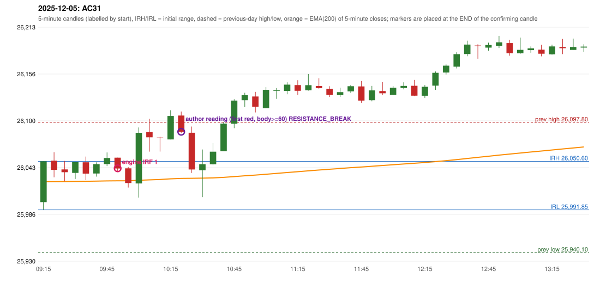

# 2025-12-05 - author's correction(s) against the engine

> Phase 5.1 date report. Evidence only; no rule was changed to produce a different outcome. Source image(s) are referenced under each correction.

## AC31 (PDF page 5, as written `20251205-1`, label `IRF`, ACTIVE)

### Author's observation

> ORB should activate instead of IRF.

Suggested: **ORB**; timing: not stated; requirement stated: ORB should have activated. Drawing (my reading): none. Uncertain: none. Image: `reports/phase5/phase51_author_corrections/pages/page_5_full.png (page 5 of docs/strategy_docs/corrected/Adobe Scan Nov 05, 2026.pdf)`.

### Original automated trade

20251205-1-IRF IRF Method 1 SHORT signal 09:55 entry 26042.15 -> T1_THEN_BUFFER_STOP

Stop 26077.15, T1 26015.15, T2 25982.15; exits 10:00 / 10:03. Engine explanation: IRF Method 1 SHORT: the completed 09:45 candle closed at 26,054.65, 4.05 points above the initial range high 26,050.60 (range [25,991.85, 26,050.60] from the 09:15 candle); the immediately following completed 09:50 candle closed at 26,041.90, back inside the range. The short signal was confirmed at 09:55 on that close. Entry reference close 26,041.90 is 8.70 points below IRH 26,050.60.

### Independent historical evidence

Session: open 26001.15, previous high/low/close 26097.8 / 25940.1 / 26033.75 (gap -32.6); first candle {'high': 26050.6, 'low': 25991.85, 'open': 26001.15, 'close': 26050.6}.

Signal-candle measurements: signal_candle_start=09:50, colour=R, body_pct=79.0, upper_wick_pct=0.0, lower_wick_pct=21.0, signal_close=26041.9, ema200=26027.05, entry_minus_ema=14.85, ema_below_entry=True, ema_within_27_below_entry=True, ema_between_entry_and_target1=True, close_below_ema=False, session_low_before_candle=25991.85, close_below_prior_session_low=False, candle_low_at_or_below_prior_session_low=False, points_above_prior_session_low=50.05, body_pct_below_60=False, body_pct_below_50=False

Readings of the author's 'first red candle' wording (my formalisations, side by side):

| reading | first red candle | support | resistance | entry (signal time, close, trigger, body %) |
|---|---|---|---|---|
| FULLY_ABOVE|body>=60 | 10:05 | 26062.35 | 26102.05 | 10:25, 26086.45, RESISTANCE_BREAK, 75.0 |
| FULLY_ABOVE|body>=0 | 10:05 | 26062.35 | 26102.05 | 10:25, 26086.45, RESISTANCE_BREAK, 75.0 |
| CLOSE_ABOVE|body>=60 | 10:05 | 26062.35 | 26102.05 | 10:25, 26086.45, RESISTANCE_BREAK, 75.0 |
| CLOSE_ABOVE|body>=0 | 10:05 | 26062.35 | 26102.05 | 10:25, 26086.45, RESISTANCE_BREAK, 75.0 |

ORB records: Gap/200DMA ENGINE_SETUP_INVALIDATED: CLOSE_NOT_BEYOND_MA

Chronological signal timeline (engine):

| time | strategy | method | dir | event | reason |
|---|---|---|---|---|---|
| 09:55 | IRF | Method 1 | SHORT | EXECUTED | trade 1: T1_THEN_BUFFER_STOP |
| 10:25 | IRF | Method 2B | SHORT | IGNORED | DAY_FINISHED |
| 10:30 | IRF | Method 1 | SHORT | IGNORED | DAY_FINISHED |
| 11:20 | IRF | Method 2B | SHORT | IGNORED | DAY_FINISHED |
| 11:50 | IRF | Method 2A | SHORT | IGNORED | DAY_FINISHED |
| 12:15 | IRF | Method 2B | SHORT | IGNORED | DAY_FINISHED |
| 13:50 | IRF | Method 2A | SHORT | IGNORED | DAY_FINISHED |
| 15:30 | IRF | Method 2B | SHORT | IGNORED | DAY_FINISHED |

Rejected / invalidated setups: 15:25 IRF Method 1/2: SESSION_ENDED_BEFORE_CONFIRMATION; 09:15 ORB Gap/200DMA: CLOSE_NOT_BEYOND_MA; 09:15 PDS Method 1/2/3: GAP_DOWN_OPEN_NOT_BELOW_ZONE

Applicable source rules:

* `ORB-GAP-LONG-003` (VERIFIED_EXPLICIT): Wait for the 09:20 close: a candle that only crosses the line but closes below it does not qualify.

### Conclusion

* **Classification:** EMA_FILTER_MISMATCH, AUTHOR_DISCRETION_UNRESOLVED   **Category:** C
* **Is the author correct under the existing rules?** Cannot be decided: the Gap/200DMA setup requires the first candle to close beyond the 200 average (in this engine the 5-minute EMA(200), ma_mode EMA200_5M, not a daily average); it closed 24.77 points on the other side
* **Is the engine correct under the existing rules?** Yes under ORB-GAP-*-003
* **Missing requirement / root cause:** which ORB setup and direction the author means
* **New rule required?** unknown   **Implementable objectively now?** no   **Owner approval needed?** YES

Candles 09:15-13:00 (start, O, H, L, C, colour, body %, upper wick %, lower wick %, EMA200, close - EMA):

| start | O | H | L | C | col | body% | uw% | lw% | EMA | c-EMA |
|---|---|---|---|---|---|---|---|---|---|---|
| 09:15 | 26001.15 | 26050.6 | 25991.85 | 26050.6 | G | 84.2 | 0.0 | 15.8 | 26025.83 | 24.77 |
| 09:20 | 26051.35 | 26061.7 | 26031.25 | 26040.35 | R | 36.1 | 34.0 | 29.9 | 26025.97 | 14.38 |
| 09:25 | 26040.8 | 26051.05 | 26026.35 | 26037.45 | R | 13.6 | 41.5 | 44.9 | 26026.08 | 11.37 |
| 09:30 | 26036.6 | 26049.65 | 26029.3 | 26049.65 | G | 64.1 | 0.0 | 35.9 | 26026.32 | 23.33 |
| 09:35 | 26049.45 | 26056.35 | 26027.8 | 26035.75 | R | 48.0 | 24.2 | 27.8 | 26026.41 | 9.34 |
| 09:40 | 26035.85 | 26049.35 | 26032.1 | 26047.2 | G | 65.8 | 12.5 | 21.7 | 26026.62 | 20.58 |
| 09:45 | 26047.25 | 26061.4 | 26044.8 | 26054.65 | G | 44.6 | 40.7 | 14.8 | 26026.9 | 27.75 |
| 09:50 | 26055.05 | 26055.05 | 26038.4 | 26041.9 | R | 79.0 | 0.0 | 21.0 | 26027.05 | 14.85 |
| 09:55 | 26042.15 | 26043.75 | 26018.85 | 26024.35 | R | 71.5 | 6.4 | 22.1 | 26027.02 | -2.67 |
| 10:00 | 26023.8 | 26091.6 | 26006.65 | 26085.15 | G | 72.2 | 7.6 | 20.2 | 26027.6 | 57.55 |
| 10:05 | 26086.0 | 26102.05 | 26062.35 | 26079.7 | R | 15.9 | 40.4 | 43.7 | 26028.12 | 51.58 |
| 10:10 | 26079.35 | 26080.3 | 26062.45 | 26078.55 | R | 4.5 | 5.3 | 90.2 | 26028.62 | 49.93 |
| 10:15 | 26077.15 | 26112.55 | 26077.15 | 26105.55 | G | 80.2 | 19.8 | 0.0 | 26029.39 | 76.16 |
| 10:20 | 26106.05 | 26110.95 | 26084.8 | 26086.45 | R | 75.0 | 18.7 | 6.3 | 26029.95 | 56.5 |
| 10:25 | 26085.25 | 26092.75 | 26036.5 | 26040.75 | R | 79.1 | 13.3 | 7.6 | 26030.06 | 10.69 |
| 10:30 | 26039.75 | 26064.95 | 26007.25 | 26047.05 | G | 12.7 | 31.0 | 56.3 | 26030.23 | 16.82 |
| 10:35 | 26047.0 | 26072.8 | 26045.8 | 26062.3 | G | 56.7 | 38.9 | 4.4 | 26030.55 | 31.75 |
| 10:40 | 26062.85 | 26098.15 | 26062.85 | 26096.25 | G | 94.6 | 5.4 | 0.0 | 26031.2 | 65.05 |
| 10:45 | 26096.15 | 26125.85 | 26090.8 | 26124.2 | G | 80.0 | 4.7 | 15.3 | 26032.13 | 92.07 |
| 10:50 | 26124.55 | 26133.65 | 26116.3 | 26130.7 | G | 35.4 | 17.0 | 47.6 | 26033.11 | 97.59 |
| 10:55 | 26129.15 | 26134.75 | 26109.85 | 26116.75 | R | 49.8 | 22.5 | 27.7 | 26033.94 | 82.81 |
| 11:00 | 26115.0 | 26140.5 | 26115.0 | 26137.25 | G | 87.3 | 12.7 | 0.0 | 26034.97 | 102.28 |
| 11:05 | 26136.05 | 26139.35 | 26126.25 | 26136.95 | G | 6.9 | 18.3 | 74.8 | 26035.98 | 100.97 |
| 11:10 | 26135.85 | 26146.35 | 26131.85 | 26143.5 | G | 52.8 | 19.7 | 27.6 | 26037.05 | 106.45 |
| 11:15 | 26142.95 | 26148.9 | 26131.05 | 26136.0 | R | 38.9 | 33.3 | 27.7 | 26038.04 | 97.96 |
| 11:20 | 26136.65 | 26156.4 | 26136.25 | 26142.85 | G | 30.8 | 67.2 | 2.0 | 26039.08 | 103.77 |
| 11:25 | 26141.85 | 26151.15 | 26138.65 | 26139.3 | R | 20.4 | 74.4 | 5.2 | 26040.08 | 99.22 |
| 11:30 | 26138.45 | 26141.6 | 26128.65 | 26131.1 | R | 56.8 | 24.3 | 18.9 | 26040.98 | 90.12 |
| 11:35 | 26130.85 | 26139.75 | 26128.6 | 26134.4 | G | 31.8 | 48.0 | 20.2 | 26041.91 | 92.49 |
| 11:40 | 26135.35 | 26143.2 | 26133.4 | 26141.6 | G | 63.8 | 16.3 | 19.9 | 26042.91 | 98.69 |
| 11:45 | 26141.3 | 26147.9 | 26121.5 | 26124.15 | R | 65.0 | 25.0 | 10.0 | 26043.71 | 80.44 |
| 11:50 | 26124.6 | 26142.0 | 26123.3 | 26136.5 | G | 63.6 | 29.4 | 7.0 | 26044.64 | 91.86 |
| 11:55 | 26135.75 | 26146.55 | 26130.8 | 26133.05 | R | 17.1 | 68.6 | 14.3 | 26045.52 | 87.53 |
| 12:00 | 26131.0 | 26141.7 | 26131.0 | 26139.65 | G | 80.8 | 19.2 | 0.0 | 26046.45 | 93.2 |
| 12:05 | 26139.4 | 26146.35 | 26137.8 | 26142.0 | G | 30.4 | 50.9 | 18.7 | 26047.4 | 94.6 |
| 12:10 | 26142.15 | 26149.25 | 26129.7 | 26130.15 | R | 61.4 | 36.3 | 2.3 | 26048.23 | 81.92 |
| 12:15 | 26130.1 | 26143.05 | 26127.45 | 26140.9 | G | 69.2 | 13.8 | 17.0 | 26049.15 | 91.75 |
| 12:20 | 26142.25 | 26159.45 | 26137.15 | 26157.9 | G | 70.2 | 7.0 | 22.9 | 26050.23 | 107.67 |
| 12:25 | 26158.15 | 26167.95 | 26155.75 | 26166.5 | G | 68.4 | 11.9 | 19.7 | 26051.39 | 115.11 |
| 12:30 | 26165.3 | 26182.65 | 26163.15 | 26180.45 | G | 77.7 | 11.3 | 11.0 | 26052.67 | 127.78 |
| 12:35 | 26180.6 | 26196.75 | 26177.9 | 26192.05 | G | 60.7 | 24.9 | 14.3 | 26054.06 | 137.99 |
| 12:40 | 26190.9 | 26192.4 | 26174.9 | 26190.2 | R | 4.0 | 8.6 | 87.4 | 26055.41 | 134.79 |
| 12:45 | 26188.35 | 26194.35 | 26184.65 | 26191.5 | G | 32.5 | 29.4 | 38.1 | 26056.77 | 134.73 |
| 12:50 | 26190.55 | 26202.55 | 26187.9 | 26194.75 | G | 28.7 | 53.2 | 18.1 | 26058.14 | 136.61 |
| 12:55 | 26193.85 | 26197.75 | 26178.5 | 26181.55 | R | 63.9 | 20.3 | 15.8 | 26059.37 | 122.18 |
| 13:00 | 26181.45 | 26200.45 | 26180.85 | 26185.65 | G | 21.4 | 75.5 | 3.1 | 26060.63 | 125.02 |
