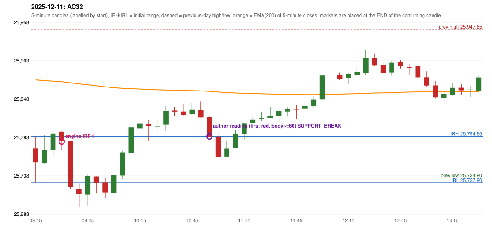

# 2025-12-11 - author's correction(s) against the engine

> Phase 5.1 date report. Evidence only; no rule was changed to produce a different outcome. Source image(s) are referenced under each correction.

## AC32 (PDF page 5, as written `20251211`, label `IRF`, ACTIVE)

### Author's observation

> Should be ignored as candle body is less than 50%. | 2nd candle should also be ignores as it is at day's low.

Suggested: **no trade (candle ignored)**; timing: not at all / later; requirement stated: ignore a candle whose body is under 50%; ignore the 2nd candle too because it is at the day's low. Drawing (my reading): none. Uncertain: 'body' is written above the line with a caret; no '-1' is written after the date; 50% here vs '60+' (AC01) and 40% (AC07). Image: `reports/phase5/phase51_author_corrections/pages/page_5_full.png (page 5 of docs/strategy_docs/corrected/Adobe Scan Nov 05, 2026.pdf)`.

### Original automated trade

20251211-1-IRF IRF Method 1 SHORT signal 09:35 entry 25787.3 -> TARGET

Stop 25822.3, T1 25760.3, T2 25727.3; exits 09:37 / 09:39. Engine explanation: IRF Method 1 SHORT: the completed 09:25 candle closed at 25,798.25, 3.60 points above the initial range high 25,794.65 (range [25,727.90, 25,794.65] from the 09:15 candle); the immediately following completed 09:30 candle closed at 25,788.50, back inside the range. The short signal was confirmed at 09:35 on that close. Entry reference close 25,788.50 is 6.15 points below IRH 25,794.65.

### Independent historical evidence

Session: open 25777.45, previous high/low/close 25947.65 / 25734.9 / 25758.0 (gap 19.45); first candle {'high': 25794.65, 'low': 25727.9, 'open': 25777.45, 'close': 25757.1}.

Signal-candle measurements: signal_candle_start=09:30, colour=R, body_pct=45.2, upper_wick_pct=4.9, lower_wick_pct=49.9, signal_close=25788.5, ema200=25872.78, entry_minus_ema=-84.28, ema_below_entry=False, ema_within_27_below_entry=False, ema_between_entry_and_target1=False, close_below_ema=True, session_low_before_candle=25727.9, close_below_prior_session_low=False, candle_low_at_or_below_prior_session_low=False, points_above_prior_session_low=60.6, body_pct_below_60=True, body_pct_below_50=True

Readings of the author's 'first red candle' wording (my formalisations, side by side):

| reading | first red candle | support | resistance | entry (signal time, close, trigger, body %) |
|---|---|---|---|---|
| FULLY_ABOVE|body>=60 | 10:35 | 25822.95 | 25837.1 | 11:00, 25794.35, SUPPORT_BREAK, 97.5 |
| FULLY_ABOVE|body>=0 | 10:35 | 25822.95 | 25837.1 | 10:55, 25821.6, SUPPORT_BREAK, 47.7 |
| CLOSE_ABOVE|body>=60 | 10:20 | 25788.55 | 25818.2 | 11:00, 25794.35, RESISTANCE_BREAK, 97.5 |
| CLOSE_ABOVE|body>=0 | 10:20 | 25788.55 | 25818.2 | 11:00, 25794.35, RESISTANCE_BREAK, 97.5 |

Chronological signal timeline (engine):

| time | strategy | method | dir | event | reason |
|---|---|---|---|---|---|
| 09:35 | IRF | Method 1 | SHORT | EXECUTED | trade 1: TARGET |
| 11:00 | IRF | Method 1 | SHORT | IGNORED | DAY_FINISHED |
| 11:00 | IRF | Method 2A | SHORT | IGNORED | DAY_FINISHED |
| 11:00 | IRF | Method 2B | SHORT | IGNORED | DAY_FINISHED |
| 11:50 | IRF | Method 2B | SHORT | IGNORED | DAY_FINISHED |
| 12:40 | IRF | Method 2B | SHORT | IGNORED | DAY_FINISHED |
| 13:00 | IRF | Method 2A | SHORT | IGNORED | DAY_FINISHED |
| 14:05 | IRF | Method 2B | SHORT | IGNORED | DAY_FINISHED |
| 14:45 | IRF | Method 2B | SHORT | IGNORED | DAY_FINISHED |

Rejected / invalidated setups: 14:40 IRF Method 1/2: SESSION_ENDED_BEFORE_CONFIRMATION; 09:15 PDR PDR: OPEN_NOT_STRICTLY_ABOVE_ZONE; 09:45 RF RF: TREND:EMA_PREV_SESSION_CLOSE wrong side

Applicable source rules:

* `IRF-M1-004` (VERIFIED_EXPLICIT): Enter short at the close of the failure candle; no support/resistance break is required.

### Conclusion

* **Classification:** MISSING_AUTHOR_RULE, CANDLE_CONFIRMATION_MISMATCH, JOURNAL_INCONSISTENCY   **Category:** B
* **Is the author correct under the existing rules?** Consistent with the author's clarification: the engine's entry candle has a 45.2% body, and the next candle closes below the session low so far
* **Is the engine correct under the existing rules?** Yes under the guide (no body or day's-low test)
* **Missing requirement / root cause:** (a) entry-candle body threshold (stated as 60+, 50 and 40 in different places), (b) 'not at the day's low'
* **New rule required?** yes   **Implementable objectively now?** partly: the body threshold is inconsistent; 'day's low' needs a measurement definition   **Owner approval needed?** YES

Candles 09:15-13:00 (start, O, H, L, C, colour, body %, upper wick %, lower wick %, EMA200, close - EMA):

| start | O | H | L | C | col | body% | uw% | lw% | EMA | c-EMA |
|---|---|---|---|---|---|---|---|---|---|---|
| 09:15 | 25777.45 | 25794.65 | 25727.9 | 25757.1 | R | 30.5 | 25.8 | 43.7 | 25875.39 | -118.29 |
| 09:20 | 25755.95 | 25796.3 | 25755.45 | 25774.6 | G | 45.7 | 53.1 | 1.2 | 25874.38 | -99.78 |
| 09:25 | 25774.9 | 25802.85 | 25765.1 | 25798.25 | G | 61.9 | 12.2 | 26.0 | 25873.62 | -75.37 |
| 09:30 | 25801.35 | 25802.75 | 25774.3 | 25788.5 | R | 45.2 | 4.9 | 49.9 | 25872.78 | -84.28 |
| 09:35 | 25787.3 | 25787.8 | 25719.35 | 25721.45 | R | 96.2 | 0.7 | 3.1 | 25871.27 | -149.82 |
| 09:40 | 25719.55 | 25726.7 | 25693.3 | 25712.25 | R | 21.9 | 21.4 | 56.7 | 25869.69 | -157.44 |
| 09:45 | 25711.45 | 25739.7 | 25695.45 | 25737.8 | G | 59.5 | 4.3 | 36.2 | 25868.38 | -130.58 |
| 09:50 | 25737.1 | 25737.1 | 25713.05 | 25727.75 | R | 38.9 | 0.0 | 61.1 | 25866.98 | -139.23 |
| 09:55 | 25728.2 | 25734.45 | 25706.35 | 25714.0 | R | 50.5 | 22.2 | 27.2 | 25865.46 | -151.46 |
| 10:00 | 25713.4 | 25741.7 | 25712.35 | 25739.0 | G | 87.2 | 9.2 | 3.6 | 25864.2 | -125.2 |
| 10:05 | 25738.45 | 25774.1 | 25733.4 | 25771.55 | G | 81.3 | 6.3 | 12.4 | 25863.28 | -91.73 |
| 10:10 | 25770.3 | 25807.55 | 25759.4 | 25807.55 | G | 77.4 | 0.0 | 22.6 | 25862.72 | -55.17 |
| 10:15 | 25805.5 | 25821.6 | 25804.3 | 25813.05 | G | 43.6 | 49.4 | 6.9 | 25862.23 | -49.18 |
| 10:20 | 25812.4 | 25818.2 | 25788.55 | 25809.1 | R | 11.1 | 19.6 | 69.3 | 25861.7 | -52.6 |
| 10:25 | 25807.8 | 25818.1 | 25803.45 | 25808.65 | G | 5.8 | 64.5 | 29.7 | 25861.17 | -52.52 |
| 10:30 | 25811.1 | 25838.45 | 25802.7 | 25830.8 | G | 55.1 | 21.4 | 23.5 | 25860.87 | -30.07 |
| 10:35 | 25831.75 | 25837.1 | 25822.95 | 25830.15 | R | 11.3 | 37.8 | 50.9 | 25860.56 | -30.41 |
| 10:40 | 25830.25 | 25841.1 | 25824.3 | 25825.35 | R | 29.2 | 64.6 | 6.2 | 25860.21 | -34.86 |
| 10:45 | 25826.5 | 25842.65 | 25824.85 | 25832.8 | G | 35.4 | 55.3 | 9.3 | 25859.94 | -27.14 |
| 10:50 | 25832.5 | 25844.45 | 25821.6 | 25821.6 | R | 47.7 | 52.3 | 0.0 | 25859.56 | -37.96 |
| 10:55 | 25822.0 | 25822.7 | 25794.35 | 25794.35 | R | 97.5 | 2.5 | 0.0 | 25858.91 | -64.56 |
| 11:00 | 25794.45 | 25801.45 | 25764.65 | 25765.3 | R | 79.2 | 19.0 | 1.8 | 25857.98 | -92.68 |
| 11:05 | 25765.6 | 25788.0 | 25764.5 | 25777.35 | G | 50.0 | 45.3 | 4.7 | 25857.18 | -79.83 |
| 11:10 | 25778.25 | 25803.1 | 25778.1 | 25797.45 | G | 76.8 | 22.6 | 0.6 | 25856.58 | -59.13 |
| 11:15 | 25797.5 | 25814.0 | 25789.9 | 25813.25 | G | 65.4 | 3.1 | 31.5 | 25856.15 | -42.9 |
| 11:20 | 25813.55 | 25822.7 | 25813.55 | 25818.7 | G | 56.3 | 43.7 | 0.0 | 25855.78 | -37.08 |
| 11:25 | 25819.9 | 25828.7 | 25816.35 | 25820.65 | G | 6.1 | 65.2 | 28.7 | 25855.43 | -34.78 |
| 11:30 | 25820.6 | 25836.95 | 25820.6 | 25823.55 | G | 18.0 | 82.0 | 0.0 | 25855.11 | -31.56 |
| 11:35 | 25823.85 | 25832.9 | 25813.3 | 25830.75 | G | 35.2 | 11.0 | 53.8 | 25854.87 | -24.12 |
| 11:40 | 25830.25 | 25836.4 | 25822.85 | 25833.7 | G | 25.5 | 19.9 | 54.6 | 25854.66 | -20.96 |
| 11:45 | 25833.6 | 25839.4 | 25819.45 | 25833.25 | R | 1.8 | 29.1 | 69.2 | 25854.44 | -21.19 |
| 11:50 | 25834.1 | 25845.85 | 25824.05 | 25838.0 | G | 17.9 | 36.0 | 46.1 | 25854.28 | -16.28 |
| 11:55 | 25838.05 | 25851.5 | 25836.0 | 25846.9 | G | 57.1 | 29.7 | 13.2 | 25854.21 | -7.31 |
| 12:00 | 25847.15 | 25882.8 | 25846.95 | 25881.7 | G | 96.4 | 3.1 | 0.6 | 25854.48 | 27.22 |
| 12:05 | 25882.6 | 25889.8 | 25868.85 | 25882.15 | R | 2.1 | 34.4 | 63.5 | 25854.76 | 27.39 |
| 12:10 | 25882.1 | 25885.8 | 25875.45 | 25876.6 | R | 53.1 | 35.7 | 11.1 | 25854.97 | 21.63 |
| 12:15 | 25878.6 | 25885.7 | 25869.0 | 25884.15 | G | 33.2 | 9.3 | 57.5 | 25855.26 | 28.89 |
| 12:20 | 25883.0 | 25895.5 | 25880.0 | 25886.75 | G | 24.2 | 56.5 | 19.4 | 25855.58 | 31.17 |
| 12:25 | 25885.6 | 25918.1 | 25882.15 | 25907.3 | G | 60.4 | 30.0 | 9.6 | 25856.09 | 51.21 |
| 12:30 | 25906.9 | 25913.3 | 25894.8 | 25896.2 | R | 57.8 | 34.6 | 7.6 | 25856.49 | 39.71 |
| 12:35 | 25896.95 | 25900.55 | 25884.95 | 25885.55 | R | 73.1 | 23.1 | 3.8 | 25856.78 | 28.77 |
| 12:40 | 25885.85 | 25902.15 | 25881.4 | 25899.85 | G | 67.5 | 11.1 | 21.4 | 25857.21 | 42.64 |
| 12:45 | 25900.55 | 25903.4 | 25891.55 | 25894.8 | R | 48.5 | 24.1 | 27.4 | 25857.58 | 37.22 |
| 12:50 | 25893.8 | 25897.95 | 25881.8 | 25892.4 | R | 8.7 | 25.7 | 65.6 | 25857.93 | 34.47 |
| 12:55 | 25895.8 | 25895.95 | 25877.15 | 25879.0 | R | 89.4 | 0.8 | 9.8 | 25858.14 | 20.86 |
| 13:00 | 25879.05 | 25887.4 | 25865.8 | 25867.3 | R | 54.4 | 38.7 | 6.9 | 25858.23 | 9.07 |
