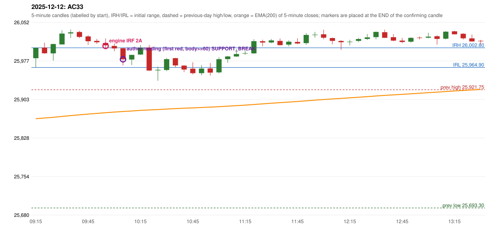

# 2025-12-12 - author's correction(s) against the engine

> Phase 5.1 date report. Evidence only; no rule was changed to produce a different outcome. Source image(s) are referenced under each correction.

## AC33 (PDF page 5, as written `20251212-1`, label `IRF`, ACTIVE)

### Author's observation

> Should be ORB, But IRF is activated.

Suggested: **ORB**; timing: not stated; requirement stated: ORB should have activated. Drawing (my reading): none. Uncertain: none. Image: `reports/phase5/phase51_author_corrections/pages/page_5_full.png (page 5 of docs/strategy_docs/corrected/Adobe Scan Nov 05, 2026.pdf)`.

### Original automated trade

20251212-1-IRF IRF Method 2A SHORT signal 10:00 entry 26006.5 -> TARGET

Stop 26041.5, T1 25979.5, T2 25946.5; exits 10:08 / 10:26. Engine explanation: IRF Method 2A SHORT: the 09:25-09:30 candle closed at 26,010.15, above IRH 26,002.80, and the next candle did not close back inside the range, so the setup is Method 2 and price stayed above it until the trigger. Extension candle 09:30-09:35, red candle 09:40-09:45. The trigger came 6 candles after the breakout candle: a completed candle closed below the recent pullback-low support (09:55-10:00); confirmed at 10:00 with close 26,007.55. Entry reference close 26,007.55 is 4.75 points above IRH 26,002.80.

### Independent historical evidence

Session: open 25982.75, previous high/low/close 25921.75 / 25693.3 / 25898.55 (gap 84.2); first candle {'high': 26002.8, 'low': 25964.9, 'open': 25982.75, 'close': 26002.55}.

Signal-candle measurements: signal_candle_start=09:55, colour=R, body_pct=23.8, upper_wick_pct=45.3, lower_wick_pct=30.8, signal_close=26007.55, ema200=25877.38, entry_minus_ema=130.17, ema_below_entry=True, ema_within_27_below_entry=False, ema_between_entry_and_target1=False, close_below_ema=False, session_low_before_candle=25964.9, close_below_prior_session_low=False, candle_low_at_or_below_prior_session_low=False, points_above_prior_session_low=42.65, body_pct_below_60=True, body_pct_below_50=True

Readings of the author's 'first red candle' wording (my formalisations, side by side):

| reading | first red candle | support | resistance | entry (signal time, close, trigger, body %) |
|---|---|---|---|---|
| FULLY_ABOVE|body>=60 | 09:40 | 26021.45 | 26035.75 | 10:10, 25980.65, SUPPORT_BREAK, 63.8 |
| FULLY_ABOVE|body>=0 | 09:40 | 26021.45 | 26035.75 | 09:50, 26015.6, SUPPORT_BREAK, 49.3 |
| CLOSE_ABOVE|body>=60 | 09:40 | 26021.45 | 26035.75 | 10:10, 25980.65, SUPPORT_BREAK, 63.8 |
| CLOSE_ABOVE|body>=0 | 09:40 | 26021.45 | 26035.75 | 09:50, 26015.6, SUPPORT_BREAK, 49.3 |

ORB records: Method 1 ENGINE_SETUP_INVALIDATED: CANDLE_QUALITY(not a strong body / wick too large); Method 2 ENGINE_SETUP_INVALIDATED: TRENDLINE_NOT_SUPPORTIVE

Chronological signal timeline (engine):

| time | strategy | method | dir | event | reason |
|---|---|---|---|---|---|
| 10:00 | IRF | Method 2A | SHORT | EXECUTED | trade 1: TARGET |
| 10:05 | IRF | Method 1 | SHORT | IGNORED | POSITION_ACTIVE (signal kept for diagnostics only; never reused) |
| 11:40 | IRF | Method 2B | SHORT | IGNORED | DAY_FINISHED |
| 11:50 | IRF | Method 2B | SHORT | IGNORED | DAY_FINISHED |
| 14:30 | IRF | Method 2A | SHORT | IGNORED | DAY_FINISHED |
| 14:30 | IRF | Method 2B | SHORT | IGNORED | DAY_FINISHED |

Rejected / invalidated setups: 14:25 IRF Method 1/2: SESSION_ENDED_BEFORE_CONFIRMATION; 09:15 ORB Method 1: CANDLE_QUALITY(not a strong body / wick too large); 09:15 ORB Method 2: TRENDLINE_NOT_SUPPORTIVE; 10:30 RF RF: GAP_UP_OUTSIDE_YESTERDAYS_RANGE

Applicable source rules:

* `ORB-M1-LONG-003` (VERIFIED_QUALITATIVE): Candle quality: strong green body and small upper wick; reject strong upper-wick rejection.
* `ORB-M2-LONG-001` (UNRESOLVED): Inner resistance inside the previous day's range is marked; a rising trendline through swing lows supports the trend.

### Conclusion

* **Classification:** CANDLE_CONFIRMATION_MISMATCH, SUPPORT_RESISTANCE_MISMATCH   **Category:** C
* **Is the author correct under the existing rules?** Cannot be decided: the first candle's body is 52.2% (proposed threshold 60%) and Method 2's trendline test failed
* **Is the engine correct under the existing rules?** Yes under the proposed MODERATE profile (body >= 60%); the LOOSE profile (body >= 50%) would admit the 52.2% body, and Method 2's trendline test failed separately
* **Missing requirement / root cause:** ORB strength profile and trendline
* **New rule required?** yes   **Implementable objectively now?** no   **Owner approval needed?** YES

Candles 09:15-13:00 (start, O, H, L, C, colour, body %, upper wick %, lower wick %, EMA200, close - EMA):

| start | O | H | L | C | col | body% | uw% | lw% | EMA | c-EMA |
|---|---|---|---|---|---|---|---|---|---|---|
| 09:15 | 25982.75 | 26002.8 | 25964.9 | 26002.55 | G | 52.2 | 0.7 | 47.1 | 25865.85 | 136.7 |
| 09:20 | 26003.3 | 26012.9 | 25991.2 | 25992.3 | R | 50.7 | 44.2 | 5.1 | 25867.11 | 125.19 |
| 09:25 | 25992.1 | 26010.9 | 25978.05 | 26010.15 | G | 54.9 | 2.3 | 42.8 | 25868.53 | 141.62 |
| 09:30 | 26009.3 | 26036.7 | 26009.3 | 26030.35 | G | 76.8 | 23.2 | 0.0 | 25870.14 | 160.21 |
| 09:35 | 26030.6 | 26038.15 | 26021.65 | 26032.7 | G | 12.7 | 33.0 | 54.2 | 25871.76 | 160.94 |
| 09:40 | 26033.4 | 26035.75 | 26021.45 | 26023.9 | R | 66.4 | 16.4 | 17.1 | 25873.27 | 150.63 |
| 09:45 | 26024.85 | 26027.25 | 26008.5 | 26015.6 | R | 49.3 | 12.8 | 37.9 | 25874.69 | 140.91 |
| 09:50 | 26016.3 | 26020.05 | 26010.4 | 26013.6 | R | 28.0 | 38.9 | 33.2 | 25876.07 | 137.53 |
| 09:55 | 26012.15 | 26020.9 | 26001.6 | 26007.55 | R | 23.8 | 45.3 | 30.8 | 25877.38 | 130.17 |
| 10:00 | 26006.5 | 26011.3 | 25996.3 | 26001.65 | R | 32.3 | 32.0 | 35.7 | 25878.61 | 123.04 |
| 10:05 | 26002.0 | 26002.05 | 25968.6 | 25980.65 | R | 63.8 | 0.1 | 36.0 | 25879.63 | 101.02 |
| 10:10 | 25980.1 | 25989.25 | 25969.6 | 25989.15 | G | 46.1 | 0.5 | 53.4 | 25880.72 | 108.43 |
| 10:15 | 25989.9 | 26008.25 | 25989.05 | 26003.3 | G | 69.8 | 25.8 | 4.4 | 25881.94 | 121.36 |
| 10:20 | 26003.4 | 26008.2 | 25957.95 | 25958.9 | R | 88.6 | 9.6 | 1.9 | 25882.7 | 76.2 |
| 10:25 | 25959.2 | 25966.5 | 25939.05 | 25960.3 | G | 4.0 | 22.6 | 73.4 | 25883.48 | 76.82 |
| 10:30 | 25959.95 | 25983.4 | 25957.65 | 25980.95 | G | 81.6 | 9.5 | 8.9 | 25884.45 | 96.5 |
| 10:35 | 25982.85 | 25983.45 | 25965.65 | 25968.85 | R | 78.7 | 3.4 | 18.0 | 25885.29 | 83.56 |
| 10:40 | 25968.45 | 25969.25 | 25955.9 | 25960.85 | R | 56.9 | 6.0 | 37.1 | 25886.04 | 74.81 |
| 10:45 | 25962.55 | 25974.95 | 25951.35 | 25953.8 | R | 37.1 | 52.5 | 10.4 | 25886.71 | 67.09 |
| 10:50 | 25953.8 | 25969.6 | 25949.75 | 25962.7 | G | 44.8 | 34.8 | 20.4 | 25887.47 | 75.23 |
| 10:55 | 25963.0 | 25973.35 | 25949.15 | 25954.9 | R | 33.5 | 42.8 | 23.8 | 25888.14 | 66.76 |
| 11:00 | 25955.4 | 25984.75 | 25953.3 | 25980.85 | G | 80.9 | 12.4 | 6.7 | 25889.06 | 91.79 |
| 11:05 | 25980.95 | 25986.95 | 25973.85 | 25986.1 | G | 39.3 | 6.5 | 54.2 | 25890.03 | 96.07 |
| 11:10 | 25986.05 | 26000.25 | 25985.3 | 25990.8 | G | 31.8 | 63.2 | 5.0 | 25891.03 | 99.77 |
| 11:15 | 25991.7 | 25996.85 | 25989.25 | 25992.45 | G | 9.9 | 57.9 | 32.2 | 25892.04 | 100.41 |
| 11:20 | 25992.05 | 26019.35 | 25991.2 | 26015.65 | G | 83.8 | 13.1 | 3.0 | 25893.27 | 122.38 |
| 11:25 | 26015.55 | 26018.55 | 26005.9 | 26013.0 | R | 20.2 | 23.7 | 56.1 | 25894.46 | 118.54 |
| 11:30 | 26013.1 | 26020.1 | 26011.65 | 26017.1 | G | 47.3 | 35.5 | 17.2 | 25895.68 | 121.42 |
| 11:35 | 26016.2 | 26020.95 | 26007.6 | 26008.1 | R | 60.7 | 35.6 | 3.7 | 25896.8 | 111.3 |
| 11:40 | 26009.05 | 26017.25 | 26005.5 | 26014.65 | G | 47.7 | 22.1 | 30.2 | 25897.97 | 116.68 |
| 11:45 | 26014.15 | 26021.2 | 26010.15 | 26011.1 | R | 27.6 | 63.8 | 8.6 | 25899.1 | 112.0 |
| 11:50 | 26011.85 | 26031.3 | 26008.75 | 26027.65 | G | 70.1 | 16.2 | 13.7 | 25900.38 | 127.27 |
| 11:55 | 26028.0 | 26033.6 | 26022.55 | 26028.3 | G | 2.7 | 48.0 | 49.3 | 25901.65 | 126.65 |
| 12:00 | 26028.95 | 26037.85 | 26019.35 | 26022.25 | R | 36.2 | 48.1 | 15.7 | 25902.85 | 119.4 |
| 12:05 | 26021.6 | 26023.05 | 26009.8 | 26016.2 | R | 40.8 | 10.9 | 48.3 | 25903.98 | 112.22 |
| 12:10 | 26016.1 | 26017.35 | 25998.95 | 26013.65 | R | 13.3 | 6.8 | 79.9 | 25905.07 | 108.58 |
| 12:15 | 26014.2 | 26018.35 | 26007.55 | 26014.6 | G | 3.7 | 34.7 | 61.6 | 25906.16 | 108.44 |
| 12:20 | 26016.2 | 26022.0 | 26013.8 | 26019.8 | G | 43.9 | 26.8 | 29.3 | 25907.29 | 112.51 |
| 12:25 | 26020.05 | 26029.5 | 26017.9 | 26023.05 | G | 25.9 | 55.6 | 18.5 | 25908.44 | 114.61 |
| 12:30 | 26023.5 | 26034.2 | 26019.35 | 26033.55 | G | 67.7 | 4.4 | 27.9 | 25909.69 | 123.86 |
| 12:35 | 26033.0 | 26037.85 | 26022.15 | 26022.15 | R | 69.1 | 30.9 | 0.0 | 25910.81 | 111.34 |
| 12:40 | 26023.35 | 26029.4 | 26015.55 | 26016.75 | R | 47.7 | 43.7 | 8.7 | 25911.86 | 104.89 |
| 12:45 | 26016.8 | 26022.0 | 26011.85 | 26014.15 | R | 26.1 | 51.2 | 22.7 | 25912.88 | 101.27 |
| 12:50 | 26014.7 | 26023.15 | 26012.65 | 26022.1 | G | 70.5 | 10.0 | 19.5 | 25913.96 | 108.14 |
| 12:55 | 26022.55 | 26024.9 | 26019.05 | 26022.25 | R | 5.1 | 40.2 | 54.7 | 25915.04 | 107.21 |
| 13:00 | 26022.4 | 26031.9 | 26021.05 | 26024.4 | G | 18.4 | 69.1 | 12.4 | 25916.13 | 108.27 |
