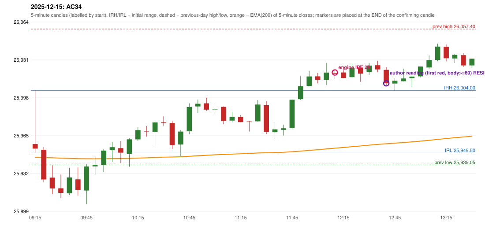

# 2025-12-15 - author's correction(s) against the engine

> Phase 5.1 date report. Evidence only; no rule was changed to produce a different outcome. Source image(s) are referenced under each correction.

## AC34 (PDF page 6, as written `20251215-1`, label `IRF`, ACTIVE)

### Author's observation

> First red candle should be considered.

Suggested: **IRF (same strategy, correct reference candle)**; timing: not stated; requirement stated: use the first red candle. Drawing (my reading): none. Uncertain: none. Image: `reports/phase5/phase51_author_corrections/pages/page_6_full.png (page 6 of docs/strategy_docs/corrected/Adobe Scan Nov 05, 2026.pdf)`.

### Original automated trade

20251215-1-IRF IRF Method 2B SHORT signal 12:15 entry 26019.55 -> T1_THEN_BUFFER_STOP

Stop 26054.55, T1 25992.55, T2 25959.55; exits 14:11 / 14:43. Engine explanation: IRF Method 2B SHORT: the 11:50-11:55 candle closed at 26,007.55, above IRH 26,004.00, and the next candle did not close back inside the range, so the setup is Method 2 and price stayed above it until the trigger. Extension candle 11:55-12:00, red candle 12:00-12:05. The trigger came 4 candles after the breakout candle: a red candle closed back below the first-push resistance after price had traded above it (12:10-12:15); confirmed at 12:15 with close 26,018.55. Entry reference close 26,018.55 is 14.55 points above IRH 26,004.00.

### Independent historical evidence

Session: open 25957.25, previous high/low/close 26057.4 / 25939.05 / 26046.95 (gap -89.7); first candle {'high': 26004.0, 'low': 25949.5, 'open': 25957.25, 'close': 25953.3}.

Signal-candle measurements: signal_candle_start=12:10, colour=R, body_pct=8.6, upper_wick_pct=31.9, lower_wick_pct=59.5, signal_close=26018.55, ema200=25953.69, entry_minus_ema=64.86, ema_below_entry=True, ema_within_27_below_entry=False, ema_between_entry_and_target1=False, close_below_ema=False, session_low_before_candle=25904.75, close_below_prior_session_low=False, candle_low_at_or_below_prior_session_low=False, points_above_prior_session_low=113.8, body_pct_below_60=True, body_pct_below_50=True

Readings of the author's 'first red candle' wording (my formalisations, side by side):

| reading | first red candle | support | resistance | entry (signal time, close, trigger, body %) |
|---|---|---|---|---|
| FULLY_ABOVE|body>=60 | 12:00 | 26010.15 | 26019.2 | 12:45, 26010.15, RESISTANCE_BREAK, 70.5 |
| FULLY_ABOVE|body>=0 | 12:00 | 26010.15 | 26019.2 | 12:15, 26018.55, RESISTANCE_BREAK, 8.6 |
| CLOSE_ABOVE|body>=60 | 12:00 | 26010.15 | 26019.2 | 12:45, 26010.15, RESISTANCE_BREAK, 70.5 |
| CLOSE_ABOVE|body>=0 | 12:00 | 26010.15 | 26019.2 | 12:15, 26018.55, RESISTANCE_BREAK, 8.6 |

ORB records: Method 2 ENGINE_SETUP_INVALIDATED: TREND:EMA_PREV_SESSION_CLOSE wrong side

Chronological signal timeline (engine):

| time | strategy | method | dir | event | reason |
|---|---|---|---|---|---|
| 12:15 | IRF | Method 2B | SHORT | EXECUTED | trade 1: T1_THEN_BUFFER_STOP |
| 12:40 | IRF | Method 2B | SHORT | IGNORED | POSITION_ACTIVE (signal kept for diagnostics only; never reused) |
| 13:30 | IRF | Method 2B | SHORT | IGNORED | POSITION_ACTIVE (signal kept for diagnostics only; never reused) |
| 14:10 | IRF | Method 2B | SHORT | IGNORED | POSITION_ACTIVE (signal kept for diagnostics only; never reused) |
| 15:30 | IRF | Method 2A | SHORT | IGNORED | DAY_FINISHED |
| 15:30 | IRF | Method 2B | SHORT | IGNORED | DAY_FINISHED |

Rejected / invalidated setups: 15:25 IRF Method 1/2: SESSION_ENDED_BEFORE_CONFIRMATION; 09:15 ORB Method 2: TREND:EMA_PREV_SESSION_CLOSE wrong side; 09:15 PDS Method 1/2/3: GAP_DOWN_OPEN_NOT_BELOW_ZONE; 09:55 RF RF: GAP_NOT_UP(DOWN)

### Conclusion

* **Classification:** MISSING_AUTHOR_RULE, ENTRY_TIMING_MISMATCH   **Category:** C
* **Is the author correct under the existing rules?** Cannot be decided: with the body condition the first-red-candle reading enters LATER (12:45); without it the same candle as the engine
* **Is the engine correct under the existing rules?** Yes under the existing proposals
* **Missing requirement / root cause:** S/R of the first red candle and the body condition
* **New rule required?** yes   **Implementable objectively now?** no (ambiguous)   **Owner approval needed?** YES

Candles 09:15-13:00 (start, O, H, L, C, colour, body %, upper wick %, lower wick %, EMA200, close - EMA):

| start | O | H | L | C | col | body% | uw% | lw% | EMA | c-EMA |
|---|---|---|---|---|---|---|---|---|---|---|
| 09:15 | 25957.25 | 26004.0 | 25949.5 | 25953.3 | R | 7.2 | 85.8 | 7.0 | 25945.75 | 7.55 |
| 09:20 | 25952.3 | 25954.75 | 25924.1 | 25926.45 | R | 84.3 | 8.0 | 7.7 | 25945.55 | -19.1 |
| 09:25 | 25928.05 | 25938.8 | 25913.8 | 25918.6 | R | 37.8 | 43.0 | 19.2 | 25945.29 | -26.69 |
| 09:30 | 25918.75 | 25930.75 | 25910.3 | 25914.75 | R | 19.6 | 58.7 | 21.8 | 25944.98 | -30.23 |
| 09:35 | 25914.45 | 25936.55 | 25912.9 | 25928.15 | G | 57.9 | 35.5 | 6.6 | 25944.81 | -16.66 |
| 09:40 | 25926.5 | 25936.9 | 25912.25 | 25917.15 | R | 37.9 | 42.2 | 19.9 | 25944.54 | -27.39 |
| 09:45 | 25916.8 | 25939.65 | 25904.75 | 25937.7 | G | 59.9 | 5.6 | 34.5 | 25944.47 | -6.77 |
| 09:50 | 25937.8 | 25946.55 | 25930.5 | 25939.15 | G | 8.4 | 46.1 | 45.5 | 25944.42 | -5.27 |
| 09:55 | 25939.1 | 25953.0 | 25932.85 | 25951.6 | G | 62.0 | 6.9 | 31.0 | 25944.49 | 7.11 |
| 10:00 | 25951.9 | 25959.05 | 25941.9 | 25954.55 | G | 15.5 | 26.2 | 58.3 | 25944.59 | 9.96 |
| 10:05 | 25953.7 | 25960.05 | 25940.75 | 25949.75 | R | 20.5 | 32.9 | 46.6 | 25944.64 | 5.11 |
| 10:10 | 25948.5 | 25962.2 | 25937.5 | 25961.35 | G | 52.0 | 3.4 | 44.5 | 25944.81 | 16.54 |
| 10:15 | 25961.35 | 25971.95 | 25959.95 | 25969.35 | G | 66.7 | 21.7 | 11.7 | 25945.05 | 24.3 |
| 10:20 | 25968.8 | 25972.9 | 25963.65 | 25968.2 | R | 6.5 | 44.3 | 49.2 | 25945.28 | 22.92 |
| 10:25 | 25967.75 | 25978.1 | 25954.55 | 25976.05 | G | 35.2 | 8.7 | 56.1 | 25945.59 | 30.46 |
| 10:30 | 25976.1 | 25981.3 | 25973.15 | 25975.35 | R | 9.2 | 63.8 | 27.0 | 25945.88 | 29.47 |
| 10:35 | 25975.5 | 25977.5 | 25953.05 | 25956.25 | R | 78.7 | 8.2 | 13.1 | 25945.99 | 10.26 |
| 10:40 | 25956.85 | 25969.35 | 25946.95 | 25968.15 | G | 50.4 | 5.4 | 44.2 | 25946.21 | 21.94 |
| 10:45 | 25968.4 | 25992.65 | 25965.95 | 25989.6 | G | 79.4 | 11.4 | 9.2 | 25946.64 | 42.96 |
| 10:50 | 25990.0 | 25996.0 | 25984.4 | 25992.35 | G | 20.3 | 31.5 | 48.3 | 25947.09 | 45.26 |
| 10:55 | 25992.7 | 25997.55 | 25986.15 | 25987.25 | R | 47.8 | 42.5 | 9.6 | 25947.49 | 39.76 |
| 11:00 | 25987.35 | 25993.6 | 25982.3 | 25987.85 | G | 4.4 | 50.9 | 44.7 | 25947.9 | 39.95 |
| 11:05 | 25989.65 | 25990.05 | 25974.55 | 25977.35 | R | 79.4 | 2.6 | 18.1 | 25948.19 | 29.16 |
| 11:10 | 25977.7 | 25985.3 | 25976.15 | 25980.95 | G | 35.5 | 47.5 | 16.9 | 25948.51 | 32.44 |
| 11:15 | 25980.85 | 25982.6 | 25976.2 | 25976.4 | R | 69.5 | 27.3 | 3.1 | 25948.79 | 27.61 |
| 11:20 | 25976.85 | 25977.35 | 25968.15 | 25976.45 | R | 4.3 | 5.4 | 90.2 | 25949.07 | 27.38 |
| 11:25 | 25977.05 | 25995.55 | 25976.75 | 25991.7 | G | 77.9 | 20.5 | 1.6 | 25949.49 | 42.21 |
| 11:30 | 25991.15 | 25994.6 | 25966.0 | 25967.8 | R | 81.6 | 12.1 | 6.3 | 25949.67 | 18.13 |
| 11:35 | 25967.6 | 25976.2 | 25961.55 | 25970.05 | G | 16.7 | 42.0 | 41.3 | 25949.88 | 20.17 |
| 11:40 | 25969.65 | 25974.05 | 25964.65 | 25971.0 | G | 14.4 | 32.4 | 53.2 | 25950.09 | 20.91 |
| 11:45 | 25971.2 | 25996.1 | 25969.85 | 25995.85 | G | 93.9 | 1.0 | 5.1 | 25950.54 | 45.31 |
| 11:50 | 25996.3 | 26016.5 | 25995.55 | 26007.55 | G | 53.7 | 42.7 | 3.6 | 25951.11 | 56.44 |
| 11:55 | 26007.8 | 26021.05 | 26007.45 | 26016.1 | G | 61.0 | 36.4 | 2.6 | 25951.76 | 64.34 |
| 12:00 | 26016.2 | 26019.2 | 26010.15 | 26013.05 | R | 34.8 | 33.1 | 32.0 | 25952.37 | 60.68 |
| 12:05 | 26013.1 | 26028.0 | 26008.55 | 26019.5 | G | 32.9 | 43.7 | 23.4 | 25953.03 | 66.47 |
| 12:10 | 26019.25 | 26021.85 | 26013.7 | 26018.55 | R | 8.6 | 31.9 | 59.5 | 25953.69 | 64.86 |
| 12:15 | 26019.55 | 26022.65 | 26014.55 | 26014.7 | R | 59.9 | 38.3 | 1.9 | 25954.29 | 60.41 |
| 12:20 | 26015.45 | 26027.3 | 26015.25 | 26023.4 | G | 66.0 | 32.4 | 1.7 | 25954.98 | 68.42 |
| 12:25 | 26023.7 | 26025.85 | 26011.45 | 26018.6 | R | 35.4 | 14.9 | 49.7 | 25955.61 | 62.99 |
| 12:30 | 26020.1 | 26027.65 | 26017.45 | 26025.6 | G | 53.9 | 20.1 | 26.0 | 25956.31 | 69.29 |
| 12:35 | 26025.85 | 26029.65 | 26019.95 | 26022.2 | R | 37.6 | 39.2 | 23.2 | 25956.97 | 65.23 |
| 12:40 | 26021.85 | 26024.3 | 26007.7 | 26010.15 | R | 70.5 | 14.8 | 14.8 | 25957.49 | 52.66 |
| 12:45 | 26009.95 | 26014.65 | 26003.45 | 26012.4 | G | 21.9 | 20.1 | 58.0 | 25958.04 | 54.36 |
| 12:50 | 26011.95 | 26022.85 | 26011.75 | 26014.35 | G | 21.6 | 76.6 | 1.8 | 25958.6 | 55.75 |
| 12:55 | 26014.65 | 26017.0 | 26006.7 | 26016.0 | G | 13.1 | 9.7 | 77.2 | 25959.17 | 56.83 |
| 13:00 | 26016.2 | 26024.8 | 26015.35 | 26024.8 | G | 91.0 | 0.0 | 9.0 | 25959.83 | 64.97 |
