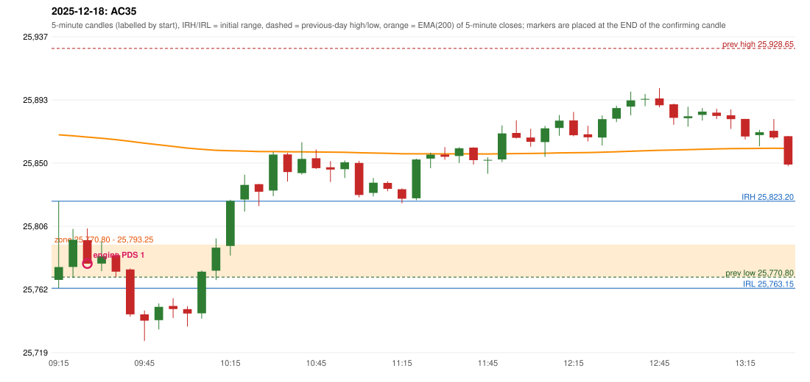

# 2025-12-18 - author's correction(s) against the engine

> Phase 5.1 date report. Evidence only; no rule was changed to produce a different outcome. Source image(s) are referenced under each correction.

## AC35 (PDF page 6, as written `20251218-1`, label `PDS (reads 'PPS')`, ACTIVE)

### Author's observation

> Should take resistance in the zone, breakout of zone Ep trap is not conside[red]

Suggested: **PDS (as labelled)**; timing: not stated; requirement stated: take the resistance inside the zone; a zone breakout 'i.e. trap' is not considered. Drawing (my reading): none. Uncertain: the label could be 'PDS' or 'PPS'; the content ('resistance in the zone', 'breakout of zone') is worded like PDR; the last word is cut by the page edge. Image: `reports/phase5/phase51_author_corrections/pages/page_6_full.png (page 6 of docs/strategy_docs/corrected/Adobe Scan Nov 05, 2026.pdf)`.

### Original automated trade

20251218-1-PDS PDS Method 1 SHORT signal 09:30 entry 25780.15 -> T1_THEN_BUFFER_STOP

Stop 25815.15, T1 25753.15, T2 25710.15; exits 09:42 / 10:12. Engine explanation: PDS Method 1 SHORT: the session opened 1.90 points below the previous-day-low zone [25,770.80, 25,793.25]; price rose to the zone at 09:15 and the first red candle at the zone (09:25, close 25,780.05) had a good body; confirmed 09:30.

### Independent historical evidence

Session: open 25768.9, previous high/low/close 25928.65 / 25770.8 / 25818.55 (gap -49.65); first candle {'high': 25823.2, 'low': 25763.15, 'open': 25768.9, 'close': 25777.75}.

ORB records: Method 2 ENGINE_SETUP_INVALIDATED: TRENDLINE_NOT_SUPPORTIVE

Chronological signal timeline (engine):

| time | strategy | method | dir | event | reason |
|---|---|---|---|---|---|
| 09:30 | PDS | Method 1 | SHORT | EXECUTED | trade 1: T1_THEN_BUFFER_STOP |
| 11:05 | IRF | Method 2A | SHORT | IGNORED | DAY_FINISHED |
| 11:05 | IRF | Method 2B | SHORT | IGNORED | DAY_FINISHED |
| 13:20 | IRF | Method 2A | SHORT | IGNORED | DAY_FINISHED |
| 14:10 | IRF | Method 1 | SHORT | IGNORED | DAY_FINISHED |
| 15:10 | IRF | Method 1 | SHORT | IGNORED | DAY_FINISHED |

Rejected / invalidated setups: 15:25 IRF Method 3: WICK_SHARE_OUT_OF_BAND; 13:15 IRF Method 1/2: SESSION_ENDED_BEFORE_CONFIRMATION; 09:15 ORB Method 2: TRENDLINE_NOT_SUPPORTIVE; 09:30 PDS Method 1/2/3: NO_QUALIFYING_ENTRY_BEFORE_SESSION_END; 10:05 RF RF: TREND:EMA_PREV_SESSION_CLOSE wrong side

Applicable source rules:

* `PDS-002` (VERIFIED_QUALITATIVE): Zone: a rectangle covering the relevant candle body and the lower wick (never a single line), extended forward.
* `PDS-005` (VERIFIED_QUALITATIVE): Valid interaction: wick touches / body touches / enters the rectangle / comes very close.

### Conclusion

* **Classification:** AUTHOR_DISCRETION_UNRESOLVED, SUPPORT_RESISTANCE_MISMATCH   **Category:** C
* **Is the author correct under the existing rules?** Cannot be decided: the remark is not mechanical ('take resistance in the zone; zone breakout i.e. trap is not considered') and its label is uncertain (PDS / PPS)
* **Is the engine correct under the existing rules?** Yes under the encoded rules
* **Missing requirement / root cause:** a definition of 'trap' and of taking resistance inside the zone
* **New rule required?** unknown   **Implementable objectively now?** no   **Owner approval needed?** YES

Candles 09:15-13:00 (start, O, H, L, C, colour, body %, upper wick %, lower wick %, EMA200, close - EMA):

| start | O | H | L | C | col | body% | uw% | lw% | EMA | c-EMA |
|---|---|---|---|---|---|---|---|---|---|---|
| 09:15 | 25768.9 | 25823.2 | 25763.15 | 25777.75 | G | 14.7 | 75.7 | 9.6 | 25869.04 | -91.29 |
| 09:20 | 25777.8 | 25804.05 | 25770.2 | 25796.55 | G | 55.4 | 22.2 | 22.5 | 25868.32 | -71.77 |
| 09:25 | 25796.3 | 25804.35 | 25780.05 | 25780.05 | R | 66.9 | 33.1 | 0.0 | 25867.44 | -87.39 |
| 09:30 | 25780.15 | 25795.45 | 25774.9 | 25785.3 | G | 25.1 | 49.4 | 25.5 | 25866.62 | -81.32 |
| 09:35 | 25785.85 | 25787.6 | 25770.8 | 25774.55 | R | 67.3 | 10.4 | 22.3 | 25865.7 | -91.15 |
| 09:40 | 25776.1 | 25776.85 | 25743.45 | 25745.1 | R | 92.8 | 2.2 | 4.9 | 25864.5 | -119.4 |
| 09:45 | 25745.1 | 25747.75 | 25726.75 | 25740.75 | R | 20.7 | 12.6 | 66.7 | 25863.27 | -122.52 |
| 09:50 | 25741.05 | 25752.6 | 25734.65 | 25750.25 | G | 51.3 | 13.1 | 35.7 | 25862.15 | -111.9 |
| 09:55 | 25750.9 | 25756.25 | 25742.55 | 25748.75 | R | 15.7 | 39.1 | 45.3 | 25861.02 | -112.27 |
| 10:00 | 25748.7 | 25750.7 | 25736.7 | 25745.65 | R | 21.8 | 14.3 | 63.9 | 25859.87 | -114.22 |
| 10:05 | 25745.8 | 25775.35 | 25742.1 | 25774.55 | G | 86.5 | 2.4 | 11.1 | 25859.02 | -84.47 |
| 10:10 | 25775.25 | 25797.5 | 25768.75 | 25791.15 | G | 55.3 | 22.1 | 22.6 | 25858.35 | -67.2 |
| 10:15 | 25792.3 | 25824.2 | 25785.65 | 25823.4 | G | 80.7 | 2.1 | 17.3 | 25858.0 | -34.6 |
| 10:20 | 25824.35 | 25841.5 | 25816.05 | 25834.45 | G | 39.7 | 27.7 | 32.6 | 25857.77 | -23.32 |
| 10:25 | 25834.95 | 25835.1 | 25819.85 | 25829.75 | R | 34.1 | 1.0 | 64.9 | 25857.49 | -27.74 |
| 10:30 | 25830.55 | 25857.15 | 25826.7 | 25855.4 | G | 81.6 | 5.7 | 12.6 | 25857.47 | -2.07 |
| 10:35 | 25855.5 | 25856.5 | 25836.75 | 25843.35 | R | 61.5 | 5.1 | 33.4 | 25857.33 | -13.98 |
| 10:40 | 25842.6 | 25863.9 | 25841.6 | 25852.4 | G | 43.9 | 51.6 | 4.5 | 25857.28 | -4.88 |
| 10:45 | 25852.85 | 25858.85 | 25845.4 | 25846.0 | R | 50.9 | 44.6 | 4.5 | 25857.16 | -11.16 |
| 10:50 | 25846.6 | 25850.95 | 25836.45 | 25845.05 | R | 10.7 | 30.0 | 59.3 | 25857.04 | -11.99 |
| 10:55 | 25845.3 | 25851.35 | 25839.2 | 25850.05 | G | 39.1 | 10.7 | 50.2 | 25856.97 | -6.92 |
| 11:00 | 25849.6 | 25851.1 | 25825.8 | 25827.5 | R | 87.4 | 5.9 | 6.7 | 25856.68 | -29.18 |
| 11:05 | 25828.9 | 25839.2 | 25826.55 | 25835.95 | G | 55.7 | 25.7 | 18.6 | 25856.47 | -20.52 |
| 11:10 | 25835.8 | 25837.0 | 25830.1 | 25831.7 | R | 59.4 | 17.4 | 23.2 | 25856.23 | -24.53 |
| 11:15 | 25831.45 | 25832.05 | 25821.7 | 25824.9 | R | 63.3 | 5.8 | 30.9 | 25855.92 | -31.02 |
| 11:20 | 25825.2 | 25852.55 | 25823.9 | 25852.0 | G | 93.5 | 1.9 | 4.5 | 25855.88 | -3.88 |
| 11:25 | 25852.6 | 25856.7 | 25845.95 | 25855.35 | G | 25.6 | 12.6 | 61.9 | 25855.87 | -0.52 |
| 11:30 | 25855.4 | 25860.5 | 25851.8 | 25853.9 | R | 17.2 | 58.6 | 24.1 | 25855.85 | -1.95 |
| 11:35 | 25854.35 | 25860.45 | 25849.55 | 25859.75 | G | 49.5 | 6.4 | 44.0 | 25855.89 | 3.86 |
| 11:40 | 25860.2 | 25860.35 | 25848.5 | 25851.55 | R | 73.0 | 1.3 | 25.7 | 25855.85 | -4.3 |
| 11:45 | 25851.7 | 25853.5 | 25842.15 | 25851.75 | G | 0.4 | 15.4 | 84.1 | 25855.81 | -4.06 |
| 11:50 | 25852.05 | 25875.5 | 25850.15 | 25870.0 | G | 70.8 | 21.7 | 7.5 | 25855.95 | 14.05 |
| 11:55 | 25870.3 | 25879.0 | 25866.5 | 25866.95 | R | 26.8 | 69.6 | 3.6 | 25856.06 | 10.89 |
| 12:00 | 25867.15 | 25873.2 | 25860.8 | 25864.2 | R | 23.8 | 48.8 | 27.4 | 25856.14 | 8.06 |
| 12:05 | 25864.0 | 25875.15 | 25853.8 | 25873.5 | G | 44.5 | 7.7 | 47.8 | 25856.31 | 17.19 |
| 12:10 | 25873.75 | 25882.65 | 25868.35 | 25878.8 | G | 35.3 | 26.9 | 37.8 | 25856.54 | 22.26 |
| 12:15 | 25878.95 | 25884.8 | 25868.0 | 25868.7 | R | 61.0 | 34.8 | 4.2 | 25856.66 | 12.04 |
| 12:20 | 25869.4 | 25875.25 | 25864.45 | 25867.3 | R | 19.4 | 54.2 | 26.4 | 25856.76 | 10.54 |
| 12:25 | 25867.15 | 25882.35 | 25861.65 | 25879.85 | G | 61.4 | 12.1 | 26.6 | 25856.99 | 22.86 |
| 12:30 | 25880.15 | 25889.1 | 25877.8 | 25887.5 | G | 65.0 | 14.2 | 20.8 | 25857.3 | 30.2 |
| 12:35 | 25888.5 | 25898.9 | 25882.45 | 25892.8 | G | 26.1 | 37.1 | 36.8 | 25857.65 | 35.15 |
| 12:40 | 25893.35 | 25897.2 | 25888.75 | 25893.85 | G | 5.9 | 39.6 | 54.4 | 25858.01 | 35.84 |
| 12:45 | 25894.15 | 25901.3 | 25888.05 | 25889.45 | R | 35.5 | 54.0 | 10.6 | 25858.32 | 31.13 |
| 12:50 | 25890.05 | 25890.6 | 25875.9 | 25880.7 | R | 63.6 | 3.7 | 32.7 | 25858.54 | 22.16 |
| 12:55 | 25880.5 | 25888.35 | 25874.55 | 25881.8 | G | 9.4 | 47.5 | 43.1 | 25858.78 | 23.02 |
| 13:00 | 25882.75 | 25887.5 | 25878.9 | 25885.05 | G | 26.7 | 28.5 | 44.8 | 25859.04 | 26.01 |
