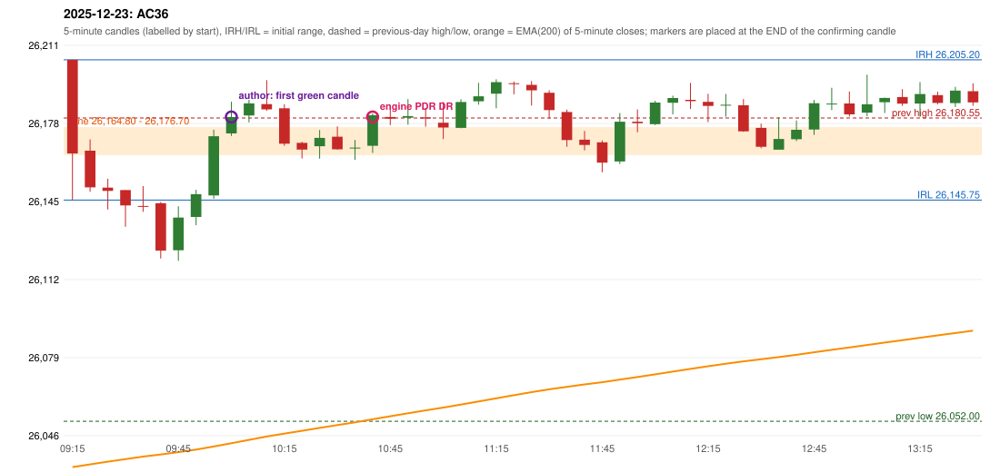

# 2025-12-23 - author's correction(s) against the engine

> Phase 5.1 date report. Evidence only; no rule was changed to produce a different outcome. Source image(s) are referenced under each correction.

## AC36 (PDF page 6, as written `20251223-1`, label `PDR`, ACTIVE)

### Author's observation

> RF should be activated instead of PDR. | PDR is also wrong.

Suggested: **RF**; timing: not stated; requirement stated: RF instead of PDR; the PDR itself is also wrong. Drawing (my reading): none. Uncertain: none. Image: `reports/phase5/phase51_author_corrections/pages/page_6_full.png (page 6 of docs/strategy_docs/corrected/Adobe Scan Nov 05, 2026.pdf)`.

### Original automated trade

20251223-1-PDR PDR PDR LONG signal 10:45 entry 26180.95 -> T1_THEN_BUFFER_STOP

Stop 26145.95, T1 26207.95, T2 26250.95; exits 14:15 / 14:44. Engine explanation: PDR LONG (body-based engine, A_HIGHEST_BODY_HIGH): the session opened 32.80 points above the previous close and 28.50 points above the previous-day highest BODY high 26,176.70 (zone [26,164.80, 26,176.70] from the 15:00 candle of 2025-12-22; the highest wick 26,180.55 is ignored). The 09:15 candle (26,145.75 - 26,205.20) tested the zone; the 10:40 candle (green, O 26,168.80 H 26,182.45 L 26,165.75 C 26,181.75) passed GOOD_GREEN_BODY and closed 5.05 points above the zone ceiling, confirming the entry at 10:45. The pattern thresholds and the zone's lower boundary are provisional research assumptions, not approved by the strategy author.

### Independent historical evidence

Session: open 26205.2, previous high/low/close 26180.55 / 26052.0 / 26172.4 (gap 32.8); first candle {'high': 26205.2, 'low': 26145.75, 'open': 26205.2, 'close': 26165.5}.

First green candle after the zone interaction ('enter in 1st green candle'): {"interaction_candle": "09:15", "first_green_close_above_ceiling": {"candle_start": "10:00", "signal_time": "10:05", "colour": "G", "body_pct": 47.9, "upper_wick_pct": 44.8, "lower_wick_pct": 7.2, "close": 26180.95, "points_above_ceiling": 4.25, "low_below_zone_floor": false}}

Chronological signal timeline (engine):

| time | strategy | method | dir | event | reason |
|---|---|---|---|---|---|
| 10:45 | PDR | PDR | LONG | EXECUTED | trade 1: T1_THEN_BUFFER_STOP |
| 11:10 | PDR | PDR | LONG | IGNORED | POSITION_ACTIVE (signal kept for diagnostics only; never reused) |
| 11:55 | PDR | PDR | LONG | IGNORED | POSITION_ACTIVE (signal kept for diagnostics only; never reused) |
| 12:05 | PDR | PDR | LONG | IGNORED | POSITION_ACTIVE (signal kept for diagnostics only; never reused) |
| 12:50 | PDR | PDR | LONG | IGNORED | POSITION_ACTIVE (signal kept for diagnostics only; never reused) |
| 14:35 | IRF | Method 1 | SHORT | IGNORED | POSITION_ACTIVE (signal kept for diagnostics only; never reused) |
| 14:45 | IRF | Method 1 | SHORT | IGNORED | DAY_FINISHED |
| 15:15 | PDR | PDR | LONG | IGNORED | DAY_FINISHED |

Rejected / invalidated setups: 15:00 IRF Method 3: WICK_SHARE_OUT_OF_BAND; 14:15 IRF Method 1/2: SESSION_ENDED_BEFORE_CONFIRMATION; 15:15 PDR PDR: NO_QUALIFYING_CONFIRMATION_BEFORE_SESSION_END; 09:50 RF RF: GAP_UP_OUTSIDE_YESTERDAYS_RANGE

Applicable source rules:

* `RF-004` (VERIFIED_EXPLICIT): The gap-up open must stay within yesterday's trading range; an open above yesterday's high is rejected.

### Conclusion

* **Classification:** JOURNAL_INCONSISTENCY, AUTHOR_DISCRETION_UNRESOLVED   **Category:** C
* **Is the author correct under the existing rules?** No for RF: RF-004 rejects the open above yesterday's high; for PDR: five-minute candles had closed below the zone floor (09:20-09:50) before the 10:45 confirmation - the failed-zone policy is an open owner decision, preserved unchanged
* **Is the engine correct under the existing rules?** Yes under the existing rules and the preserved failed-zone policy
* **Missing requirement / root cause:** RF-004 versus the author's reading; the PDR failed-zone policy
* **New rule required?** yes (policy)   **Implementable objectively now?** no   **Owner approval needed?** YES

Candles 09:15-13:00 (start, O, H, L, C, colour, body %, upper wick %, lower wick %, EMA200, close - EMA):

| start | O | H | L | C | col | body% | uw% | lw% | EMA | c-EMA |
|---|---|---|---|---|---|---|---|---|---|---|
| 09:15 | 26205.2 | 26205.2 | 26145.75 | 26165.5 | R | 66.8 | 0.0 | 33.2 | 26032.54 | 132.96 |
| 09:20 | 26166.7 | 26171.45 | 26149.25 | 26151.15 | R | 70.0 | 21.4 | 8.6 | 26033.72 | 117.43 |
| 09:25 | 26151.05 | 26154.8 | 26141.75 | 26149.65 | R | 10.7 | 28.7 | 60.5 | 26034.87 | 114.78 |
| 09:30 | 26150.0 | 26150.0 | 26134.45 | 26143.5 | R | 41.8 | 0.0 | 58.2 | 26035.95 | 107.55 |
| 09:35 | 26143.25 | 26151.7 | 26140.8 | 26143.1 | R | 1.4 | 77.5 | 21.1 | 26037.02 | 106.08 |
| 09:40 | 26144.4 | 26144.95 | 26121.0 | 26124.3 | R | 83.9 | 2.3 | 13.8 | 26037.89 | 86.41 |
| 09:45 | 26124.5 | 26143.15 | 26120.0 | 26138.35 | G | 59.8 | 20.7 | 19.4 | 26038.89 | 99.46 |
| 09:50 | 26138.6 | 26150.1 | 26135.1 | 26148.25 | G | 64.3 | 12.3 | 23.3 | 26039.97 | 108.28 |
| 09:55 | 26147.7 | 26175.6 | 26146.3 | 26172.8 | G | 85.7 | 9.6 | 4.8 | 26041.3 | 131.5 |
| 10:00 | 26174.0 | 26187.45 | 26172.95 | 26180.95 | G | 47.9 | 44.8 | 7.2 | 26042.69 | 138.26 |
| 10:05 | 26181.65 | 26188.25 | 26178.7 | 26186.75 | G | 53.4 | 15.7 | 30.9 | 26044.12 | 142.63 |
| 10:10 | 26186.45 | 26196.6 | 26183.55 | 26184.2 | R | 17.2 | 77.8 | 5.0 | 26045.51 | 138.69 |
| 10:15 | 26184.65 | 26186.4 | 26168.75 | 26169.65 | R | 85.0 | 9.9 | 5.1 | 26046.75 | 122.9 |
| 10:20 | 26170.0 | 26170.5 | 26163.4 | 26167.15 | R | 40.1 | 7.0 | 52.8 | 26047.95 | 119.2 |
| 10:25 | 26168.55 | 26175.45 | 26163.3 | 26172.1 | G | 29.2 | 27.6 | 43.2 | 26049.18 | 122.92 |
| 10:30 | 26172.6 | 26176.95 | 26167.15 | 26167.25 | R | 54.6 | 44.4 | 1.0 | 26050.36 | 116.89 |
| 10:35 | 26167.75 | 26171.25 | 26162.8 | 26168.0 | G | 3.0 | 38.5 | 58.6 | 26051.53 | 116.47 |
| 10:40 | 26168.8 | 26182.45 | 26165.75 | 26181.75 | G | 77.5 | 4.2 | 18.3 | 26052.82 | 128.93 |
| 10:45 | 26180.95 | 26185.65 | 26177.55 | 26180.2 | R | 9.3 | 58.0 | 32.7 | 26054.09 | 126.11 |
| 10:50 | 26180.65 | 26188.55 | 26177.7 | 26181.35 | G | 6.5 | 66.4 | 27.2 | 26055.36 | 125.99 |
| 10:55 | 26180.8 | 26184.8 | 26176.85 | 26180.3 | R | 6.3 | 50.3 | 43.4 | 26056.6 | 123.7 |
| 11:00 | 26178.55 | 26187.3 | 26171.6 | 26176.5 | R | 13.1 | 55.7 | 31.2 | 26057.79 | 118.71 |
| 11:05 | 26176.35 | 26188.5 | 26176.2 | 26187.3 | G | 89.0 | 9.8 | 1.2 | 26059.08 | 128.22 |
| 11:10 | 26187.65 | 26195.45 | 26186.2 | 26189.75 | G | 22.7 | 61.6 | 15.7 | 26060.38 | 129.37 |
| 11:15 | 26190.85 | 26196.95 | 26184.65 | 26195.75 | G | 39.8 | 9.8 | 50.4 | 26061.73 | 134.02 |
| 11:20 | 26195.3 | 26196.0 | 26190.6 | 26195.0 | R | 5.6 | 13.0 | 81.5 | 26063.05 | 131.95 |
| 11:25 | 26194.6 | 26196.25 | 26185.8 | 26192.3 | R | 22.0 | 15.8 | 62.2 | 26064.34 | 127.96 |
| 11:30 | 26191.25 | 26192.3 | 26180.2 | 26183.9 | R | 60.7 | 8.7 | 30.6 | 26065.53 | 118.37 |
| 11:35 | 26183.1 | 26184.1 | 26168.35 | 26171.2 | R | 75.6 | 6.3 | 18.1 | 26066.58 | 104.62 |
| 11:40 | 26171.35 | 26175.05 | 26166.8 | 26169.1 | R | 27.3 | 44.8 | 27.9 | 26067.6 | 101.5 |
| 11:45 | 26170.25 | 26171.05 | 26157.55 | 26161.65 | R | 63.7 | 5.9 | 30.4 | 26068.54 | 93.11 |
| 11:50 | 26162.1 | 26182.65 | 26161.05 | 26178.95 | G | 78.0 | 17.1 | 4.9 | 26069.64 | 109.31 |
| 11:55 | 26178.95 | 26184.15 | 26174.5 | 26178.35 | R | 6.2 | 53.9 | 39.9 | 26070.72 | 107.63 |
| 12:00 | 26177.95 | 26187.85 | 26177.55 | 26187.1 | G | 88.8 | 7.3 | 3.9 | 26071.88 | 115.22 |
| 12:05 | 26187.0 | 26190.0 | 26182.1 | 26189.0 | G | 25.3 | 12.7 | 62.0 | 26073.04 | 115.96 |
| 12:10 | 26188.25 | 26195.45 | 26184.35 | 26187.7 | R | 5.0 | 64.9 | 30.2 | 26074.18 | 113.52 |
| 12:15 | 26187.4 | 26190.8 | 26178.8 | 26185.65 | R | 14.6 | 28.3 | 57.1 | 26075.29 | 110.36 |
| 12:20 | 26186.05 | 26190.75 | 26181.1 | 26186.15 | G | 1.0 | 47.7 | 51.3 | 26076.39 | 109.76 |
| 12:25 | 26185.95 | 26188.6 | 26174.7 | 26174.9 | R | 79.5 | 19.1 | 1.4 | 26077.37 | 97.53 |
| 12:30 | 26176.35 | 26178.15 | 26167.75 | 26168.35 | R | 76.9 | 17.3 | 5.8 | 26078.28 | 90.07 |
| 12:35 | 26167.1 | 26180.85 | 26167.1 | 26171.65 | G | 33.1 | 66.9 | 0.0 | 26079.21 | 92.44 |
| 12:40 | 26171.55 | 26179.5 | 26170.75 | 26175.55 | G | 45.7 | 45.1 | 9.1 | 26080.17 | 95.38 |
| 12:45 | 26175.65 | 26188.15 | 26173.4 | 26186.8 | G | 75.6 | 9.2 | 15.3 | 26081.23 | 105.57 |
| 12:50 | 26186.55 | 26193.35 | 26183.9 | 26186.65 | G | 1.1 | 70.9 | 28.0 | 26082.28 | 104.37 |
| 12:55 | 26186.7 | 26191.8 | 26181.15 | 26182.1 | R | 43.2 | 47.9 | 8.9 | 26083.27 | 98.83 |
| 13:00 | 26182.8 | 26198.95 | 26181.25 | 26186.35 | G | 20.1 | 71.2 | 8.8 | 26084.3 | 102.05 |
