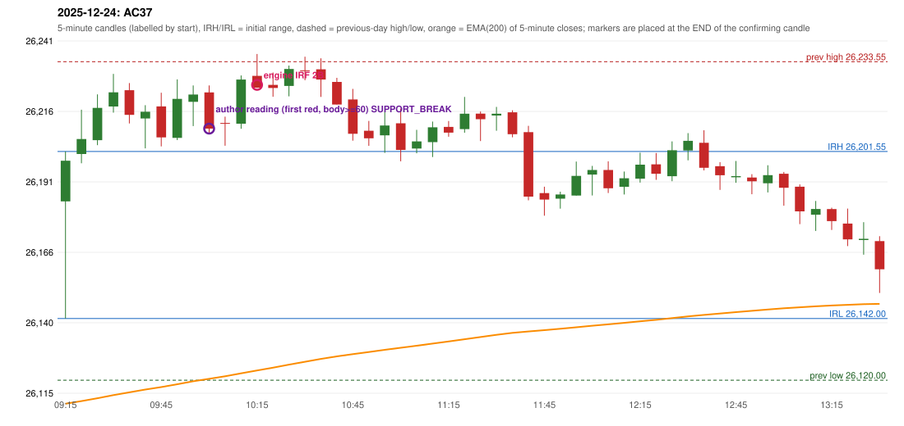

# 2025-12-24 - author's correction(s) against the engine

> Phase 5.1 date report. Evidence only; no rule was changed to produce a different outcome. Source image(s) are referenced under each correction.

## AC37 (PDF page 6, as written `20251224-1`, label `IRF`, ACTIVE)

### Author's observation

> ORB should be activated instead of IRF

Suggested: **ORB**; timing: not stated; requirement stated: ORB should have activated. Drawing (my reading): none. Uncertain: none. Image: `reports/phase5/phase51_author_corrections/pages/page_6_full.png (page 6 of docs/strategy_docs/corrected/Adobe Scan Nov 05, 2026.pdf)`.

### Original automated trade

20251224-1-IRF IRF Method 2B SHORT signal 10:20 entry 26225.3 -> TARGET

Stop 26260.3, T1 26198.3, T2 26165.3; exits 11:03 / 13:25. Engine explanation: IRF Method 2B SHORT: the 09:20-09:25 candle closed at 26,206.00, above IRH 26,201.55, and the next candle did not close back inside the range, so the setup is Method 2 and price stayed above it until the trigger. Extension candle 09:25-09:30, red candle 09:35-09:40. The trigger came 11 candles after the breakout candle: a red candle closed back below the first-push resistance after price had traded above it (10:15-10:20); confirmed at 10:20 with close 26,224.25. Entry reference close 26,224.25 is 22.70 points above IRH 26,201.55.

### Independent historical evidence

Session: open 26183.75, previous high/low/close 26233.55 / 26120.0 / 26177.15 (gap 6.6); first candle {'high': 26201.55, 'low': 26142.0, 'open': 26183.75, 'close': 26198.25}.

Signal-candle measurements: signal_candle_start=10:15, colour=R, body_pct=35.3, upper_wick_pct=64.7, lower_wick_pct=0.0, signal_close=26224.25, ema200=26123.47, entry_minus_ema=100.78, ema_below_entry=True, ema_within_27_below_entry=False, ema_between_entry_and_target1=False, close_below_ema=False, session_low_before_candle=26142.0, close_below_prior_session_low=False, candle_low_at_or_below_prior_session_low=False, points_above_prior_session_low=82.25, body_pct_below_60=True, body_pct_below_50=True

Readings of the author's 'first red candle' wording (my formalisations, side by side):

| reading | first red candle | support | resistance | entry (signal time, close, trigger, body %) |
|---|---|---|---|---|
| FULLY_ABOVE|body>=60 | 09:35 | 26211.55 | 26225.95 | 10:05, 26209.7, SUPPORT_BREAK, 76.3 |
| FULLY_ABOVE|body>=0 | 09:35 | 26211.55 | 26225.95 | 09:50, 26206.55, SUPPORT_BREAK, 57.7 |
| CLOSE_ABOVE|body>=60 | 09:35 | 26211.55 | 26225.95 | 10:05, 26209.7, SUPPORT_BREAK, 76.3 |
| CLOSE_ABOVE|body>=0 | 09:35 | 26211.55 | 26225.95 | 09:50, 26206.55, SUPPORT_BREAK, 57.7 |

Chronological signal timeline (engine):

| time | strategy | method | dir | event | reason |
|---|---|---|---|---|---|
| 10:20 | IRF | Method 2B | SHORT | EXECUTED | trade 1: TARGET |
| 11:45 | IRF | Method 1 | SHORT | IGNORED | POSITION_ACTIVE (signal kept for diagnostics only; never reused) |
| 12:40 | IRF | Method 1 | SHORT | IGNORED | POSITION_ACTIVE (signal kept for diagnostics only; never reused) |
| 15:00 | RF | RF | LONG | IGNORED | DAY_FINISHED |

Rejected / invalidated setups: 10:15 IRF Method 1/2: SESSION_ENDED_BEFORE_CONFIRMATION; 09:15 PDR PDR: OPEN_NOT_STRICTLY_ABOVE_ZONE

Applicable source rules:

* `ORB-M2-LONG-001` (UNRESOLVED): Inner resistance inside the previous day's range is marked; a rising trendline through swing lows supports the trend.

### Conclusion

* **Classification:** AUTHOR_DISCRETION_UNRESOLVED   **Category:** C
* **Is the author correct under the existing rules?** Cannot be decided: no ORB record exists (the first candle broke no previous-day level)
* **Is the engine correct under the existing rules?** Not decidable: Method 2's inner level / trendline is not source-defined
* **Missing requirement / root cause:** the level or condition the author used
* **New rule required?** unknown   **Implementable objectively now?** no   **Owner approval needed?** YES

Candles 09:15-13:00 (start, O, H, L, C, colour, body %, upper wick %, lower wick %, EMA200, close - EMA):

| start | O | H | L | C | col | body% | uw% | lw% | EMA | c-EMA |
|---|---|---|---|---|---|---|---|---|---|---|
| 09:15 | 26183.75 | 26201.55 | 26142.0 | 26198.25 | G | 24.3 | 5.5 | 70.1 | 26111.6 | 86.65 |
| 09:20 | 26200.65 | 26216.45 | 26197.35 | 26206.0 | G | 28.0 | 54.7 | 17.3 | 26112.54 | 93.46 |
| 09:25 | 26205.6 | 26221.9 | 26203.8 | 26217.1 | G | 63.5 | 26.5 | 9.9 | 26113.58 | 103.52 |
| 09:30 | 26217.6 | 26229.2 | 26215.4 | 26222.65 | G | 36.6 | 47.5 | 15.9 | 26114.67 | 107.98 |
| 09:35 | 26223.4 | 26225.95 | 26211.55 | 26214.6 | R | 61.1 | 17.7 | 21.2 | 26115.66 | 98.94 |
| 09:40 | 26213.3 | 26218.05 | 26202.65 | 26215.7 | G | 15.6 | 15.3 | 69.2 | 26116.66 | 99.04 |
| 09:45 | 26217.6 | 26222.5 | 26203.35 | 26206.55 | R | 57.7 | 25.6 | 16.7 | 26117.55 | 89.0 |
| 09:50 | 26206.4 | 26227.25 | 26205.6 | 26220.3 | G | 64.2 | 32.1 | 3.7 | 26118.57 | 101.73 |
| 09:55 | 26219.25 | 26225.1 | 26210.6 | 26221.85 | G | 17.9 | 22.4 | 59.7 | 26119.6 | 102.25 |
| 10:00 | 26222.6 | 26225.1 | 26208.2 | 26209.7 | R | 76.3 | 14.8 | 8.9 | 26120.5 | 89.2 |
| 10:05 | 26211.7 | 26213.95 | 26203.6 | 26211.55 | R | 1.4 | 21.7 | 76.8 | 26121.4 | 90.15 |
| 10:10 | 26211.45 | 26228.65 | 26209.65 | 26227.2 | G | 82.9 | 7.6 | 9.5 | 26122.46 | 104.74 |
| 10:15 | 26228.5 | 26236.3 | 26224.25 | 26224.25 | R | 35.3 | 64.7 | 0.0 | 26123.47 | 100.78 |
| 10:20 | 26225.3 | 26229.7 | 26221.05 | 26224.2 | R | 12.7 | 50.9 | 36.4 | 26124.47 | 99.73 |
| 10:25 | 26224.9 | 26232.2 | 26221.2 | 26230.95 | G | 55.0 | 11.4 | 33.6 | 26125.53 | 105.42 |
| 10:30 | 26230.5 | 26235.35 | 26226.95 | 26230.45 | R | 0.6 | 57.7 | 41.7 | 26126.57 | 103.88 |
| 10:35 | 26230.85 | 26234.75 | 26221.0 | 26227.2 | R | 26.5 | 28.4 | 45.1 | 26127.58 | 99.62 |
| 10:40 | 26226.35 | 26227.8 | 26218.3 | 26218.3 | R | 84.7 | 15.3 | 0.0 | 26128.48 | 89.82 |
| 10:45 | 26220.1 | 26223.85 | 26205.4 | 26207.85 | R | 66.4 | 20.3 | 13.3 | 26129.27 | 78.58 |
| 10:50 | 26208.95 | 26212.45 | 26203.55 | 26206.25 | R | 30.3 | 39.3 | 30.3 | 26130.03 | 76.22 |
| 10:55 | 26207.3 | 26215.6 | 26201.05 | 26210.8 | G | 24.1 | 33.0 | 43.0 | 26130.84 | 79.96 |
| 11:00 | 26211.6 | 26216.85 | 26198.05 | 26202.1 | R | 50.5 | 27.9 | 21.5 | 26131.55 | 70.55 |
| 11:05 | 26202.6 | 26209.25 | 26200.9 | 26205.15 | G | 30.5 | 49.1 | 20.4 | 26132.28 | 72.87 |
| 11:10 | 26204.85 | 26212.2 | 26199.55 | 26210.15 | G | 41.9 | 16.2 | 41.9 | 26133.05 | 77.1 |
| 11:15 | 26210.3 | 26212.4 | 26206.8 | 26208.25 | R | 36.6 | 37.5 | 25.9 | 26133.8 | 74.45 |
| 11:20 | 26209.5 | 26221.0 | 26208.25 | 26215.0 | G | 43.1 | 47.1 | 9.8 | 26134.61 | 80.39 |
| 11:25 | 26215.05 | 26215.8 | 26205.25 | 26213.05 | R | 19.0 | 7.1 | 73.9 | 26135.39 | 77.66 |
| 11:30 | 26214.35 | 26217.45 | 26208.95 | 26215.0 | G | 7.6 | 28.8 | 63.5 | 26136.18 | 78.82 |
| 11:35 | 26215.5 | 26216.25 | 26206.6 | 26207.7 | R | 80.8 | 7.8 | 11.4 | 26136.89 | 70.81 |
| 11:40 | 26208.45 | 26210.7 | 26184.15 | 26185.45 | R | 86.6 | 8.5 | 4.9 | 26137.38 | 48.07 |
| 11:45 | 26186.7 | 26189.0 | 26178.65 | 26184.4 | R | 22.2 | 22.2 | 55.6 | 26137.85 | 46.55 |
| 11:50 | 26184.7 | 26187.2 | 26181.15 | 26186.2 | G | 24.8 | 16.5 | 58.7 | 26138.33 | 47.87 |
| 11:55 | 26185.85 | 26197.95 | 26185.8 | 26192.85 | G | 57.6 | 42.0 | 0.4 | 26138.87 | 53.98 |
| 12:00 | 26193.3 | 26196.4 | 26185.85 | 26194.95 | G | 15.6 | 13.7 | 70.6 | 26139.43 | 55.52 |
| 12:05 | 26194.95 | 26198.05 | 26186.75 | 26188.45 | R | 57.5 | 27.4 | 15.0 | 26139.91 | 48.54 |
| 12:10 | 26188.95 | 26194.4 | 26186.2 | 26192.0 | G | 37.2 | 29.3 | 33.5 | 26140.43 | 51.57 |
| 12:15 | 26191.85 | 26201.1 | 26190.45 | 26196.85 | G | 46.9 | 39.9 | 13.1 | 26140.99 | 55.86 |
| 12:20 | 26196.95 | 26201.0 | 26191.45 | 26193.6 | R | 35.1 | 42.4 | 22.5 | 26141.52 | 52.08 |
| 12:25 | 26192.75 | 26205.15 | 26190.95 | 26202.0 | G | 65.1 | 22.2 | 12.7 | 26142.12 | 59.88 |
| 12:30 | 26201.9 | 26208.1 | 26198.4 | 26205.35 | G | 35.6 | 28.4 | 36.1 | 26142.75 | 62.6 |
| 12:35 | 26204.65 | 26209.1 | 26194.8 | 26195.75 | R | 62.2 | 31.1 | 6.6 | 26143.28 | 52.47 |
| 12:40 | 26196.3 | 26197.75 | 26187.85 | 26193.1 | R | 32.3 | 14.6 | 53.0 | 26143.77 | 49.33 |
| 12:45 | 26192.35 | 26198.15 | 26190.4 | 26192.75 | G | 5.2 | 69.7 | 25.2 | 26144.26 | 48.49 |
| 12:50 | 26192.25 | 26193.45 | 26186.3 | 26190.9 | R | 18.9 | 16.8 | 64.3 | 26144.72 | 46.18 |
| 12:55 | 26190.2 | 26196.65 | 26186.95 | 26193.1 | G | 29.9 | 36.6 | 33.5 | 26145.2 | 47.9 |
| 13:00 | 26193.6 | 26194.25 | 26182.2 | 26188.6 | R | 41.5 | 5.4 | 53.1 | 26145.64 | 42.96 |
