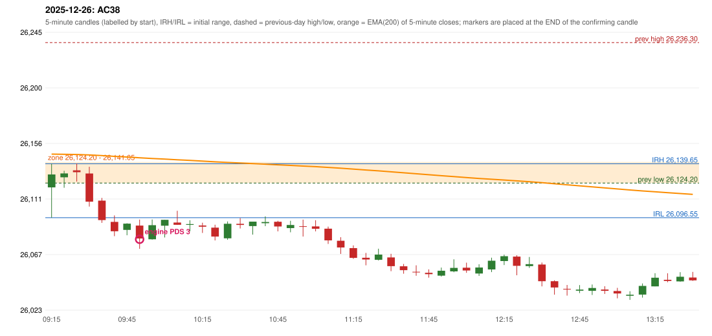

# 2025-12-26 - author's correction(s) against the engine

> Phase 5.1 date report. Evidence only; no rule was changed to produce a different outcome. Source image(s) are referenced under each correction.

## AC38 (PDF page 6, as written `20251216-1 (as written; read as 20251226-1)`, label `PDS`, ACTIVE)

### Author's observation

> First candle entry.

Suggested: **PDS (first candle entry)**; timing: earlier (first candle); requirement stated: entry on the first candle. Drawing (my reading): none. Uncertain: the date reads 2025-12-16 or 2025-12-26; no trade exists on 2025-12-16, while 20251226-1 is a PDS Method 3 trade, and the entry sits between 20251224 and 20251230 in page order - so it is read as 2025-12-26. Image: `reports/phase5/phase51_author_corrections/pages/page_6_full.png (page 6 of docs/strategy_docs/corrected/Adobe Scan Nov 05, 2026.pdf)`.

### Original automated trade

20251226-1-PDS PDS Method 3 SHORT signal 09:55 entry 26079.35 -> TARGET

Stop 26114.35, T1 26052.35, T2 26009.35; exits 11:36 / 14:50. Engine explanation: PDS Method 3 SHORT: the session opened 3.45 points below the previous-day-low zone [26,124.20, 26,141.05]; the first red candle at the zone (09:25) was weak (body 10.38%), so the engine waited for a small support; the 09:40 candle's low 26,081.85 (42.35 points below the zone floor) was broken by the close of the 09:50 candle (26,080.00); confirmed 09:55.

### Independent historical evidence

Session: open 26120.75, previous high/low/close 26236.3 / 26124.2 / 26142.1 (gap -21.35); first candle {'high': 26139.65, 'low': 26096.55, 'open': 26120.75, 'close': 26131.05}.

Chronological signal timeline (engine):

| time | strategy | method | dir | event | reason |
|---|---|---|---|---|---|
| 09:55 | PDS | Method 3 | SHORT | EXECUTED | trade 1: TARGET |

Rejected / invalidated setups: 09:35 RF RF: NO_RETURN_INSIDE_BEFORE_SESSION_END

Applicable source rules:

* `PDS-M-001` (VERIFIED_QUALITATIVE): Methods 1 and 2 apply to the FIRST red candle at the zone; a weak red candle is not taken (quality rule).
* `PDS-M3-001` (VERIFIED_QUALITATIVE): Break of a small support near the zone, used when the first red candle is not satisfying.

### Conclusion

* **Classification:** CANDLE_CONFIRMATION_MISMATCH, ENTRY_TIMING_MISMATCH, JOURNAL_INCONSISTENCY   **Category:** C
* **Is the author correct under the existing rules?** In conflict with PDS-M-001: 'a weak red candle is not taken'; the first red candle at the zone (09:25) has a 10.4% body
* **Is the engine correct under the existing rules?** Yes under PDS-M-001 (Method 3 waits for a small-support break)
* **Missing requirement / root cause:** whether the first red candle at the zone is taken regardless of strength
* **New rule required?** yes   **Implementable objectively now?** no   **Owner approval needed?** YES

Candles 09:15-13:00 (start, O, H, L, C, colour, body %, upper wick %, lower wick %, EMA200, close - EMA):

| start | O | H | L | C | col | body% | uw% | lw% | EMA | c-EMA |
|---|---|---|---|---|---|---|---|---|---|---|
| 09:15 | 26120.75 | 26139.65 | 26096.55 | 26131.05 | G | 23.9 | 20.0 | 56.1 | 26147.32 | -16.27 |
| 09:20 | 26128.8 | 26134.0 | 26120.45 | 26131.9 | G | 22.9 | 15.5 | 61.6 | 26147.16 | -15.26 |
| 09:25 | 26134.35 | 26139.85 | 26125.4 | 26132.85 | R | 10.4 | 38.1 | 51.6 | 26147.02 | -14.17 |
| 09:30 | 26131.85 | 26137.2 | 26105.45 | 26109.35 | R | 70.9 | 16.9 | 12.3 | 26146.65 | -37.3 |
| 09:35 | 26110.2 | 26112.35 | 26092.45 | 26094.7 | R | 77.9 | 10.8 | 11.3 | 26146.13 | -51.43 |
| 09:40 | 26093.2 | 26098.4 | 26081.85 | 26085.7 | R | 45.3 | 31.4 | 23.3 | 26145.53 | -59.83 |
| 09:45 | 26086.85 | 26092.15 | 26082.55 | 26091.85 | G | 52.1 | 3.1 | 44.8 | 26144.99 | -53.14 |
| 09:50 | 26090.3 | 26095.1 | 26071.7 | 26080.0 | R | 44.0 | 20.5 | 35.5 | 26144.35 | -64.35 |
| 09:55 | 26079.35 | 26095.15 | 26079.1 | 26090.6 | G | 70.1 | 28.3 | 1.6 | 26143.81 | -53.21 |
| 10:00 | 26090.15 | 26094.85 | 26080.8 | 26094.85 | G | 33.5 | 0.0 | 66.5 | 26143.33 | -48.48 |
| 10:05 | 26092.7 | 26102.1 | 26090.8 | 26090.9 | R | 15.9 | 83.2 | 0.9 | 26142.8 | -51.9 |
| 10:10 | 26090.85 | 26094.55 | 26085.65 | 26091.45 | G | 6.7 | 34.8 | 58.4 | 26142.29 | -50.84 |
| 10:15 | 26090.35 | 26092.55 | 26084.4 | 26089.4 | R | 11.7 | 27.0 | 61.3 | 26141.77 | -52.37 |
| 10:20 | 26088.65 | 26090.95 | 26078.45 | 26081.55 | R | 56.8 | 18.4 | 24.8 | 26141.17 | -59.62 |
| 10:25 | 26080.15 | 26093.6 | 26078.95 | 26091.75 | G | 79.2 | 12.6 | 8.2 | 26140.68 | -48.93 |
| 10:30 | 26091.7 | 26096.25 | 26087.95 | 26090.8 | R | 10.8 | 54.8 | 34.3 | 26140.18 | -49.38 |
| 10:35 | 26089.9 | 26093.45 | 26083.05 | 26093.45 | G | 34.1 | 0.0 | 65.9 | 26139.71 | -46.26 |
| 10:40 | 26092.15 | 26097.6 | 26089.8 | 26093.1 | G | 12.2 | 57.7 | 30.1 | 26139.25 | -46.15 |
| 10:45 | 26093.35 | 26094.1 | 26085.65 | 26089.6 | R | 44.4 | 8.9 | 46.7 | 26138.76 | -49.16 |
| 10:50 | 26088.25 | 26094.1 | 26084.9 | 26090.75 | G | 27.2 | 36.4 | 36.4 | 26138.28 | -47.53 |
| 10:55 | 26089.75 | 26095.05 | 26081.5 | 26089.4 | R | 2.6 | 39.1 | 58.3 | 26137.79 | -48.39 |
| 11:00 | 26089.6 | 26094.55 | 26085.65 | 26087.75 | R | 20.8 | 55.6 | 23.6 | 26137.29 | -49.54 |
| 11:05 | 26087.8 | 26089.45 | 26075.65 | 26078.45 | R | 67.8 | 12.0 | 20.3 | 26136.71 | -58.26 |
| 11:10 | 26078.15 | 26081.0 | 26067.65 | 26072.8 | R | 40.1 | 21.3 | 38.6 | 26136.07 | -63.27 |
| 11:15 | 26072.3 | 26074.45 | 26063.75 | 26064.5 | R | 72.9 | 20.1 | 7.0 | 26135.36 | -70.86 |
| 11:20 | 26064.6 | 26068.45 | 26058.55 | 26063.2 | R | 14.1 | 38.9 | 47.0 | 26134.64 | -71.44 |
| 11:25 | 26062.95 | 26071.8 | 26062.45 | 26067.15 | G | 44.9 | 49.7 | 5.3 | 26133.97 | -66.82 |
| 11:30 | 26064.85 | 26067.75 | 26053.9 | 26057.9 | R | 50.2 | 20.9 | 28.9 | 26133.21 | -75.31 |
| 11:35 | 26057.8 | 26059.65 | 26051.85 | 26054.7 | R | 39.7 | 23.7 | 36.5 | 26132.43 | -77.73 |
| 11:40 | 26053.4 | 26058.55 | 26050.2 | 26053.15 | R | 3.0 | 61.7 | 35.3 | 26131.64 | -78.49 |
| 11:45 | 26052.6 | 26055.3 | 26048.7 | 26051.5 | R | 16.7 | 40.9 | 42.4 | 26130.85 | -79.35 |
| 11:50 | 26050.35 | 26056.75 | 26049.6 | 26054.25 | G | 54.5 | 35.0 | 10.5 | 26130.09 | -75.84 |
| 11:55 | 26053.7 | 26063.35 | 26053.05 | 26056.5 | G | 27.2 | 66.5 | 6.3 | 26129.35 | -72.85 |
| 12:00 | 26056.65 | 26060.7 | 26052.6 | 26054.45 | R | 27.2 | 50.0 | 22.8 | 26128.61 | -74.16 |
| 12:05 | 26052.0 | 26059.4 | 26050.1 | 26056.8 | G | 51.6 | 28.0 | 20.4 | 26127.89 | -71.09 |
| 12:10 | 26055.3 | 26064.65 | 26053.15 | 26062.25 | G | 60.4 | 20.9 | 18.7 | 26127.24 | -64.99 |
| 12:15 | 26062.0 | 26067.1 | 26058.8 | 26065.85 | G | 46.4 | 15.1 | 38.6 | 26126.63 | -60.78 |
| 12:20 | 26065.55 | 26066.6 | 26050.65 | 26058.2 | R | 46.1 | 6.6 | 47.3 | 26125.95 | -67.75 |
| 12:25 | 26057.95 | 26065.25 | 26056.5 | 26059.5 | G | 17.7 | 65.7 | 16.6 | 26125.29 | -65.79 |
| 12:30 | 26059.2 | 26060.8 | 26041.75 | 26045.9 | R | 69.8 | 8.4 | 21.8 | 26124.5 | -78.6 |
| 12:35 | 26045.9 | 26046.6 | 26035.15 | 26040.9 | R | 43.7 | 6.1 | 50.2 | 26123.67 | -82.77 |
| 12:40 | 26039.8 | 26042.9 | 26034.4 | 26039.75 | R | 0.6 | 36.5 | 62.9 | 26122.83 | -83.08 |
| 12:45 | 26038.3 | 26042.8 | 26036.4 | 26039.2 | G | 14.1 | 56.2 | 29.7 | 26122.0 | -82.8 |
| 12:50 | 26038.2 | 26043.25 | 26034.9 | 26040.45 | G | 26.9 | 33.5 | 39.5 | 26121.19 | -80.74 |
| 12:55 | 26039.25 | 26041.85 | 26035.75 | 26038.25 | R | 16.4 | 42.6 | 41.0 | 26120.36 | -82.11 |
| 13:00 | 26038.05 | 26040.6 | 26032.2 | 26036.1 | R | 23.2 | 30.4 | 46.4 | 26119.52 | -83.42 |
