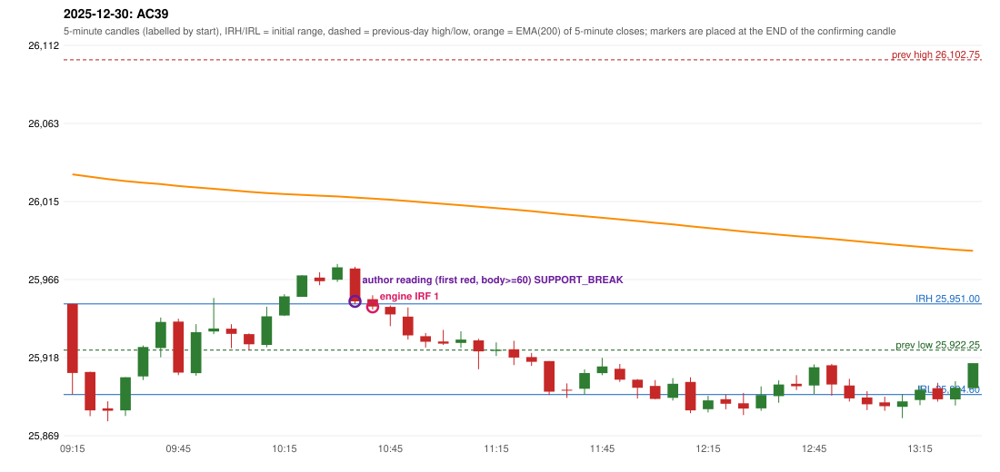

# 2025-12-30 - author's correction(s) against the engine

> Phase 5.1 date report. Evidence only; no rule was changed to produce a different outcome. Source image(s) are referenced under each correction.

## AC39 (PDF page 6, as written `20251230-1`, label `IRF`, ACTIVE)

### Author's observation

> ORB should be activated instead of IRF.

Suggested: **ORB**; timing: not stated; requirement stated: ORB should have activated. Drawing (my reading): none. Uncertain: none. Image: `reports/phase5/phase51_author_corrections/pages/page_6_full.png (page 6 of docs/strategy_docs/corrected/Adobe Scan Nov 05, 2026.pdf)`.

### Original automated trade

20251230-1-IRF IRF Method 1 SHORT signal 10:45 entry 25949.1 -> TARGET

Stop 25984.1, T1 25922.1, T2 25889.1; exits 11:10 / 12:13. Engine explanation: IRF Method 1 SHORT: the completed 10:35 candle closed at 25,952.55, 1.55 points above the initial range high 25,951.00 (range [25,894.60, 25,951.00] from the 09:15 candle); the immediately following completed 10:40 candle closed at 25,949.30, back inside the range. The short signal was confirmed at 10:45 on that close. Entry reference close 25,949.30 is 1.70 points below IRH 25,951.00.

### Independent historical evidence

Session: open 25951.0, previous high/low/close 26102.75 / 25922.25 / 25942.1 (gap 8.9); first candle {'high': 25951.0, 'low': 25894.6, 'open': 25951.0, 'close': 25908.05}.

Signal-candle measurements: signal_candle_start=10:40, colour=R, body_pct=52.0, upper_wick_pct=27.7, lower_wick_pct=20.3, signal_close=25949.3, ema200=26016.47, entry_minus_ema=-67.17, ema_below_entry=False, ema_within_27_below_entry=False, ema_between_entry_and_target1=False, close_below_ema=True, session_low_before_candle=25878.0, close_below_prior_session_low=False, candle_low_at_or_below_prior_session_low=False, points_above_prior_session_low=71.3, body_pct_below_60=True, body_pct_below_50=False

Readings of the author's 'first red candle' wording (my formalisations, side by side):

| reading | first red candle | support | resistance | entry (signal time, close, trigger, body %) |
|---|---|---|---|---|
| FULLY_ABOVE|body>=60 | 10:25 | 25962.6 | 25970.6 | 10:40, 25952.55, SUPPORT_BREAK, 88.3 |
| FULLY_ABOVE|body>=0 | 10:25 | 25962.6 | 25970.6 | 10:40, 25952.55, SUPPORT_BREAK, 88.3 |
| CLOSE_ABOVE|body>=60 | 10:25 | 25962.6 | 25970.6 | 10:40, 25952.55, SUPPORT_BREAK, 88.3 |
| CLOSE_ABOVE|body>=0 | 10:25 | 25962.6 | 25970.6 | 10:40, 25952.55, SUPPORT_BREAK, 88.3 |

ORB records: Method 1 ENGINE_SETUP_INVALIDATED: CANDLE_QUALITY(not a strong body / wick too large); Method 2 ENGINE_SETUP_INVALIDATED: CANDLE_QUALITY

Chronological signal timeline (engine):

| time | strategy | method | dir | event | reason |
|---|---|---|---|---|---|
| 10:45 | IRF | Method 1 | SHORT | EXECUTED | trade 1: TARGET |
| 11:15 | IRF | Method 2A | SHORT | IGNORED | POSITION_ACTIVE (signal kept for diagnostics only; never reused) |
| 13:55 | IRF | Method 1 | SHORT | IGNORED | DAY_FINISHED |

Rejected / invalidated setups: 15:25 IRF Method 1/2: SESSION_ENDED_BEFORE_CONFIRMATION; 09:15 ORB Method 1: CANDLE_QUALITY(not a strong body / wick too large); 09:15 ORB Method 2: CANDLE_QUALITY; 09:15 PDR PDR: OPEN_NOT_STRICTLY_ABOVE_ZONE; 09:30 RF RF: TREND:EMA_PREV_SESSION_CLOSE wrong side

Applicable source rules:

* `ORB-M1-SHORT-003` (VERIFIED_QUALITATIVE): Candle quality: strong red body and small lower wick; reject strong lower-wick rejection.

### Conclusion

* **Classification:** CANDLE_CONFIRMATION_MISMATCH   **Category:** C
* **Is the author correct under the existing rules?** Cannot be decided: the first candle (red, body 76.2%) failed the proposed lower-wick limit (23.8% > 20%)
* **Is the engine correct under the existing rules?** Yes under the proposed MODERATE strength profile (lower-wick limit 20%); the LOOSE profile in params.py (body >= 50%, wick <= 25%) would admit this candle
* **Missing requirement / root cause:** the ORB strength profile (a proposal; the author gives no numbers)
* **New rule required?** yes   **Implementable objectively now?** no   **Owner approval needed?** YES

Candles 09:15-13:00 (start, O, H, L, C, colour, body %, upper wick %, lower wick %, EMA200, close - EMA):

| start | O | H | L | C | col | body% | uw% | lw% | EMA | c-EMA |
|---|---|---|---|---|---|---|---|---|---|---|
| 09:15 | 25951.0 | 25951.0 | 25894.6 | 25908.05 | R | 76.2 | 0.0 | 23.8 | 26031.51 | -123.46 |
| 09:20 | 25908.65 | 25908.8 | 25881.15 | 25884.8 | R | 86.3 | 0.5 | 13.2 | 26030.05 | -145.25 |
| 09:25 | 25886.0 | 25890.4 | 25878.0 | 25884.55 | R | 11.7 | 35.5 | 52.8 | 26028.6 | -144.05 |
| 09:30 | 25884.75 | 25905.35 | 25881.25 | 25905.35 | G | 85.5 | 0.0 | 14.5 | 26027.37 | -122.02 |
| 09:35 | 25905.85 | 25925.1 | 25903.6 | 25924.15 | G | 85.1 | 4.4 | 10.5 | 26026.35 | -102.2 |
| 09:40 | 25923.55 | 25942.5 | 25917.8 | 25939.75 | G | 65.6 | 11.1 | 23.3 | 26025.48 | -85.73 |
| 09:45 | 25939.95 | 25941.8 | 25906.65 | 25908.25 | R | 90.2 | 5.3 | 4.6 | 26024.32 | -116.07 |
| 09:50 | 25907.9 | 25938.4 | 25906.3 | 25933.35 | G | 79.3 | 15.7 | 5.0 | 26023.41 | -90.06 |
| 09:55 | 25933.85 | 25954.7 | 25932.2 | 25935.7 | G | 8.2 | 84.4 | 7.3 | 26022.54 | -86.84 |
| 10:00 | 25935.55 | 25938.35 | 25923.4 | 25932.35 | R | 21.4 | 18.7 | 59.9 | 26021.64 | -89.29 |
| 10:05 | 25932.15 | 25932.6 | 25922.1 | 25925.8 | R | 60.5 | 4.3 | 35.2 | 26020.69 | -94.89 |
| 10:10 | 25925.45 | 25949.25 | 25924.0 | 25943.25 | G | 70.5 | 23.8 | 5.7 | 26019.92 | -76.67 |
| 10:15 | 25943.75 | 25957.0 | 25943.4 | 25955.65 | G | 87.5 | 9.9 | 2.6 | 26019.28 | -63.63 |
| 10:20 | 25955.4 | 25968.8 | 25955.4 | 25968.7 | G | 99.3 | 0.7 | 0.0 | 26018.77 | -50.07 |
| 10:25 | 25967.35 | 25970.6 | 25962.6 | 25965.1 | R | 28.1 | 40.6 | 31.2 | 26018.24 | -53.14 |
| 10:30 | 25965.95 | 25975.8 | 25964.65 | 25973.7 | G | 69.5 | 18.8 | 11.7 | 26017.8 | -44.1 |
| 10:35 | 25973.0 | 25974.05 | 25950.9 | 25952.55 | R | 88.3 | 4.5 | 7.1 | 26017.15 | -64.6 |
| 10:40 | 25953.9 | 25956.35 | 25947.5 | 25949.3 | R | 52.0 | 27.7 | 20.3 | 26016.47 | -67.17 |
| 10:45 | 25949.1 | 25949.95 | 25937.15 | 25944.4 | R | 36.7 | 6.6 | 56.6 | 26015.76 | -71.36 |
| 10:50 | 25943.05 | 25948.75 | 25928.8 | 25931.35 | R | 58.6 | 28.6 | 12.8 | 26014.92 | -83.57 |
| 10:55 | 25930.9 | 25932.85 | 25923.85 | 25927.45 | R | 38.3 | 21.7 | 40.0 | 26014.05 | -86.6 |
| 11:00 | 25927.6 | 25934.8 | 25925.45 | 25926.25 | R | 14.4 | 77.0 | 8.6 | 26013.17 | -86.92 |
| 11:05 | 25926.7 | 25933.9 | 25923.65 | 25928.8 | G | 20.5 | 49.8 | 29.8 | 26012.33 | -83.53 |
| 11:10 | 25928.3 | 25929.3 | 25910.35 | 25921.45 | R | 36.1 | 5.3 | 58.6 | 26011.43 | -89.98 |
| 11:15 | 25921.7 | 25927.05 | 25918.6 | 25922.45 | G | 8.9 | 54.4 | 36.7 | 26010.54 | -88.09 |
| 11:20 | 25922.75 | 25928.05 | 25912.9 | 25917.6 | R | 34.0 | 35.0 | 31.0 | 26009.62 | -92.02 |
| 11:25 | 25917.9 | 25920.5 | 25912.4 | 25914.95 | R | 36.4 | 32.1 | 31.5 | 26008.68 | -93.73 |
| 11:30 | 25915.4 | 25915.4 | 25894.3 | 25896.4 | R | 90.0 | 0.0 | 10.0 | 26007.56 | -111.16 |
| 11:35 | 25897.6 | 25901.55 | 25892.5 | 25897.55 | R | 0.6 | 43.6 | 55.8 | 26006.46 | -108.91 |
| 11:40 | 25898.2 | 25910.2 | 25894.45 | 25907.95 | G | 61.9 | 14.3 | 23.8 | 26005.48 | -97.53 |
| 11:45 | 25907.95 | 25917.45 | 25906.65 | 25912.1 | G | 38.4 | 49.5 | 12.0 | 26004.56 | -92.46 |
| 11:50 | 25910.6 | 25913.6 | 25902.4 | 25903.85 | R | 60.3 | 26.8 | 12.9 | 26003.55 | -99.7 |
| 11:55 | 25903.85 | 25904.25 | 25892.1 | 25898.8 | R | 41.6 | 3.3 | 55.1 | 26002.51 | -103.71 |
| 12:00 | 25899.95 | 25903.6 | 25891.65 | 25891.85 | R | 67.8 | 30.5 | 1.7 | 26001.41 | -109.56 |
| 12:05 | 25892.55 | 25904.85 | 25890.85 | 25901.3 | G | 62.5 | 25.4 | 12.1 | 26000.41 | -99.11 |
| 12:10 | 25902.45 | 25905.3 | 25883.0 | 25884.8 | R | 79.1 | 12.8 | 8.1 | 25999.26 | -114.46 |
| 12:15 | 25885.45 | 25893.8 | 25883.45 | 25890.95 | G | 53.1 | 27.5 | 19.3 | 25998.19 | -107.24 |
| 12:20 | 25891.7 | 25894.6 | 25885.45 | 25888.9 | R | 30.6 | 31.7 | 37.7 | 25997.1 | -108.2 |
| 12:25 | 25889.15 | 25895.6 | 25881.8 | 25885.9 | R | 23.6 | 46.7 | 29.7 | 25995.99 | -110.09 |
| 12:30 | 25886.0 | 25899.65 | 25884.45 | 25894.3 | G | 54.6 | 35.2 | 10.2 | 25994.98 | -100.68 |
| 12:35 | 25893.6 | 25903.4 | 25889.5 | 25900.85 | G | 52.2 | 18.3 | 29.5 | 25994.04 | -93.19 |
| 12:40 | 25901.3 | 25906.65 | 25897.4 | 25899.75 | R | 16.8 | 57.8 | 25.4 | 25993.1 | -93.35 |
| 12:45 | 25900.25 | 25913.3 | 25894.95 | 25911.6 | G | 61.9 | 9.3 | 28.9 | 25992.29 | -80.69 |
| 12:50 | 25912.8 | 25913.65 | 25893.9 | 25900.85 | R | 60.5 | 4.3 | 35.2 | 25991.38 | -90.53 |
| 12:55 | 25900.2 | 25904.35 | 25890.25 | 25892.2 | R | 56.7 | 29.4 | 13.8 | 25990.4 | -98.2 |
| 13:00 | 25892.8 | 25896.65 | 25884.95 | 25888.55 | R | 36.3 | 32.9 | 30.8 | 25989.38 | -100.83 |
