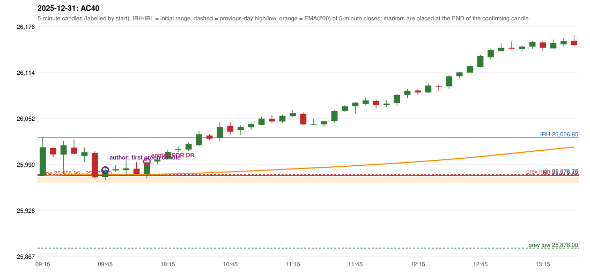

# 2025-12-31 - author's correction(s) against the engine

> Phase 5.1 date report. Evidence only; no rule was changed to produce a different outcome. Source image(s) are referenced under each correction.

## AC40 (PDF page 6, as written `20251231-1`, label `PDR`, ACTIVE)

### Author's observation

> ORB should activate first, Which hits SL Ep then PDR. | PDR 1st candle entry.

Suggested: **ORB first (it stops out), then PDR on its 1st candle**; timing: earlier (ORB first; PDR on the 1st candle); requirement stated: ORB first; PDR entry on the first candle. Drawing (my reading): none. Uncertain: 'Ep' read as 'i.e.'; the second strategy is written 'PPR' and read as PDR. Image: `reports/phase5/phase51_author_corrections/pages/page_6_full.png (page 6 of docs/strategy_docs/corrected/Adobe Scan Nov 05, 2026.pdf)`.

### Original automated trade

20251231-1-PDR PDR PDR LONG signal 10:10 entry 25994.35 -> TARGET

Stop 25959.35, T1 26021.35, T2 26064.35; exits 10:31 / 11:40. Engine explanation: PDR LONG (body-based engine, A_HIGHEST_BODY_HIGH): the session opened 36.60 points above the previous close and 1.75 points above the previous-day highest BODY high 25,973.70 (zone [25,965.95, 25,973.70] from the 10:30 candle of 2025-12-30; the highest wick 25,976.75 is ignored). The 09:40 candle (25,972.05 - 26,009.00) tested the zone; the 10:05 candle (green, O 25,977.50 H 25,995.10 L 25,971.75 C 25,993.30) passed GOOD_GREEN_BODY and closed 19.60 points above the zone ceiling, confirming the entry at 10:10. The pattern thresholds and the zone's lower boundary are provisional research assumptions, not approved by the strategy author.

### Independent historical evidence

Session: open 25975.45, previous high/low/close 25976.75 / 25878.0 / 25938.85 (gap 36.6); first candle {'high': 26026.85, 'low': 25975.45, 'open': 25975.45, 'close': 26013.65}.

First green candle after the zone interaction ('enter in 1st green candle'): {"interaction_candle": "09:40", "first_green_close_above_ceiling": {"candle_start": "09:45", "signal_time": "09:50", "colour": "G", "body_pct": 49.7, "upper_wick_pct": 26.9, "lower_wick_pct": 23.4, "close": 25982.8, "points_above_ceiling": 9.1, "low_below_zone_floor": false}}

ORB records: Method 1 ENGINE_SETUP_INVALIDATED: TREND:EMA_PREV_SESSION_CLOSE wrong side; Method 2 ENGINE_SETUP_INVALIDATED: TREND:EMA_PREV_SESSION_CLOSE wrong side

Chronological signal timeline (engine):

| time | strategy | method | dir | event | reason |
|---|---|---|---|---|---|
| 10:10 | PDR | PDR | LONG | EXECUTED | trade 1: TARGET |
| 10:40 | IRF | Method 1 | SHORT | IGNORED | POSITION_ACTIVE (signal kept for diagnostics only; never reused) |
| 11:25 | IRF | Method 2B | SHORT | IGNORED | POSITION_ACTIVE (signal kept for diagnostics only; never reused) |
| 13:40 | IRF | Method 2A | SHORT | IGNORED | DAY_FINISHED |
| 14:25 | IRF | Method 2A | SHORT | IGNORED | DAY_FINISHED |
| 15:05 | IRF | Method 2A | SHORT | IGNORED | DAY_FINISHED |

Rejected / invalidated setups: 15:00 IRF Method 1/2: SESSION_ENDED_BEFORE_CONFIRMATION; 09:15 ORB Method 1: TREND:EMA_PREV_SESSION_CLOSE wrong side; 09:15 ORB Method 2: TREND:EMA_PREV_SESSION_CLOSE wrong side; 09:45 RF RF: TREND:EMA_PREV_SESSION_CLOSE wrong side

Applicable source rules:

* `PDR-007` (VERIFIED_QUALITATIVE): After the zone has been tested, wait for a green candle and take the long on that confirmation.
* `TREND-EMA-001` (USER_APPROVED): Approved research variant A of the ORB/RF trend: the five-minute EMA(200) price location only (previous session's last close above/below its EMA(200); for RF the trend must exist BEFORE the opening gap, so the gap day contributes nothing). Not claimed to repro

### Conclusion

* **Classification:** EMA_FILTER_MISMATCH, CANDLE_CONFIRMATION_MISMATCH, ENTRY_TIMING_MISMATCH   **Category:** C
* **Is the author correct under the existing rules?** Partly: PDR - the first green candle (09:45) is earlier than the engine's 10:10; ORB - rejected by the approved trend variant
* **Is the engine correct under the existing rules?** Yes under the proposed thresholds and the approved trend variant
* **Missing requirement / root cause:** PDR confirmation thresholds; the ORB trend definition
* **New rule required?** yes   **Implementable objectively now?** no   **Owner approval needed?** YES

Candles 09:15-13:00 (start, O, H, L, C, colour, body %, upper wick %, lower wick %, EMA200, close - EMA):

| start | O | H | L | C | col | body% | uw% | lw% | EMA | c-EMA |
|---|---|---|---|---|---|---|---|---|---|---|
| 09:15 | 25975.45 | 26026.85 | 25975.45 | 26013.65 | G | 74.3 | 25.7 | 0.0 | 25975.53 | 38.12 |
| 09:20 | 26012.55 | 26013.3 | 26000.15 | 26003.9 | R | 65.8 | 5.7 | 28.5 | 25975.82 | 28.08 |
| 09:25 | 26003.65 | 26021.8 | 25977.45 | 26016.3 | G | 28.5 | 12.4 | 59.1 | 25976.22 | 40.08 |
| 09:30 | 26013.1 | 26023.9 | 26004.3 | 26004.8 | R | 42.3 | 55.1 | 2.6 | 25976.5 | 28.3 |
| 09:35 | 26001.95 | 26013.4 | 25993.7 | 26006.9 | G | 25.1 | 33.0 | 41.9 | 25976.8 | 30.1 |
| 09:40 | 26006.05 | 26009.0 | 25972.05 | 25973.25 | R | 88.8 | 8.0 | 3.2 | 25976.77 | -3.52 |
| 09:45 | 25973.65 | 25987.75 | 25969.35 | 25982.8 | G | 49.7 | 26.9 | 23.4 | 25976.83 | 5.97 |
| 09:50 | 25982.5 | 25989.5 | 25980.15 | 25984.15 | G | 17.6 | 57.2 | 25.1 | 25976.9 | 7.25 |
| 09:55 | 25982.85 | 25996.2 | 25976.4 | 25985.1 | G | 11.4 | 56.1 | 32.6 | 25976.98 | 8.12 |
| 10:00 | 25984.7 | 25993.55 | 25977.6 | 25977.6 | R | 44.5 | 55.5 | 0.0 | 25976.99 | 0.61 |
| 10:05 | 25977.5 | 25995.1 | 25971.75 | 25993.3 | G | 67.7 | 7.7 | 24.6 | 25977.15 | 16.15 |
| 10:10 | 25994.35 | 26000.95 | 25990.75 | 25997.0 | G | 26.0 | 38.7 | 35.3 | 25977.35 | 19.65 |
| 10:15 | 25998.35 | 26010.35 | 25998.35 | 26007.45 | G | 75.8 | 24.2 | 0.0 | 25977.65 | 29.8 |
| 10:20 | 26009.85 | 26014.75 | 26006.5 | 26010.9 | G | 12.7 | 46.7 | 40.6 | 25977.98 | 32.92 |
| 10:25 | 26010.55 | 26020.2 | 26008.8 | 26018.1 | G | 66.2 | 18.4 | 15.4 | 25978.38 | 39.72 |
| 10:30 | 26016.45 | 26035.3 | 26015.6 | 26030.95 | G | 73.6 | 22.1 | 4.3 | 25978.9 | 52.05 |
| 10:35 | 26029.35 | 26031.25 | 26023.35 | 26025.0 | R | 55.1 | 24.1 | 20.9 | 25979.36 | 45.64 |
| 10:40 | 26026.2 | 26047.15 | 26022.35 | 26040.95 | G | 59.5 | 25.0 | 15.5 | 25979.97 | 60.98 |
| 10:45 | 26042.4 | 26047.2 | 26030.85 | 26034.4 | R | 48.9 | 29.4 | 21.7 | 25980.52 | 53.88 |
| 10:50 | 26036.85 | 26043.35 | 26029.9 | 26041.15 | G | 32.0 | 16.4 | 51.7 | 25981.12 | 60.03 |
| 10:55 | 26040.35 | 26046.6 | 26037.35 | 26044.65 | G | 46.5 | 21.1 | 32.4 | 25981.75 | 62.9 |
| 11:00 | 26043.7 | 26054.3 | 26043.15 | 26052.15 | G | 75.8 | 19.3 | 4.9 | 25982.45 | 69.7 |
| 11:05 | 26051.85 | 26056.75 | 26045.75 | 26048.2 | R | 33.2 | 44.5 | 22.3 | 25983.11 | 65.09 |
| 11:10 | 26048.2 | 26057.5 | 26046.45 | 26055.8 | G | 68.8 | 15.4 | 15.8 | 25983.83 | 71.97 |
| 11:15 | 26055.45 | 26063.75 | 26053.55 | 26059.7 | G | 41.7 | 39.7 | 18.6 | 25984.58 | 75.12 |
| 11:20 | 26058.65 | 26060.35 | 26043.5 | 26044.45 | R | 84.3 | 10.1 | 5.6 | 25985.18 | 59.27 |
| 11:25 | 26043.7 | 26052.0 | 26043.5 | 26044.55 | G | 10.0 | 87.6 | 2.4 | 25985.77 | 58.78 |
| 11:30 | 26044.5 | 26049.55 | 26040.35 | 26048.45 | G | 42.9 | 12.0 | 45.1 | 25986.39 | 62.06 |
| 11:35 | 26049.05 | 26063.3 | 26046.75 | 26062.2 | G | 79.5 | 6.6 | 13.9 | 25987.15 | 75.05 |
| 11:40 | 26062.45 | 26070.9 | 26060.65 | 26068.55 | G | 59.5 | 22.9 | 17.6 | 25987.96 | 80.59 |
| 11:45 | 26068.7 | 26074.45 | 26058.75 | 26073.65 | G | 31.5 | 5.1 | 63.4 | 25988.81 | 84.84 |
| 11:50 | 26072.0 | 26080.35 | 26070.55 | 26076.7 | G | 48.0 | 37.2 | 14.8 | 25989.69 | 87.01 |
| 11:55 | 26075.95 | 26077.7 | 26065.8 | 26070.6 | R | 45.0 | 14.7 | 40.3 | 25990.49 | 80.11 |
| 12:00 | 26070.6 | 26076.95 | 26067.7 | 26072.35 | G | 18.9 | 49.7 | 31.4 | 25991.31 | 81.04 |
| 12:05 | 26072.9 | 26085.9 | 26069.3 | 26083.95 | G | 66.6 | 11.7 | 21.7 | 25992.23 | 91.72 |
| 12:10 | 26083.85 | 26091.55 | 26079.9 | 26089.55 | G | 48.9 | 17.2 | 33.9 | 25993.2 | 96.35 |
| 12:15 | 26089.9 | 26091.4 | 26083.55 | 26087.3 | R | 33.1 | 19.1 | 47.8 | 25994.13 | 93.17 |
| 12:20 | 26087.35 | 26099.05 | 26086.35 | 26096.7 | G | 73.6 | 18.5 | 7.9 | 25995.15 | 101.55 |
| 12:25 | 26096.0 | 26097.7 | 26089.2 | 26095.55 | R | 5.3 | 20.0 | 74.7 | 25996.15 | 99.4 |
| 12:30 | 26095.6 | 26110.9 | 26092.05 | 26109.1 | G | 71.6 | 9.5 | 18.8 | 25997.28 | 111.82 |
| 12:35 | 26109.25 | 26114.9 | 26106.75 | 26114.25 | G | 61.3 | 8.0 | 30.7 | 25998.44 | 115.81 |
| 12:40 | 26114.0 | 26123.05 | 26113.9 | 26122.6 | G | 94.0 | 4.9 | 1.1 | 25999.67 | 122.93 |
| 12:45 | 26121.4 | 26137.9 | 26120.9 | 26136.25 | G | 87.4 | 9.7 | 2.9 | 26001.03 | 135.22 |
| 12:50 | 26134.55 | 26146.2 | 26131.35 | 26144.3 | G | 65.7 | 12.8 | 21.5 | 26002.46 | 141.84 |
| 12:55 | 26142.7 | 26153.9 | 26142.7 | 26147.25 | G | 40.6 | 59.4 | 0.0 | 26003.9 | 143.35 |
| 13:00 | 26147.3 | 26155.8 | 26145.1 | 26146.2 | R | 10.3 | 79.4 | 10.3 | 26005.32 | 140.88 |
