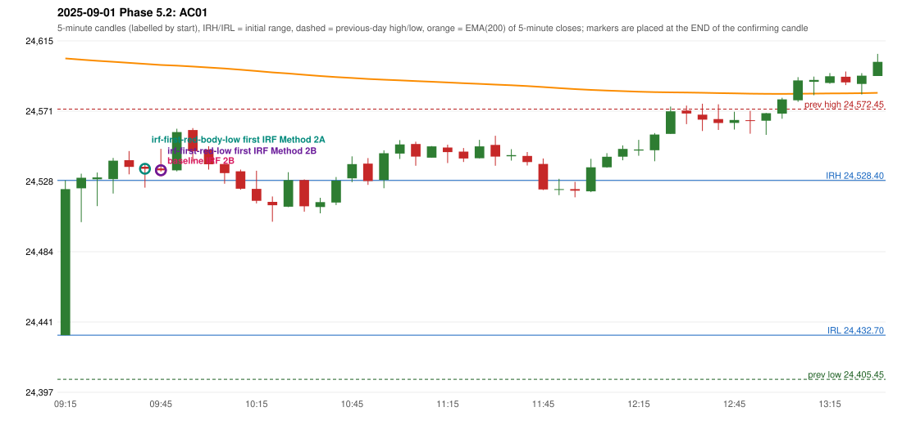

# 2025-09-01 - Phase 5.2 original versus corrected signals

> Signal-level comparison only: no controller, no fills, no P&L. Candidates are NOT approved rules.

## AC01 (PDF page 1) - topic `IRF_FIRST_RED_CANDLE`

> IRF should be entered at the resistance itself. | Entry can either be break of Support/Resistance which ever happens first. | 60+ body candle in the entry side.

* Original automated trade: IRF Method 2B signal 09:50; entry candle OHLC 24535.8/24547.9/24533.8/24534.65; EMA200 at that candle 24599.73; prev_high=24572.45; prev_low=24405.45; prev_close=24426.85; open=24432.7; IRH=24528.4; IRL=24432.7
* Expected (author): IRF (same strategy, different entry point) | earlier (at the resistance itself)
* Current entry conditions: Method 2A: a candle closes below the swing-low fractal support left by the extension (SWING_K1) after a red candle has formed; Method 2B: a red candle closes back below the first push top after trading above it
* Phase 5.2: candidate (not active): Method 2A support = first red candle's LOW or BODY LOW; first red candle never replaced by a later one
* Evidence: old reference resistance 24546.55 (candle 09:35); first red candle 09:35 OHLC 24540.9/24546.55/24532.15/24536.75; candidate LOW: same time and method; candidate BODY_LOW: earlier (09:50 -> 09:45 Method 2A)
* Explicit or ambiguous: ambiguous (level); resolved by Phase 5.2: NO - candidate only; level and method scope unresolved; remaining decision: O4 (level definition: low / body low / local support; scope 2A only or also 2B / Method 3)

### Signal changes under the candidate configurations (this date)

| config | strategy | method | change | baseline | candidate | rule cause |
|---|---|---|---|---|---|---|
| phase52-cand-irf-first-red-low | IRF | Method 1 | ANNOTATION_ONLY | 10:55 | 10:55 | IRF 2A candidate: support = LOW of the first red candle (level definit |
| phase52-cand-irf-first-red-low | IRF | Method 2A | TIME_SHIFTED_EARLIER | 11:50 | 10:05 | IRF 2A candidate: support = LOW of the first red candle (level definit |
| phase52-cand-irf-first-red-low | IRF | Method 2B | ADDED |  | 10:55 | IRF 2A candidate: support = LOW of the first red candle (level definit |
| phase52-cand-irf-first-red-low | IRF | Method 2B | ADDED |  | 11:35 | IRF 2A candidate: support = LOW of the first red candle (level definit |
| phase52-cand-irf-first-red-body-low | IRF | Method 1 | ANNOTATION_ONLY | 10:55 | 10:55 | IRF 2A candidate: support = BODY LOW of the first red candle (level de |
| phase52-cand-irf-first-red-body-low | IRF | Method 2A | TIME_SHIFTED_EARLIER | 11:50 | 09:45 | IRF 2A candidate: support = BODY LOW of the first red candle (level de |
| phase52-cand-irf-first-red-body-low | IRF | Method 2A | ADDED |  | 10:05 | IRF 2A candidate: support = BODY LOW of the first red candle (level de |
| phase52-cand-irf-first-red-body-low | IRF | Method 2A | ADDED |  | 11:25 | IRF 2A candidate: support = BODY LOW of the first red candle (level de |
| phase52-cand-irf-first-red-body-low | IRF | Method 2A | ADDED |  | 11:45 | IRF 2A candidate: support = BODY LOW of the first red candle (level de |
| phase52-cand-irf-first-red-body-low | IRF | Method 2A | ADDED |  | 12:40 | IRF 2A candidate: support = BODY LOW of the first red candle (level de |
| phase52-cand-irf-first-red-body-low | IRF | Method 2B | TIME_SHIFTED_LATER | 09:50 | 10:55 | IRF 2A candidate: support = BODY LOW of the first red candle (level de |

