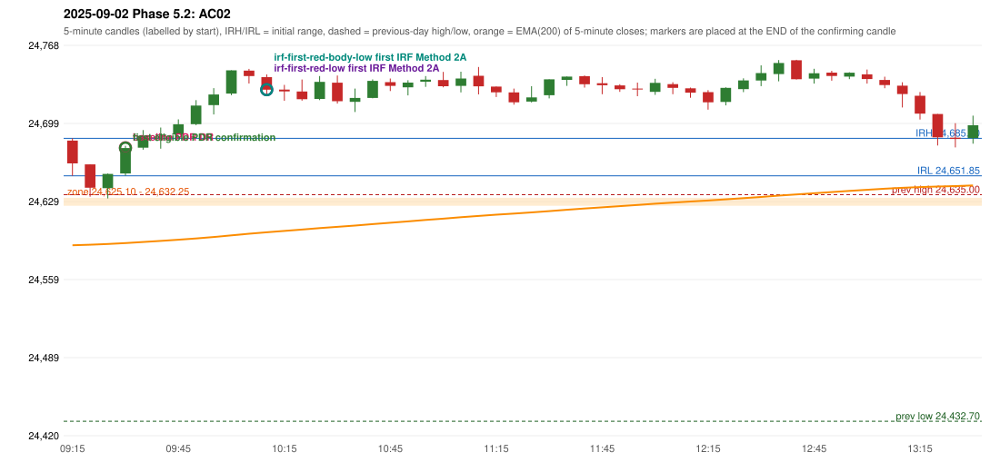

# 2025-09-02 - Phase 5.2 original versus corrected signals

> Signal-level comparison only: no controller, no fills, no P&L. Candidates are NOT approved rules.

## AC02 (PDF page 1) - topic `PDR_FIRST_ELIGIBLE`

> Enter here | PDR Zone | Support from previous day resistance.

* Original automated trade: PDR PDR signal 09:35; entry candle OHLC 24653.9/24678.7/24652.0/24676.6; EMA200 at that candle 24591.81; prev_high=24635.0; prev_low=24432.7; prev_close=24625.05; open=24683.25; IRH=24685.3; IRL=24651.85
* Expected (author): PDR (earlier entry) | earlier ('Enter here' is drawn above the zone)
* Current entry conditions: zone retest, then the first later candle with GOOD_GREEN_BODY (body >= 60%, upper wick <= 20%) or LOWER_PRICE_REJECTION or HAMMER that closes strictly above the zone ceiling; the retest candle itself is not a confirmation (PDR-A07)
* Phase 5.2: already satisfied: the engine activates on the first eligible candle; the numeric thresholds and the retest-candle convention are preserved
* Evidence: zone [24625.1, 24632.25], first touch 09:25, first eligible signal 09:35, engine 09:35, verdict ENGINE_ON_FIRST_ELIGIBLE_CANDLE; author's reading: 09:25 (body 57.3%, upper wick 1.6%, lower wick 41.1%)
* Explicit or ambiguous: explicit and USER_APPROVED; resolved by Phase 5.2: PARTLY - the engine is on the first eligible candle only under the PRESERVED proposals (PDR-A07 retest convention, numeric thresholds); the author's example candle is not eligible under them; remaining decision: O6/O7 (loosen the numeric thresholds? may the retest candle be the confirmation?)

### Signal changes under the candidate configurations (this date)

| config | strategy | method | change | baseline | candidate | rule cause |
|---|---|---|---|---|---|---|
| phase52-cand-irf-first-red-low | IRF | Method 2A | TIME_SHIFTED_EARLIER | 10:35 | 10:15 | IRF 2A candidate: support = LOW of the first red candle (level definit |
| phase52-cand-irf-first-red-low | IRF | Method 2A | TIME_SHIFTED_EARLIER | 12:20 | 11:25 | IRF 2A candidate: support = LOW of the first red candle (level definit |
| phase52-cand-irf-first-red-low | IRF | Method 2A | TIME_SHIFTED_EARLIER | 13:10 | 11:55 | IRF 2A candidate: support = LOW of the first red candle (level definit |
| phase52-cand-irf-first-red-low | IRF | Method 2A | ADDED |  | 12:20 | IRF 2A candidate: support = LOW of the first red candle (level definit |
| phase52-cand-irf-first-red-low | IRF | Method 2A | ADDED |  | 13:10 | IRF 2A candidate: support = LOW of the first red candle (level definit |
| phase52-cand-irf-first-red-body-low | IRF | Method 2A | TIME_SHIFTED_EARLIER | 10:35 | 10:15 | IRF 2A candidate: support = BODY LOW of the first red candle (level de |
| phase52-cand-irf-first-red-body-low | IRF | Method 2A | TIME_SHIFTED_EARLIER | 12:20 | 11:20 | IRF 2A candidate: support = BODY LOW of the first red candle (level de |
| phase52-cand-irf-first-red-body-low | IRF | Method 2A | TIME_SHIFTED_EARLIER | 13:10 | 11:50 | IRF 2A candidate: support = BODY LOW of the first red candle (level de |
| phase52-cand-irf-first-red-body-low | IRF | Method 2B | ADDED |  | 12:45 | IRF 2A candidate: support = BODY LOW of the first red candle (level de |

