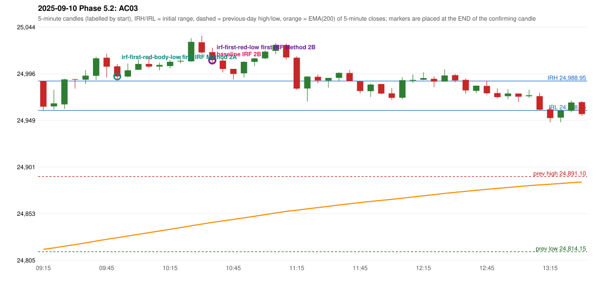

# 2025-09-10 - Phase 5.2 original versus corrected signals

> Signal-level comparison only: no controller, no fills, no P&L. Candidates are NOT approved rules.

## AC03 (PDF page 1) - topic `IRF_FIRST_RED_CANDLE`

> The first red candle only should be considered. | This candle should be considered | only break of first red candle which is outside the 5 min range, only the red candles break of S/R should be entered.

* Original automated trade: IRF Method 2B signal 10:40; entry candle OHLC 25018.6/25023.15/25008.05/25010.4; EMA200 at that candle 24844.11; prev_high=24891.1; prev_low=24814.15; prev_close=24868.6; open=24988.95; IRH=24988.95; IRL=24958.85
* Expected (author): IRF (same strategy, correct reference candle) | not stated
* Current entry conditions: Method 2A: a candle closes below the swing-low fractal support left by the extension (SWING_K1) after a red candle has formed; Method 2B: a red candle closes back below the first push top after trading above it
* Phase 5.2: candidate (not active): Method 2A support = first red candle's LOW or BODY LOW; first red candle never replaced by a later one
* Evidence: old reference resistance 25017.1 (candle 09:45); first red candle 09:45 OHLC 25012.85/25017.1/24992.7/25003.7; candidate LOW: same time and method; candidate BODY_LOW: earlier (10:40 -> 09:55 Method 2A)
* Explicit or ambiguous: ambiguous (level); resolved by Phase 5.2: NO - candidate only; level and method scope unresolved; remaining decision: O4 (level definition: low / body low / local support; scope 2A only or also 2B / Method 3)

### Signal changes under the candidate configurations (this date)

| config | strategy | method | change | baseline | candidate | rule cause |
|---|---|---|---|---|---|---|
| phase52-cand-irf-first-red-body-low | IRF | Method 2A | TIME_SHIFTED_EARLIER | 11:20 | 09:55 | IRF 2A candidate: support = BODY LOW of the first red candle (level de |
| phase52-cand-irf-first-red-body-low | IRF | Method 2A | ADDED |  | 11:20 | IRF 2A candidate: support = BODY LOW of the first red candle (level de |

