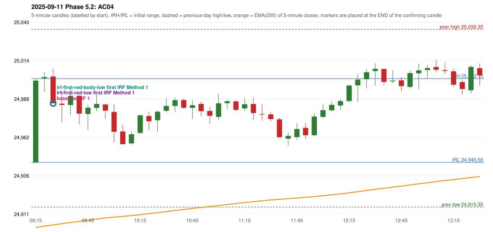

# 2025-09-11 - Phase 5.2 original versus corrected signals

> Signal-level comparison only: no controller, no fills, no P&L. Candidates are NOT approved rules.

## AC04 (PDF page 1) - topic `ORB_MISSING`

> This should be an ORB trade. | It is shown as IRF, ORB should activate Ep 30 pts SL.

* Original automated trade: IRF Method 1 signal 09:30; entry candle OHLC 25003.55/25008.75/24985.45/24985.45; EMA200 at that candle 24903.28; prev_high=25035.35; prev_low=24915.35; prev_close=24973.1; open=24945.5; IRH=25002.1; IRL=24945.5
* Expected (author): ORB | not stated
* Current entry conditions: Methods 1 / 2 / gap setup as encoded (Method 2 inner level and trendline are research variants); strength profile MODERATE (body >= 60%, opposite wick <= 20%) with a conditional pin bar
* Phase 5.2: audit only: the first failing rule per date; no priority override and no threshold change
* Evidence: cause METHOD2_TRENDLINE; first candle GREEN body 97.7%; first failing (colour direction): Method 1: NO_SETUP: first candle did not break and close beyond the previous-day high 25035.35; Method 2: TRENDLINE_NOT_SUPPORTIVE; Gap/200DMA: NO_SETUP: no gap in this direction
* Explicit or ambiguous: explicit complaint; cause not a single rule; resolved by Phase 5.2: EXPLAINED (cause identified); not changed; remaining decision: O8 (ORB inner level, trendline, strength profile, trend filter)

### Signal changes under the candidate configurations (this date)

| config | strategy | method | change | baseline | candidate | rule cause |
|---|---|---|---|---|---|---|
| phase52-cand-irf-first-red-low | IRF | Method 2A | ADDED |  | 12:50 | IRF 2A candidate: support = LOW of the first red candle (level definit |
| phase52-cand-irf-first-red-low | IRF | Method 2A | ADDED |  | 14:35 | IRF 2A candidate: support = LOW of the first red candle (level definit |
| phase52-cand-irf-first-red-body-low | IRF | Method 2A | ADDED |  | 12:50 | IRF 2A candidate: support = BODY LOW of the first red candle (level de |
| phase52-cand-irf-first-red-body-low | IRF | Method 2A | ADDED |  | 14:35 | IRF 2A candidate: support = BODY LOW of the first red candle (level de |
| phase52-cand-irf-first-red-body-low | IRF | Method 2A | ADDED |  | 15:00 | IRF 2A candidate: support = BODY LOW of the first red candle (level de |
| phase52-cand-irf-first-red-body-low | IRF | Method 2B | ANNOTATION_ONLY | 15:00 | 15:00 | IRF 2A candidate: support = BODY LOW of the first red candle (level de |

