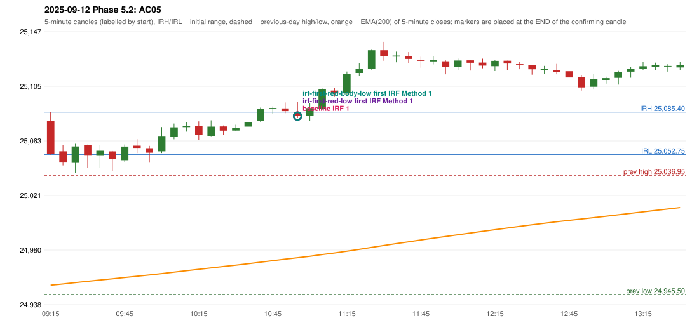

# 2025-09-12 - Phase 5.2 original versus corrected signals

> Signal-level comparison only: no controller, no fills, no P&L. Candidates are NOT approved rules.

## AC05 (PDF page 1) - topic `NOT_ADDRESSED_BY_THE_CALL`

> This should be RF entry, IRF should not be taken as RF is activated.

* Original automated trade: IRF Method 1 signal 11:00; entry candle OHLC 25084.95/25093.35/25080.85/25082.35; EMA200 at that candle 24973.72; prev_high=25036.95; prev_low=24945.5; prev_close=25005.5; open=25078.55; IRH=25085.4; IRL=25052.75
* Expected (author): RF | not stated
* Current entry conditions: not addressed by the call; unchanged
* Phase 5.2: none
* Evidence: 
* Explicit or ambiguous: n/a; resolved by Phase 5.2: NO - not addressed; remaining decision: see phase51 owner_approval_required.md

### Signal changes under the candidate configurations (this date)

| config | strategy | method | change | baseline | candidate | rule cause |
|---|---|---|---|---|---|---|
| phase52-cand-irf-first-red-low | IRF | Method 1 | ANNOTATION_ONLY | 11:00 | 11:00 | IRF 2A candidate: support = LOW of the first red candle (level definit |
| phase52-cand-irf-first-red-low | IRF | Method 2A | TIME_SHIFTED_EARLIER | 12:50 | 11:00 | IRF 2A candidate: support = LOW of the first red candle (level definit |
| phase52-cand-irf-first-red-low | IRF | Method 2A | REMOVED | 14:40 |  | IRF 2A candidate: support = LOW of the first red candle (level definit |
| phase52-cand-irf-first-red-low | IRF | Method 2B | REMOVED | 13:45 |  | IRF 2A candidate: support = LOW of the first red candle (level definit |
| phase52-cand-irf-first-red-low | IRF | Method 2B | REMOVED | 15:25 |  | IRF 2A candidate: support = LOW of the first red candle (level definit |
| phase52-cand-irf-first-red-body-low | IRF | Method 1 | ANNOTATION_ONLY | 11:00 | 11:00 | IRF 2A candidate: support = BODY LOW of the first red candle (level de |
| phase52-cand-irf-first-red-body-low | IRF | Method 2A | TIME_SHIFTED_EARLIER | 12:50 | 11:00 | IRF 2A candidate: support = BODY LOW of the first red candle (level de |
| phase52-cand-irf-first-red-body-low | IRF | Method 2A | REMOVED | 14:40 |  | IRF 2A candidate: support = BODY LOW of the first red candle (level de |
| phase52-cand-irf-first-red-body-low | IRF | Method 2B | REMOVED | 13:45 |  | IRF 2A candidate: support = BODY LOW of the first red candle (level de |
| phase52-cand-irf-first-red-body-low | IRF | Method 2B | REMOVED | 15:25 |  | IRF 2A candidate: support = BODY LOW of the first red candle (level de |

